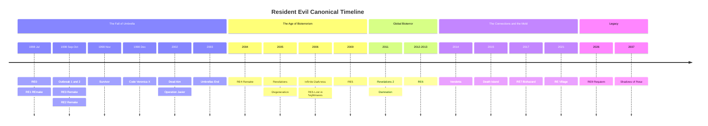
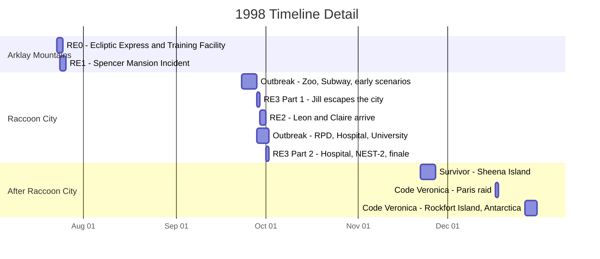
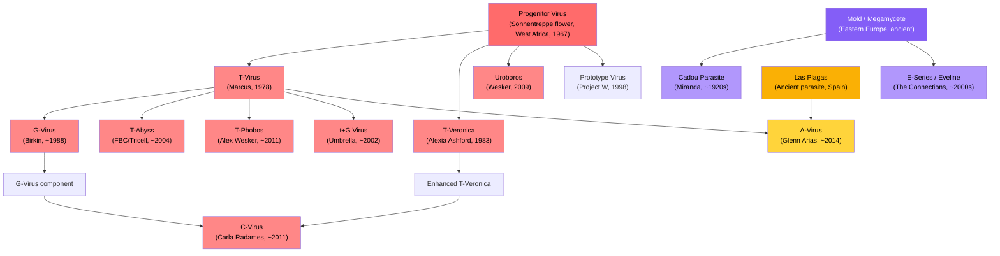

# Resident Evil: Cronología Canónica

Una referencia integral que documenta la historia canónica de cada juego, DLC y proyecto animado en CG de Resident Evil, ordenada por cronología dentro del universo. Cada entrada incluye la trama completa, personajes clave, amenazas biológicas y significado para la lore.

Los juegos están ordenados según cuándo ocurren en la historia, no por su fecha de lanzamiento. Los remakes son la fuente preferida para los detalles de la trama. Todos los spin-offs canónicos, DLCs y películas animadas en CG están incluidos. Las entradas no canónicas se listan por separado como referencia.

## Índice

- [Vista General de la Cronología](#vista-general-de-la-cronología)
- [El Incidente de Raccoon City: Una Mirada Más de Cerca](#el-incidente-de-raccoon-city-una-mirada-más-de-cerca)
- [Prehistoria: Las Semillas del Bioterrorismo](#prehistoria-las-semillas-del-bioterrorismo-19191998)
- **Las Montañas Arklay y Raccoon City (1998)**
  - [Resident Evil 0](#resident-evil-0)
  - [Resident Evil (REmake)](#resident-evil-remake)
  - [Resident Evil Outbreak / File #2](#resident-evil-outbreak--file-2)
  - [Resident Evil 3 (Remake)](#resident-evil-3-remake)
  - [Resident Evil 2 (Remake)](#resident-evil-2-remake)
  - [Resident Evil Survivor](#resident-evil-survivor)
  - [Resident Evil Code: Veronica X](#resident-evil-code-veronica-x)
- **La Caída de Umbrella (2002-2004)**
  - [Resident Evil Dead Aim](#resident-evil-dead-aim)
  - [Darkside Chronicles: Operation Javier](#darkside-chronicles-operation-javier)
  - [Umbrella Chronicles: Umbrella's End](#umbrella-chronicles-umbrellas-end)
  - [Resident Evil 4 (Remake)](#resident-evil-4-remake)
- **El Auge del Bioterrorismo (2005-2009)**
  - [Resident Evil Revelations](#resident-evil-revelations)
  - [Degeneration (Película CG)](#degeneration-película-cg)
  - [Infinite Darkness (Serie CG)](#infinite-darkness-serie-cg)
  - [Resident Evil 5](#resident-evil-5)
- **Bioterrorismo Global (2011-2013)**
  - [Resident Evil Revelations 2](#resident-evil-revelations-2)
  - [Damnation (Película CG)](#damnation-película-cg)
  - [Resident Evil 6](#resident-evil-6)
- **The Connections y el Moho (2014-2021)**
  - [Vendetta (Película CG)](#vendetta-película-cg)
  - [Death Island (Película CG)](#death-island-película-cg)
  - [Resident Evil 7: Biohazard](#resident-evil-7-biohazard)
  - [Resident Evil Village](#resident-evil-village)
- **Legado (2026-2037)**
  - [Resident Evil 9: Requiem](#resident-evil-9-requiem)
  - [Shadows of Rose](#shadows-of-rose)
- [Genealogía Viral](#genealogía-viral)
- [Organizaciones Principales](#organizaciones-principales)
- [Apariciones de Personajes](#apariciones-de-personajes)
- [Referencia de Canonicidad](#referencia-de-canonicidad)

---

## Vista General de la Cronología

> El bloque de 1998 es engañosamente denso. Siete entradas canónicas transcurren en seis meses, con cuatro de ellas superponiéndose durante la destrucción de Raccoon City entre septiembre y octubre. El diagrama de Gantt a continuación amplía este período.

---

## El Incidente de Raccoon City: Una Mirada Más de Cerca

Superposiciones clave a tener en cuenta:

- **RE0 termina donde RE1 comienza.** Rebecca termina de luchar contra la Queen Leech y camina directamente hacia la Mansión Spencer.
- **La Parte 1 de RE3 comienza antes de RE2.** Jill inicia su escape el 28 de septiembre, un día completo antes de que Leon y Claire lleguen el 29 de septiembre.
- **RE2, RE3 y Outbreak se superponen** durante el 29 de septiembre al 1 de octubre. Diferentes personajes experimentan la misma catástrofe desde diferentes ubicaciones a lo largo de la ciudad.
- **Raccoon City es destruida el 1 de octubre** por un misil termobárico del gobierno estadounidense, poniendo fin a RE3 y Outbreak simultáneamente.

---

## Prehistoria: Las Semillas del Bioterrorismo (1919-1998)

Los eventos de la serie Resident Evil se remontan más de un siglo atrás. Comprender esta historia de fondo es esencial, ya que conecta los orígenes de cada virus, organización y antagonista principal.

**~Tiempos antiguos.** El Megamycete, un superorganismo fúngico masivo, se desarrolla en un sistema de cuevas en Europa del Este. Absorbe y almacena la consciencia y el ADN de organismos que mueren en su cercanía. Por separado, el Progenitor Virus evoluciona de forma natural dentro de las flores Sonnentreppe en África Occidental, en un sistema de cuevas sagrado para el pueblo Ndipaya. El organismo parasitario Las Plagas prospera en cuevas bajo lo que se convertirá en el Castillo Salazar en la España rural hasta que el 1er Conde Salazar los sella en el siglo XV.

**1909.** Eva nace de una mujer conocida solo como Mother Miranda en un pueblo remoto de Europa del Este.

**1919.** La gripe española arrasa el pueblo de Miranda y mata a Eva a los 10 años. Consumida por el dolor, Miranda se adentra en una cueva y descubre el Megamycete. Al entrar en contacto, experimenta visiones de cientos de consciencias absorbidas. Se da cuenta de que el hongo puede almacenar y potencialmente restaurar una mente. Sacrifica el cuerpo de Eva al Megamycete y dedica su vida a encontrar un recipiente compatible para la resurrección de Eva. A lo largo de las décadas siguientes, Miranda experimenta con los aldeanos usando el Moho, creando el parásito Cadou al infectar gusanos nematodos con material fúngico.

**Década de 1950.** Un joven estudiante de medicina llamado Oswell E. Spencer queda atrapado en una tormenta de nieve en las montañas europeas. Miranda lo rescata y lo cuida hasta que se recupera. Spencer aprende sobre su investigación del Moho y queda fascinado por el concepto de usar agentes biológicos para remodelar a la humanidad. Más tarde utiliza las ideas de Miranda como base filosófica para sus propias ambiciones: convertirse en un dios controlando la evolución humana.

**Diciembre de 1966.** Spencer, Edward Ashford y James Marcus organizan una expedición a África Occidental. A principios de 1967, aíslan el Progenitor Virus de las flores Sonnentreppe en el Jardín del Sol.

**1967-1968.** Spencer encarga al arquitecto George Trevor diseñar una mansión en las Montañas Arklay cerca de Raccoon City. El verdadero propósito de la mansión es ocultar un laboratorio subterráneo de armas biológicas. Tras la finalización, Spencer secuestra a la familia Trevor y los usa como sujetos de prueba del Progenitor. Jessica Trevor muere por la cepa Tipo-A. Su hija Lisa Trevor, de 14 años, sobrevive a la cepa Tipo-B y se vuelve efectivamente inmortal. Lisa soporta décadas de experimentación continua, convirtiéndose en una figura grotesca y trágica que deambula por los terrenos de la mansión usando los rostros de investigadores muertos, buscando a su madre.

**1968.** Spencer, Ashford y Marcus fundan Umbrella Pharmaceuticals. Públicamente un conglomerado farmacéutico que abarca cosméticos, químicos, maquinaria y productos de consumo. En secreto, una fachada para investigación de armas biológicas financiada con contratos gubernamentales. Edward Ashford muere por exposición accidental al Progenitor poco después de la fundación, dejando debilitada la rama familiar de los Ashford.

**1971.** Alexander Ashford, hijo de Edward, intenta restaurar el prestigio de su familia mediante el Project CODE: Veronica. Extrae ADN del cuerpo embalsamado de su brillante antepasada Veronica Ashford y crea clones gemelos: Alexia, una prodigio que hereda el genio de Veronica, y Alfred, un subproducto de inteligencia promedio.

**13 de enero de 1978.** James Marcus logra el avance del T-Virus en el Centro de Entrenamiento Ejecutivo al combinar el Progenitor Virus con ADN de sanguijuela. Nace el Tyrant Virus, o T-Virus. Causa necrosis, zombificación y mutagénesis extrema en la mayoría de los huéspedes, pero sujetos compatibles poco frecuentes desarrollan habilidades sobrehumanas.

**1981.** Alexia Ashford, de 10 años, se convierte en Investigadora Jefe en la instalación antártica de Umbrella. Crea el virus T-Veronica combinando el Progenitor Virus con genes de hormiga reina y un virus antiguo. El virus otorga a su huésped habilidades pirocinéticas y control de insectos, pero solo si el huésped se somete a 15 años de adaptación criogénica. La inyección inmediata causa mutación incontrolada.

**1983.** Alexia inyecta a su padre Alexander con T-Veronica como sujeto de prueba, transformándolo en la criatura Nosferatu. Lo encadena en el sótano de la instalación. Luego se inyecta a sí misma y entra en sueño criogénico, para despertar 15 años después con el virus perfectamente vinculado a su cuerpo. Alfred queda solo para administrar el legado Ashford, descendiendo lentamente a la locura.

**1988.** Spencer se vuelve paranoico ante las ambiciones e independencia de Marcus. Ordena su asesinato. Albert Wesker y William Birkin, los propios alumnos estrella de Marcus que habían estado informando secretamente a Spencer durante años, lideran un escuadrón USS al laboratorio de Marcus. Marcus es fusilado y su cuerpo arrojado a las alcantarillas. Birkin se apodera de la investigación del T-Virus de Marcus y se atribuye el mérito. Sin que nadie lo sepa, una Queen Leech entra en el cadáver de Marcus, absorbe sus recuerdos y comienza un proceso de regeneración de una década.

**Principios de la década de 1990.** William Birkin comienza a desarrollar el G-Virus en el laboratorio NEST bajo Raccoon City, derivado de mutaciones únicas observadas en el cuerpo de Lisa Trevor. A diferencia del T-Virus, que crea zombis, el G-Virus causa mutación continua incontrolada y permite la reproducción parasitaria mediante implantación de embriones.

**1996.** Wesker está infiltrado como capitán del Equipo Alpha de S.T.A.R.S. en el Departamento de Policía de Raccoon City, mientras trabaja secretamente para Umbrella y hace arreglos con una organización rival.

**11 de mayo de 1998.** Una fuga de la cepa epsilon del T-Virus en el Laboratorio Arklay desencadena un brote. Los investigadores son infectados. Los Cerberus escapan al bosque. Durante las semanas siguientes, una serie de extraños "asesinatos caníbales" en las Montañas Arklay atrae la atención pública y policial. El Departamento de Policía de Raccoon City crea la unidad de tácticas especiales S.T.A.R.S. para investigar.

---

## Las Montañas Arklay y Raccoon City (1998)

### Resident Evil 0

**Fechas en la Cronología:** 23-24 de julio de 1998
**Ubicación:** Tren Ecliptic Express, Centro de Entrenamiento Ejecutivo de Umbrella, Montañas Arklay
**Protagonistas:** Rebecca Chambers, médica del Equipo Bravo de S.T.A.R.S., 18 años y la miembro más joven de S.T.A.R.S. Billy Coen, ex Segundo Teniente del Cuerpo de Marines de EE.UU. condenado por masacrar a 23 personas en África, siendo transportado a su ejecución cuando el convoy fue atacado. Billy afirma que fue incriminado por su oficial al mando.
**Antagonistas:** Queen Leech, la consciencia reanimada de James Marcus. Proto Tyrant, un modelo Tyrant temprano y fallido.

#### Resumen de la Trama

La noche del 23 de julio de 1998, la Queen Leech desata un enjambre de sanguijuelas sobre el Ecliptic Express, un tren propiedad de Umbrella que viaja por las Montañas Arklay. Todos los pasajeros y tripulantes son asesinados o infectados con el T-Virus. El ataque es la venganza de la Queen Leech contra Umbrella por el asesinato de Marcus una década antes.

El helicóptero del Equipo Bravo de S.T.A.R.S. sufre una avería y aterriza de emergencia en el Bosque Raccoon mientras se dirigía a investigar los asesinatos caníbales. El equipo se separa para rastrear la zona. Descubren un transporte de policía militar destrozado con los conductores muertos. El prisionero, Billy Coen, ha desaparecido.

Rebecca descubre el Ecliptic Express detenido y sube sola, encontrándolo infestado de zombis y sanguijuelas. Se encuentra con Billy, quien también se ha refugiado en el tren. A pesar de sus órdenes de arrestarlo, Rebecca coopera a regañadientes con Billy para sobrevivir al tren infestado. El miembro del Equipo Bravo Edward Dewey llega tambaleándose al tren, gravemente herido por Cerberus, y muere tras advertir a Rebecca sobre los peligros del exterior.

La Queen Leech, disfrazada como una versión joven de James Marcus, reactiva el tren. Billy y Rebecca accionan desesperadamente los frenos de emergencia, pero el tren descarrila y se estrella en una estación subterránea conectada al Centro de Entrenamiento Ejecutivo de Umbrella.

El Centro de Entrenamiento fue construido en la década de 1960 para educar a adolescentes talentosos reclutados por Umbrella. Las pruebas encontradas a lo largo de la instalación revelan una verdad más oscura: Marcus usaba a los estudiantes como sujetos de prueba para sus experimentos con sanguijuelas y el T-Virus, convirtiéndolos en zombis. El sótano de la instalación contiene una cámara de tortura cubierta de sangre seca.

Rebecca y Billy reconstruyen la historia de Marcus a través de documentos dispersos. Descubren que Marcus, junto con Spencer y Ashford, descubrió el Progenitor Virus en la década de 1960. Marcus lo combinó con ADN de sanguijuela para crear el T-Virus el 13 de enero de 1978. Encuentran pruebas de que Spencer ordenó el asesinato de Marcus en 1988, ejecutado por sus propios protegidos Wesker y Birkin, quienes luego robaron su investigación.

La pareja navega por una iglesia dilapidada y desciende al laboratorio subterráneo oculto de Marcus. La criatura que se hacía pasar por el joven Marcus se revela como la Queen Leech, un organismo masivo y mutante que ha pasado diez años regenerándose usando el cadáver de Marcus como huésped. Ha absorbido los recuerdos, la personalidad y la sed de venganza de Marcus contra Umbrella.

En la batalla final, Rebecca descubre que la Queen Leech es vulnerable a la luz solar directa. Abre el techo de la instalación mientras Billy atrae la atención de la criatura. Expuesta a la luz solar, la Queen Leech se debilita y Billy la destruye con un revólver magnum. William Birkin, monitoreando la situación de forma remota, activa el sistema de autodestrucción de la instalación.

Mientras el complejo detona, Rebecca toma una decisión que define su personaje: falsifica la muerte de Billy en su informe oficial, diciendo a las autoridades que pereció en las montañas. Se queda con sus placas de identificación como "prueba". Billy desaparece en el bosque, un hombre libre. Rebecca se dirige hacia la Mansión Spencer para reunirse con sus colegas del Equipo Bravo, caminando directamente hacia los eventos de Resident Evil 1.

#### Principales Amenazas Biológicas

- **Queen Leech:** Una sanguijuela que entró en el cadáver de Marcus, absorbió sus recuerdos y desarrolló habilidades de cambio de forma. Puede imitar la apariencia humana de Marcus y controlar enjambres de sanguijuelas telepáticamente. En su forma verdadera, es un organismo amorfo masivo vulnerable a la luz UV.
- **Mimicry Marcus:** Formas humanoides compuestas por cientos de sanguijuelas actuando como colectivo, imitando la forma de Marcus.
- **Proto Tyrant:** Un prototipo Tyrant temprano e inestable almacenado en el laboratorio de Marcus. Menos poderoso y menos estable que el modelo T-002 que aparece en RE1.
- **Eliminator:** Primates infectados con T-Virus con agresividad y fuerza aumentadas.
- **Stinger:** Un escorpión mutado masivo por T-Virus encontrado en el Centro de Entrenamiento.
- **Centurion:** Un ciempiés gigante creado por exposición al T-Virus.

#### Significado para la Lore

RE0 es el punto de partida cronológico de la serie jugable. Establece el origen del T-Virus, las dinámicas internas de poder dentro de Umbrella y las traiciones que ponen en marcha toda la franquicia. El juego revela que los tres cofundadores de Umbrella tenían agendas distintas: Spencer buscaba poder, Ashford buscaba prestigio y Marcus buscaba avances científicos. La disposición de Spencer a asesinar a su propio cofundador y robar su investigación establece la crueldad que define la cultura corporativa de Umbrella.

El viaje de Rebecca desde el Centro de Entrenamiento directamente a la Mansión Spencer proporciona el puente narrativo a RE1. El juego también explica por qué los miembros del Equipo Bravo están dispersos por toda la zona de la mansión cuando llega el Equipo Alpha.

---

### Resident Evil (REmake)

**Fechas en la Cronología:** 24-25 de julio de 1998
**Ubicación:** Mansión Spencer y Laboratorio Arklay, Montañas Arklay cerca de Raccoon City
**Protagonistas:** Chris Redfield, hombre punta del Equipo Alpha de S.T.A.R.S. Jill Valentine, seguridad de retaguardia del Equipo Alpha de S.T.A.R.S., ex operativa de Delta Force. Barry Burton, especialista en armas del Equipo Alpha, chantajeado por Wesker en el escenario de Jill. Rebecca Chambers, llegando desde RE0, asiste a Chris en su escenario.
**Antagonistas:** Albert Wesker, capitán del Equipo Alpha de S.T.A.R.S. y agente doble secreto de Umbrella. Tyrant T-002, el prototipo de supersoldado de Umbrella. Lisa Trevor, un trágico sujeto de prueba casi indestructible que ha sido objeto de experimentación desde 1967.

#### Resumen de la Trama

Tras la falta de comunicación del Equipo Bravo, el Equipo Alpha es desplegado el 24 de julio de 1998. El equipo está compuesto por Chris Redfield, Jill Valentine, Barry Burton, Albert Wesker, Joseph Frost y el piloto de helicóptero Brad Vickers. Al aterrizar en el Bosque Arklay, descubren los restos del helicóptero del Equipo Bravo. Joseph Frost es atacado y asesinado por perros zombi Cerberus. Brad Vickers entra en pánico y se aleja con el helicóptero, dejando varados a los cuatro restantes en tierra. Chris, Jill, Barry y Wesker huyen hacia la Mansión Spencer.

Wesker ordena al equipo separarse e investigar. En la campaña de Jill, ella trabaja junto a Barry, quien proporciona armas y asistencia mientras informa secretamente a Wesker. Wesker está chantajeando a Barry amenazando a su familia. En la campaña de Chris, él explora solo hasta encontrar a Rebecca Chambers, recién llegada de los eventos de RE0, quien lo asiste con su experiencia médica.

La mansión es una trampa mortal. Los salones ornamentados están llenos de zombis, trampas diseñadas por el arquitecto de la mansión y criaturas cada vez más peligrosas. El equipo descubre los cuerpos y diarios de miembros muertos del Equipo Bravo esparcidos por todas partes. Kenneth Sullivan es encontrado siendo devorado por un zombi. Forest Speyer yace muerto en el balcón, asesinado por cuervos y con explosivos colocados en su cuerpo. Richard Aiken, envenenado por la serpiente gigante Yawn, muere a pesar de los intentos de Rebecca por salvarlo en el escenario de Chris.

Exclusivo del REmake, los zombis que son eliminados pero no se eliminan apropiadamente reaniman como Crimson Heads: mutantes más rápidos y agresivos con garras e instintos depredadores intensificados. La única forma de prevenirlo es quemar los cadáveres o decapitarlos. Esta mecánica añade una tensión persistente de gestión de recursos al explorar la mansión.

La casa de huéspedes, un edificio separado conectado a la mansión, alberga el tanque de tiburones Aqua Ring que contiene a Neptune, un gran tiburón blanco infectado con T-Virus, y la masiva Plant 42, una planta mutante que ha consumido la estructura del edificio. Los jugadores aprenden a través de los diarios de investigadores sobre los diversos experimentos realizados en la instalación y el desglose gradual de los protocolos de seguridad que precedieron al brote.

El REmake introduce la historia de Lisa Trevor. Los jugadores la encuentran en la zona de cabañas y los túneles subterráneos. No puede ser eliminada permanentemente. Sus entradas de diario, escritas con caligrafía cada vez más deteriorada a lo largo de décadas, revelan el horror de su cautiverio. En 1967, a los 14 años, ella y su madre Jessica fueron secuestradas por Spencer y usadas como sujetos de prueba del Progenitor. Jessica murió. Lisa sobrevivió a cada virus que le inyectaron, incluyendo el parásito NE-alpha que luego se usaría para crear a Nemesis. El G-Virus fue finalmente aislado de su sangre. Para 1998, es una criatura grotesca que viste los rostros arrancados de investigadores que asesinó, buscando perpetuamente el rostro de su madre.

Bajo la mansión se encuentra el Laboratorio Arklay, la instalación de investigación subterránea de Umbrella donde opera el programa de BOW del T-Virus. El laboratorio contiene registros de desarrollo, almacenamiento criogénico para sujetos experimentales y la joya de la corona de la investigación de Umbrella: el Proyecto Tyrant.

En el laboratorio, Wesker se revela como traidor. Ha sido agente de Umbrella todo el tiempo, y toda la operación de S.T.A.R.S. fue diseñada para recopilar datos de combate sobre BOWs luchando contra soldados entrenados. Ha estado grabando todo. En el escenario de Jill, se revela su chantaje a Barry, y Barry finalmente se vuelve contra Wesker. Wesker activa al Tyrant T-002 de su cápsula criogénica, un humanoide imponente de piel gris con una garra masiva y un corazón expuesto. El Tyrant empala a Wesker a través del abdomen, aparentemente matándolo, y luego se vuelve contra los miembros restantes de S.T.A.R.S.

Lo que nadie sabe es que Wesker se inyectó un virus especial proporcionado por William Birkin antes de entrar en la mansión. El virus, parte del Project W de Spencer, está diseñado para otorgar habilidades sobrehumanas a huéspedes genéticamente compatibles. Wesker muere y es resucitado por el virus mientras los demás luchan por sobrevivir.

Tras derrotar al Tyrant en el laboratorio, los supervivientes activan el sistema de autodestrucción de emergencia. Corren a través de la instalación en colapso hasta el helipuerto en el techo de la mansión. El Tyrant, ahora mutado en su forma Super Tyrant con un corazón expuesto y garras masivas, irrumpe a través del suelo del helipuerto para una confrontación final. Brad Vickers, que ha estado sobrevolando la zona en el helicóptero, lanza un lanzacohetes. El Super Tyrant es destruido.

Chris, Jill, Barry y Rebecca escapan en el helicóptero mientras la Mansión Spencer y su laboratorio subterráneo son consumidos por la explosión. Los cuatro supervivientes se proponen exponer los crímenes de Umbrella. Chris parte hacia Europa poco después para investigar la sede de Umbrella, una decisión que llevará a su hermana Claire a Raccoon City dos meses después buscándolo.

#### Principales Amenazas Biológicas

- **Tyrant T-002:** El prototipo de supersoldado de Umbrella, la cumbre de su Proyecto Tyrant. Un BOW humanoide con fuerza y velocidad sobrehumanas y una garra ósea masiva que se extiende desde su brazo derecho. Su corazón expuesto es su debilidad. Cuando recibe daño suficiente, muta en la forma Super Tyrant, más rápida y agresiva.
- **Lisa Trevor:** No es una antagonista tradicional sino una presencia indestructible. Décadas de experimentación viral la han hecho efectivamente inmortal. Absorbió el parásito NE-alpha que luego se usaría en el Proyecto Nemesis. Su cuerpo fue el material de origen para el G-Virus.
- **Crimson Heads:** Zombis que reaniman si no son quemados o decapitados. Más rápidos y letales que los zombis estándar, con garras y agresividad intensificada. Una mecánica exclusiva del REmake.
- **Hunters MA-121 Alpha:** BOWs híbridos reptil-humano creados injertando ADN de reptil en embriones humanos usando el T-Virus. Capaces de decapitar víctimas de un solo golpe. Infiltran la mansión después de la sección de la casa de huéspedes.
- **Yawn:** Una serpiente mutada masiva por T-Virus que custodia los pisos superiores de la mansión. Su veneno es letal sin antídoto.
- **Neptune:** Grandes tiburones blancos infectados con T-Virus en el Aqua Ring.
- **Plant 42:** Una planta mutante masiva en la casa de huéspedes, vulnerable al compuesto químico V-JOLT.
- **Cerberus:** Dobermans infectados con T-Virus que merodean por los terrenos de la mansión y el bosque.

#### Significado para la Lore

El Incidente de la Mansión es el evento desencadenante de toda la franquicia Resident Evil. Cada juego posterior tiene sus raíces en lo que sucede aquí. Los supervivientes se convierten en los luchadores centrales contra Umbrella: Chris y Jill cofundan la BSAA, Barry entrena a la próxima generación de operativos y Rebecca continúa la investigación de armas biológicas desde el ámbito académico.

La supervivencia y transformación de Wesker de agente humano a amenaza sobrehumana lo establece como el antagonista general de la serie hasta RE5. Su inyección del virus del Project W es la primera pista del programa de eugenesia de Spencer, un hilo que tarda siete juegos en desenredarse por completo.

Las autoridades de Raccoon City, bajo la influencia de Umbrella, encubren el Incidente de la Mansión. S.T.A.R.S. es discretamente disuelto. Las advertencias de los supervivientes son ignoradas. Este encubrimiento permite directamente el brote de T-Virus que consume la ciudad dos meses después. El Jefe de Policía de Raccoon City, Brian Irons, está en la nómina de Umbrella y suprime activamente las pruebas.

La historia de Lisa Trevor es la adición más significativa del REmake a la lore. Sus décadas de sufrimiento revelan la profundidad de la crueldad de Umbrella y proporcionan el origen tanto del G-Virus como del parásito NE-alpha usado en Nemesis. Ella es el hilo conector entre el Progenitor Virus, el T-Virus, el G-Virus y el Proyecto Nemesis.

---

### Resident Evil Outbreak / File #2

**Fechas en la Cronología:** 23 de septiembre al 1 de octubre de 1998
**Ubicación:** Varias ubicaciones a lo largo de Raccoon City: J's Bar, Zoo de Raccoon, sistema de metro, Hospital General de Raccoon, Comisaría del RPD, Universidad de Raccoon, instalación de eliminación de residuos de Umbrella
**Protagonistas:** Ocho civiles de Raccoon City: Kevin Ryman, oficial de policía del RPD. Mark Wilkins, guardia de seguridad y veterano de Vietnam. Jim Chapman, empleado del metro. George Hamilton, cirujano del Hospital General de Raccoon. David King, fontanero y manitas. Alyssa Ashcroft, periodista de investigación. Yoko Suzuki, estudiante universitaria y ex empleada de Umbrella con recuerdos suprimidos. Cindy Lennox, camarera en J's Bar.
**Antagonistas:** William Birkin en forma de mutante G. Thanatos, un Tyrant no autorizado creado por el investigador de la Universidad de Raccoon Greg Mueller. Nyx, un BOW amorfo masivo almacenado en un muelle de Umbrella. Nikolai Ginovaef, monitor de UBCS trabajando para Umbrella.

#### Resumen de la Trama

Los juegos Outbreak representan el desastre de Raccoon City a través de los ojos de ciudadanos comunes en lugar de operativos entrenados. Los escenarios abarcan toda la duración del brote, desde la infección inicial del suministro de agua hasta la destrucción de la ciudad por impacto de misil.

**"Wild Things", 23 de septiembre.** El escenario más temprano cronológicamente. El T-Virus ha llegado al Zoo de Raccoon, mutando a los animales. Los supervivientes enfrentan leones zombi, un elefante zombi llamado Oscar e hienas infectadas. Un helicóptero de evacuación se estrella, obligando al grupo a encontrar una ruta de escape alternativa. Este escenario muestra cuán temprano se extendió la infección a la infraestructura de la ciudad.

**"Outbreak", 24 de septiembre.** El brote del T-Virus llega a J's Bar en el centro de Raccoon City, donde muchos de los ocho protagonistas son clientes habituales o empleados. Los zombis irrumpen por las ventanas y puertas. Los supervivientes barricadan las entradas, luchan a través de la horda y escapan por los tejados mientras el RPD detona explosivos para despejar las calles. Este escenario introductorio es la primera vez que los ocho civiles se cruzan.

**"Underbelly", 25-26 de septiembre.** Los supervivientes intentan huir por el sistema de metro de Raccoon City. Un accidente de tren perturba un nido de parásitos, incluyendo al Giga Bite, una pulga mutante masiva. El grupo navega por los túneles inundados y escapa en un tren que parte o por conductos de ventilación.

**"Below Freezing Point", 25-26 de septiembre.** Liderados por Yoko Suzuki, cuyos recuerdos fragmentados de trabajar en Umbrella afloran a lo largo del escenario, el grupo se infiltra en el laboratorio subterráneo de Umbrella bajo la ciudad, la misma instalación NEST de RE2. Se encuentran con Monica, una viróloga renegada de Umbrella que intenta robar datos de investigación. Monica es asesinada por el mutado William Birkin en su forma de criatura G. Los supervivientes escapan por los túneles de emergencia del laboratorio.

**"The Hive", 26-27 de septiembre.** El Hospital General de Raccoon, el mismo hospital que aparece en RE3, está bajo ataque de una colonia de sanguijuelas mutantes gigantes. Una entidad Leech Man acecha los pasillos. Los supervivientes destruyen a la Leech Queen que habita en el sótano del hospital para escapar.

**"Hellfire", 27-28 de septiembre.** Un incendio envuelve un viejo hotel en Raccoon City. Los supervivientes navegan por la estructura en llamas y en colapso mientras luchan contra zombis. Una criatura mutante masiva merodea por el hotel. El escenario ilustra cómo la infraestructura de la ciudad se está desintegrando en múltiples frentes simultáneamente.

**"Flashback", 28-29 de septiembre.** El grupo se refugia en una cabaña en el Bosque Raccoon, donde conocen a Al Lester, un hombre que promete guiarlos a un lugar seguro. Al en realidad está trastornado. Su esposa Dorothy fue experimentada en un hospital abandonado cercano y se fusionó con una planta mutante. Al atrae víctimas para alimentar la planta, esperando mantener viva a Dorothy. Los supervivientes destruyen el núcleo de la planta y escapan del bosque.

**"Desperate Times", 28-29 de septiembre.** Los supervivientes se unen a los oficiales de policía restantes que defienden la Comisaría del RPD, el mismo edificio de RE2. El Teniente Marvin Branagh, el oficial herido que luego da información a Leon en RE2, lidera la defensa. Las barricadas finalmente caen y los supervivientes escapan por las alcantarillas mientras la comisaría es invadida.

**"Decisions, Decisions", 1 de octubre.** El escenario final y más significativo. George Hamilton guía al grupo a la Universidad de Raccoon para encontrar a su colega Peter Jenkins, quien estaba desarrollando una vacuna contra el T-Virus llamada "Daylight". Descubren que Peter fue asesinado por el ex investigador de Umbrella Greg Mueller, quien quería suprimir la vacuna y vender su propia creación no autorizada de Tyrant. Mueller es asesinado por Nikolai Ginovaef, el monitor de UBCS de RE3, quien está eliminando testigos y recopilando datos. El Tyrant de Mueller, Thanatos, es liberado. Los supervivientes sintetizan la vacuna Daylight ellos mismos, derrotan a Thanatos tras mutar en la forma más poderosa Thanatos R, y escapan en helicóptero momentos antes de que el misil termobárico del gobierno estadounidense oblitere Raccoon City el 1 de octubre.

**"End of the Road", 1 de octubre.** David King guía al grupo a una instalación de eliminación de residuos de Umbrella en las afueras de la ciudad. Se encuentran con científicos que intentan recuperar una cura. Quienes escapan por la autopista enfrentan a Nyx, un BOW amorfo masivo que puede absorber otros organismos, incluyendo un Tyrant T-103. Este escenario proporciona uno de los últimos vistazos de Raccoon City antes de su destrucción.

#### Principales Amenazas Biológicas

- **Thanatos:** Un Tyrant no autorizado creado por Greg Mueller en la Universidad de Raccoon usando investigación robada de Umbrella. Distinto de los modelos oficiales de Tyrant de Umbrella. Su forma mutada, Thanatos R, es más rápida y agresiva.
- **Nyx:** Un BOW amorfo masivo almacenado en un muelle de eliminación de residuos de Umbrella. Capaz de absorber e incorporar otros organismos a su masa corporal, incluyendo un Tyrant T-103. Uno de los BOWs más peligrosos encontrados en el incidente de Raccoon City.
- **William Birkin forma G:** Encontrado en el escenario "Below Freezing Point" en el mismo laboratorio NEST de RE2.
- **Oscar:** Un elefante infectado con T-Virus en el Zoo de Raccoon.
- **Giga Bite:** Una pulga mutante masiva en el sistema de metro.
- **Leech Man:** Una entidad humanoide compuesta de sanguijuelas mutantes que infestan el Hospital General de Raccoon.

#### Significado para la Lore

Los juegos Outbreak demuestran que la destrucción de Raccoon City no fue solo la historia de unos pocos héroes. Miles de civiles experimentaron el brote, y pequeños grupos lucharon por sobrevivir en cada rincón de la ciudad simultáneamente. La vacuna "Daylight" representa una cura alternativa para el T-Virus que, de haberse producido en masa, podría haber cambiado el curso de los eventos.

Los recuerdos suprimidos de Umbrella de Yoko Suzuki sugieren que Umbrella experimentaba con sus propios empleados y borraba su consciencia. El trasfondo de periodista de investigación de Alyssa Ashcroft se vuelve directamente relevante para RE9: Requiem, donde su hija Grace Ashcroft es protagonista.

Los escenarios se superponen con RE2 y RE3, colocando al jugador en ubicaciones que Leon, Claire y Jill visitan, a veces al mismo tiempo. La defensa del RPD por parte de Marvin Branagh en "Desperate Times" muestra las horas antes de que Leon y Claire lleguen para encontrar la comisaría ya caída.

---

### Resident Evil 3 (Remake)

**Fechas en la Cronología:** 28 de septiembre al 1 de octubre de 1998. Comienza aproximadamente 24 horas antes de RE2. La primera mitad precede a RE2; la segunda mitad ocurre después de que concluyan los eventos principales de RE2.
**Ubicación:** Calles de Raccoon City, sistema de metro, Torre del Reloj, Hospital General de Raccoon, laboratorio NEST-2
**Protagonistas:** Jill Valentine, ex miembro del Equipo Alpha de S.T.A.R.S. y superviviente del Incidente de la Mansión. Desde julio ha intentado exponer los crímenes de Umbrella pero ha sido bloqueada por la influencia de la compañía sobre las autoridades locales. Carlos Oliveira, Cabo del Servicio de Contramedidas Biológicas de Umbrella, un ex guerrillero sudamericano que se unió al UBCS sin conocer el alcance total de los crímenes de Umbrella.
**Antagonistas:** Nemesis-T Type, un Tyrant T-103 implantado con un parásito NE-alpha, otorgándole inteligencia, habla y la capacidad de seguir órdenes complejas. Su misión: cazar y matar a todos los miembros supervivientes de S.T.A.R.S. para demostrar la efectividad de combate del parásito. Nikolai Zinoviev, Sargento del UBCS y "Supervisor" secreto de Umbrella plantado para recopilar datos de combate de BOWs.

#### Resumen de la Trama

El juego abre con Jill teniendo una pesadilla en su apartamento, ilustrando el TEPT que ha sufrido desde el Incidente de la Mansión dos meses antes. Despierta por una llamada telefónica advirtiéndole de una nueva amenaza. Antes de que pueda reaccionar, Nemesis irrumpe a través de la pared de su apartamento.

Nemesis es el arma biológica más sofisticada de Umbrella hasta la fecha: un Tyrant T-103 implantado con el parásito NE-alpha, que forma su propio cerebro dentro del sistema nervioso del huésped. Esto otorga a la criatura inteligencia, razonamiento táctico, la capacidad de usar armas y habla limitada. Puede decir una palabra: "S.T.A.R.S." Su misión es eliminar a todos los miembros supervivientes de S.T.A.R.S. como demostración de campo del potencial militar del parásito NE-alpha. Jill, como una de cuatro supervivientes conocidas, es el objetivo principal.

Jill apenas escapa del encuentro inicial y huye a las calles. Presencia cómo Brad Vickers, su ex colega de S.T.A.R.S. y piloto del helicóptero en RE1, es superado por zombis. Brad mantiene una puerta cerrada para darle tiempo a Jill y es mordido. Muere por la infección poco después. Su cuerpo zombificado es encontrado más tarde por Carlos en el RPD.

Jill conoce a los mercenarios supervivientes del UBCS: Carlos Oliveira, el líder de pelotón herido Mikhail Viktor y el sospechoso Nikolai Zinoviev. El UBCS fue desplegado por Umbrella para manejar el brote, pero la mayoría de los escuadrones han sido aniquilados. Los supervivientes planean escapar por el sistema de metro.

Jill y Carlos trabajan para restaurar la energía del metro. Jill navega por la ciudad infestada, recolectando piezas y resolviendo problemas mientras es acechada periódicamente por Nemesis. La criatura es implacable, apareciendo en momentos impredecibles, a veces portando un lanzacohetes. Los encuentros escalan en intensidad, con Nemesis adaptándose a las tácticas de Jill.

Cuando Nemesis aborda el vagón del metro durante su escape, Mikhail Viktor hace un sacrificio heroico. El líder de pelotón herido detona una granada a quemarropa, destruyendo el vagón y deteniendo a Nemesis. Mikhail muere en la explosión. El metro dañado se estrella cerca de la Torre del Reloj.

En la Torre del Reloj, Jill y Carlos intentan señalar un helicóptero de rescate. Un helicóptero llega, pero Nemesis, habiendo sobrevivido y ahora desprendiéndose de su gabardina para revelar una forma más orgánica cubierta de tentáculos, lo destruye. Durante la batalla subsiguiente, Nemesis infecta a Jill con el T-Virus a través de un golpe de tentáculo. Jill colapsa y cae en coma.

Carlos lleva a Jill al Hospital General de Raccoon y busca desesperadamente una cura. El hospital está invadido por Hunters y personal zombi. Carlos lucha a través de las salas y descubre una vacuna contra el T-Virus sintetizada por investigadores de Umbrella. También se encuentra con Nikolai, quien revela su verdadero rol como un "Supervisor" pagado, un monitor plantado por Umbrella para recopilar de forma encubierta datos de combate de BOWs durante el brote. Nikolai ha estado eliminando a otros monitores y supervivientes para asegurar que solo él posea los valiosos datos. Carlos lo confronta pero Nikolai escapa.

El remake le da a Carlos una sección de juego expandida en la Comisaría del RPD, superponiéndose con el escenario de RE2. Carlos lucha por los mismos pasillos que Leon y Claire recorren, aproximadamente al mismo tiempo, proporcionando una perspectiva diferente de la caída de la comisaría.

Carlos administra la vacuna, curando a Jill. Ella despierta el 1 de octubre, el día en que el gobierno estadounidense ha autorizado un impacto de misil termobárico sobre Raccoon City. Las transmisiones de radio anuncian la destrucción inminente. El reloj corre.

La Jill curada se dirige a NEST-2, un laboratorio de Umbrella conectado a la instalación NEST de RE2. Descubre que ha sido utilizado para más desarrollo de BOWs e investigación viral. Nikolai reaparece, intentando ejecutar a Jill en el helipuerto de la instalación y usar a Carlos como cebo para recopilar datos de combate finales. Carlos inmoviliza a Nikolai, y Jill pone fin a sus planes.

Nemesis, ahora mutado en una forma cuadrúpeda masiva apenas reconocible como alguna vez humanoide, ataca a Jill en NEST-2. Ella sumerge a la criatura en ácido y la remata con un cañón de rieles, destruyendo el arma biológica que la ha acechado por toda la ciudad.

Jill y Carlos llegan al helipuerto y son extraídos justo cuando el misil termobárico impacta. Raccoon City es completamente obliterada. Cada infectado restante, cada pieza de evidencia de Umbrella y cada civil que no pudo escapar es aniquilado. El gobierno estadounidense, bajo la dirección del Asesor de Seguridad Nacional Derek C. Simmons, orquesta un encubrimiento de su propia participación.

#### Principales Amenazas Biológicas

- **Nemesis-T Type:** El modelo Tyrant más avanzado en el momento del incidente de Raccoon City. Un T-103 implantado con el parásito NE-alpha, que forma un cerebro secundario. Capaz de hablar, usar armas, planificación táctica y persecución implacable. Progresa a través de múltiples etapas de mutación: humanoide con gabardina, forma orgánica expuesta con tentáculos y criatura cuadrúpeda masiva. El parásito NE-alpha fue originalmente probado en Lisa Trevor, quien lo absorbió.
- **Drain Deimos / Brain Suckers:** Parásitos gigantes mutantes similares a pulgas que drenan el líquido cefalorraquídeo de las víctimas.
- **Hunters Beta y Gamma:** Variantes avanzadas de Hunter. Los Hunters Gamma son acuáticos, encontrados en las alcantarillas. Los Hunters Beta se encuentran en el hospital.
- **Grave Digger:** Un gusano masivo mutado por T-Virus en la zona del parque de la ciudad, presente en la versión original.
- **Pale Heads:** Zombis exclusivos del remake con habilidades regenerativas extremas, encontrados en NEST-2.

#### Significado para la Lore

RE3 transcurre simultáneamente con RE2 y muestra el otro lado de los últimos días de Raccoon City. Mientras Leon y Claire navegan por el RPD y el NEST subterráneo, Jill lucha contra Nemesis por las calles, el metro y los hospitales de la ciudad. La sección de Carlos en el RPD se superpone directamente con los eventos de RE2.

El Proyecto Nemesis demuestra las ambiciones crecientes de Umbrella. El parásito NE-alpha le da a un Tyrant inteligencia y enfoque de misión, un salto significativo desde el inconsciente T-002 de RE1 o el obediente pero simple Mr. X de RE2. Los datos de combate recopilados durante la persecución de Nemesis a Jill son valiosos para Umbrella independientemente de la supervivencia de la criatura.

El despliegue del UBCS por parte de Umbrella revela la disposición de la compañía a sacrificar a sus propios empleados. Los mercenarios del UBCS son activos prescindibles, reclutados entre criminales de guerra y soldados desesperados de todo el mundo. Los Supervisores ocultos entre ellos existen únicamente para documentar cómo los BOWs se desempeñan contra humanos entrenados en combate real.

La destrucción de Raccoon City es el evento pivotal de la franquicia. Desencadena investigaciones del congreso, indignación internacional y finalmente los procedimientos legales que destruyen a Umbrella Corporation. La supervivencia de Jill y su conocimiento de primera mano tanto del Incidente de la Mansión como de la destrucción de Raccoon City la convierten en una de las testigos más importantes contra Umbrella. Ella y Chris cofundan la BSAA.

---

### Resident Evil 2 (Remake)

**Fechas en la Cronología:** 29 de septiembre al 1 de octubre de 1998
**Ubicación:** Afueras de Raccoon City, Comisaría del RPD, alcantarillas de Raccoon City, laboratorio subterráneo NEST
**Protagonistas:** Leon S. Kennedy, un policía novato de 21 años que llega a su primer día en el RPD. Se quedó dormido en un motel en las afueras de la ciudad tras una ruptura sentimental y llegó tarde, solo para encontrar la ciudad invadida. Claire Redfield, estudiante universitaria de 19 años y hermana menor de Chris Redfield, llegando a Raccoon City en su motocicleta para buscar a Chris, quien no se ha comunicado con ella desde el Incidente de la Mansión. Ada Wong, una espía que trabaja para una organización rival, haciéndose pasar por agente del FBI buscando a un reportero llamado Ben Bertolucci mientras persigue en secreto una muestra del G-Virus. Sherry Birkin, hija de 12 años de William y Annette Birkin, escondida en la comisaría de policía.
**Antagonistas:** William Birkin / "G", ex Investigador Jefe en NEST y creador del G-Virus, quien se inyectó su propia creación después de ser disparado por el USS de Umbrella y ahora muta a través de cinco etapas cada vez más grotescas. Mr. X / T-00, un Tyrant T-103 de producción en masa desplegado por Umbrella para recuperar la muestra del G-Virus y eliminar supervivientes. Jefe Brian Irons, el corrupto Jefe del RPD que ha estado en la nómina de Umbrella durante años, suprimiendo evidencia de sus crímenes.

#### Resumen de la Trama

El 22 de septiembre de 1998, una semana antes de que comience el juego, el Servicio de Seguridad de Umbrella liderado por el operativo HUNK asalta el laboratorio NEST bajo Raccoon City. Su misión: apoderarse del G-Virus de William Birkin, quien ha estado planeando desertar al ejército estadounidense con su investigación. En la confrontación, operativos del USS disparan a Birkin múltiples veces. Dado por muerto, Birkin se inyecta una muestra de G-Virus en desesperación. El virus lo reanima y muta en una criatura impulsada por la rabia y el instinto reproductivo. Masacra al escuadrón del USS. En el caos, muestras del T-Virus se derraman y son esparcidas por el sistema de alcantarillado por las ratas. En cuestión de días, el suministro de agua de la ciudad está contaminado y decenas de miles de ciudadanos están infectados.

La noche del 29 de septiembre, Leon Kennedy y Claire Redfield llegan a Raccoon City de forma independiente. Leon, conduciendo su Jeep, y Claire, en su motocicleta, se encuentran en una gasolinera en las afueras cuando atacan los zombis. Toman un coche de policía y se dirigen a toda velocidad hacia el edificio del RPD. Un zombi en el asiento trasero causa un choque, y un camión cisterna atravesado los separa. Acuerdan encontrarse en el RPD y toman rutas separadas.

La Comisaría del RPD, antiguamente un museo de arte, es un edificio laberíntico con arquitectura elaborada que ahora sirve como tumba. La mayoría de los oficiales están muertos. El Teniente Marvin Branagh, gravemente herido y luchando contra la infección, le da a Leon un cuchillo de combate e información crítica antes de sucumbir al T-Virus y transformarse. El jugador se ve obligado a acabar con el hombre que acaba de ayudarle.

Leon se encuentra con Ada Wong, quien afirma estar buscando al reportero Ben Bertolucci. En realidad, Ada es una espía trabajando para una organización rival, enviada a recuperar una muestra del G-Virus. A pesar de su misión, desarrolla sentimientos genuinos por Leon durante el transcurso de su colaboración. Su dinámica mezcla la dependencia mutua con el engaño mutuo.

Claire descubre a Sherry Birkin escondida en la comisaría. Los padres de Sherry, William y Annette, son científicos de Umbrella en NEST. Claire toma a Sherry bajo su protección, y su vínculo se convierte en una de las relaciones más duraderas de la serie.

El Jefe Brian Irons, el corrupto jefe de policía, es encontrado en la sala de taxidermia del RPD rodeado de sus trofeos de caza. Ha estado en la nómina de Umbrella durante años, suprimiendo evidencia de sus actividades ilegales y obstruyendo los intentos de los supervivientes de S.T.A.R.S. de exponer a la compañía. Durante el brote, su cordura se deteriora. En el escenario de Claire, Irons secuestra a Sherry. Su muerte llega cuando William Birkin, impulsado por el instinto reproductivo del G-Virus, le implanta un embrión G. El embrión revienta del cuerpo de Irons, matándolo violentamente.

Un helicóptero de Umbrella deja caer un contenedor de transporte en el techo del RPD a mitad del juego. El Tyrant T-00, nombre en código Mr. X, emerge y comienza a acechar metódicamente al jugador por la comisaría. A diferencia de los zombis inconscientes, Mr. X está orientado a su misión: recuperar el colgante del G-Virus y eliminar testigos. No puede ser detenido permanentemente, solo aturdido. El sonido de sus pesados pasos resonando por los pasillos crea una tensión persistente. En el remake, Mr. X patrulla dinámicamente, siguiendo sonidos y persiguiendo al jugador a través de múltiples habitaciones.

Ambos personajes finalmente navegan desde el RPD al sistema de alcantarillado de la ciudad, y de ahí a NEST, la masiva instalación de investigación subterránea de Umbrella donde se desarrolló el G-Virus. La instalación es un complejo de alta tecnología lleno de laboratorios, almacenamiento de especímenes y la evidencia de décadas de investigación de Birkin.

En el escenario de Leon, Annette Birkin, la esposa de William y compañera investigadora de NEST, revela la verdadera identidad de Ada. Ada no busca un novio ni a un reportero. Es una espía mercenaria contratada para robar el G-Virus. La revelación obliga a Leon a confrontar sus crecientes sentimientos por alguien que lo ha estado manipulando. En la escena culminante, Ada apunta a Leon con un arma para exigir la muestra del G-Virus. Durante la secuencia de autodestrucción de la instalación, Ada es lanzada de una pasarela y cae en la oscuridad. Sobrevive, escapando con un fragmento de tejido que contiene material del G-Virus.

En el escenario de Claire, William Birkin, impulsado por el instinto reproductivo del G-Virus de encontrar huéspedes genéticamente compatibles, tiene como objetivo a su propia hija Sherry. Le implanta un embrión G. Claire y Annette se apresuran a sintetizar la vacuna DEVIL del equipo de Umbrella en NEST. Annette, mortalmente herida por el mutado William, confirma que la vacuna funciona antes de morir. Sherry es curada, pero la exposición al G-Virus le deja habilidades regenerativas permanentes que se vuelven relevantes en RE6.

Se activa la autodestrucción de la instalación NEST. Leon derrota a Mr. X en su forma final de Super Tyrant mutado en una plataforma elevadora, usando un lanzacohetes que Ada le lanza desde las sombras arriba. Los supervivientes convergen en un tren de emergencia subterráneo. Mientras el tren avanza a toda velocidad por el túnel, Birkin en su forma final G5, una masa enorme de carne, dientes y ojos que ha consumido la sección trasera del tren, ataca. El vagón trasero es desacoplado, dejando a Birkin ser consumido por la explosión de la instalación.

Leon, Claire y Sherry emergen del túnel en las afueras de Raccoon City al amanecer. Caminan por un camino alejándose de la ciudad en llamas. Leon le dice a Claire que encontrará la forma de detener a Umbrella. Claire dice que todavía necesita encontrar a Chris. Sus caminos se separan, pero sus vidas permanecen entrelazadas a lo largo de la serie.

HUNK, el único operativo USS superviviente de la incursión original contra Birkin, escapa de Raccoon City por separado con una muestra de G-Virus asegurada en un maletín. Su extracción por helicóptero desde el techo del RPD significa que Umbrella finalmente obtuvo lo que vino a buscar, al costo de una ciudad entera.

#### Principales Amenazas Biológicas

- **William Birkin / "G":** Progresa a través de cinco etapas de mutación. G1 retiene una forma vagamente humana con un ojo masivo en el hombro derecho y un brazo con garras. G2 pierde la mayoría de los rasgos humanos, creciendo un segundo par de brazos. G3 es completamente monstruoso, cuadrúpedo. G4 es un horror masivo y asimétrico. G5 es una masa amorfa de carne y dientes que consume todo lo que toca. A diferencia de las mutaciones del T-Virus, la mutación del G-Virus es continua e incontrolable.
- **Mr. X / T-00:** Un Tyrant T-103 de producción en masa, más refinado que el prototipo T-002 de RE1. Desplegado con gabardina y sombrero para camuflarse en entornos urbanos. Sigue órdenes, rastrea objetivos y no puede ser eliminado permanentemente con armas convencionales. En su forma Super Tyrant, la gabardina se desgarra para revelar musculatura expuesta y una garra ósea masiva.
- **Lickers:** BOWs sin piel y ciegos que cazan por sonido. Son una etapa avanzada de mutación de zombis cuyos cerebros se han hinchado y quedado expuestos. Rápidos, letales y capaces de trepar por las paredes. Sus lenguas pueden empalar víctimas desde el otro lado de una habitación.
- **G-Adults / G-Embryos:** Birkin, impulsado por el instinto reproductivo del G-Virus, implanta embriones parasitarios en huéspedes. Los huéspedes genéticamente incompatibles rechazan el embrión, que revienta y crece hasta convertirse en un G-Adult: una criatura pequeña y agresiva. Los huéspedes compatibles, específicamente parientes consanguíneos, teóricamente producirían un organismo G perfecto.
- **Caimán Gigante:** Un caimán masivo infectado con T-Virus en las alcantarillas de la ciudad. Se encuentra brevemente pero de forma memorable.
- **Ivy:** BOWs basados en plantas en NEST creados por exposición al T-Virus. En el remake, se llaman Plant 43 y se encuentran en la sección del invernadero.

#### Significado para la Lore

RE2 representa la catástrofe definitoria de la franquicia. El brote de Raccoon City es el evento al que todo lo anterior conduce y al que todo lo posterior responde. Destruye la reputación pública de Umbrella, desencadena investigaciones gubernamentales e inicia el mercado negro global de armas biológicas.

La experiencia de Leon aquí lo transforma de un novato idealista en el endurecido agente gubernamental en que se convierte en RE4 y RE6. Su complicada relación con Ada Wong, nacida en el engaño y la desesperación de Raccoon City, se convierte en uno de los hilos narrativos más prolongados de la serie.

El vínculo de Claire con Sherry se traslada directamente. En RE: Revelations 2, Claire es secuestrada mientras trabaja para TerraSave. En RE6, Sherry regresa como agente adulta del DSO, sus habilidades regenerativas una marca permanente de la exposición al G-Virus que Claire luchó por curar.

El G-Virus representa una amenaza fundamentalmente diferente al T-Virus. Mientras el T-Virus crea zombis controlables y BOWs para venta militar, el G-Virus crea un organismo incontrolable impulsado por puro instinto evolutivo. La tragedia de Birkin es que el trabajo de su vida lo consumió literalmente.

La recuperación de muestras del G-Virus por múltiples partes, HUNK para Umbrella, Ada para su empleador, crea las condiciones para la proliferación de armas biológicas en juegos posteriores. El C-Virus en RE6 se deriva directamente de combinar material del G-Virus con una cepa mejorada de T-Veronica.

---

### Resident Evil Survivor

**Fechas en la Cronología:** 22-26 de noviembre de 1998
**Ubicación:** Sheena Island, una isla privada propiedad de Umbrella en Europa
**Protagonistas:** Ark Thompson, un detective privado y amigo de Leon S. Kennedy. Se infiltró en Sheena Island haciéndose pasar por Vincent Goldman, el comandante de Umbrella en la isla, para investigar las operaciones de la instalación. Lott y Lily Klein, hijos de un investigador de Umbrella que ayudan a Ark a escapar.
**Antagonistas:** Vincent Goldman, el verdadero comandante de Umbrella en Sheena Island. Deliberadamente desencadenó un brote de T-Virus para encubrir la evidencia de su operación ilegal de producción en masa de Tyrants. Hypnos-T Type, una variante avanzada de Tyrant desarrollada en la isla.

#### Resumen de la Trama

Sheena Island es la instalación secreta de producción en masa de BOWs clase Tyrant de Umbrella. La población de la isla consiste en empleados de Umbrella y sus familias, junto con adolescentes secuestrados usados como materia prima para la producción de Tyrants. Los sujetos adolescentes son seleccionados porque sus cerebros en desarrollo producen niveles más altos de las hormonas específicas necesarias para el cultivo de Tyrants.

Ark Thompson, enviado por Leon S. Kennedy para investigar, se infiltró en la isla haciéndose pasar por el comandante Vincent Goldman. Cuando Goldman descubrió la infiltración, liberó el T-Virus por toda la isla para destruir evidencia y eliminar testigos. Toda la población fue infectada.

Ark sobrevive al brote inicial pero sufre amnesia por un accidente de helicóptero. Deambula por la isla, recuperando gradualmente sus recuerdos mientras lucha contra zombis, Hunters y Lickers. Descubre la horrible verdad sobre la línea de producción de Tyrants y los adolescentes secuestrados.

Ark se encuentra con Lott Klein, el hijo de un investigador de Umbrella, y su hermana menor Lily. Los niños inicialmente desconfían de Ark pero eventualmente lo ayudan a navegar por la instalación. Goldman, habiendo sobrevivido a su propio brote, activa al Hypnos-T Type, un modelo Tyrant avanzado desarrollado específicamente en Sheena Island. El Hypnos-T es más ágil e inteligente que los Tyrants estándar.

Ark derrota al Hypnos-T Type después de que progresa a través de múltiples etapas de mutación. Él, Lott y Lily escapan de la isla en helicóptero mientras el sistema de autodestrucción de la instalación se activa. La isla y toda la evidencia de la producción en masa de Tyrants de Umbrella son destruidas.

#### Principales Amenazas Biológicas

- **Hypnos-T Type:** Un modelo Tyrant avanzado creado en Sheena Island. Más ágil y rápido que la serie T-103. Nombrado en honor al dios griego del sueño. Progresa a través de múltiples formas de mutación.
- **Cleaners:** Soldados blindados de Umbrella con máscaras de gas desplegados en la isla.
- **Undertakers:** BOWs parasitarios que reaniman y controlan cuerpos muertos.

#### Significado para la Lore

Survivor revela la escala industrial de la producción de Tyrants de Umbrella. Sheena Island era una fábrica, no solo un laboratorio. El uso de adolescentes secuestrados como materia prima biológica demuestra que la crueldad de Umbrella se extendía mucho más allá de sus investigadores adultos y sujetos de prueba. La existencia de una instalación dedicada a la producción en masa implica que Umbrella tenía compradores en fila para BOWs clase Tyrant, apuntando a un mercado negro próspero que explota tras el colapso de Umbrella.

La conexión de Ark con Leon establece una red de agentes anti-Umbrella que operan independientemente durante este período. El juego fue escrito por FLAGSHIP, el mismo equipo responsable de RE0, lo que le otorga peso canónico.

---

### Resident Evil Code: Veronica X

**Fechas en la Cronología:** 17 de diciembre de 1998, hasta finales de diciembre de 1998
**Ubicación:** Instalación de Umbrella en París, Isla Rockfort en el Océano Austral, Base de Investigación Antártica de Umbrella
**Protagonistas:** Claire Redfield, continuando su búsqueda de Chris tras escapar de Raccoon City. Chris Redfield, quien viaja a la Isla Rockfort tras recibir el mensaje de socorro de Claire retransmitido por Leon. Steve Burnside, un compañero prisionero en la Isla Rockfort, hijo de un ex empleado de Umbrella que fue atrapado vendiendo secretos de la empresa.
**Antagonistas:** Alexia Ashford, la gemela genio que creó T-Veronica y acaba de despertar de 15 años de sueño criogénico con el virus perfectamente vinculado a su cuerpo, otorgándole habilidades pirocinéticas. Alfred Ashford, su inestable hermano gemelo y comandante de la Isla Rockfort, que ha desarrollado una personalidad dividida y se viste de mujer como Alexia. Albert Wesker, ahora operando como agente libre con habilidades sobrehumanas, buscando una muestra de T-Veronica para su investigación.

#### Resumen de la Trama

El 17 de diciembre de 1998, Claire Redfield se infiltra en una instalación de Umbrella en París, todavía buscando a su hermano Chris. Es capturada por las fuerzas de seguridad de Umbrella.

Diez días después, el 27 de diciembre, Claire despierta en una celda en la Isla Rockfort, una prisión remota y base militar en el Océano Austral. Un brote de T-Virus ya ha arrasado la isla, desencadenado por un ataque del grupo paramilitar de Wesker, H.C.F., que asaltó la instalación buscando muestras del virus T-Veronica. Los prisioneros y el personal de la isla son ahora zombis.

Claire conoce a Steve Burnside, un joven prisionero temerario. El padre de Steve era un empleado de Umbrella atrapado vendiendo secretos de la empresa. Umbrella encarceló a toda la familia en la Isla Rockfort como castigo. El padre de Steve fue infectado durante experimentos, y Steve se vio obligado a disparar a su propio padre zombificado, dejando profundas cicatrices emocionales. A pesar de su bravuconería, Steve está traumatizado y es emocionalmente volátil.

La isla está comandada por Alfred Ashford, la 7ª generación de la familia Ashford. Alfred es profundamente inestable. Alterna entre su propia personalidad y la de su hermana gemela Alexia, vistiéndose de mujer y hablando con su voz. En su delirio, cree que Alexia todavía está presente en la isla, dando órdenes y vigilándolo. La realidad es que Alexia ha estado en sueño criogénico en la base antártica desde 1983.

Claire y Steve exploran la instalación de entrenamiento militar y el complejo penitenciario de la isla. Descubren la oscura historia de la familia Ashford a través de retratos, diarios y habitaciones secretas. Aprenden sobre el Project CODE: Veronica de Alexander Ashford, que clonó el ADN de la ancestro Veronica para producir a Alexia y Alfred. Encuentran al propio Alexander, todavía vivo como la criatura Nosferatu, encadenado en el sótano de la instalación. Alexia usó a su propio padre como sujeto de prueba de T-Veronica en 1983, antes de inyectarse a sí misma y entrar en sueño criogénico. Alexander ha estado sufriendo en este estado grotesco durante quince años. Claire y Steve luchan y matan a Nosferatu en el techo de la instalación durante una tormenta de nieve.

Claire y Steve escapan de la Isla Rockfort en un hidroavión, pero Alfred, en un acto final, redirige el piloto automático a la instalación antártica de Umbrella. En la base antártica, encuentran otro brote de T-Virus en curso. Hieren mortalmente a Alfred, quien se tambalea hasta la cámara criogénica y, con su último acto, libera a Alexia de su sueño de 15 años. Alexia despierta con el virus T-Veronica perfectamente integrado en su cuerpo. Está tranquila, controlada e inmensamente poderosa. Su cuerpo puede generar llamas y puede controlar organismos similares a insectos telepáticamente.

Mientras tanto, Chris Redfield recibe el mensaje de socorro de Claire, retransmitido por Leon Kennedy. Chris viaja a la Isla Rockfort y llega para encontrarla devastada. Se encuentra con Albert Wesker por primera vez desde el Incidente de la Mansión. Wesker revela su velocidad sobrehumana, fuerza y ojos rojos brillantes. Quiere T-Veronica y sabe que Alexia posee la cepa perfeccionada. Chris lucha a través de las amenazas restantes de la isla y sigue el rastro de Claire hasta la Antártida.

En la base antártica, Wesker confronta a Alexia directamente. Ella resulta más poderosa de lo que anticipó. Sus habilidades pirocinéticas y mejoras de T-Veronica abruman incluso el físico sobrehumano de Wesker. En la versión X, luchan más igualados antes de que Wesker se retire, calculando que necesita que Chris debilite a Alexia primero.

Steve es capturado e inyectado con T-Veronica por Alexia. Sin el período de adaptación de 15 años, el virus causa una mutación inmediata y violenta. Steve se transforma en una criatura masiva que empuña un hacha y ataca a Claire. En un momento de desgarradora lucidez, Steve recupera suficiente humanidad para resistir el virus y volverse contra Alexia, protegiendo a Claire. El esfuerzo le cuesta la vida. Confiesa su amor por Claire antes de morir en sus brazos.

Chris activa el sistema de autodestrucción de la base. Confronta a Alexia a través de múltiples formas de mutación. En su primera forma, retiene su apariencia humana pero empuña fuego. En su segunda forma, se convierte en una criatura alada e insectoide. Chris derrota su forma final usando el Linear Launcher, un arma que el propio Alexander Ashford diseñó décadas antes como medida de seguridad contra Alexia, anticipando la posibilidad de que el experimento de su hija algún día necesitara ser detenido.

Chris y Claire escapan de la instalación en explosión juntos. Finalmente se reúnen tras meses de separación. Wesker escapa por separado, llevándose el cuerpo de Steve Burnside. El cadáver de Steve contiene muestras de T-Veronica que Wesker usará para su futura investigación. Wesker deja un mensaje escalofriante para Chris: su rivalidad está lejos de terminar.

#### Principales Amenazas Biológicas

- **Virus T-Veronica:** Creado por Alexia Ashford combinando el Progenitor Virus con genes de hormiga reina, ADN vegetal y un virus antiguo. Requiere 15 años de adaptación criogénica para que un huésped se vincule adecuadamente. Otorga pirocinesis, telepatía con insectos y mejora física extrema. La inyección inmediata sin adaptación causa mutación monstruosa incontrolada.
- **Alexia Ashford:** La única huésped exitosa de T-Veronica. Tres formas de mutación: humana con control de fuego, insectoide alada e híbrido final de planta-insecto.
- **Nosferatu:** Alexander Ashford, mutado por inyección de T-Veronica en 1983. Encadenado en el sótano durante 15 años. Una figura trágica usada como sujeto de prueba por sus propios hijos.
- **Forma mutada de Steve Burnside:** Transformado por inyección forzada de T-Veronica en una criatura masiva que empuña un hacha. Retiene suficiente humanidad para resistir el virus momentáneamente.
- **Bandersnatch:** BOWs con brazos elásticos exclusivos de la Isla Rockfort. Un brazo está sobredesarrollado y puede estirarse por habitaciones; el otro está atrofiado.
- **Gulp Worm:** Un gusano masivo encontrado en las áreas subterráneas de la isla.

#### Significado para la Lore

Code: Veronica sirve de puente entre la era de Raccoon City y la era del bioterrorismo global. Es el primer juego en mostrar las capacidades post-humanas completas de Wesker, estableciéndolo como una amenaza física, no solo un conspirador. Su recolección de muestras de T-Veronica del cuerpo de Steve alimenta directamente su investigación posterior que conduce al virus Uroboros en RE5.

El arco de la familia Ashford enriquece la historia corporativa de Umbrella. La muerte accidental de Edward Ashford, el desesperado proyecto de clonación de Alexander y el parricidio y megalomanía de los gemelos pintan un retrato de ambición heredada y decadencia dentro de las familias fundadoras de Umbrella.

La conexión de T-Veronica con RE6 es directa. Carla Radames más tarde combina una cepa mejorada de T-Veronica con el G-Virus para crear el C-Virus, haciendo de la creación de Alexia uno de los componentes ancestrales del arma biológica más devastadora de la serie.

La rivalidad Chris-Wesker, establecida aquí y extendida hasta RE5, se convierte en el núcleo emocional del arco medio de la franquicia. Su confrontación antártica, donde Wesker se burla de Chris por su debilidad y promete futuros encuentros, establece las apuestas para la siguiente década de la historia.

---

## La Caída de Umbrella (2002-2004)

### Resident Evil Dead Aim

**Fechas en la Cronología:** 18-22 de septiembre de 2002
**Ubicación:** Spencer Rain, un transatlántico de lujo propiedad de Umbrella en el Atlántico, y una isla abandonada de eliminación de residuos de Umbrella cercana
**Protagonistas:** Bruce McGivern, operativo estadounidense del Equipo Anti-Umbrella de Persecución e Investigación bajo USSTRATCOM. Fong Ling, una agente de inteligencia china enviada a neutralizar la amenaza bioterrorista.
**Antagonistas:** Morpheus D. Duvall, un ex empleado de Umbrella convertido en chivo expiatorio del incidente de Raccoon City. Impulsado por la venganza, roba armas biológicas para tomar como rehenes a EE.UU. y China, exigiendo $5 mil millones.

#### Resumen de la Trama

Para 2002, Umbrella está bajo presión legal y militar internacional. Múltiples gobiernos realizan operaciones activas anti-Umbrella. Morpheus D. Duvall, un ex investigador de Umbrella que fue culpado del desastre de Raccoon City para proteger a la alta dirección, roba tres muestras de T-Virus y una muestra prototipo del virus t+G del laboratorio de Umbrella en París.

Morpheus libera el T-Virus a bordo del Spencer Rain, un transatlántico de lujo de Umbrella usado para transporte encubierto de BOWs y subastas. Amenaza con lanzar misiles cargados de T-Virus a Estados Unidos y China a menos que reciba $5 mil millones.

Bruce McGivern se infiltra en el barco. Fong Ling, trabajando para la inteligencia china, también está a bordo con órdenes de eliminar la amenaza. Los dos chocan inicialmente pero forman una alianza incómoda mientras luchan a través del barco infectado.

Un ataque con granada hiere mortalmente a Morpheus, quien se inyecta el virus experimental t+G. El virus t+G, un híbrido del T-Virus y el G-Virus, le otorga una transformación extraña: su cuerpo se vuelve aparentemente perfecto pero andrógino, rodeado de una barrera eléctrica que desvía las armas convencionales.

El Spencer Rain se estrella en una isla cercana que contiene una instalación abandonada de eliminación de residuos de Umbrella. La isla fue usada para deshacerse de experimentos BOW fallidos y ya ha sufrido su propio brote. Bruce descubre que China ha desplegado un satélite de armas orbital para eliminar a Fong Ling como cabo suelto, rastreando un chip incrustado en su tatuaje. Bruce le extrae el chip con un cuchillo, salvándole la vida.

Fong Ling es capturada por el cada vez más inestable Morpheus. Bruce elige rescatarla en lugar de dirigirse directamente a los controles de los misiles. Derrota a Morpheus en una confrontación final submarina, donde el virus t+G causa mutación y expansión continua. La instalación se autodestruye, destruyendo los misiles y toda la evidencia. Bruce y Fong Ling escapan a la superficie.

#### Significado para la Lore

Dead Aim demuestra que para 2002, los ex empleados descontentos de Umbrella se han convertido en una amenaza por derecho propio. El uso de Morpheus como chivo expiatorio ilustra cómo Umbrella protegía a sus líderes sacrificando al personal de rango inferior. El virus t+G, un híbrido del T-Virus y el G-Virus, representa los primeros intentos de combinar cepas virales, una tendencia que escala dramáticamente con el C-Virus en RE6. El satélite orbital y las múltiples operaciones gubernamentales contra Umbrella muestran la escala geopolítica de la crisis de armas biológicas.

---

### Darkside Chronicles: Operation Javier

**Fechas en la Cronología:** Verano de 2002
**Ubicación:** Una región ficticia en la Amazonía sudamericana
**Protagonistas:** Leon S. Kennedy, ahora agente del gobierno estadounidense. Jack Krauser, un operativo militar estadounidense y compañero de Leon en esta misión.
**Antagonistas:** Javier Hidalgo, un narcotraficante sudamericano que compró muestras del virus T-Veronica a un ex investigador de Umbrella para mantener viva a su esposa moribunda.

#### Resumen de la Trama

Leon Kennedy y Jack Krauser son enviados a Sudamérica para investigar informes de un narcotraficante usando armas biológicas. Javier Hidalgo adquirió muestras de T-Veronica e inyectó a su esposa moribunda, Hilda, esperando salvarla de una enfermedad terminal. Sin la adaptación criogénica de 15 años, Hilda mutó en una criatura monstruosa.

Javier mantuvo a Hilda contenida y más tarde adquirió más T-Veronica para tratar a su hija Manuela, administrándolo en dosis controladas junto con trasplantes de órganos de chicas secuestradas para retrasar la progresión del virus. Manuela retiene su humanidad y desarrolla habilidades pirocinéticas limitadas similares a Alexia Ashford.

Leon y Krauser luchan a través del complejo de Javier, descubriendo el alcance total de sus experimentos. Javier se fusiona con un organismo vegetal masivo de T-Veronica en desesperación. Leon y Krauser, con la ayuda de Manuela, destruyen la criatura. Krauser resulta gravemente herido durante la misión, y su brazo queda permanentemente dañado.

Esta misión es el origen de la relación entre Leon y Krauser, directamente referenciada en RE4. La lesión de Krauser y su frustración con sus limitaciones físicas lo llevan a buscar mejora biológica, eventualmente conduciéndolo a Las Plagas y Los Illuminados. Su traición en RE4 tiene raíces en la amargura nacida aquí.

#### Significado para la Lore

Operation Javier confirma que muestras de T-Veronica se filtraron al mercado negro después de Code: Veronica. El colapso de Umbrella se está acelerando, y sus creaciones virales se están extendiendo a organizaciones criminales en todo el mundo. El arco de Krauser de soldado leal a traidor buscador de armas biológicas comienza aquí, proporcionando contexto crucial para su rol como antagonista en RE4.

---

### Umbrella Chronicles: Umbrella's End

**Fechas en la Cronología:** 18 de febrero de 2003
**Ubicación:** El último bastión de Umbrella, una instalación en Rusia
**Protagonistas:** Chris Redfield y Jill Valentine, liderando un asalto militar combinado estadounidense-ruso.
**Antagonistas:** Sergei Vladimir, un ex coronel soviético y uno de los últimos leales de Umbrella. T-A.L.O.S., Tyrant-Armored Lethal Organic System, el modelo Tyrant más avanzado de Umbrella.

#### Resumen de la Trama

A principios de 2003, Umbrella Corporation ha sido declarada culpable de todos los cargos relacionados con el desastre de Raccoon City y numerosas otras violaciones de armas biológicas. La empresa está siendo forzada a la bancarrota. La mayoría de los líderes han huido o sido arrestados. Una instalación permanece operativa: un bastión ruso bajo el mando de Sergei Vladimir.

Chris y Jill lideran el asalto, apoyados por fuerzas militares estadounidenses y rusas. La instalación es el último esfuerzo desesperado de Umbrella por preservar su investigación. Sergei activa a T-A.L.O.S., el Tyrant más avanzado jamás producido por Umbrella, una plataforma de combate totalmente blindada y equipada con armas.

Chris y Jill destruyen a T-A.L.O.S. Wesker, operando independientemente, se infiltra en los sistemas informáticos de la instalación y descarga la totalidad del archivo de investigación de Umbrella del mainframe UMF-013, incluyendo datos que incluso Spencer mantuvo ocultos de la mayor parte de la organización. Sergei confronta a Wesker directamente. Wesker lo mata.

Umbrella Corporation deja de existir oficialmente. La empresa es disuelta, sus activos confiscados, sus líderes procesados. Sin embargo, la investigación de armas biológicas acumulada durante tres décadas ya se ha filtrado a docenas de naciones, corporaciones y organizaciones criminales. El fin de Umbrella marca el comienzo de una era de bioterrorismo mucho más peligrosa y descentralizada.

#### Significado para la Lore

Este escenario proporciona cierre a la historia de Umbrella Corporation. La compañía que impulsó los primeros siete años de la franquicia ha desaparecido. El robo del archivo completo por parte de Wesker le da la base tecnológica para el proyecto Uroboros. El vacío de poder dejado por el colapso de Umbrella es llenado por organizaciones como Tricell, Neo-Umbrella y The Connections, cada una de las cuales se convierte en una amenaza principal en juegos posteriores.

---

### Resident Evil 4 (Remake)

**Fechas en la Cronología:** Otoño de 2004
**Ubicación:** Una región rural de España
**Protagonistas:** Leon S. Kennedy, ahora un agente altamente capacitado del gobierno estadounidense que trabaja para la Division of Security Operations. Ashley Graham, la hija del Presidente de EE.UU., secuestrada por Los Illuminados e implantada con un parásito Plaga. Luis Serra Navarro, un ex investigador de Umbrella que desertó de Los Illuminados tras descubrir los verdaderos planes de la secta, y aliado de Leon.
**Antagonistas:** Osmund Saddler, profeta y líder de Los Illuminados, quien porta un Plaga Dominante que le da control directo sobre todos los huéspedes de Plaga Subordinado. Su plan: usar a Ashley como agente durmiente para infiltrar el gobierno estadounidense. Ramon Salazar, el 8º Conde de Valdelobos y castellano del castillo, manipulado por Saddler desde la infancia. Bitores Mendez, el jefe del pueblo, un ejecutor infectado con Plaga. Jack Krauser, el ex compañero de Leon de Operation Javier, ahora trabajando con la secta tras buscar mejora biológica para su brazo dañado.

#### Resumen de la Trama

Seis años después de Raccoon City, Leon Kennedy se ha convertido en uno de los agentes más capaces del gobierno estadounidense. Umbrella ha desaparecido, pero las armas biológicas se han proliferado globalmente. Cuando Ashley Graham, la hija del Presidente, es secuestrada y llevada a la España rural, Leon es enviado solo con dos escoltas policiales locales a investigar.

Los escoltas son asesinados por aldeanos hostiles a los pocos minutos de llegar. Los aldeanos no son zombis. Son Ganados: humanos infectados con parásitos Plaga Subordinado que suprimen su libre albedrío mientras mantienen su inteligencia, coordinación y capacidad de usar herramientas y armas. Se comunican, tienden emboscadas y trabajan como grupos organizados. Esto representa un cambio fundamental en el modelo de amenaza de la franquicia: de muertos vivientes tambaleantes a enemigos coordinados e inteligentes.

Las Plagas es un organismo parasitario antiguo descubierto en forma fósil bajo el Castillo Salazar. El 1er Conde Salazar selló los parásitos en las cuevas durante una cruzada contra una secta pagana en el siglo XV. Ramon Salazar, el 8º Conde, fue manipulado por Saddler desde la infancia para reabrir las cuevas. Las esporas fosilizadas fueron excavadas y revividas, infectando a la población local.

Leon es capturado temprano e inyectado con un huevo de Plaga por el Jefe Mendez. El parásito eventualmente eclosionará y tomará control de su sistema nervioso. Esto crea un reloj en cuenta regresiva durante todo el juego: Leon debe completar su misión y encontrar una forma de eliminar el parásito antes de que madure.

Leon conoce a Luis Serra Navarro en cautiverio. Luis es un ex oficial de policía de Madrid que fue reclutado por Los Illuminados por sus habilidades de investigación. Anteriormente trabajó para Umbrella y posee conocimiento de biología viral. Desertó tras descubrir el plan de Saddler de usar Plagas para la dominación global. Luis proporciona a Leon medicación supresora de Plaga e información crítica, convirtiéndose en un aliado encantador e indispensable.

Leon rescata a Ashley de la iglesia del pueblo. Juntos, luchan a través del pueblo, eventualmente llegando al castillo de Salazar. El Jefe Mendez confronta a Leon en un granero en llamas y se transforma en una criatura insectoide masiva cuando su Plaga toma control total. Leon lo mata y toma su ojo falso, que sirve como llave para abandonar el pueblo.

En el castillo, Leon se encuentra con Ada Wong, operando en las sombras con su propia agenda. En el DLC Separate Ways del remake, se revela la misión completa de Ada: fue enviada por Wesker a recuperar una muestra de Plaga Dominante. Sin embargo, tras descubrir que Wesker planea usar Las Plagas para exterminar a miles de millones de personas en un paralelo a su posterior plan de Uroboros, Ada lo traiciona explícitamente, desviando el helicóptero que transporta la muestra lejos de los agentes de Wesker.

Luis es asesinado durante la sección del castillo. En el remake, su muerte viene a manos de Krauser, quien le clava un cuchillo en la espalda. Luis sobrevive lo suficiente para pasar a Leon datos de investigación críticos y la medicación supresora de Plaga. Su muerte es uno de los momentos más emotivos del remake, dado su rol expandido y carisma.

Ramon Salazar, confrontando a Leon en la sala del trono del castillo, se fusiona con una Queen Plaga para convertirse en una torre biológica masiva. Leon destruye la criatura y avanza al complejo militar de la isla donde se encuentran las fuerzas principales de Saddler.

En la isla, Leon se encuentra con Krauser. El reencuentro es amargo. Krauser, el ex compañero de Leon de Operation Javier en 2002, fue amargado por su lesión permanente en el brazo y buscó poder biológico. Se infiltró en Los Illuminados para obtener muestras de Plaga para su propia mejora. En el remake, las motivaciones de Krauser son más complejas: genuinamente cree que la mejora biológica es el futuro de la guerra y ve la resistencia de Leon como ingenua. Su pelea con cuchillo en las ruinas es el clímax de un arco de traición personal que comenzó en Sudamérica.

Leon y Ashley localizan un dispositivo médico láser desarrollado por la investigación de Luis. El dispositivo elimina sus parásitos Plaga, liberándolos del control potencial de Saddler. Este es un momento crucial: sin la eliminación, Ashley habría regresado a Washington como agente durmiente, permitiendo a Saddler eventualmente controlar al Presidente y altos funcionarios del gobierno.

En la confrontación final, Saddler se transforma en una criatura masiva de múltiples extremidades, su Plaga Dominante completamente manifestado. Ada le proporciona a Leon un lanzacohetes especial desde las sombras. Leon destruye a Saddler, poniendo fin a la amenaza de Los Illuminados.

Ada toma la muestra de Plaga Dominante y escapa en helicóptero, desviándose deliberadamente del punto de extracción de Wesker. Leon y Ashley escapan en una moto acuática mientras el sistema de autodestrucción de la isla se activa.

#### Principales Amenazas Biológicas

- **Las Plagas:** Organismos parasitarios antiguos con dos tipos principales. Los Plagas Subordinados suprimen el libre albedrío del huésped mientras mantienen la inteligencia y coordinación. Los Plagas Dominantes otorgan al portador control directo sobre todos los huéspedes Subordinados en rango. Cuando un Plaga Subordinado madura completamente y es amenazado, puede estallar de la cabeza o cuerpo del huésped, convirtiéndose en una criatura de tentáculos expuesta que lucha independientemente.
- **Ganados:** Humanos infectados con Plaga. Los Ganados del pueblo usan herramientas agrícolas y dinamita. Los Ganados Cultistas del castillo visten túnicas y usan armas medievales. Los Ganados Militares de la isla usan armas de fuego modernas y tácticas de combate.
- **El Gigante:** Un BOW humanoide masivo creado por exposición a Plaga.
- **Garrador:** Un prisionero cegado y blindado equipado con garras de cuchilla, controlado por un Plaga en su espalda.
- **Verdugo:** Los guardaespaldas insectoides de Salazar, entre los BOWs individuales más peligrosos del juego.
- **Novistador:** Criaturas invisibles similares a insectos en las alcantarillas del castillo.
- **U-3:** Un BOW quimera encontrado en la isla, combinando múltiples tipos de organismos.
- **Regenerador / Iron Maiden:** Enemigos terroríficos en la sección de la isla que se regeneran de cualquier daño a menos que sus núcleos Plaga internos sean destruidos con ópticas térmicas.

#### Significado para la Lore

RE4 marca el giro de la franquicia alejándose de Umbrella. La compañía está muerta, pero su legado, un mundo donde las armas biológicas están disponibles para cualquiera con dinero, es más peligroso que la propia compañía. Las Plagas representa una bioamenaza fundamentalmente diferente: un parásito de control mental en lugar de un virus mutagénico.

La tecnología de Plaga se extiende globalmente después de este incidente. Reaparece en RE5 como los parásitos Majini en África, en Revelations 2 en forma modificada, y en RE6 como componente de varias amenazas. El plan de Saddler de usar a Ashley como agente durmiente prefigura los temas de manipulación política de RE6, donde el Asesor de Seguridad Nacional orquesta ataques bioterroristas para beneficio político.

La traición de Ada a Wesker en el DLC Separate Ways del remake es narrativamente significativa. Confirma que Ada, a pesar de su exterior mercenario, tiene una línea moral que no cruzará. También significa que Wesker nunca obtiene una muestra de Plaga Dominante a través de Ada, potencialmente alterando la línea temporal de su investigación hacia el proyecto Uroboros.

---

## El Auge del Bioterrorismo (2005-2009)

### Resident Evil Revelations

**Fechas en la Cronología:** 2005
**Ubicación:** Crucero Queen Zenobia en el Mar Mediterráneo, cerca de las ruinas de la ciudad flotante Terragrigia
**Protagonistas:** Jill Valentine y Parker Luciani, agentes de la BSAA investigando el barco. Chris Redfield y Jessica Sherawat, agentes de la BSAA en una misión paralela.
**Antagonistas:** Morgan Lansdale, Director de la Comisión Federal de Bioterrorismo, quien secretamente orquestó el Pánico de Terragrigia para aumentar el poder y presupuesto de la FBC. Jack Norman, líder del grupo bioterrorista Il Veltro, usado y traicionado por Lansdale.

#### Resumen de la Trama

En 2004, la ciudad flotante de Terragrigia fue atacada por Il Veltro, una organización bioterrorista que desplegó UAVs cargados con el virus T-Abyss y BOWs Hunter desde el Queen Zenobia y sus barcos hermanos. La FBC respondió bajo el mando de Morgan Lansdale con apoyo de la BSAA. Tras tres semanas de combate, Lansdale ordenó la activación del satélite Regia Solis, un arma de energía solar que concentró radiación solar para incinerar Terragrigia por completo. Miles murieron. La ciudad fue reducida a cenizas.

La verdad, revelada durante el transcurso del juego, es que el propio Lansdale suministró secretamente a Il Veltro el virus T-Abyss y orquestó todo el ataque. Su objetivo: crear una crisis de bioterrorismo tan devastadora que la FBC obtuviera autoridad y financiación ampliadas. Luego traicionó a Veltro, con la intención de eliminarlos junto con la evidencia.

En 2005, el director de la BSAA Clive R. O'Brian envía a Jill y Parker a investigar el abandonado Queen Zenobia después de que Chris y Jessica supuestamente desaparecieran durante una investigación del posible regreso de Veltro. O'Brian en realidad está manipulando los eventos entre bastidores para sacar a la luz evidencia de la conspiración de Lansdale.

El Queen Zenobia está infestado de Ooze, víctimas del virus T-Abyss que han sufrido mutaciones de temática acuática. Los pasillos del barco son claustrofóbicos y anegados. Jill y Parker descubren que el barco sirvió como base de operaciones de Veltro y que Veltro plantó dispositivos cargados de T-Abyss capaces de contaminar un quinto de los océanos de la Tierra.

Chris y Jessica, que en realidad estaban en una misión separada, eventualmente llegan al Zenobia. Los cuatro agentes de la BSAA trabajan juntos a través de los niveles del barco. Raymond Vester, un agente de la FBC disfrazado de operativo de Veltro, es disparado por Jessica. Sobrevive. Su verdadera lealtad se revela gradualmente: Raymond estaba trabajando para exponer a Lansdale desde dentro de la FBC.

En el laboratorio del barco, Jill y Chris neutralizan las muestras de T-Abyss. Durante una videoconfrontación, Lansdale revela inadvertidamente su participación en la conspiración de Terragrigia. Parker descubre que Jessica es en realidad una topo de la FBC trabajando para Lansdale. Jessica activa el sistema de autodestrucción del Zenobia y escapa. Parker queda atrapado en la explosión y resulta gravemente herido pero sobrevive.

El Queen Zenobia se hunde. Jill y Chris escapan al Queen Dido, un barco hermano donde Jack Norman ha estado escondido durante un año, mutando lentamente por la exposición prolongada al T-Abyss. Norman, furioso por haber sido traicionado por el hombre que le suministró el virus en primer lugar, se inyecta una dosis concentrada de T-Abyss y se transforma en el Ultimate Abyss. Jill y Chris lo destruyen y recuperan su PDA con evidencia irrefutable de los crímenes de Lansdale.

Lansdale es arrestado. La FBC es disuelta por orden ejecutiva. Sus activos, personal y autoridad son absorbidos por la BSAA, que es reorganizada como una unidad especial bajo el control de las Naciones Unidas. Esta transformación le da a la BSAA autoridad real de ejecución, convirtiéndola en la principal organización global antiterrorismo.

En una escena post-créditos, Jessica entrega una muestra de T-Abyss a Tricell, el conglomerado farmacéutico que se convierte en el principal antagonista corporativo de RE5. Raymond, revelado estar en contacto con Jessica, facilitó la entrega.

#### Principales Amenazas Biológicas

- **Virus T-Abyss:** Creado combinando el T-Virus con material genético de un organismo de aguas profundas llamado "The Abyss". Produce mutaciones de temática acuática: aletas, ventosas, piel translúcida, bioluminiscencia. Diseñado para contaminación oceánica.
- **Ooze:** Humanos infectados con T-Abyss. Mutantes acuáticos pálidos e hinchados que rezuman por los pasillos del barco. Algunas variantes pueden disparar proyectiles óseos.
- **Malacoda:** Una criatura marina masiva similar a una ballena controlada por parásitos, encontrada durante el hundimiento del barco.
- **Scagdead:** Un Ooze grande y parcialmente mutado que retiene suficiente habla para repetir frases, creando un efecto perturbador.
- **Ultimate Abyss:** La mutación final de Jack Norman por T-Abyss. Rápido, capaz de teletransportarse y generar ilusiones.

#### Significado para la Lore

Revelations explica la transformación de la BSAA de una ONG limitada a una agencia de ejecución respaldada por la ONU. Este cambio institucional es crítico para todo lo que sigue: las operaciones globales de la BSAA en RE5, RE6 y RE Village dependen de la autoridad obtenida aquí.

La muestra de T-Abyss entregada a Tricell prepara directamente el escenario para RE5. Tricell usa la investigación dispersa de Umbrella, incluyendo T-Abyss y otras muestras virales, para financiar el proyecto Uroboros de Wesker. La traición de Jessica demuestra que incluso dentro de la BSAA, la lealtad no está garantizada, un tema que se intensifica con la corrupción de la BSAA revelada en RE Village.

El Pánico de Terragrigia es uno de los eventos fuera de pantalla más significativos de la serie. La destrucción de una ciudad flotante entera por un satélite gubernamental, basada en una operación de falsa bandera, ilustra cómo el bioterrorismo se ha convertido en una herramienta de manipulación política. Esto prefigura el uso del bioterror por Derek Simmons con fines políticos en RE6.

---

### Degeneration (Película CG)

**Fechas en la Cronología:** 2005
**Ubicación:** Aeropuerto de Harvardville e instalación de WilPharma Corporation, Estados Unidos
**Protagonistas:** Leon S. Kennedy, ahora agente federal. Claire Redfield, trabajando para la ONG TerraSave.
**Antagonistas:** Curtis Miller, un hombre que perdió a su familia en Raccoon City y busca venganza contra el gobierno y WilPharma. Frederic Downing, un ex investigador de Umbrella trabajando en WilPharma que ha estado vendiendo secretamente muestras de T-Virus y G-Virus en el mercado negro.

#### Resumen de la Trama

Leon y Claire se reúnen por primera vez desde Raccoon City cuando un brote de T-Virus ocurre en el Aeropuerto de Harvardville. Un ataque zombi en la terminal crea pánico. Leon llega con un equipo de respuesta gubernamental, mientras Claire, ahora activista de TerraSave, ya está en el aeropuerto abogando contra la controvertida investigación de vacunas de WilPharma.

Curtis Miller, cuya familia murió en la destrucción de Raccoon City, se ha radicalizado. Culpa tanto al gobierno como a las compañías farmacéuticas por el encubrimiento. Curtis ataca la instalación de investigación de WilPharma, y en el caos, se inyecta el G-Virus. Muta a través de etapas similares a William Birkin, atacando a Leon y Claire en la instalación en colapso.

Leon derrota al mutado Curtis. La investigación revela que Frederic Downing, el investigador jefe de la instalación y ex científico de Umbrella, orquestó el brote del aeropuerto y la radicalización de Curtis. Downing ha estado vendiendo muestras de T-Virus y G-Virus en el mercado negro mientras usaba WilPharma como tapadera. Es arrestado.

La película muestra que el legado viral de Umbrella ha infectado a la industria farmacéutica. Ex investigadores de Umbrella se han infiltrado en compañías legítimas, continuando lucrándose con la venta de armas biológicas. La tragedia de Curtis Miller ilustra cómo la destrucción de Raccoon City creó una generación de individuos radicalizados dispuestos a usar armas biológicas como instrumentos de venganza.

---

### Infinite Darkness (Serie CG)

**Fechas en la Cronología:** 2006
**Ubicación:** La Casa Blanca, Washington D.C.; el país ficticio de Penamstan
**Protagonistas:** Leon S. Kennedy y Claire Redfield.
**Antagonistas:** El Secretario de Defensa Wilson, quien fue infectado secretamente con un virus durante una operación militar en Penamstan y ha estado usando fármacos inhibidores para suprimir la infección. Jason, un soldado estadounidense infectado en Penamstan que está siendo usado por Wilson.

#### Resumen de la Trama

Un brote zombi ocurre dentro de la Casa Blanca. Leon investiga y descubre que fue desencadenado por un chip de ordenador comprometido que contenía un virus. El rastro lleva a Penamstan, un país ficticio donde el ejército estadounidense realizó operaciones años antes.

Claire, trabajando para TerraSave, descubre evidencia de un encubrimiento militar estadounidense en Penamstan. Civiles fueron expuestos a armas biológicas durante la operación militar, y el gobierno suprimió toda la evidencia.

Jason, un soldado que fue infectado durante la operación en Penamstan, ha sido manipulado por el Secretario de Defensa Wilson. Wilson quiere usar la amenaza del bioterrorismo para justificar una intervención militar expandida. Jason, perdiendo el control de su infección, se transforma en un BOW masivo. Leon mata al mutado Jason a bordo de un submarino.

Leon confronta a Wilson pero no puede exponerlo públicamente sin comprometer la seguridad nacional. El encubrimiento se mantiene. Claire está frustrada por el resultado, pero Leon promete que la verdad eventualmente saldrá a la luz.

La serie destaca la corrupción gubernamental y la instrumentalización de amenazas bioterroristas para beneficio político. El plan de Wilson prefigura la manipulación política mucho más ambiciosa de Derek Simmons en RE6. El encubrimiento mantenido demuestra que incluso después de la caída de Umbrella, instituciones poderosas continúan suprimiendo la verdad sobre las armas biológicas.

---

### Resident Evil 5

**Fechas en la Cronología:** 2006 para el DLC Lost in Nightmares. 5-7 de marzo de 2009 para el juego principal.
**Ubicación:** Finca Spencer en Europa para Lost in Nightmares. Zona Autónoma de Kijuju, África Occidental para el juego principal. Una instalación volcánica para el desenlace.
**Protagonistas:** Chris Redfield, operativo de la BSAA. Sheva Alomar, agente de la rama de África Occidental de la BSAA cuyos padres fueron asesinados por la explotación de Umbrella en África. Jill Valentine, revelada estar viva tras ser dada por muerta, lavada de cerebro por Wesker.
**Antagonistas:** Albert Wesker, planeando liberar el virus Uroboros a nivel global mediante misil para forzar la evolución humana, matando a miles de millones de humanos "indignos". Excella Gionne, CEO de la división africana de Tricell y socia de Wesker, que proporciona recursos e instalaciones. Ricardo Irving, un traficante de armas biológicas en el mercado negro.

#### Lost in Nightmares (2006)

Dos años antes del juego principal, Chris y Jill reciben información sobre la ubicación de Ozwell E. Spencer, cofundador de Umbrella. Se infiltran en la finca europea de Spencer, un edificio que deliberadamente evoca la Mansión Spencer de RE1, lleno de puzles arquitectónicos y trampas familiares.

Encuentran a Spencer ya muerto. Wesker está de pie sobre el cadáver del anciano. En sus últimos momentos, Spencer reveló la verdad completa del Project W a Wesker: era un programa de eugenesia. Cientos de niños fueron secuestrados de todo el mundo y criados en hogares de la Fundación Spencer, seleccionados por su potencial genético y condicionados ideológicamente para compartir los valores de Spencer. A todos se les dio el apellido "Wesker". En un momento predeterminado, los candidatos recibieron una variante especial del Progenitor Virus. La mayoría murió. Solo Albert y Alex Wesker sobrevivieron, obteniendo habilidades sobrehumanas.

El objetivo de Spencer era convertirse en un dios creando una raza de superhumanos que él controlara. Wesker, asqueado por haber sido un peón, mató a Spencer. Luego decidió heredar y superar la visión de Spencer: no servir como la creación de Spencer, sino convertirse en el dios él mismo.

Chris y Jill confrontan a Wesker. Él es vastamente superior físicamente. Jill se lanza contra Wesker a través de una ventana y ambos caen por un acantilado a la oscuridad. Chris no encuentra cuerpos. Jill es declarada muerta, y Chris es consumido por la culpa.

Wesker sobrevivió a la caída gracias a su resistencia sobrehumana. Encontró a Jill viva y la capturó. Durante su cautiverio, Wesker descubrió que los restos del T-Virus en el cuerpo de Jill producían anticuerpos únicos. Extrajo estos anticuerpos para refinar el virus Uroboros, haciéndolo menos letal para huéspedes genéticamente compatibles. También le colocó un dispositivo de control mental P30 en el pecho, esclavizándola como operativa de combate.

#### Juego Principal (Marzo de 2009)

Chris y Sheva son desplegados en la Zona Autónoma de Kijuju en África Occidental para interceptar un trato de armas biológicas llevado a cabo por Ricardo Irving. La población local ha sido infectada con variantes de Plaga Tipo 2 y 3, convirtiéndose en Majini: inteligentes, coordinados y hostiles, igual que los Ganados en RE4 pero en un contexto africano.

El Equipo Alpha de la BSAA desplegado antes que Chris y Sheva es aniquilado durante la operación inicial. Chris descubre una fotografía en datos de inteligencia recuperados que muestra a Jill, confirmando que podría estar viva. Este descubrimiento transforma la misión de una operación estándar en una búsqueda personal.

Irving escapa de varias emboscadas. Eventualmente se inyecta una variante de Plaga y se transforma en una criatura acuática masiva en una batalla en un embalse. Chris y Sheva lo matan. Las últimas palabras de Irving los dirigen hacia una serie de cuevas subterráneas.

Las cuevas contienen la Escalera del Sol, el hábitat natural de las flores Sonnentreppe de las cuales se aisló el Progenitor Virus en 1967. Este es el lugar de nacimiento de cada virus de la serie. Bajo las cuevas se encuentra una antigua instalación de investigación de Umbrella, ahora operada por Tricell, donde se está fabricando el virus Uroboros.

Chris y Sheva descubren evidencia del plan completo de Wesker: cargar Uroboros en misiles y detonarlos en la atmósfera, dispersando el virus globalmente. Uroboros es un mecanismo de selección. Los huéspedes genéticamente compatibles obtienen habilidades sobrehumanas. Todos los demás son consumidos por tentáculos negros retorcidos y mueren. Wesker pretende que esto sea evolución forzada, matando a miles de millones para crear un nuevo mundo de superhumanos con él mismo como su dios.

Se encuentran con una misteriosa mujer encapuchada que acompaña a Excella Gionne. Durante una pelea, su máscara cae, revelando a Jill Valentine. Está viva pero bajo el control de Wesker a través del dispositivo P30 en su pecho. Wesker aparece y se burla de Chris, diciendo que "solo puede dedicar siete minutos" al encuentro antes de irse dejando a Jill para que luche contra ellos.

Chris y Sheva con cuidado inmovilizan a Jill y le retiran el dispositivo P30 del pecho, liberándola del control mental de Wesker. El reencuentro es emotivo. Jill, ahora libre, proporciona inteligencia crítica: Wesker requiere dosis regulares de un suero llamado PG67A/W para mantener su estabilidad sobrehumana. Una sobredosis desestabilizaría su estructura genética.

Wesker traiciona a Excella, inyectándola con Uroboros. Ella se transforma en la criatura masiva Uroboros Aheri. Chris y Sheva la destruyen. Wesker aborda un bombardero furtivo cargado con misiles de Uroboros, con la intención de desplegarlos desde gran altura para dispersión global.

Chris y Sheva se cuelan en el bombardero y confrontan a Wesker. Le administran una sobredosis de su suero usando jeringas encontradas en el avión, desestabilizando su cuerpo. La lucha causa que el bombardero se estrelle en un volcán.

En la batalla final, Wesker, desesperado y perdiendo el control, se inyecta con Uroboros. Su cuerpo absorbe parcialmente el virus, transformando su brazo derecho en una masa de tentáculos negros retorcidos mientras su lado izquierdo permanece humanoide. Ataca a Chris y Sheva en plataformas de roca rodeadas de lava. Un helicóptero de la BSAA pilotado por Jill y Josh Stone llega para la extracción.

Chris y Sheva disparan RPGs a Wesker mientras se hunde en la lava fundida, una explosión final de cohete empujándolo bajo la superficie. Albert Wesker, el arquitecto de tanto sufrimiento, el niño criado en un tubo de ensayo para ser el instrumento de un dios que eligió convertirse en un dios él mismo, muere en un volcán a la edad de aproximadamente 49 años.

#### Desperate Escape (DLC)

Transcurriendo en paralelo a los capítulos finales del juego principal, Jill Valentine y el agente de la BSAA Josh Stone luchan para escapar de la instalación de Tricell y llegar al helicóptero. El DLC muestra la recuperación y determinación de Jill después de meses de control mental, ya que inmediatamente se lanza de nuevo al combate para salvar a Chris.

#### Principales Amenazas Biológicas

- **Virus Uroboros:** Un virus ARN basado en el Progenitor diseñado por Wesker. Diseñado como mecanismo de selección para la evolución humana global. Los huéspedes compatibles obtienen habilidades sobrehumanas. Los huéspedes incompatibles son consumidos por tentáculos negros retorcidos y mueren. Refinado usando anticuerpos extraídos de la exposición de Jill al T-Virus.
- **Majini:** Humanos infectados con variantes de Plaga Tipo 2 y 3. Inteligentes, coordinados, capaces de usar armas y vehículos. Una evolución directa de la amenaza Ganado de RE4.
- **Uroboros Aheri:** La forma mutada de Excella Gionne por Uroboros. Una criatura de tentáculos masiva.
- **Lickers:** Regresando de RE2, ahora desplegados como armas biológicas controladas por Tricell.
- **Reapers:** BOWs similares a cucarachas con habilidades de muerte instantánea.
- **Ndesu:** Una variante masiva de El Gigante encontrada en Kijuju.
- **U-8:** Una criatura gigante similar a un cangrejo en la instalación subterránea.
- **Forma Uroboros de Wesker:** Mitad humano, mitad masa de tentáculos. La desesperada transformación final de Wesker.

#### Significado para la Lore

RE5 cierra el arco de Wesker que comenzó en RE1. La revelación del Project W une todo el personaje de Wesker: su fría superioridad, su desdén por la humanidad, su obsesión con la evolución. Fue diseñado para ser exactamente lo que se convirtió. Spencer creó un monstruo y el monstruo superó a su creador.

El origen del Progenitor Virus en África Occidental une la genealogía viral completa de la serie. Cada virus principal, T-Virus, G-Virus, T-Veronica, Uroboros, se remonta a la flor Sonnentreppe que crece en estas cuevas. Spencer, Ashford y Marcus vinieron aquí en 1966 y tomaron una flor. Sesenta años de horror siguieron.

El arco de cautiverio y rescate de Jill es uno de los hilos más emotivos de la serie. Su disposición a sacrificarse por Chris en la Finca Spencer, su sufrimiento bajo el control de Wesker y su regreso inmediato al combate al ser liberada demuestran por qué es uno de los personajes más respetados de la franquicia.

La BSAA se establece como la principal fuerza global antiterrorismo, pero ya se están formando grietas. La dependencia de la organización de financiación gubernamental y apoyo político la hace vulnerable a la corrupción revelada en RE Village.

---

## Bioterrorismo Global (2011-2013)

### Resident Evil Revelations 2

**Fechas en la Cronología:** 2011, con la campaña de Barry transcurriendo seis meses después de la de Claire y Moira
**Ubicación:** Isla Sein en el Mar Báltico, sede de TerraSave
**Protagonistas:** Claire Redfield, ahora trabajando para la ONG antiterrorismo TerraSave. Moira Burton, hija de Barry y compañera miembro de TerraSave, que tiene un profundo miedo a las armas de fuego derivado de un accidente de infancia donde disparó a su hermana Polly con el arma de Barry. Barry Burton, ex miembro de S.T.A.R.S., que llega a la isla seis meses después buscando a Moira. Natalia Korda, una joven huérfana encontrada en la isla por Barry, con la capacidad de detectar enemigos y percibir cosas invisibles para los humanos normales.
**Antagonistas:** Alex Wesker, el último sujeto superviviente del Proyecto Wesker de Spencer junto con Albert. Sirvió como Supervisora de los experimentos de miedo de la isla. Su objetivo: transferir su consciencia a un joven huésped adecuado para lograr la inmortalidad.

#### Resumen de la Trama

Alex Wesker es uno de los trece niños seleccionados para el Project W de Spencer. Como Albert, se le dio el apellido Wesker, fue criada en un hogar de la Fundación Spencer y mejorada con una variante especial de virus. Spencer le asignó una tarea específica: investigar la inmortalidad. Mientras Albert perseguía la perfección física mediante mejora viral, Alex perseguía la transferencia de consciencia de un cuerpo a otro.

En 2006, Alex estableció una instalación de investigación en la Isla Sein en el Mar Báltico. Desarrolló el virus T-Phobos, un patógeno único que se activa basándose en la respuesta de miedo del huésped. Los sujetos que sucumben al miedo extremo activan el virus, que causa mutación grotesca. Los sujetos que permanecen tranquilos suprimen el virus por completo. Este mecanismo de activación basado en el miedo sirve al verdadero propósito de Alex: identificar un huésped con suficiente resistencia mental para recibir su consciencia transferida.

Alex identificó a Natalia Korda, una joven huérfana que sobrevivió a un ataque bioterrorista que mató a sus padres, como la candidata ideal. Natalia demostró una respuesta de miedo de cero durante las pruebas, haciéndola el recipiente perfecto.

En 2011, miembros de TerraSave incluyendo a Claire Redfield y Moira Burton son secuestrados durante una fiesta de la empresa por operativos de Alex y transportados a la Isla Sein. Se les colocan brazaletes de monitoreo que miden los niveles de miedo en tiempo real, convirtiendo su terror en datos.

La campaña de Claire y Moira abarca su lucha a través de los ambientes de pesadilla de la isla. Los Afflicted, humanos enloquecidos por la tortura y la infección de T-Phobos, pueblan las instalaciones. Los Revenants, BOWs compuestos cosidos a partir de múltiples víctimas de T-Phobos, representan algunos de los enemigos más perturbadores de la serie. Claire y Moira descubren la identidad de Alex Wesker y su plan a través de documentos dispersos y mensajes grabados.

Alex copia su consciencia en Natalia mediante un procedimiento experimental. Luego se suicida, creyendo que su mente se manifestará completamente en el cuerpo de la niña con el tiempo. La transferencia es imperfecta: el cadáver de Alex reanima como un monstruo mutado, impulsado por consciencia fragmentada y rabia. La criatura no es completamente Alex, pero tampoco es inconsciente.

Claire y Moira se separan durante el colapso de la torre de Alex. Claire es rescatada por un helicóptero de TerraSave. Se cree que Moira ha muerto.

Seis meses después, Barry Burton llega a la isla para buscar a su hija. Encuentra a Natalia, quien posee habilidades perceptivas inusuales: puede detectar la posición de los enemigos y percibir amenazas invisibles. Estos poderes provienen de la transferencia parcial de consciencia de Alex. Barry y Natalia navegan por la isla ahora deteriorada, que se ha degradado aún más durante seis meses. Las ruinas están habitadas por BOWs restantes y los restos mutados de los experimentos de Alex.

Barry descubre que Moira sobrevivió al colapso de la torre. Ha estado viviendo en la isla durante seis meses, sobreviviendo por su cuenta. En el final bueno canónico, Moira supera su miedo a las armas de fuego, tomando un arma para salvar a su padre de la mutada Alex Wesker. Este momento es la resolución de su arco de personaje: la chica que accidentalmente disparó a su hermana de niña finalmente recupera su agencia.

La mutada Alex Wesker es destruida con un lanzacohetes, disparado por Claire que llega en helicóptero. Barry se reconcilia con Moira y decide adoptar a Natalia.

En la escena final, Natalia está leyendo un libro cuando de repente sonríe de forma perturbadora, con un breve destello de los ojos de Alex Wesker. La implicación es clara: la consciencia de Alex está latente dentro de Natalia y podría eventualmente tomar el control. Este hilo sin resolver no ha sido abordado en juegos posteriores.

#### Principales Amenazas Biológicas

- **Virus T-Phobos:** Un patógeno único activado por el miedo. Desencadena mutación cuando el huésped experimenta terror extremo. Los huéspedes que permanecen tranquilos suprimen el virus. Diseñado como mecanismo de selección para candidatos de transferencia de consciencia.
- **The Afflicted:** Humanos enloquecidos por tortura prolongada e infección de T-Phobos. Retienen uso básico de herramientas pero son impulsados por rabia y dolor.
- **Revenants:** BOWs compuestos ensamblados de múltiples víctimas de T-Phobos cosidas juntas. Solo pueden ser eliminados destruyendo un núcleo débil específico oculto dentro de su masa. Uno de los diseños de enemigos más intensos en horror corporal de la franquicia.
- **Alex Wesker mutada:** El cadáver reanimado de Alex, parcialmente transformado por el T-Phobos residual y su fallida transferencia de consciencia. Múltiples etapas de mutación.
- **Glasp:** BOWs invisibles que solo pueden ser detectados por la percepción especial de Natalia.

#### Significado para la Lore

Revelations 2 completa la narrativa del Proyecto Wesker. Albert Wesker buscó la divinidad física y murió en un volcán. Alex Wesker buscó la inmortalidad a través de la transferencia de consciencia y puede haberlo logrado parcialmente. Los dos hermanos representan enfoques filosóficos diferentes al mismo objetivo que Spencer les dio: trascender las limitaciones humanas.

El virus T-Phobos es único en la serie como patógeno activado por el miedo, añadiendo una dimensión psicológica a las amenazas biológicas de la franquicia. El arco de Moira, de chica traumatizada con fobia a las armas a alguien que salva a su padre conquistando ese miedo, es uno de los arcos más emotivos de las entregas secundarias.

El hilo de Alex-en-Natalia permanece sin resolver y representa uno de los puntos argumentales pendientes más significativos de la franquicia.

---

### Damnation (Película CG)

**Fechas en la Cronología:** 2011
**Ubicación:** La República del Este de Eslavia, un país ficticio de Europa del Este en guerra civil
**Protagonistas:** Leon S. Kennedy, enviado a investigar informes de BOWs siendo usados en el conflicto. Alexander "Sasha" Kozachenko, un líder rebelde que lucha contra el gobierno.
**Antagonistas:** La Presidenta Svetlana Belikova, que está usando modelos Tyrant T-103 para suprimir la rebelión. Ada Wong aparece persiguiendo sus propios objetivos.

#### Resumen de la Trama

Leon es enviado a la República del Este de Eslavia, donde una guerra civil se ha convertido en campo de pruebas para armas biológicas. Los rebeldes han obtenido parásitos Plaga Subordinado y los están usando para controlar Lickers como animales de ataque. La imagen de Lickers siguiendo órdenes de manejadores humanos es una demostración contundente de cómo la tecnología de Las Plagas se ha proliferado desde RE4.

El gobierno de la Presidenta Belikova, enfrentando la amenaza de Lickers rebeldes, responde desplegando Tyrants T-103. Múltiples Tyrants son lanzados en zonas de combate urbano. La película presenta una de las secuencias de acción más espectaculares de la franquicia: Leon luchando junto a fuerzas rebeldes contra múltiples Tyrants en una ciudad devastada por la guerra.

Ada Wong aparece, operando independientemente. Está recopilando inteligencia y muestras para su empleador anónimo. Sus motivos, como siempre, son opacos.

Leon se alía con Sasha, quien está usando Plagas para controlar Lickers por desesperación más que por malicia. Su asociación es incómoda pero efectiva. Leon finalmente derrota a los Tyrants, y una intervención militar conjunta estadounidense-rusa obliga a Belikova a rendirse.

La película demuestra que las armas biológicas se han convertido en parte estándar de la guerra moderna. Lo que comenzó como experimentos secretos de Umbrella son ahora herramientas usadas por gobiernos y grupos rebeldes por igual. La naturalidad con la que ambos bandos despliegan BOWs ilustra cuán normalizado se ha vuelto el bioterror.

---

### Resident Evil 6

**Fechas en la Cronología:** 24-25 de diciembre de 2012 para Edonia. 29 de junio al 1 de julio de 2013 para Tall Oaks y Lanshiang.
**Ubicación:** Edonia, una república ficticia de Europa del Este. Tall Oaks, una ciudad estadounidense. Lanshiang, China. Varias ubicaciones submarinas y aéreas.
**Protagonistas:** Leon S. Kennedy y Helena Harper en la campaña de Leon. Chris Redfield y Piers Nivans en la campaña de Chris. Jake Muller y Sherry Birkin en la campaña de Jake. Ada Wong en la campaña de Ada.
**Antagonistas:** Derek C. Simmons, Asesor de Seguridad Nacional de EE.UU. y líder de "The Family", una organización secreta centenaria que manipula eventos globales desde las sombras. Carla Radames, una genetista brillante que creó el C-Virus y fue transformada a la fuerza en un clon genético de Ada Wong por Simmons, volviéndola loca y llevándola a fundar Neo-Umbrella.

#### Resumen de la Trama

RE6 es la entrada de escala más global en la franquicia, con cuatro campañas entrelazadas que abarcan dos continentes y seis meses.

**Edonia, 24-25 de diciembre de 2012.** Chris Redfield lidera un equipo de la BSAA en Edonia, un país ficticio de Europa del Este donde una guerra civil está siendo alimentada por mercenarios mejorados con C-Virus llamados J'avo. A diferencia de los zombis, los J'avo retienen inteligencia, habla y la capacidad de usar armas de fuego. Cuando reciben daño, sus cuerpos sufren mutaciones localizadas rápidas, creciendo nuevas extremidades o transformando partes del cuerpo en armas insectoides.

Jake Muller es uno de estos mercenarios, luchando por dinero sin conocer la importancia de su propia sangre. Sherry Birkin, ahora agente adulta del DSO con habilidades regenerativas de su exposición al G-Virus en la infancia, contacta a Jake. Le revela que su sangre contiene anticuerpos naturales contra el C-Virus, heredados de su padre. El padre de Jake es Albert Wesker. Jake nunca ha conocido a su padre y no sabe nada sobre él más allá del nombre.

La falsa "Ada Wong", en realidad Carla Radames en su cuerpo clonado, embosca al equipo de Chris. Inyecta a la mayoría de sus soldados con el C-Virus mediante proyectiles con punta de aguja. Chris observa impotente mientras sus hombres, personas que él entrenó y en las que confió, se transforman en monstruos ante sus ojos. Solo Chris y su francotirador Piers Nivans sobreviven. El trauma destroza a Chris. Sufre amnesia y TEPT, desaparece del servicio y pasa seis meses como alcohólico en Europa del Este.

Sherry y Jake son capturados por las fuerzas de Carla y mantenidos prisioneros en una instalación china durante seis meses.

**Tall Oaks, 29 de junio de 2013.** El Presidente Adam Benford llega a la Universidad Ivy en Tall Oaks para pronunciar un discurso histórico. Tiene la intención de revelar públicamente el rol del gobierno estadounidense en el encubrimiento de Raccoon City. Leon Kennedy, ahora amigo cercano y guardaespaldas del Presidente, apoya la decisión.

Simmons, el Asesor de Seguridad Nacional, no puede permitir esta divulgación. Expondría el rol de The Family en la manipulación del encubrimiento y desestabilizaría el equilibrio de poder global que The Family ha mantenido durante siglos. Despliega una Lepotica dentro de la universidad, un BOW que libera C-Virus en aerosol. El campus se llena de zombis en cuestión de minutos.

Leon encuentra al Presidente Benford ya transformado. Se ve obligado a disparar a su amigo, el hombre que le dio su carrera y creía en exponer la verdad. Este momento define el arco de Leon en RE6: ha perdido a su mentor y ha sido incriminado por el asesinato.

Helena Harper, una agente del Servicio Secreto, revela que ayudó a Simmons a acceder al Presidente. Simmons secuestró a la hermana de Helena, Deborah, como palanca, amenazando con matarla a menos que Helena cooperara. Juntos, Leon y Helena luchan a través de las catacumbas de la Catedral de Tall Oaks. Encuentran a Deborah, pero ya ha sido inyectada con el C-Virus y se transforma en una criatura similar a una araña. Helena ve morir a su hermana por segunda vez, habiéndola perdido ya una vez por el chantaje de Simmons.

Tall Oaks es destruida por una operación de esterilización gubernamental, reflejando Raccoon City quince años antes. Simmons inculpa a Leon y Helena por la muerte del Presidente.

**Lanshiang, China, 30 de junio al 1 de julio de 2013.** Las cuatro campañas convergen en Lanshiang, una importante ciudad costera china donde Neo-Umbrella, la organización fundada por Carla Radames, tiene su sede.

Piers Nivans encuentra a Chris en un bar en Europa del Este y literalmente lo arrastra de vuelta al servicio. Los recuerdos de Chris regresan gradualmente mientras lidera un nuevo equipo de la BSAA por Lanshiang. Cuando Carla mata a sus nuevos soldados de la misma forma que mató a los anteriores, los recuerdos recuperados de Chris desencadenan una rabia que casi lo consume. Se obsesiona con cazar a "Ada", sin saber que en realidad es un clon.

Jake y Sherry escapan de su cautiverio de seis meses y luchan a través de Lanshiang perseguidos por el Ustanak, un BOW masivo asignado para capturar a Jake vivo por sus anticuerpos.

Leon y Helena rastrean a Simmons hasta Lanshiang. Simmons es inyectado con un C-Virus mejorado por uno de los agentes de Carla. Sufre múltiples transformaciones grotescas: una forma de centauro, una forma de dinosaurio, una forma insectoide, y finalmente una criatura de mosca gigante tras absorber cientos de zombis. Leon y Helena lo destruyen en lo alto de un edificio, usando un pararrayos para asestar el golpe final.

Carla es traicionada y disparada por uno de los agentes de The Family de Simmons. Cae de un barco portaaviones pero se inyecta con un C-Virus mejorado, mutando en una criatura blob blanca masiva que se extiende por el barco. La verdadera Ada Wong, que ha estado operando en las sombras durante todo el tiempo, destruye la forma mutada de Carla.

Un misil de Neo-Umbrella detona sobre el centro de Lanshiang, liberando gas de C-Virus e infectando a miles de civiles. La ciudad desciende al caos.

Chris y Piers se infiltran en una instalación submarina de Neo-Umbrella para detener a Haos, un BOW del tamaño de un edificio diseñado como medida de seguridad. Si el plan del misil fallaba, Haos sería liberado para esparcir físicamente el C-Virus a través del océano. Durante la batalla, Piers resulta gravemente herido, perdiendo su brazo derecho. Sabiendo que la misión fracasará sin más potencia de fuego, Piers se inyecta el C-Virus. Su brazo derecho muta en un arma bioeléctrica capaz de generar descargas eléctricas masivas. Usando este nuevo poder, Piers ayuda a Chris a destruir a Haos.

Pero Piers sabe que el virus eventualmente lo consumirá por completo. Obliga a Chris a entrar en una cápsula de escape y sella la puerta desde fuera. Chris observa a través del cristal mientras Piers, el hombre que lo sacó de un bar y lo devolvió al servicio, el hombre que sacrificó su humanidad para completar la misión, le hace un saludo y activa la destrucción de la instalación. Piers muere.

Jake y Sherry derrotan al Ustanak por última vez en un pozo de lava submarino. Jake proporciona su sangre para una vacuna contra el C-Virus. Inicialmente exigió $50 millones, pero tras conocer la verdad completa sobre el legado de su padre y elegir ser un tipo diferente de persona, acepta la misión por su propio mérito.

Leon y Helena son absueltos de todos los cargos después de que se presenta evidencia compilada contra Simmons. Chris, inspirado por el sacrificio de Piers, decide continuar liderando la BSAA en lugar de retirarse. Ada destruye el laboratorio de Carla y toda la investigación restante de Neo-Umbrella.

#### Principales Amenazas Biológicas

- **C-Virus:** Creado por Carla Radames combinando una cepa mejorada de T-Veronica con el G-Virus extraído de la sangre de Sherry Birkin. Extremadamente versátil: puede crear zombis por aerosolización, J'avo por inyección y mutaciones crisálidas por exposición concentrada. Las víctimas pueden transformarse en docenas de tipos diferentes de criaturas dependiendo de la cepa y el método de exposición.
- **J'avo:** Humanos infectados con C-Virus que retienen inteligencia, habla y competencia con armas. Cuando reciben daño, sus cuerpos sufren mutaciones localizadas rápidas. Nombrados de la palabra serbia para "diablo".
- **Lepotica:** Un BOW que libera gas de C-Virus, responsable de las infecciones masivas de Tall Oaks y Lanshiang.
- **Ustanak:** Un BOW masivo e implacable que persigue a Jake y Sherry a través de múltiples campañas. Funcionalmente similar a Nemesis y Mr. X en su rol de persecución persistente.
- **Haos:** Un BOW submarino del tamaño de un edificio diseñado para esparcir el C-Virus globalmente. Una de las criaturas más grandes de la franquicia.
- **Mutaciones de Simmons:** Derek Simmons progresa a través de formas de centauro, dinosaurio, insectoide y mosca gigante. Su capacidad de cambiar entre formas lo hace impredecible.

#### Significado para la Lore

RE6 representa el pico del bioterror global en la franquicia. El C-Virus, descendiente tanto del G-Virus como de T-Veronica, es la síntesis de las principales amenazas virales de la serie. Su versatilidad lo hace más peligroso que cualquier virus individual anterior.

The Family revela que el encubrimiento de Raccoon City no fue solo obra de Umbrella. Una organización secreta centenaria, operando a través del propio Asesor de Seguridad Nacional, orquestó la destrucción y suprimió la verdad. Simmons mató a un Presidente en funciones para evitar la divulgación. La implicación es asombrosa: el bioterror ha sido una herramienta de la política de poder global durante décadas.

Jake Muller como hijo de Wesker introduce un tema de legado genético. Jake heredó la resistencia viral de su padre pero elige un camino fundamentalmente diferente. Donde Albert Wesker buscó la divinidad, Jake finalmente rechaza el poder y elige ayudar a la humanidad.

El sacrificio de Piers Nivans es uno de los actos más desinteresados de la franquicia. Se inyecta el mismo virus contra el que luchan, sabiendo que lo matará, para salvar a su capitán y completar la misión. Su muerte motiva a Chris a seguir luchando, proporcionando el combustible emocional para la aparición de Chris en RE7 y más allá.

El regreso de Sherry Birkin cierra un ciclo que comenzó en RE2. La niña de 12 años que Claire salvó en Raccoon City es ahora una agente adulta capaz, su regeneración por G-Virus un recordatorio físico permanente de aquella noche. Su asociación con Jake, cuyo padre creó el virus que mutó a su padre, añade una capa de peso generacional.

---

## The Connections y el Moho (2014-2021)

### Vendetta (Película CG)

**Fechas en la Cronología:** 2014
**Ubicación:** México, las montañas de Colorado y la Ciudad de Nueva York
**Protagonistas:** Chris Redfield, operativo de la BSAA. Leon S. Kennedy, agente del DSO. Rebecca Chambers, ahora profesora universitaria e investigadora de la BSAA especializada en biología viral.
**Antagonistas:** Glenn Arias, un traficante de armas internacional cuya familia fue asesinada por un ataque con dron autorizado por el gobierno durante su boda. Su guardaespaldas Diego. Maria Gomez, una mujer alterada quirúrgicamente para parecerse a la esposa muerta de Arias.

#### Resumen de la Trama

Glenn Arias desarrolló el A-Virus, un nuevo agente biológico que crea zombis inteligentes capaces de distinguir entre amigos y enemigos. Arias usa señalización basada en feromonas: los sujetos infectados solo atacan a aquellos no marcados con una firma química específica, permitiendo a Arias caminar entre su ejército zombi sin sufrir daño.

Chris lidera una incursión de la BSAA en el complejo de Arias en México después de que su equipo descubre evidencia del desarrollo del A-Virus. La incursión sale mal. Arias escapa, y la mayoría del equipo de Chris es asesinado. Entre los horrores encontrados en el complejo hay evidencia de la obsesión de Arias con su esposa muerta: Maria Gomez ha sido alterada quirúrgicamente y controlada mentalmente para servir como reemplazo.

Arias secuestra a Rebecca Chambers porque ella se parece físicamente a su esposa muerta. Rebecca, que ha pasado los años desde Raccoon City convirtiéndose en una investigadora viral líder, estaba al borde de desarrollar una vacuna para el A-Virus cuando fue capturada.

Chris rastrea a Arias hasta la Ciudad de Nueva York y recluta a Leon, que está pasando por un período difícil y ha estado bebiendo en exceso. Leon es reticente pero finalmente acepta. Los dos veteranos de la franquicia trabajan juntos por primera vez en pantalla.

Arias libera el A-Virus en el suministro de agua de Nueva York, amenazando con un desastre a escala de Raccoon City en la ciudad más poblada de Estados Unidos. Rebecca, incluso en cautiverio, logra sintetizar una vacuna.

En la batalla climática, Arias se fusiona con su guardaespaldas Diego usando el A-Virus, formando una criatura masiva similar a un Tyrant. Chris y Leon luchan contra el monstruo combinado por las calles de Nueva York. Leon asesta el golpe final desde una motocicleta usando un arma especializada. La vacuna de Rebecca es distribuida mediante dispersión aérea sobre la ciudad, curando a la población infectada antes de que el brote se vuelva irreversible.

La película es notable por reunir a tres de la generación original de la franquicia: Chris, Leon y Rebecca luchando juntos por primera vez. Demuestra que incluso veinte años después de Raccoon City, nuevas amenazas virales continúan emergiendo.

---

### Death Island (Película CG)

**Fechas en la Cronología:** 2015
**Ubicación:** Bahía de San Francisco, Isla de Alcatraz
**Protagonistas:** Chris Redfield, Jill Valentine, Leon S. Kennedy, Claire Redfield y Rebecca Chambers. El mayor ensamble de protagonistas de la franquicia en una sola historia.
**Antagonistas:** Dylan Blake, un ex operativo de la BSAA que busca venganza. Dr. Antonio Taylor, un ex investigador de Umbrella que desarrolló un nuevo virus.

#### Resumen de la Trama

Death Island reúne a cinco de los personajes más icónicos de la franquicia en la Isla de Alcatraz. Cada protagonista es atraído a la isla a través de hilos separados que convergen:

Chris y Jill están investigando inteligencia de la BSAA sobre una venta de armas biológicas. Leon sigue una pista separada sobre actividad bioterrorista. Claire se encuentra con individuos infectados en San Francisco mientras trabaja para TerraSave. La investigación viral de Rebecca se conecta con la firma biológica de la amenaza.

Dylan Blake, un agente de la BSAA desencantado, se ha aliado con el Dr. Antonio Taylor, quien desarrolló un nuevo virus capaz de crear BOWs de rápida mutación. Su plan usa la Isla de Alcatraz, "Death Island", como base de operaciones.

El clímax de la película presenta a los cinco protagonistas luchando juntos en una secuencia de acción extendida en y alrededor de Alcatraz. Su experiencia combinada, abarcando todos los incidentes principales de bioterror desde el Incidente de la Mansión hasta Lanshiang, los convierte en el equipo antiterrorismo más formidable jamás reunido.

La película sirve como celebración del legado de personajes de la franquicia y un puente entre la era de bioterror global de RE6 y la narrativa más personal y centrada en el horror de RE7.

---

### Resident Evil 7: Biohazard

**Fechas en la Cronología:** 18-19 de julio de 2017 para el juego principal. El DLC Not a Hero transcurre inmediatamente después. El DLC End of Zoe transcurre semanas después.
**Ubicación:** Rancho Baker, Parroquia de Dulvey, Luisiana. Barco cisterna naufragado en el pantano. Mina de Sal Abercrombie.
**Protagonistas:** Ethan Winters, ingeniero de sistemas buscando a su esposa Mia, quien lleva desaparecida tres años. Mia Winters, esposa de Ethan y operativa encubierta de The Connections, un sindicato criminal de armas biológicas. Zoe Baker, hija de Jack que resiste el control de Eveline y guía a Ethan por teléfono. Chris Redfield, liderando la unidad antiterrorismo de Blue Umbrella, que llega en el desenlace.
**Antagonistas:** Eveline, E-001, un arma biológica de la Serie E creada por The Connections. Una niña genéticamente modificada capaz de control mental psíquico a través de un moho mutagénico. Envejece rápidamente, apareciendo como una anciana en silla de ruedas para 2017. Jack Baker, el patriarca de la familia, dotado de regeneración sobrehumana por la infección de Eveline. Marguerite Baker, quien controla enjambres de insectos mutantes. Lucas Baker, quien fue inmunizado contra el control mental de Eveline por The Connections a cambio de proporcionarles datos de investigación, y quien prepara elaboradas trampas mortales.

#### Resumen de la Trama

La historia de fondo comienza en octubre de 2014. Mia Winters y Alan Droney eran operativos encubiertos de The Connections, un sindicato criminal que desarrollaba armas biológicas usando muestras de moho obtenidas de la investigación de Mother Miranda. Estaban transportando a Eveline, su creación más avanzada, a bordo de un barco cisterna. Durante un huracán, Eveline se volvió inestable. Mató a Alan y comenzó a esparcir moho por todo el barco. El cisterna se partió y encalló en el pantano de Luisiana cerca de la propiedad de la familia Baker.

Jack Baker encontró los restos del naufragio y, con su característica hospitalidad sureña, llevó a Mia y a la niña Eveline a su hogar. En cuestión de días, Eveline infectó a toda la familia Baker usando su control psíquico basado en moho. De 2014 a 2017, los Baker secuestraron y asesinaron a numerosas personas bajo la influencia de Eveline, atrayéndolos al rancho como "familia". Lucas Baker, el hijo mayor, fue contactado secretamente por The Connections, quienes le proporcionaron un suero que lo liberó del control mental de Eveline a cambio de su cooperación como informante e investigador.

El 18 de julio de 2017, Ethan Winters recibe un correo electrónico de Mia: "Ven a buscarme". Lleva desaparecida tres años. Ethan conduce a la propiedad Baker en Dulvey, Luisiana.

El rancho Baker es una obra maestra de horror ambiental. La casa principal, la casa vieja y los diversos edificios anexos están dilapidados, cubiertos de moho y llenos de evidencia de violencia. El juego se presenta en primera persona, una desviación radical de las entregas anteriores, creando una sensación íntima de vulnerabilidad.

Ethan encuentra a Mia en el sótano. Ella brevemente parece ser ella misma, pero el control de Eveline se reafirma. Mia ataca a Ethan con una motosierra y le corta la mano izquierda. La revelación más crucial del juego está enterrada en este momento: Jack Baker mata a Ethan poco después. El Moho resucita a Ethan, integrándose en su biología. Desde este punto en adelante, Ethan es técnicamente un constructo de Moho animado por su consciencia. Esto explica su capacidad de reacoplar extremidades cercenadas, sobrevivir a lesiones letales y seguir luchando a pesar de daños que matarían a una persona normal. El propio Ethan no se da cuenta de lo que se ha convertido hasta RE Village.

Jack Baker acecha a Ethan por la casa principal. Jack es grotesco pero también trágico: en raros momentos de lucidez, le suplica a Ethan que detenga a Eveline y libere a su familia. Jack se regenera de heridas aparentemente fatales, reviviendo tras ser incendiado, recibir un disparo en la cabeza y ser disuelto en ácido. Sus encuentros son brutales y claustrofóbicos.

Marguerite Baker controla la casa vieja, una estructura invadida por nidos de insectos y crecimientos orgánicos de moho. Comanda enjambres de avispas y arañas mutantes. Su conexión con el Moho ha distorsionado sus instintos maternales en algo horrifico: "da a luz" insectos de su cuerpo y los cuida como si fueran sus hijos.

Lucas Baker ha convertido una sección de la propiedad en una elaborada trampa mortal: una "sala de fiestas" llena de puzles y mecanismos letales. A diferencia de sus padres, Lucas es plenamente consciente de sus actos. Fue liberado del control mental de Eveline por el suero de The Connections y ahora actúa como su informante, documentando los efectos del Moho mientras prepara trampas por diversión. Es el monstruo más humano del juego: su crueldad es enteramente suya.

Zoe Baker, la hija de Jack y Marguerite, contacta a Ethan por teléfono a lo largo del juego. Ha resistido el control de Eveline por pura fuerza de voluntad y guía a Ethan hacia la creación de un suero a partir de componentes de la Serie D que puede curar la infección del Moho. Ethan fabrica dos sueros pero tiene suficiente para solo dos personas.

En la elección canónica, Ethan usa el suero en Mia en lugar de Zoe. La pareja intenta escapar en un bote, pero Eveline, furiosa por el rechazo, calcifica a Zoe y vuelca el bote, separando a Ethan y Mia.

Ethan es transportado al barco cisterna naufragado varado en el pantano. A través de la perspectiva de Mia en flashbacks jugables, experimenta la historia completa del incidente de 2014: el colapso de Eveline en el barco, la infección de la tripulación y los desesperados intentos de Mia por contener la situación. Estas secuencias revelan la doble vida de Mia como operativa de The Connections y la verdadera naturaleza de Eveline como arma biológica manufacturada.

En la Mina de Sal Abercrombie, un laboratorio operado por Umbrella, Ethan sintetiza una necrotoxina a partir del material genético de Eveline. Regresa a la casa Baker y confronta a Eveline. La inyección revela su verdadera forma: la anciana en silla de ruedas que ha estado presente en la casa durante todo el juego. El envejecimiento acelerado de Eveline la ha consumido, y la "abuela" junto a la que Ethan pasó múltiples veces era la jefa final desde el principio.

Eveline muta en una criatura fúngica masiva, irrumpiendo a través de la casa y elevándose sobre la propiedad. Chris Redfield llega con el escuadrón antiterrorismo de Blue Umbrella y proporciona a Ethan una pistola anti-BOW Albert-01. Ethan destruye a Eveline. Chris extrae a Ethan y Mia en helicóptero.

#### Not a Hero (DLC)

Inmediatamente después del juego principal, Chris Redfield persigue a Lucas Baker hasta las minas de sal. Lucas ha estado transmitiendo datos a The Connections y ha preparado las minas como una arena masiva llena de trampas. Lucas se inyecta una muestra mutante de Moho y se transforma en un monstruo. Chris lo mata y recupera evidencia de las operaciones de The Connections.

#### End of Zoe (DLC)

Varias semanas después del juego principal, Joe Baker, el hermano de Jack y un superviviente del pantano, descubre el cuerpo calcificado de Zoe en el pantano. Blue Umbrella ha desarrollado una cura para la calcificación del Moho. Joe lucha a través de criaturas del pantano infestadas de Moho, incluyendo un Jack Baker mutado y regenerante que de alguna manera ha sobrevivido, para llegar a un puesto avanzado de Blue Umbrella y obtener la cura. Joe, usando nada más que sus puños y armas improvisadas, derrota al mutado Jack en una pelea a puñetazos potenciada por un guantelete prototipo de Blue Umbrella. Zoe es curada.

#### Principales Amenazas Biológicas

- **Eveline / E-001:** Un arma biológica de la Serie E, una niña humana genéticamente modificada con el Moho integrado en su genoma a nivel embrionario. Capaz de control mental psíquico sobre cualquiera expuesto a su Moho. Envejece rápidamente, alcanzando la vejez biológica en tres años. Su obsesión con la "familia" la impulsa a controlar y consumir a todos los que encuentra.
- **El Moho / Mutamycete:** Un organismo fúngico mutagénico derivado del Megamycete. Otorga regeneración, red de consciencia y control mental. Se propaga por contacto físico, esporas transmitidas por el aire y alimentos/agua contaminados. La base del poder de Eveline y las mutaciones de la familia Baker.
- **Molded:** Criaturas de moho humanoides, negras y sin rasgos, que sirven como enemigos principales. Emergen de depósitos de Moho y atacan por instinto.
- **Jack Baker:** Se regenera de virtualmente cualquier daño. Sus encuentros de jefe incluyen un duelo con motosierra, una pelea en un garaje de coches y una forma monstruosa en la casa del bote.
- **Marguerite Baker:** Controla insectos, muta en una forma insectoide similar a una araña en la casa vieja.
- **Lucas Baker:** No está mutado físicamente, pero está armado con diseño de trampas de nivel genial y plena consciencia de sus actos.

#### Significado para la Lore

RE7 cambia la franquicia del bioterror global de vuelta al horror íntimo. Tras la escala creciente de RE5 y RE6, el juego vuelve a una sola ubicación, un elenco reducido y una historia profundamente personal.

The Connections vincula RE7 al universo más amplio. Este sindicato criminal adquirió muestras de Moho de la investigación de Mother Miranda en Europa del Este, conectando los eventos del juego con RE Village. La propia Miranda conoció a Eveline antes del incidente del cisterna, evaluándola como potencial recipiente para la resurrección de Eva antes de rechazarla como imperfecta.

El estatus de Ethan como constructo de Moho es la revelación de mayor alcance del juego. Redefine la naturaleza del protagonista y plantea preguntas sobre consciencia, identidad y lo que significa ser humano. Estos temas se exploran plenamente en RE Village.

Chris Redfield trabajando con Blue Umbrella, una rama reformada de la Umbrella Corporation original, crea una complejidad moral incómoda. La organización que causó el Incidente de la Mansión ahora ayuda a limpiar el bioterror. La desconfianza de Chris hacia Blue Umbrella refleja el tema más amplio de la franquicia de que las instituciones no son de fiar.

---

### Resident Evil Village

**Fechas en la Cronología:** 9-10 de febrero de 2021
**Ubicación:** Un pueblo remoto de Europa del Este y sus dominios circundantes: Castillo Dimitrescu, Casa Beneviento, Embalse de Moreau, Fábrica de Heisenberg, y la cueva del Megamycete bajo el pueblo.
**Protagonistas:** Ethan Winters, viviendo bajo protección de la BSAA con su esposa Mia y su hija de seis meses Rose. Chris Redfield, liderando el Hound Wolf Squad, una unidad de élite que opera de forma semiindependiente de la BSAA.
**Antagonistas:** Mother Miranda, la mujer centenaria que descubrió el Megamycete en 1919 y ha pasado más de cien años buscando un recipiente para resucitar a su hija Eva. Los Cuatro Señores, los sujetos más exitosos de los experimentos Cadou de Miranda: Alcina Dimitrescu, Donna Beneviento, Salvatore Moreau y Karl Heisenberg.

#### Resumen de la Trama

Tres años después del incidente Baker, Ethan y Mia viven en una casa de seguridad europea bajo protección de la BSAA con su hija pequeña Rosemary. La vida ha sido pacífica. Entonces el Hound Wolf Squad de Chris Redfield asalta su hogar. Chris dispara a Mia múltiples veces. Los soldados se llevan a Rose. Ethan es drogado y transportado en un convoy.

El convoy es emboscado. Ethan despierta en la nieve cerca de un pueblo remoto de Europa del Este. Tropieza con una pesadilla: el pueblo está bajo asedio de Lycans, criaturas similares a hombres lobo creadas por infección del parásito Cadou. Los aldeanos que no se han transformado se acurrucan en las casas, rezando a Mother Miranda.

Miranda ha tomado a Rose. Pretende usar a la bebé como recipiente para la consciencia de su hija Eva. Rose nació con compatibilidad innata al Moho heredada de ambos padres: Ethan es un constructo de Moho, y Mia fue previamente infectada durante el incidente Baker. Esto hace de Rose la candidata perfecta que Miranda ha buscado durante más de un siglo.

Miranda ha dividido el cuerpo de Rose en cuatro frascos cristalizados y los ha distribuido entre sus Cuatro Señores para su custodia durante el ritual de resurrección. Ethan debe recuperar los cuatro.

**Castillo Dimitrescu.** Alcina Dimitrescu es una imponente noble de casi tres metros de altura, a quien se le implantó un parásito Cadou antes de 1958. Una enfermedad sanguínea hereditaria, combinada con el Cadou, le dio dependencia del consumo de sangre humana y habilidades regenerativas extremas. Sus tres "hijas", Bela, Cassandra y Daniela, no son humanas en absoluto: son enjambres de moscas carnívoras con forma humanoide por implantación de Cadou, mantenidas unidas por una inteligencia de colmena. Ethan lucha a través de los salones góticos del castillo, descubriendo la historia de la familia Dimitrescu de atraer doncellas al castillo, drenar su sangre y vender sus restos como vino para financiar su estilo de vida. Destruye a las tres hijas exponiéndolas al frío, que dispersa sus enjambres de moscas. La propia Dimitrescu, furiosa, se transforma en una criatura masiva similar a un dragón en la torre del castillo. Ethan la mata y recupera el primer frasco.

**Casa Beneviento.** Donna Beneviento es una solitaria fabricante de muñecas que canaliza sus habilidades Cadou a través de su muñeca de porcelana Angie. Su poder es psicológico: el polen de mutamycete de sus flores induce alucinaciones vívidas. Ethan entra en la casa y es despojado de todas las armas e inventario. Lo que sigue es la secuencia más terrorífica del juego: una sección de horror inspirada en P.T. donde Ethan navega por una casa oscura, resuelve puzles usando una muñeca de su hija, y es perseguido por una criatura de feto mutante grotesco que representa sus miedos más profundos sobre fracasar como padre. El horror es psicológico, no físico. Ethan destruye el Cadou de Donna y recupera el segundo frasco.

**Embalse de Moreau.** Salvatore Moreau es el más patético de los Cuatro Señores. Su Cadou causó una deformidad física severa en lugar de mejora. Está desesperado por la aprobación de Miranda, buscando constantemente validación de la figura materna que lo ve como un fracaso. Moreau puede transformarse en una criatura masiva similar a un pez. Ethan drena el embalse manipulando compuertas y derrota a Moreau, recuperando el tercer frasco.

**Fábrica de Heisenberg.** Karl Heisenberg es el más complejo de los Cuatro Señores. Su Cadou le otorga habilidades electromagnéticas: puede generar y controlar campos magnéticos, manipulando objetos metálicos telecinéticamente. Su fábrica es un complejo industrial de pesadilla donde crea Soldats, soldados híbridos mecánico-biológicos construidos a partir de cadáveres infectados con Cadou equipados con componentes mecánicos y armas. Heisenberg secretamente desprecia a Miranda y ha estado construyendo su ejército Soldat para derrocarla. Le ofrece a Ethan un trato: dale a Rose, y juntos destruirán a Miranda. Cuando Ethan se niega, Heisenberg ataca, fusionándose con una construcción metálica masiva. Ethan, usando un tanque improvisado ensamblado con piezas de la fábrica, destruye a Heisenberg y recupera el cuarto frasco.

El Duke, un comerciante misterioso y enorme que ha aparecido en cada ubicación para vender suministros a Ethan, reensambla a Rose a partir de los cuatro frascos. La naturaleza del Duke nunca se explica. Sabe cosas que no debería, aparece en ubicaciones imposibles y parece genuinamente interesado en el éxito de Ethan.

La revelación central del juego se despliega: Chris no asesinó a Mia. La mujer a la que disparó era Mother Miranda. Miranda usó su habilidad de cambio de forma otorgada por el Moho para reemplazar a Mia, infiltrándose en el hogar de los Winters para estudiar a Rose y planificar el secuestro. Chris organizó la operación para eliminar a Miranda, pero la emboscada del convoy los separó antes de que pudiera explicarse. La verdadera Mia está viva, prisionera en el laboratorio de Miranda bajo el pueblo.

Ethan persigue a Miranda al sitio del Megamycete, el antiguo organismo fúngico que lo empezó todo en 1919. Miranda comienza la ceremonia para resucitar a Eva usando a Rose como recipiente. Durante la confrontación, Miranda hiere mortalmente a Ethan. Su cuerpo, un constructo de Moho desde RE7, comienza a desintegrarse. El Moho ya no puede sostenerlo.

En la secuencia más emocionalmente poderosa del juego, Ethan, moribundo, lucha contra Miranda por última vez. La derrota. Pero su cuerpo está fallando. Entrega a Rose a Chris. El equipo de Chris ha plantado explosivos alrededor del Megamycete. Ethan toma el detonador.

Chris, Mia y Rose escapan en helicóptero. Mientras se elevan sobre el pueblo, Ethan activa la detonación. El Megamycete, el pueblo y Ethan Winters son consumidos por la explosión. Un padre se sacrifica para salvar a su hija, destruyendo el organismo antiguo que ha sido la raíz de tanto sufrimiento.

En la escena post-créditos, Chris descubre que los soldados de la BSAA enviados al pueblo como refuerzo no eran humanos. Al quitarle el casco a un soldado muerto se revela un BOW mutante debajo. La BSAA ha estado desplegando armas biológicas como soldados. Chris, horrorizado, declara su intención de confrontar directamente a la BSAA.

#### Principales Amenazas Biológicas

- **Cadou:** Un nematodo parasitario alterado por el Moho, creado por Miranda como vehículo de infección. Implantado en sujetos humanos para probar la compatibilidad para la resurrección de Eva. Alta compatibilidad produce individuos poderosos como los Cuatro Señores. Baja compatibilidad produce Lycans o peor.
- **Lycans:** Criaturas similares a hombres lobo creadas a partir de aldeanos infectados con Cadou. Rápidos, agresivos, cazadores en manada que retienen suficiente inteligencia para usar herramientas básicas y coordinar ataques. Urias es el Lycan alfa, un líder masivo que empuña un martillo de guerra.
- **Hijas Dimitrescu:** Enjambres de moscas carnívoras con forma humanoide por Cadou. Vulnerables al frío, que interrumpe su cohesión.
- **Soldats:** Híbridos mecánico-biológicos creados por Heisenberg. Cadáveres infectados con Cadou equipados con taladros, cuchillas, motores a reacción y armadura.
- **Megamycete:** El antiguo superorganismo fúngico. Almacena la consciencia y ADN de cada organismo que muere en su cercanía. La fuente de todo el Moho. Destruido por el sacrificio de Ethan.

#### Significado para la Lore

Village revela el origen definitivo de la franquicia Resident Evil. El descubrimiento del Megamycete por Mother Miranda en 1919 inspiró a Spencer a perseguir la manipulación viral después de conocerla en la década de 1950. Spencer tomó las ideas de Miranda sobre remodelar a la humanidad a través de agentes biológicos y las combinó con el Progenitor Virus para crear Umbrella Corporation. Sin Miranda, no hay Umbrella, no hay T-Virus, no hay Raccoon City.

The Connections obtuvo su Moho de Miranda. Crearon a Eveline a partir de la investigación de Miranda. Miranda rechazó a Eveline como recipiente imperfecto. Esta cadena de eventos conecta el incidente de la Casa Baker de RE7 directamente con una búsqueda centenaria de una madre afligida.

El sacrificio de Ethan cierra su arco personal. El ingeniero de sistemas que condujo a Luisiana buscando a su esposa se convirtió, sin saberlo, en una consciencia basada en Moho habitando un cuerpo construido. Su elección de sacrificarse es una decisión plenamente humana tomada por alguien cuya humanidad estaba en cuestión. El juego argumenta que la consciencia y el amor definen la humanidad, no la biología.

La revelación de la corrupción de la BSAA en la escena post-créditos es un cambio sísmico. La organización que Chris y Jill fundaron para luchar contra el bioterror ahora está desplegando armas biológicas ella misma. Este hilo continúa directamente en RE9: Requiem.

---

## Legado (2026-2037)

### Resident Evil 9: Requiem

**Fechas en la Cronología:** Octubre de 2026, veintiocho años después de la destrucción de Raccoon City
**Ubicación:** Un área reconstruida cerca del antiguo sitio de Raccoon City, el Hotel Wrenwood
**Protagonistas:** Grace Ashcroft, analista del FBI e hija de Alyssa Ashcroft de RE Outbreak. Leon S. Kennedy, ahora un agente veterano.
**Antagonistas:** Victor Gideon, un ex científico de Umbrella que desencadena un nuevo brote zombi. Los efectos persistentes del T-Virus se manifiestan como "Síndrome de Raccoon City", una condición que afecta a los supervivientes del brote original.

#### Resumen de la Trama

Veintiocho años después de que el misil termobárico borrara Raccoon City del mapa, el área ha sido parcialmente reconstruida. Pero los fantasmas de 1998 se niegan a permanecer enterrados. El Síndrome de Raccoon City, una mutación a largo plazo del T-Virus que afecta a supervivientes que fueron expuestos pero nunca completamente infectados, ha estado cobrándose víctimas silenciosamente.

Grace Ashcroft, analista del FBI, investiga una serie de muertes vinculadas al síndrome. Es la hija de Alyssa Ashcroft, la periodista de investigación de RE Outbreak que sobrevivió a la destrucción de Raccoon City. La conexión personal de Grace con la tragedia impulsa su investigación.

El rastro conduce al Hotel Wrenwood, el lugar donde su madre Alyssa fue asesinada. Victor Gideon, un ex científico de Umbrella que sobrevivió al colapso de la empresa, ha estado desarrollando nuevas aplicaciones del T-Virus. Desencadena un brote zombi fresco en la zona, sumergiendo a Grace en un escenario de survival horror que hace eco de la experiencia de su madre veintiocho años antes.

Leon S. Kennedy maneja los segmentos orientados a la acción del juego. Ahora a finales de sus cuarenta, Leon es uno de los agentes antiterrorismo más experimentados con vida. Su participación conecta el juego con la historia más profunda de la franquicia: estuvo allí el 29 de septiembre de 1998, un policía novato en su primer día.

El juego revela el proyecto final de Spencer: Elpis, una cura integral para el T-Virus. Leon, que ha estado portando trazas de su exposición en Raccoon City durante casi tres décadas, es curado del Síndrome de Raccoon City. Chris Redfield aparece en el final, conectando el juego con la trama en curso de la corrupción de la BSAA de RE Village.

RE9 puede jugarse tanto en perspectiva de primera persona como de tercera persona, intercambiable en cualquier momento. El juego tiende un puente entre la era clásica de la franquicia y su dirección moderna al regresar a donde todo comenzó: las ruinas de Raccoon City.

#### Significado para la Lore

Requiem demuestra que el legado de Raccoon City es biológico, no solo histórico. El T-Virus no desapareció cuando la ciudad fue destruida. Mutó, se adaptó y persistió en los cuerpos de los supervivientes durante décadas. El proyecto Elpis de Spencer prueba que Umbrella, en sus últimos años, estaba investigando una cura junto con sus armas, aunque si fue por consciencia o interés comercial permanece ambiguo.

La conexión de Grace Ashcroft con los juegos Outbreak hace que esos spin-offs sean retroactivamente más importantes. La supervivencia de Alyssa Ashcroft en Raccoon City y su instinto periodístico de documentar la verdad crearon un legado que su hija continúa.

El juego usa el modelo del RPD del RE2 Remake, reforzando la posición de Capcom de que los remakes representan el canon visual y espacial definitivo.

---

### Shadows of Rose

**Fechas en la Cronología:** 2037, dieciséis años después de RE Village
**Ubicación:** Un laboratorio gubernamental, el reino de consciencia del Megamycete
**Protagonistas:** Rosemary "Rose" Winters, ahora de 16 años, poseyendo poderes sobrenaturales basados en el Moho incluyendo telecinesis y manipulación del Moho. Michael, una entidad misteriosa que guía a Rose dentro del Megamycete, revelado más tarde como un fragmento de consciencia de Ethan Winters preservado en la red del Moho.
**Antagonistas:** La consciencia archivada de Mother Miranda, que ha pasado dieciséis años dentro del Megamycete intentando escapar. Una versión corrupta del Duke que caza a Rose a lo largo del reino.

#### Resumen de la Trama

Dieciséis años después del sacrificio de Ethan, Rose es una adolescente viviendo con Mia bajo protección de la BSAA. Posee habilidades extraordinarias basadas en el Moho: telecinesis, percepción del Moho y regeneración. Estos poderes la han convertido en una marginada. Ha sido acosada y ostracizada toda su vida por ser diferente.

K, un miembro del Hound Wolf Squad de Chris Redfield, le cuenta a Rose sobre un cristal dentro del reino de consciencia del Megamycete que podría borrar permanentemente sus poderes. Aunque el Megamycete físico fue destruido en 2021, se preservaron y estudiaron fragmentos por investigadores gubernamentales. Una puerta de entrada al reino de consciencia del Megamycete todavía existe.

Rose entra en el reino. Dentro, encuentra reconstrucciones distorsionadas de ubicaciones de RE Village: Castillo Dimitrescu, Casa Beneviento y el propio pueblo. El reino se manifiesta como una base de datos viviente, reconstruyendo entornos a partir de los recuerdos y consciencias almacenados de todos los que el Megamycete consumió durante siglos.

Una entidad misteriosa llamada "Michael" se comunica con Rose escribiendo texto dorado brillante en superficies a lo largo del reino. Michael la guía, la advierte del peligro y le proporciona suministros. Su identidad es desconocida.

Rose es cazada por una versión corrupta del Duke y se encuentra con la consciencia archivada de Miranda. Miranda, plenamente consciente de que está atrapada dentro del reino, ha pasado dieciséis años intentando escapar. Todavía busca resucitar a Eva, y ve a Rose como el recipiente que le fue robado.

Miranda captura a Rose. En el momento climático, Michael se revela como Ethan Winters. Su consciencia, preservada en la red del Moho cuando murió destruyendo el Megamycete, ha persistido como un fragmento dentro del reino. Padre e hija se encuentran por primera y única vez en la memoria de Rose. Juntos, derrotan a Miranda. La consciencia de Miranda es absorbida permanentemente en los restos del Megamycete, poniendo fin a su amenaza para siempre.

En una cálida conversación emotiva, Ethan anima a Rose a aceptar quién es. Le dice que sus poderes no son una maldición sino parte de su identidad. Rose decide quedarse con sus poderes en lugar de eliminarlos.

Rose sale del reino del Megamycete. El DLC termina con la escena del epílogo de RE Village, ahora enriquecida con un significado más profundo: una Rose mayor visita la tumba de Ethan. Coloca flores y le habla. Un todoterreno llega para recogerla. Una figura camina detrás de su coche, brevemente visible. Algunos fans interpretan esto como la consciencia de Ethan manifestándose en el mundo real.

#### Principales Amenazas Biológicas

- **Face Eaters:** Enemigos basados en Moho dentro del reino del Megamycete.
- **Duke Corrupto:** Una versión distorsionada del comerciante de Village, ahora hostil.
- **Consciencia de Miranda:** El remanente archivado de Mother Miranda, todavía peligrosa dentro de la red del Moho.

#### Significado para la Lore

Shadows of Rose es el punto más lejano en la cronología canónica: 2037. Cierra la saga de la familia Winters definitivamente. La consciencia de Ethan encuentra paz, Rose acepta su identidad y la amenaza de Miranda termina permanentemente.

La capacidad del Megamycete de preservar consciencia después de la destrucción física confirma que el Moho opera a un nivel más allá de la biología convencional. La persistencia de Ethan como Michael demuestra que la frontera entre la vida y la muerte en el universo de Resident Evil no es absoluta, al menos para aquellos conectados al Moho.

La decisión de Rose de quedarse con sus poderes y su entrenamiento con el Hound Wolf Squad de Chris la posicionan como uno de los individuos más poderosos del universo de Resident Evil y una potencial futura protagonista.

---

## Genealogía Viral

Tres linajes biológicos distintos definen la franquicia:

1. **Linaje Progenitor** (rojo): La flor Sonnentreppe produjo el Progenitor Virus, que engendró el T-Virus, G-Virus, T-Veronica, T-Abyss, T-Phobos, Uroboros y finalmente el C-Virus. Este linaje es responsable de la mayoría de las amenazas biológicas de la franquicia.

2. **Linaje del Moho** (púrpura): El Megamycete produjo el Moho, que Miranda usó para crear el parásito Cadou. The Connections obtuvo muestras de Moho de Miranda para diseñar a Eveline. Este linaje impulsa RE7, Village y Shadows of Rose.

3. **Linaje Plaga** (amarillo): Las Plagas es un parásito antiguo con un origen evolutivo separado. Fue combinado con componentes del T-Virus para crear el A-Virus. La tecnología de Plaga también fue usada por Tricell para crear a los Majini y por varias facciones para controlar Lickers.

El rol histórico único de Spencer es que encontró tanto el Progenitor Virus en África como la investigación del Moho de Miranda en Europa, absorbiendo ideas de ambos para crear Umbrella Corporation. Él es el puente humano entre los linajes Progenitor y Moho.

---

## Organizaciones Principales

| Organización | Período Activo | Rol | Destino |
|---|---|---|---|
| Mother Miranda's Village | ~1919-2021 | Origen de la investigación del Moho, experimentos Cadou en aldeanos | Destruido por Ethan Winters |
| Umbrella Corporation | 1968-2003 | Creó T-Virus, G-Virus, programa Tyrant y docenas de modelos BOW | Bancarrota tras condena criminal |
| S.T.A.R.S. | Pre-1996 a 1998 | Unidad de tácticas especiales de Raccoon City. Infiltrada por Wesker | Disuelta tras el Incidente de la Mansión |
| The Family | Antigua a 2013 | Organización gubernamental en la sombra que controla la estabilidad global mediante manipulación | Debilitada tras la muerte de Simmons |
| BSAA | 2003-presente | Fuerza antiterrorismo respaldada por la ONU. Fundada por Chris y Jill | Corrompida para ~2021, desplegando soldados BOW |
| Tricell Inc. | Pre-2004 a ~2011 | Conglomerado farmacéutico que financió el proyecto Uroboros de Wesker | Declarada culpable, activos confiscados |
| The Connections | Pre-2000 a presente | Sindicato criminal internacional de armas biológicas. Creó a Eveline. Subvirtió la BSAA | Todavía activa |
| Neo-Umbrella | ~2012-2013 | Organización terrorista fundada por Carla Radames. Desplegó C-Virus globalmente | Destruida tras Lanshiang |
| Blue Umbrella | 2007-presente | Rama reformada de EE.UU. de la Umbrella original. Asiste en antiterrorismo bajo supervisión gubernamental | Activa, con desconfianza |
| Hound Wolf Squad | ~2018-presente | Unidad de élite de Chris Redfield, operando semiindependientemente de la BSAA | Activa |
| TerraSave | Pre-2005 a presente | ONG antiterrorismo enfocada en activismo y apoyo a supervivientes. Organización de Claire Redfield | Activa |
| Division of Security Operations (DSO) | Pre-2004 a presente | Agencia antiterrorismo del gobierno de EE.UU. Empleador de Leon Kennedy | Activa |
| Los Illuminados | Antigua a 2004 | Secta religiosa española que revivió y armó Las Plagas | Destruida por Leon Kennedy |

---

## Apariciones de Personajes

| Character | RE0 | RE1 | Out | RE3 | RE2 | Surv | CV | DA | OJ | UE | RE4 | Rev | Deg | ID | RE5 | Rev2 | Dam | RE6 | Ven | DI | RE7 | Vil | RE9 | SoR |
|---|---|---|---|---|---|---|---|---|---|---|---|---|---|---|---|---|---|---|---|---|---|---|---|---|
| Chris Redfield | | X | | | | | X | | | X | | X | | X | X | | | X | X | X | X | X | X | |
| Jill Valentine | | X | | X | | | | | | X | | X | | | X | | | | | X | | | | |
| Leon S. Kennedy | | | | | X | | | | X | | X | | X | X | | | X | X | X | X | | | X | |
| Claire Redfield | | | | | X | | X | | | | | | X | X | | X | | | | X | | | | |
| Ada Wong | | | | | X | | | | | | X | | | | | | | X | | | | | | |
| Barry Burton | | X | | | | | | | | | | | | | | X | | | | | | | | |
| Rebecca Chambers | X | X | | | | | | | | | | | | | | | | | X | X | | | | |
| Albert Wesker | | X | | | | | X | | | | X | | | | X | | | | | | | | | |
| Sherry Birkin | | | | | X | | | | | | | | | | | | | X | | | | | | |
| Carlos Oliveira | | | | X | | | | | | | | | | | | | | | | | | | | |
| Ethan Winters | | | | | | | | | | | | | | | | | | | | | X | X | | X |
| Rose Winters | | | | | | | | | | | | | | | | | | | | | | X | | X |
| HUNK | | | | | X | | | | | | | | | | | | | | | | | | | |
| Jake Muller | | | | | | | | | | | | | | | | | | X | | | | | | |

> **Leyenda:** RE0=RE Zero, RE1=REmake, Out=Outbreak, RE3=RE3 Remake, RE2=RE2 Remake, Surv=Survivor, CV=Code Veronica, DA=Dead Aim, OJ=Operation Javier, UE=Umbrella's End, RE4=RE4 Remake, Rev=Revelations, Deg=Degeneration, ID=Infinite Darkness, RE5=RE5, Rev2=Revelations 2, Dam=Damnation, RE6=RE6, Ven=Vendetta, DI=Death Island, RE7=RE7, Vil=Village, RE9=Requiem, SoR=Shadows of Rose

---

## Referencia de Canonicidad

| Título | Año de Lanzamiento | Estado Canónico | Notas |
|---|---|---|---|
| Resident Evil / REmake | 1996 / 2002 | Canon | Ambas versiones canon. REmake preferido por detalle |
| Resident Evil 2 / RE2 Remake | 1998 / 2019 | Canon | Ambas versiones canon. Remake preferido |
| Resident Evil 3 / RE3 Remake | 1999 / 2020 | Canon | Ambas versiones canon. Remake preferido |
| Resident Evil 0 | 2002 | Canon | Precuela cronológica de RE1 |
| Resident Evil Code: Veronica X | 2000 | Canon | Entrada central de la trama |
| Resident Evil 4 / RE4 Remake | 2005 / 2023 | Canon | Ambas versiones canon. Remake preferido |
| Resident Evil 5 | 2009 | Canon | Incluye DLCs Lost in Nightmares y Desperate Escape |
| Resident Evil 6 | 2012 | Canon | Cuatro campañas entrelazadas |
| Resident Evil 7: Biohazard | 2017 | Canon | Incluye DLCs Not a Hero y End of Zoe |
| Resident Evil Village | 2021 | Canon | Incluye DLC Shadows of Rose |
| Resident Evil 9: Requiem | 2026 | Canon | Última entrada de la línea principal |
| Resident Evil Revelations | 2012 | Canon | Ambientado entre RE4 y RE5 |
| Resident Evil Revelations 2 | 2015 | Canon | Ambientado entre RE5 y RE6 |
| Resident Evil Outbreak | 2003 | Canon | Eventos referenciados en Umbrella Chronicles. RE9 presenta a la hija de Alyssa |
| Resident Evil Outbreak File #2 | 2004 | Canon | Misma continuidad que Outbreak |
| Resident Evil Survivor | 2000 | Canon | Escrito por FLAGSHIP. Referenciado en materiales oficiales |
| Resident Evil Dead Aim | 2003 | Canon | Confirmado en la guía de Darkside Chronicles |
| Umbrella Chronicles | 2007 | Canon | Escenarios originales canon. Las reinterpretaciones son abreviadas |
| Darkside Chronicles | 2009 | Canon | Operation Javier es canon. Las reinterpretaciones son abreviadas |
| Umbrella Corps | 2016 | Canon (disputado) | El productor confirmó ubicación en la línea temporal. Historia mínima |
| Degeneration (Película CG) | 2008 | Canon | Leon y Claire post-Raccoon City |
| Infinite Darkness (Serie CG) | 2021 | Canon | Producida bajo supervisión de Capcom |
| Damnation (Película CG) | 2012 | Canon | Leon en la República del Este de Eslavia |
| Vendetta (Película CG) | 2017 | Canon | Chris, Leon y Rebecca |
| Death Island (Película CG) | 2023 | Canon | Cinco protagonistas reunidos |
| RE: Operation Raccoon City | 2012 | **No canon** | Escenario "qué pasaría si" donde el jugador puede matar a Leon |
| RE Gaiden | 2001 | **No canon** | Game Boy Color. No avalado por Capcom |
| RE: RE:Verse | 2022 | **No canon** | Spin-off multijugador |
| RE: Resistance | 2020 | **No canon** | Multijugador asimétrico |
| RE: Mercenaries 3D | 2011 | **No canon** | Solo jugabilidad, sin historia |
| Novelas de S.D. Perry | 1998-2004 | **No canon** | Continuidad separada "Perryverse" |
| Películas de acción real (Anderson) | 2002-2016 | **No canon** | Continuidad completamente separada |
| Welcome to Raccoon City | 2021 | **No canon** | Adaptación separada |
| Serie de acción real de Netflix | 2022 | **No canon** | Cancelada. Continuidad separada |

> **Postura oficial de Capcom:** los originales y los remakes "todos existen simultáneamente". Ambos se consideran representaciones canónicas de los mismos eventos generales. Cuando los detalles entran en conflicto, los juegos futuros pueden tomar de cualquiera de las versiones. En la práctica, RE9: Requiem usa el modelo del RPD del RE2 Remake, sugiriendo que los remakes tienen precedencia visual y espacial.
