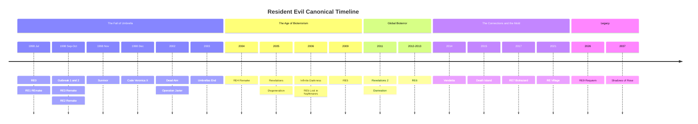
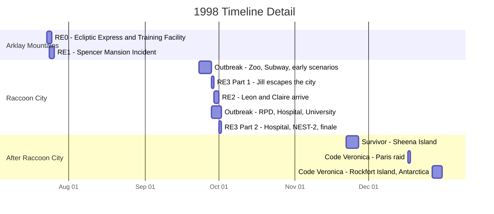
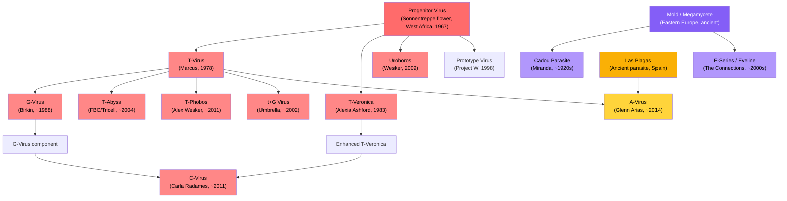

# Resident Evil: Cronologia Canonica

Un riferimento completo che documenta la storia canonica di ogni gioco, DLC e progetto d'animazione CG di Resident Evil, ordinato secondo la cronologia interna all'universo narrativo. Ogni voce include la trama completa, i personaggi chiave, le minacce biologiche e il significato per la lore.

[English](README.md) &nbsp;|&nbsp; [Português (Brasil)](README.pt-br.md) &nbsp;|&nbsp; [Português (Portugal)](README.pt-eu.md) &nbsp;|&nbsp; Italiano &nbsp;|&nbsp; [Español](README.es.md)

I giochi sono ordinati in base a quando si svolgono nella storia, non in base alla data di uscita. I remake sono la fonte preferita per i dettagli della trama. Tutti gli spin-off canonici, i DLC e i film d'animazione CG sono inclusi. Le voci non canoniche sono elencate separatamente come riferimento.

## Indice

- [Panoramica della Cronologia](#panoramica-della-cronologia)
- [L'Incidente di Raccoon City: Uno Sguardo Ravvicinato](#lincidente-di-raccoon-city-uno-sguardo-ravvicinato)
- [Preistoria: Le Radici del Bioterrorismo](#preistoria-le-radici-del-bioterrorismo-19191998)
- **I Monti Arklay e Raccoon City (1998)**
  - [Resident Evil 0](#resident-evil-0)
  - [Resident Evil (REmake)](#resident-evil-remake)
  - [Resident Evil Outbreak / File #2](#resident-evil-outbreak--file-2)
  - [Resident Evil 3 (Remake)](#resident-evil-3-remake)
  - [Resident Evil 2 (Remake)](#resident-evil-2-remake)
  - [Resident Evil Survivor](#resident-evil-survivor)
  - [Resident Evil Code: Veronica X](#resident-evil-code-veronica-x)
- **La Caduta di Umbrella (2002-2004)**
  - [Resident Evil Dead Aim](#resident-evil-dead-aim)
  - [Darkside Chronicles: Operation Javier](#darkside-chronicles-operation-javier)
  - [Umbrella Chronicles: Umbrella's End](#umbrella-chronicles-umbrellas-end)
  - [Resident Evil 4 (Remake)](#resident-evil-4-remake)
- **L'Ascesa del Bioterrorismo (2005-2009)**
  - [Resident Evil Revelations](#resident-evil-revelations)
  - [Degeneration (Film CG)](#degeneration-film-cg)
  - [Infinite Darkness (Serie CG)](#infinite-darkness-serie-cg)
  - [Resident Evil 5](#resident-evil-5)
- **Bioterrorismo Globale (2011-2013)**
  - [Resident Evil Revelations 2](#resident-evil-revelations-2)
  - [Damnation (Film CG)](#damnation-film-cg)
  - [Resident Evil 6](#resident-evil-6)
- **The Connections e la Muffa (2014-2021)**
  - [Vendetta (Film CG)](#vendetta-film-cg)
  - [Death Island (Film CG)](#death-island-film-cg)
  - [Resident Evil 7: Biohazard](#resident-evil-7-biohazard)
  - [Resident Evil Village](#resident-evil-village)
- **Eredità (2026-2037)**
  - [Resident Evil 9: Requiem](#resident-evil-9-requiem)
  - [Shadows of Rose](#shadows-of-rose)
- [Genealogia Virale](#genealogia-virale)
- [Organizzazioni Principali](#organizzazioni-principali)
- [Apparizioni dei Personaggi](#apparizioni-dei-personaggi)
- [Riferimento alla Canonicità](#riferimento-alla-canonicità)

---

## Panoramica della Cronologia

> Il cluster del 1998 è ingannevolmente denso. Sette voci canoniche si svolgono nell'arco di sei mesi, con quattro che si sovrappongono durante la distruzione di Raccoon City tra settembre e ottobre. Il diagramma di Gantt qui sotto ingrandisce questo periodo.

---

## L'Incidente di Raccoon City: Uno Sguardo Ravvicinato

Sovrapposizioni chiave da notare:

- **RE0 finisce dove inizia RE1.** Rebecca conclude lo scontro con la Queen Leech e si dirige direttamente alla Spencer Mansion.
- **La Parte 1 di RE3 inizia prima di RE2.** Jill comincia la sua fuga il 28 settembre, un giorno intero prima dell'arrivo di Leon e Claire il 29 settembre.
- **RE2, RE3 e Outbreak si sovrappongono tutti** dal 29 settembre al 1° ottobre. Personaggi diversi vivono la stessa catastrofe da luoghi diversi della città.
- **Raccoon City viene distrutta il 1° ottobre** da un attacco missilistico termobarico del governo statunitense, che pone fine a RE3 e Outbreak contemporaneamente.

---

## Preistoria: Le Radici del Bioterrorismo (1919-1998)

Gli eventi della serie Resident Evil affondano le radici in oltre un secolo di storia. Comprendere questo retroscena è essenziale, poiché collega le origini di ogni virus, organizzazione e antagonista principale.

**~Tempi antichi.** Il Megamycete, un enorme superorganismo fungino, si sviluppa in un sistema di grotte nell'Europa dell'Est. Assorbe e conserva la coscienza e il DNA degli organismi che muoiono nelle sue vicinanze. Separatamente, il Progenitor Virus si evolve naturalmente all'interno dei fiori Sonnentreppe nell'Africa occidentale, in un sistema di grotte sacro al popolo Ndipaya. L'organismo parassitario Las Plagas prospera nelle grotte sotto quello che diventerà il Castello Salazar nella Spagna rurale, finché il primo Conte Salazar lo sigilla nel XV secolo.

**1909.** Eva nasce da una donna conosciuta solo come Mother Miranda in un remoto villaggio dell'Europa dell'Est.

**1919.** L'influenza spagnola devasta il villaggio di Miranda e uccide Eva all'età di 10 anni. Consumata dal dolore, Miranda vaga in una grotta e scopre il Megamycete. Al contatto, sperimenta visioni di centinaia di coscienze assorbite. Si rende conto che il fungo può conservare e potenzialmente ripristinare una mente. Sacrifica il corpo di Eva al Megamycete e dedica la sua vita a trovare un ricettacolo compatibile per la resurrezione di Eva. Nei decenni successivi, Miranda sperimenta sui villani usando la Muffa, creando il parassita Cadou infettando vermi nematodi con materiale fungino.

**Anni '50.** Un giovane studente di medicina di nome Oswell E. Spencer viene colto da una tempesta di neve nelle montagne europee. Miranda lo salva e lo cura. Spencer apprende della sua ricerca sulla Muffa e rimane affascinato dal concetto di usare agenti biologici per rimodellare l'umanità. In seguito usa le idee di Miranda come fondamento filosofico delle proprie ambizioni: diventare un dio controllando l'evoluzione umana.

**Dicembre 1966.** Spencer, Edward Ashford e James Marcus organizzano una spedizione nell'Africa occidentale. All'inizio del 1967, isolano il Progenitor Virus dai fiori Sonnentreppe nel Giardino del Sole.

**1967-1968.** Spencer incarica l'architetto George Trevor di progettare una villa sui Monti Arklay, vicino a Raccoon City. Il vero scopo della villa è nascondere un laboratorio sotterraneo per armi biologiche. Dopo il completamento, Spencer rapisce la famiglia Trevor e li usa come cavie per il Progenitor. Jessica Trevor muore a causa del ceppo Type-A. Sua figlia Lisa Trevor, 14 anni, sopravvive al ceppo Type-B e diventa di fatto immortale. Lisa subisce decenni di sperimentazione continua, diventando una figura grottesca e tragica che vaga per i terreni della villa indossando i volti dei ricercatori morti, alla ricerca di sua madre.

**1968.** Spencer, Ashford e Marcus fondano la Umbrella Pharmaceuticals. Pubblicamente un conglomerato farmaceutico che spazia tra cosmetici, prodotti chimici, macchinari e beni di consumo. Segretamente una copertura per la ricerca sulle armi biologiche finanziata da contratti governativi. Edward Ashford muore per esposizione accidentale al Progenitor poco dopo la fondazione, indebolendo il ramo della famiglia Ashford.

**1971.** Alexander Ashford, figlio di Edward, tenta di restaurare il prestigio della sua famiglia attraverso il Project CODE: Veronica. Estrae il DNA dal corpo imbalsamato della sua brillante antenata Veronica Ashford e crea due cloni gemelli: Alexia, un prodigio che eredita il genio di Veronica, e Alfred, un sottoprodotto di intelligenza media.

**13 gennaio 1978.** James Marcus raggiunge la svolta del T-Virus presso l'Executive Training Facility, combinando il Progenitor Virus con DNA di sanguisuga. Nasce il Tyrant Virus, o T-Virus. Causa necrosi, zombificazione e mutagenesi estrema nella maggior parte degli ospiti, ma rari soggetti compatibili sviluppano abilità sovrumane.

**1981.** Alexia Ashford, a soli 10 anni, diventa Ricercatrice Capo presso la struttura antartica di Umbrella. Crea il virus T-Veronica combinando il Progenitor Virus con geni di formica regina e un virus antico. Il virus conferisce al suo ospite abilità pirocinetica e il controllo degli insetti, ma solo se l'ospite si sottopone a 15 anni di adattamento criogenico. L'iniezione immediata causa mutazione incontrollata.

**1983.** Alexia inietta suo padre Alexander con il T-Veronica come soggetto di prova, trasformandolo nella creatura Nosferatu. Lo incatena nel seminterrato della struttura. Poi si inietta il virus e entra in sonno criogenico, per risvegliarsi 15 anni dopo con il virus perfettamente legato al suo corpo. Alfred viene lasciato solo a gestire l'eredità degli Ashford, scivolando lentamente nella follia.

**1988.** Spencer diventa paranoico riguardo alle ambizioni e all'indipendenza di Marcus. Ordina il suo assassinio. Albert Wesker e William Birkin, i migliori allievi di Marcus che hanno segretamente fatto rapporto a Spencer per anni, guidano una squadra USS nel laboratorio di Marcus. Marcus viene ucciso a colpi d'arma da fuoco e il suo corpo gettato nelle fogne. Birkin si impossessa della ricerca sul T-Virus di Marcus e se ne prende il merito. All'insaputa di tutti, una Queen Leech entra nel cadavere di Marcus, ne assorbe i ricordi e inizia un processo decennale di rigenerazione.

**Inizio anni '90.** William Birkin inizia lo sviluppo del G-Virus al laboratorio NEST sotto Raccoon City, derivato da mutazioni uniche osservate nel corpo di Lisa Trevor. A differenza del T-Virus, che crea zombie, il G-Virus causa mutazione continua e incontrollata e permette la riproduzione parassitaria attraverso l'impianto di embrioni.

**1996.** Wesker viene inserito come capitano dello S.T.A.R.S. Alpha Team nel dipartimento di polizia di Raccoon City, lavorando segretamente per Umbrella e preparando accordi con un'organizzazione rivale.

**11 maggio 1998.** Una fuoriuscita del ceppo epsilon del T-Virus al Laboratorio Arklay scatena un'epidemia. I ricercatori vengono infettati. I Cerberus fuggono nella foresta. Nelle settimane successive, una serie di bizzarri "omicidi cannibali" sui Monti Arklay attira l'attenzione del pubblico e della polizia. Il dipartimento di polizia di Raccoon City crea l'unità tattica speciale S.T.A.R.S. per indagare.

---

## I Monti Arklay e Raccoon City (1998)

### Resident Evil 0

**Date nella Cronologia:** 23-24 luglio 1998
**Luogo:** Treno Ecliptic Express, Umbrella Executive Training Facility, Monti Arklay
**Protagonisti:** Rebecca Chambers, medico dello S.T.A.R.S. Bravo Team, 18 anni, il membro più giovane degli S.T.A.R.S. Billy Coen, ex Secondo Tenente dei Marines statunitensi condannato per il massacro di 23 persone in Africa, in trasferimento verso la sua esecuzione quando il convoglio è stato attaccato. Billy sostiene di essere stato incastrato dal suo ufficiale in comando.
**Antagonisti:** Queen Leech, la coscienza rianimata di James Marcus. Proto Tyrant, un primo modello di Tyrant fallito.

#### Riassunto della Trama

La sera del 23 luglio 1998, la Queen Leech scatena uno sciame di sanguisughe sull'Ecliptic Express, un treno di proprietà di Umbrella che viaggia attraverso i Monti Arklay. Tutti i passeggeri e il personale vengono uccisi o infettati dal T-Virus. L'attacco è la vendetta della Queen Leech contro Umbrella per l'assassinio di Marcus un decennio prima.

L'elicottero dello S.T.A.R.S. Bravo Team subisce un malfunzionamento e atterra di fortuna nella Foresta di Raccoon mentre era in viaggio per indagare sugli omicidi cannibali. La squadra si divide per perlustrare la zona. Scoprono il relitto di un trasporto della polizia militare con gli autisti morti. Il prigioniero, Billy Coen, è scomparso.

Rebecca scopre l'Ecliptic Express fermo e sale a bordo da sola, trovandolo invaso da zombie e sanguisughe. Incontra Billy, che si è anch'egli rifugiato sul treno. Nonostante gli ordini di arrestarlo, Rebecca collabora controvoglia con Billy per sopravvivere sul treno infestato. Il membro del Bravo Team Edward Dewey barcolla a bordo, gravemente ferito dai Cerberus, e muore dopo aver avvertito Rebecca dei pericoli all'esterno.

La Queen Leech, travestita da versione giovane di James Marcus, riattiva il treno. Billy e Rebecca azionano disperatamente i freni d'emergenza, ma il treno deraglia e si schianta in una stazione sotterranea collegata all'Umbrella Executive Training Facility.

La Training Facility fu costruita negli anni '60 per educare adolescenti dotati reclutati da Umbrella. Le prove sparse nella struttura rivelano una verità più oscura: Marcus usava gli studenti come cavie per i suoi esperimenti sulle sanguisughe e il T-Virus, trasformandoli in zombie. Il seminterrato della struttura contiene una camera di tortura coperta di sangue secco.

Rebecca e Billy ricostruiscono la storia di Marcus attraverso documenti sparsi. Scoprono che Marcus, insieme a Spencer e Ashford, scoprì il Progenitor Virus negli anni '60. Marcus lo combinò con DNA di sanguisuga per creare il T-Virus il 13 gennaio 1978. Trovano prove che Spencer ordinò l'assassinio di Marcus nel 1988, eseguito dai suoi stessi protetti Wesker e Birkin, che poi rubarono la sua ricerca.

La coppia naviga attraverso una chiesa fatiscente e scende nel laboratorio sotterraneo nascosto di Marcus. La creatura che si spacciava per il giovane Marcus si rivela essere la Queen Leech, un organismo massiccio e mutante che ha trascorso dieci anni a rigenerarsi usando il cadavere di Marcus come ospite. Ha assorbito i ricordi, la personalità e la sete di vendetta di Marcus contro Umbrella.

Nella battaglia finale, Rebecca scopre che la Queen Leech è vulnerabile alla luce solare diretta. Apre il tetto della struttura mentre Billy attira l'attenzione della creatura. Esposta alla luce del sole, la Queen Leech si indebolisce e Billy la distrugge con un revolver magnum. William Birkin, monitorando la situazione da remoto, attiva il sistema di autodistruzione della struttura.

Mentre il complesso detona, Rebecca prende una decisione che definisce il suo personaggio: falsifica la morte di Billy nel suo rapporto ufficiale, dicendo alle autorità che è perito in montagna. Tiene le sue piastrine come "prova". Billy scompare nella foresta, un uomo libero. Rebecca si dirige verso la Spencer Mansion per ricongiungersi con i colleghi del Bravo Team, camminando direttamente verso gli eventi di Resident Evil 1.

#### Principali Minacce Biologiche

- **Queen Leech:** Una sanguisuga che è entrata nel cadavere di Marcus, ne ha assorbito i ricordi e ha sviluppato capacità di metamorfosi. Può imitare l'aspetto umano di Marcus e controllare sciami di sanguisughe telepaticamente. Nella sua vera forma, è un massiccio organismo amorfo vulnerabile alla luce UV.
- **Mimicry Marcus:** Forme umanoidi composte da centinaia di sanguisughe che agiscono come un collettivo, imitando la forma di Marcus.
- **Proto Tyrant:** Un primo prototipo instabile di Tyrant conservato nel laboratorio di Marcus. Meno potente e meno stabile del modello T-002 che appare in RE1.
- **Eliminator:** Primati infettati dal T-Virus con aggressività e forza potenziate.
- **Stinger:** Un enorme scorpione mutato dal T-Virus, incontrato nella Training Facility.
- **Centurion:** Un millepiedi gigante creato dall'esposizione al T-Virus.

#### Significato per la Lore

RE0 è il punto di partenza cronologico della serie giocabile. Stabilisce l'origine del T-Virus, le dinamiche di potere interne a Umbrella e i tradimenti che mettono in moto l'intera saga. Il gioco rivela che i tre co-fondatori di Umbrella avevano ciascuno obiettivi distinti: Spencer cercava il potere, Ashford cercava il prestigio e Marcus cercava scoperte scientifiche. La volontà di Spencer di assassinare il proprio co-fondatore e rubare la sua ricerca stabilisce la spietatezza che definisce la cultura aziendale di Umbrella.

Il viaggio di Rebecca dalla Training Facility direttamente nella Spencer Mansion fornisce il ponte narrativo verso RE1. Il gioco spiega anche perché i membri del Bravo Team sono dispersi nella zona della villa quando arriva l'Alpha Team.

---

### Resident Evil (REmake)

**Date nella Cronologia:** 24-25 luglio 1998
**Luogo:** Spencer Mansion e Laboratorio Arklay, Monti Arklay vicino a Raccoon City
**Protagonisti:** Chris Redfield, punta di diamante dello S.T.A.R.S. Alpha Team. Jill Valentine, retroguardia dello S.T.A.R.S. Alpha Team, ex operativa della Delta Force. Barry Burton, specialista d'armi dell'Alpha Team, ricattato da Wesker nello scenario di Jill. Rebecca Chambers, arrivata da RE0, assiste Chris nel suo scenario.
**Antagonisti:** Albert Wesker, capitano dello S.T.A.R.S. Alpha Team e agente doppio segreto di Umbrella. Tyrant T-002, il super-soldato prototipo di Umbrella. Lisa Trevor, una tragica cavia quasi indistruttibile sottoposta a sperimentazioni dal 1967.

#### Riassunto della Trama

Dopo che il Bravo Team non si presenta al rapporto, l'Alpha Team viene inviato il 24 luglio 1998. La squadra è composta da Chris Redfield, Jill Valentine, Barry Burton, Albert Wesker, Joseph Frost e il pilota d'elicottero Brad Vickers. All'atterraggio nella Foresta Arklay, scoprono i rottami dell'elicottero del Bravo Team. Joseph Frost viene attaccato e ucciso dai cani zombie Cerberus. Brad Vickers si fa prendere dal panico e vola via con l'elicottero, lasciando i quattro rimanenti a terra. Chris, Jill, Barry e Wesker fuggono nella Spencer Mansion.

Wesker ordina alla squadra di dividersi ed esplorare. Nella campagna di Jill, lei lavora al fianco di Barry, che fornisce armi e assistenza mentre segretamente fa rapporto a Wesker. Wesker sta ricattando Barry minacciando la sua famiglia. Nella campagna di Chris, esplora da solo finché non trova Rebecca Chambers, fresca degli eventi di RE0, che lo assiste con la sua competenza medica.

La villa è una trappola mortale. Le sale ornate sono piene di zombie, trappole progettate dall'architetto della villa e creature sempre più pericolose. La squadra scopre i corpi e i diari di membri morti del Bravo Team sparsi ovunque. Kenneth Sullivan viene trovato mentre viene divorato da uno zombie. Forest Speyer giace morto sul balcone, ucciso dai corvi e imbottito di esplosivo. Richard Aiken, avvelenato dal serpente gigante Yawn, muore nonostante i tentativi di Rebecca di salvarlo nello scenario di Chris.

Una caratteristica unica del REmake: gli zombie uccisi ma non smaltiti correttamente si rianimano come Crimson Head, mutanti più veloci e aggressivi con artigli e istinti predatori potenziati. L'unico modo per prevenire questo è bruciare i cadaveri o decapitarli. Questa meccanica aggiunge una tensione persistente nella gestione delle risorse durante l'esplorazione della villa.

La guardhouse, un edificio separato collegato alla villa, ospita la vasca degli squali Aqua Ring contenente Neptune, un grande squalo bianco infettato dal T-Virus, e l'enorme Plant 42, una pianta mutante che ha consumato la struttura dell'edificio. I giocatori apprendono attraverso i diari dei ricercatori i vari esperimenti condotti nella struttura e il graduale cedimento dei protocolli di sicurezza che ha preceduto l'epidemia.

Il REmake introduce la storia di Lisa Trevor. I giocatori la incontrano nella zona della baita e nei tunnel sotterranei. Non può essere uccisa permanentemente. Le sue voci di diario, scritte con una calligrafia sempre più deteriorata nel corso dei decenni, rivelano l'orrore della sua prigionia. Nel 1967, a 14 anni, lei e sua madre Jessica furono rapite da Spencer e usate come cavie per il Progenitor. Jessica morì. Lisa sopravvisse a ogni virus che le fu iniettato, incluso il parassita NE-alpha usato successivamente per creare il Nemesis. Il G-Virus fu infine isolato dal suo sangue. Nel 1998, è una creatura grottesca che indossa i volti scuoiati dei ricercatori che ha ucciso, perennemente alla ricerca del volto di sua madre.

Sotto la villa si trova il Laboratorio Arklay, la struttura di ricerca sotterranea di Umbrella dove opera il programma BOW del T-Virus. Il laboratorio contiene registri di sviluppo, stoccaggio criogenico per soggetti sperimentali e il fiore all'occhiello della ricerca di Umbrella: il Tyrant Project.

Nel laboratorio, Wesker si rivela come un traditore. È stato un agente di Umbrella fin dall'inizio, e l'intera operazione S.T.A.R.S. era progettata per raccogliere dati di combattimento sui BOW contro soldati addestrati. Ha registrato tutto. Nello scenario di Jill, il suo ricatto di Barry viene svelato, e Barry alla fine si rivolta contro Wesker. Wesker attiva il Tyrant T-002 dal suo contenitore criogenico: un umanoide imponente, dalla pelle grigia, con un artiglio massiccio e un cuore esposto. Il Tyrant trafigge Wesker all'addome, apparentemente uccidendolo, poi si rivolta contro i membri rimanenti degli S.T.A.R.S.

Quello che nessuno sa è che Wesker si è iniettato un virus speciale fornito da William Birkin prima di entrare nella villa. Il virus, parte del Project W di Spencer, è progettato per conferire abilità sovrumane a ospiti geneticamente compatibili. Wesker muore e viene resuscitato dal virus mentre gli altri lottano per la sopravvivenza.

Dopo aver sconfitto il Tyrant nel laboratorio, i sopravvissuti attivano il sistema di autodistruzione d'emergenza. Corrono attraverso la struttura che crolla fino all'eliporto sul tetto della villa. Il Tyrant, ora mutato nella sua forma Super Tyrant con cuore esposto e artigli massicci, sfonda il pavimento dell'eliporto per uno scontro finale. Brad Vickers, che ha sorvolato la zona in elicottero, lancia un lanciarazzi. Il Super Tyrant viene distrutto.

Chris, Jill, Barry e Rebecca fuggono in elicottero mentre la Spencer Mansion e il suo laboratorio sotterraneo vengono consumati dall'esplosione. I quattro sopravvissuti si impegnano a smascherare i crimini di Umbrella. Chris parte poco dopo per l'Europa per indagare sul quartier generale di Umbrella, una decisione che porterà sua sorella Claire a Raccoon City due mesi dopo, alla sua ricerca.

#### Principali Minacce Biologiche

- **Tyrant T-002:** Il super-soldato prototipo di Umbrella, apice del loro Tyrant Project. Un BOW umanoide con forza e velocità sovrumane e un massiccio artiglio osseo che si estende dal braccio destro. Il cuore esposto è il suo punto debole. Quando sufficientemente danneggiato, muta nella forma Super Tyrant, più veloce e aggressiva.
- **Lisa Trevor:** Non un'antagonista tradizionale, ma una presenza indistruttibile. Decenni di sperimentazione virale l'hanno resa di fatto immortale. Ha assorbito il parassita NE-alpha che sarebbe stato poi usato nel Nemesis Project. Il suo corpo è stato il materiale di partenza per il G-Virus.
- **Crimson Head:** Zombie che si rianimano se non bruciati o decapitati. Più veloci e letali degli zombie standard, con artigli e aggressività potenziata. Una meccanica esclusiva del REmake.
- **Hunter MA-121 Alpha:** BOW ibridi rettile-umano creati innestando DNA rettile su embrioni umani tramite il T-Virus. Capaci di decapitare le vittime con un solo colpo. Infiltrano la villa dopo la sezione della guardhouse.
- **Yawn:** Un enorme serpente mutato dal T-Virus che sorveglia i piani superiori della villa. Il suo veleno è letale senza antidoto.
- **Neptune:** Grandi squali bianchi infettati dal T-Virus nell'Aqua Ring.
- **Plant 42:** Un'enorme pianta mutante nella guardhouse, vulnerabile al composto chimico V-JOLT.
- **Cerberus:** Dobermann infettati dal T-Virus che vagano per i terreni della villa e la foresta.

#### Significato per la Lore

L'Incidente della Villa è l'evento scatenante dell'intero franchise di Resident Evil. Ogni gioco successivo affonda le proprie radici in ciò che accade qui. I sopravvissuti diventano il nucleo dei combattenti anti-Umbrella: Chris e Jill co-fondano la BSAA, Barry addestra la generazione successiva di operativi, e Rebecca prosegue la ricerca sulle armi biologiche dal punto di vista accademico.

La sopravvivenza e trasformazione di Wesker da agente umano a minaccia sovrumana lo definisce come l'antagonista ricorrente della serie fino a RE5. La sua iniezione del virus del Project W è il primo indizio del programma eugenetico di Spencer, un filo narrativo che richiede sette giochi per essere pienamente svelato.

Le autorità di Raccoon City, sotto l'influenza di Umbrella, insabbiano l'Incidente della Villa. Gli S.T.A.R.S. vengono silenziosamente sciolti. Gli avvertimenti dei sopravvissuti vengono ignorati. Questo insabbiamento rende direttamente possibile l'epidemia di T-Virus che consuma la città due mesi dopo. Il capo della polizia di Raccoon City, Brian Irons, è sul libro paga di Umbrella e sopprime attivamente le prove.

La storia di Lisa Trevor è l'aggiunta più significativa del REmake alla lore. I suoi decenni di sofferenza rivelano la profondità della crudeltà di Umbrella e forniscono l'origine sia del G-Virus che del parassita NE-alpha usato nel Nemesis. È il filo conduttore tra il Progenitor Virus, il T-Virus, il G-Virus e il Nemesis Project.

---

### Resident Evil Outbreak / File #2

**Date nella Cronologia:** Dal 23 settembre al 1° ottobre 1998
**Luogo:** Varie località di Raccoon City: J's Bar, Zoo di Raccoon, rete metropolitana, Raccoon General Hospital, stazione di polizia RPD, Università di Raccoon, impianto di smaltimento rifiuti di Umbrella
**Protagonisti:** Otto civili di Raccoon City: Kevin Ryman, agente di polizia RPD. Mark Wilkins, guardia di sicurezza e veterano del Vietnam. Jim Chapman, impiegato della metropolitana. George Hamilton, chirurgo al Raccoon General Hospital. David King, idraulico e tuttofare. Alyssa Ashcroft, giornalista investigativa. Yoko Suzuki, studentessa universitaria ed ex dipendente Umbrella con ricordi soppressi. Cindy Lennox, cameriera al J's Bar.
**Antagonisti:** William Birkin nella sua forma mutante G. Thanatos, un Tyrant non autorizzato creato dal ricercatore dell'Università di Raccoon Greg Mueller. Nyx, un massiccio BOW amorfo stoccato in un cantiere navale di Umbrella. Nikolai Ginovaef, supervisore UBCS al servizio di Umbrella.

#### Riassunto della Trama

I giochi Outbreak descrivono il disastro di Raccoon City attraverso gli occhi di cittadini comuni piuttosto che di operativi addestrati. Gli scenari coprono l'intera durata dell'epidemia, dalla contaminazione iniziale della rete idrica alla distruzione della città con un attacco missilistico.

**"Wild Things", 23 settembre.** Lo scenario cronologicamente più antico. Il T-Virus ha raggiunto lo Zoo di Raccoon, mutando gli animali. I sopravvissuti affrontano leoni zombie, un elefante zombie di nome Oscar e iene infette. Un elicottero di evacuazione si schianta, costringendo il gruppo a trovare una via di fuga alternativa. Questo scenario mostra quanto presto l'infezione si sia diffusa nelle infrastrutture della città.

**"Outbreak", 24 settembre.** L'epidemia di T-Virus raggiunge il J's Bar nella zona alta di Raccoon City, dove molti degli otto protagonisti sono clienti abituali o dipendenti. Gli zombie sfondano finestre e porte. I sopravvissuti barricano gli ingressi, combattono attraverso l'orda e fuggono dai tetti mentre la RPD fa detonare esplosivi per sgomberare le strade. Questo scenario introduttivo è la prima volta che gli otto civili si incrociano.

**"Underbelly", 25-26 settembre.** I sopravvissuti tentano di fuggire tramite la metropolitana di Raccoon City. Lo schianto di un treno disturba un nido di parassiti, tra cui il Giga Bite, un'enorme pulce mutante. Il gruppo naviga attraverso i tunnel allagati e fugge su un treno in partenza o attraverso condotti di ventilazione.

**"Below Freezing Point", 25-26 settembre.** Guidato da Yoko Suzuki, i cui ricordi frammentati del lavoro presso Umbrella riaffiorano durante lo scenario, il gruppo si infiltra nel laboratorio sotterraneo di Umbrella sotto la città, la stessa struttura NEST di RE2. Incontrano Monica, una virologa rinnegata di Umbrella che tenta di rubare dati di ricerca. Monica viene uccisa dal mutato William Birkin nella sua forma G. I sopravvissuti fuggono attraverso i tunnel d'emergenza del laboratorio.

**"The Hive", 26-27 settembre.** Il Raccoon General Hospital, lo stesso ospedale che appare in RE3, è sotto attacco di una colonia di sanguisughe mutanti giganti. Un'entità Leech Man infesta i corridoi. I sopravvissuti distruggono la Leech Queen che abita il seminterrato dell'ospedale per fuggire.

**"Hellfire", 27-28 settembre.** Un incendio divampa in un vecchio hotel di Raccoon City. I sopravvissuti navigano attraverso la struttura in fiamme e in crollo combattendo gli zombie. Una creatura mutante massiccia si aggira per l'hotel. Lo scenario illustra come le infrastrutture della città si stiano disintegrando su più fronti contemporaneamente.

**"Flashback", 28-29 settembre.** Il gruppo si rifugia in una baita nella Foresta di Raccoon, dove incontra Al Lester, un uomo che promette di guidarli in salvo. Al in realtà è squilibrato. Sua moglie Dorothy è stata oggetto di esperimenti in un ospedale abbandonato vicino e si è fusa con una pianta mutante. Al attira vittime per nutrire la pianta, sperando di mantenere Dorothy in vita. I sopravvissuti distruggono il nucleo della pianta e fuggono dalla foresta.

**"Desperate Times", 28-29 settembre.** I sopravvissuti si uniscono ai poliziotti rimasti nella difesa della stazione di polizia RPD, lo stesso edificio di RE2. Il Tenente Marvin Branagh, l'agente ferito che successivamente fornisce informazioni a Leon in RE2, guida la difesa. Le barricate alla fine cedono, e i sopravvissuti fuggono attraverso le fogne mentre la stazione viene sopraffatta.

**"Decisions, Decisions", 1° ottobre.** Lo scenario finale e più significativo. George Hamilton guida il gruppo all'Università di Raccoon per trovare il suo collega Peter Jenkins, che stava sviluppando un vaccino per il T-Virus chiamato "Daylight". Scoprono che Peter è stato assassinato dall'ex ricercatore di Umbrella Greg Mueller, che voleva sopprimere il vaccino e vendere la sua creazione non autorizzata, un Tyrant. Mueller viene assassinato da Nikolai Ginovaef, il supervisore UBCS di RE3, che sta eliminando testimoni e raccogliendo dati. Il Tyrant di Mueller, Thanatos, viene liberato. I sopravvissuti sintetizzano il vaccino Daylight da soli, sconfiggono Thanatos dopo che muta nella più potente forma Thanatos R, e fuggono in elicottero pochi istanti prima che il missile termobarico del governo statunitense annichilisca Raccoon City il 1° ottobre.

**"End of the Road", 1° ottobre.** David King guida il gruppo verso un impianto di smaltimento rifiuti di Umbrella alla periferia della città. Incontrano scienziati che tentano di recuperare una cura. Coloro che fuggono in autostrada affrontano Nyx, un massiccio BOW amorfo in grado di assorbire altri organismi, incluso un Tyrant T-103. Questo scenario offre uno degli ultimi scorci di Raccoon City prima della sua distruzione.

#### Principali Minacce Biologiche

- **Thanatos:** Un Tyrant non autorizzato creato da Greg Mueller all'Università di Raccoon usando ricerca rubata ad Umbrella. Distinto dai modelli ufficiali di Tyrant di Umbrella. La sua forma mutata, Thanatos R, è più veloce e aggressiva.
- **Nyx:** Un massiccio BOW amorfo stoccato in un cantiere di smaltimento rifiuti di Umbrella. Capace di assorbire e incorporare altri organismi nella propria massa corporea, incluso un Tyrant T-103. Uno dei BOW più pericolosi incontrati nell'incidente di Raccoon City.
- **William Birkin forma G:** Incontrato nello scenario "Below Freezing Point" nello stesso laboratorio NEST di RE2.
- **Oscar:** Un elefante infettato dal T-Virus allo Zoo di Raccoon.
- **Giga Bite:** Un'enorme pulce mutante nel sistema metropolitano.
- **Leech Man:** Un'entità umanoide composta da sanguisughe mutanti che infesta il Raccoon General Hospital.

#### Significato per la Lore

I giochi Outbreak dimostrano che la distruzione di Raccoon City non è stata solo la storia di pochi eroi. Migliaia di civili hanno vissuto l'epidemia, e piccoli gruppi hanno lottato per sopravvivere in ogni angolo della città contemporaneamente. Il vaccino "Daylight" rappresenta una cura alternativa al T-Virus che, se fosse stata prodotta in massa, avrebbe potuto cambiare il corso degli eventi.

I ricordi soppressi di Yoko Suzuki riguardo a Umbrella suggeriscono che Umbrella sperimentava sui propri dipendenti e cancellava la loro consapevolezza. Il background da giornalista investigativa di Alyssa Ashcroft diventa direttamente rilevante in RE9: Requiem, dove sua figlia Grace Ashcroft è una protagonista.

Gli scenari si sovrappongono a RE2 e RE3, posizionando il giocatore in luoghi che Leon, Claire e Jill visitano, a volte contemporaneamente. La difesa della RPD da parte di Marvin Branagh in "Desperate Times" mostra le ore precedenti l'arrivo di Leon e Claire, quando trovano la stazione già caduta.

---

### Resident Evil 3 (Remake)

**Date nella Cronologia:** Dal 28 settembre al 1° ottobre 1998. Inizia circa 24 ore prima di RE2. La prima metà precede RE2; la seconda metà avviene dopo la conclusione degli eventi principali di RE2.
**Luogo:** Strade di Raccoon City, rete metropolitana, Clock Tower, Raccoon General Hospital, laboratorio NEST-2
**Protagonisti:** Jill Valentine, ex membro dello S.T.A.R.S. Alpha Team e sopravvissuta dell'Incidente della Villa. Da luglio ha cercato di smascherare i crimini di Umbrella ma è stata ostacolata dall'influenza dell'azienda sulle autorità locali. Carlos Oliveira, Caporale del Biohazard Countermeasure Service di Umbrella, un ex guerrigliero sudamericano che si è unito alla UBCS senza conoscere la piena portata dei crimini di Umbrella.
**Antagonisti:** Nemesis-T Type, un Tyrant T-103 impiantato con un parassita NE-alpha, che gli conferisce intelligenza, parola e capacità di seguire ordini complessi. La sua missione: dare la caccia e uccidere tutti i membri sopravvissuti degli S.T.A.R.S. per dimostrare l'efficacia in combattimento del parassita. Nikolai Zinoviev, Sergente UBCS e "Supervisore" segreto di Umbrella, infiltrato per raccogliere dati di combattimento sui BOW.

#### Riassunto della Trama

Il gioco si apre con Jill che ha un incubo nel suo appartamento, illustrando il disturbo da stress post-traumatico che soffre dall'Incidente della Villa due mesi prima. Si sveglia per una telefonata che la avverte di una nuova minaccia. Prima che possa reagire, Nemesis sfonda il muro del suo appartamento.

Nemesis è l'arma biologica più sofisticata di Umbrella fino a quel momento: un Tyrant T-103 impiantato con il parassita NE-alpha, che forma un proprio cervello all'interno del sistema nervoso dell'ospite. Questo conferisce alla creatura intelligenza, ragionamento tattico, capacità di usare armi e linguaggio limitato. Riesce a dire una parola: "S.T.A.R.S." La sua missione è eliminare tutti i membri sopravvissuti degli S.T.A.R.S. come dimostrazione sul campo del potenziale militare del parassita NE-alpha. Jill, come uno dei quattro sopravvissuti noti, è il bersaglio primario.

Jill sfugge a stento al primo incontro e fugge per le strade. Assiste Brad Vickers, il suo ex collega degli S.T.A.R.S. e pilota d'elicottero di RE1, venire sopraffatto dagli zombie. Brad tiene chiusa una porta per far guadagnare tempo a Jill e viene morso. Muore per l'infezione poco dopo. Il suo corpo zombificato viene successivamente incontrato da Carlos alla RPD.

Jill incontra i mercenari sopravvissuti della UBCS: Carlos Oliveira, il capo plotone ferito Mikhail Viktor e il sospetto Nikolai Zinoviev. La UBCS è stata dispiegata da Umbrella per gestire l'epidemia, ma la maggior parte delle squadre è stata decimata. I sopravvissuti pianificano di fuggire attraverso la metropolitana.

Jill e Carlos lavorano per ripristinare l'energia della metropolitana. Jill naviga per la città infestata, raccogliendo componenti e risolvendo problemi mentre viene periodicamente braccata da Nemesis. La creatura è implacabile, appare in momenti imprevedibili, a volte brandendo un lanciarazzi. Gli scontri si intensificano progressivamente, con Nemesis che si adatta alle tattiche di Jill.

Quando Nemesis sale sul vagone della metropolitana durante la loro fuga, Mikhail Viktor compie un sacrificio eroico. Il capo plotone ferito fa detonare una granata a bruciapelo, distruggendo il vagone e rallentando Nemesis. Mikhail muore nell'esplosione. La metropolitana danneggiata si schianta vicino alla Clock Tower.

Alla Clock Tower, Jill e Carlos tentano di segnalare un elicottero di soccorso. Un elicottero arriva, ma Nemesis, sopravvissuto e ora privo del cappotto per rivelare una forma più organica coperta di tentacoli, lo distrugge. Durante la battaglia che segue, Nemesis infetta Jill con il T-Virus tramite un colpo di tentacolo. Jill crolla e cade in coma.

Carlos porta Jill al Raccoon General Hospital e cerca disperatamente una cura. L'ospedale è invaso da Hunter e personale zombie. Carlos combatte attraverso i reparti e scopre un vaccino per il T-Virus sintetizzato dai ricercatori di Umbrella. Incontra anche Nikolai, che rivela il suo vero ruolo di "Supervisore" pagato, un osservatore infiltrato da Umbrella per raccogliere segretamente dati di combattimento sui BOW durante l'epidemia. Nikolai ha eliminato altri supervisori e sopravvissuti per assicurarsi di essere l'unico a possedere i preziosi dati. Carlos lo affronta, ma Nikolai fugge.

Il remake offre a Carlos una sezione di gioco espansa alla stazione di polizia RPD, sovrapponendosi all'ambientazione di RE2. Carlos combatte attraverso gli stessi corridoi che Leon e Claire percorrono, più o meno nello stesso periodo, fornendo una prospettiva diversa sulla caduta della stazione.

Carlos somministra il vaccino, curando Jill. Si risveglia il 1° ottobre, il giorno in cui il governo statunitense ha autorizzato un attacco missilistico termobarico su Raccoon City. Le trasmissioni radio annunciano la distruzione imminente. Il tempo stringe.

La Jill guarita si dirige verso il NEST-2, un laboratorio di Umbrella collegato alla struttura NEST di RE2. Scopre che è stato usato per ulteriore sviluppo di BOW e ricerca virale. Nikolai riappare, tentando di giustiziare Jill sull'eliporto della struttura e usare Carlos come esca per raccogliere dati finali di combattimento. Carlos immobilizza Nikolai, e Jill pone fine ai suoi piani.

Nemesis, ora mutato in una massiccia forma quadrupede a malapena riconoscibile come un tempo umanoide, attacca Jill nel NEST-2. Lei immerge la creatura nell'acido e la finisce con un railgun, distruggendo l'arma biologica che l'ha braccata per tutta la città.

Jill e Carlos raggiungono l'eliporto e vengono estratti proprio mentre il missile termobarico colpisce. Raccoon City viene completamente annichilita. Ogni infetto rimasto, ogni prova di Umbrella e ogni civile che non è riuscito a fuggire viene distrutto. Il governo statunitense, sotto la direzione del Consigliere per la Sicurezza Nazionale Derek C. Simmons, orchestra un insabbiamento del proprio coinvolgimento.

#### Principali Minacce Biologiche

- **Nemesis-T Type:** Il modello di Tyrant più avanzato al momento dell'incidente di Raccoon City. Un T-103 impiantato con il parassita NE-alpha, che forma un cervello secondario. Capace di parola, uso di armi, pianificazione tattica e inseguimento implacabile. Progredisce attraverso molteplici stadi di mutazione: umanoide in impermeabile, forma organica esposta con tentacoli, e massiccia creatura quadrupede. Il parassita NE-alpha fu originariamente testato su Lisa Trevor, che lo assorbì.
- **Drain Deimos / Brain Sucker:** Parassiti mutanti giganti simili a pulci che drenano il liquido cerebrospinale dalle vittime.
- **Hunter Beta e Gamma:** Varianti avanzate di Hunter. Gli Hunter Gamma sono acquatici, incontrati nelle fogne. Gli Hunter Beta sono incontrati all'ospedale.
- **Grave Digger:** Un enorme verme mutato dal T-Virus nell'area del parco cittadino, presente nella versione originale.
- **Pale Head:** Zombie esclusivi del remake con capacità rigenerative estreme, trovati nel NEST-2.

#### Significato per la Lore

RE3 si svolge in contemporanea con RE2 e mostra l'altro volto degli ultimi giorni di Raccoon City. Mentre Leon e Claire navigano la RPD e il NEST sotterraneo, Jill combatte Nemesis per le strade, la metropolitana e gli ospedali della città. La sezione di Carlos alla RPD si sovrappone direttamente agli eventi di RE2.

Il Nemesis Project dimostra le ambizioni crescenti di Umbrella. Il parassita NE-alpha conferisce a un Tyrant intelligenza e concentrazione sulla missione, un salto significativo rispetto al privo di pensiero T-002 di RE1 o all'obbediente ma semplice Mr. X di RE2. I dati di combattimento raccolti durante l'inseguimento di Jill da parte di Nemesis sono preziosi per Umbrella indipendentemente dalla sopravvivenza della creatura.

Il dispiegamento della UBCS da parte di Umbrella rivela la volontà dell'azienda di sacrificare i propri dipendenti. I mercenari UBCS sono risorse sacrificabili, reclutati tra criminali di guerra e soldati disperati di tutto il mondo. I Supervisori nascosti tra loro esistono unicamente per documentare le prestazioni dei BOW contro umani addestrati in combattimento reale.

La distruzione di Raccoon City è l'evento cardine del franchise. Scatena indagini del Congresso, indignazione internazionale e infine i procedimenti legali che distruggono la Umbrella Corporation. La sopravvivenza di Jill e la sua conoscenza diretta sia dell'Incidente della Villa che della distruzione di Raccoon City la rendono una delle testimoni più importanti contro Umbrella. Lei e Chris fondano la BSAA.

---

### Resident Evil 2 (Remake)

**Date nella Cronologia:** Dal 29 settembre al 1° ottobre 1998
**Luogo:** Periferia di Raccoon City, stazione di polizia RPD, fogne di Raccoon City, laboratorio sotterraneo NEST
**Protagonisti:** Leon S. Kennedy, poliziotto recluta di 21 anni al suo primo giorno alla RPD. Ha dormito troppo in un motel alla periferia della città dopo una rottura sentimentale ed è arrivato in ritardo, solo per trovare la città invasa. Claire Redfield, studentessa universitaria di 19 anni e sorella minore di Chris Redfield, arriva a Raccoon City in moto alla ricerca di Chris, che non l'ha contattata dall'Incidente della Villa. Ada Wong, una spia al servizio di un'organizzazione rivale, che si spaccia per agente dell'FBI alla ricerca di un giornalista di nome Ben Bertolucci, mentre segretamente insegue un campione di G-Virus. Sherry Birkin, figlia dodicenne di William e Annette Birkin, nascosta nella stazione di polizia.
**Antagonisti:** William Birkin / "G", ex Ricercatore Capo del NEST e creatore del G-Virus, che si è iniettato la propria creazione dopo essere stato colpito dalla USS di Umbrella e ora muta attraverso cinque stadi sempre più grotteschi. Mr. X / T-00, un Tyrant T-103 prodotto in serie, dispiegato da Umbrella per recuperare il campione di G-Virus e eliminare i testimoni. Capo Brian Irons, il corrotto capo della RPD sul libro paga di Umbrella da anni, che sopprime le prove dei loro crimini.

#### Riassunto della Trama

Il 22 settembre 1998, una settimana prima dell'inizio del gioco, il Security Service di Umbrella guidato dall'operativo HUNK fa irruzione nel laboratorio NEST sotto Raccoon City. La loro missione: sequestrare il G-Virus a William Birkin, che stava pianificando di disertare verso i militari statunitensi con la sua ricerca. Nello scontro, gli operativi USS sparano a Birkin più volte. Lasciato in fin di vita, Birkin si inietta un campione di G-Virus per disperazione. Il virus lo rianima e lo muta in una creatura guidata dalla rabbia e dall'istinto riproduttivo. Massacra la squadra USS. Nel caos, campioni di T-Virus si riversano e vengono diffusi attraverso il sistema fognario dai ratti. In pochi giorni, la rete idrica della città è contaminata e decine di migliaia di cittadini vengono infettati.

La sera del 29 settembre, Leon Kennedy e Claire Redfield arrivano a Raccoon City indipendentemente. Leon, guidando la sua Jeep, e Claire, sulla sua moto, si incontrano a una stazione di servizio alla periferia quando gli zombie attaccano. Requisiscono un'auto della polizia e si dirigono verso l'edificio RPD. Uno zombie sul sedile posteriore causa un incidente, e un camion cisterna ribaltato li separa. Si accordano per incontrarsi alla RPD e prendono percorsi separati.

La stazione di polizia RPD, un tempo museo d'arte, è un edificio labirintico dall'architettura elaborata che ora funge da tomba. La maggior parte degli agenti è morta. Il Tenente Marvin Branagh, gravemente ferito e in lotta con l'infezione, dà a Leon un coltello da combattimento e informazioni critiche prima di soccombere al T-Virus e trasformarsi. Il giocatore è costretto a eliminare l'uomo che lo ha appena aiutato.

Leon incontra Ada Wong, che dice di essere alla ricerca del giornalista Ben Bertolucci. In realtà, Ada è una spia al servizio di un'organizzazione rivale, inviata per recuperare un campione di G-Virus. Nonostante la missione, sviluppa sentimenti sinceri per Leon nel corso della loro collaborazione. La loro dinamica mescola dipendenza reciproca e inganno reciproco.

Claire scopre Sherry Birkin nascosta nella stazione di polizia. I genitori di Sherry, William e Annette, sono scienziati di Umbrella al NEST. Claire prende Sherry sotto la sua protezione, e il loro legame diventa una delle relazioni più durature della serie.

Il Capo Brian Irons, il corrotto capo della polizia, viene incontrato nella sala tassidermia della RPD circondato dai suoi trofei di caccia. È stato sul libro paga di Umbrella per anni, sopprimendo le prove delle loro attività illegali e ostacolando i tentativi dei sopravvissuti degli S.T.A.R.S. di smascherare l'azienda. Durante l'epidemia, la sua salute mentale si deteriora. Nello scenario di Claire, Irons rapisce Sherry. La sua morte arriva quando William Birkin, spinto dall'istinto riproduttivo del G-Virus, gli impianta un embrione G. L'embrione esplode dal corpo di Irons, uccidendolo in modo violento.

A metà gioco, un elicottero di Umbrella sgancia un container sul tetto della RPD. Il Tyrant T-00, nome in codice Mr. X, emerge e inizia a dare la caccia metodicamente al giocatore nella stazione. A differenza degli zombie privi di pensiero, Mr. X è orientato alla missione: recuperare il ciondolo con il G-Virus e eliminare i testimoni. Non può essere fermato permanentemente, solo rallentato. Il suono dei suoi pesanti passi che riecheggiano nei corridoi crea una tensione persistente. Nel remake, Mr. X pattuglia dinamicamente, seguendo i suoni e inseguendo il giocatore attraverso più stanze.

Entrambi i personaggi navigano infine dalla RPD al sistema fognario della città, e da lì al NEST, il massiccio laboratorio sotterraneo di Umbrella dove il G-Virus è stato sviluppato. La struttura è un complesso ad alta tecnologia pieno di laboratori, depositi di campioni e le prove di decenni di ricerca di Birkin.

Nello scenario di Leon, Annette Birkin, la moglie di William e ricercatrice al NEST, rivela la vera identità di Ada. Ada non sta cercando un fidanzato o un giornalista. È una spia mercenaria incaricata di rubare il G-Virus. La rivelazione costringe Leon a fare i conti con i suoi sentimenti crescenti per qualcuno che lo ha manipolato. Nella scena culminante, Ada punta la pistola contro Leon per esigere il campione di G-Virus. Durante la sequenza di autodistruzione della struttura, Ada viene sbalzata da una passerella e cade nell'oscurità. Sopravvive, fuggendo con un frammento di tessuto contenente materiale di G-Virus.

Nello scenario di Claire, William Birkin, guidato dall'istinto riproduttivo del G-Virus a trovare ospiti geneticamente compatibili, prende di mira la propria figlia Sherry. Le impianta un embrione G. Claire e Annette corrono per sintetizzare il vaccino DEVIL dall'equipaggiamento di Umbrella nel NEST. Annette, mortalmente ferita dal mutato William, conferma che il vaccino funziona prima di morire. Sherry viene curata, ma l'esposizione al G-Virus le lascia abilità rigenerative permanenti che diventano rilevanti in RE6.

Il sistema di autodistruzione del NEST si attiva. Leon sconfigge Mr. X nella sua forma finale di Super Tyrant mutato su una piattaforma dell'ascensore, usando un lanciarazzi lanciato da Ada dall'ombra sopra di lui. I sopravvissuti convergono su un treno d'emergenza sotterraneo. Mentre il treno sfreccia attraverso il tunnel, Birkin nella sua forma finale G5, una massa enorme di carne, denti e occhi che ha consumato la sezione posteriore del treno, attacca. Il vagone posteriore viene sganciato, lasciando Birkin all'esplosione della struttura.

Leon, Claire e Sherry emergono dal tunnel alla periferia di Raccoon City all'alba. Camminano lungo una strada allontanandosi dalla città in fiamme. Leon dice a Claire che troverà un modo per fermare Umbrella. Claire dice che deve ancora trovare Chris. Le loro strade si dividono, ma le loro vite restano intrecciate per tutta la serie.

HUNK, l'unico operativo USS sopravvissuto del raid originale su Birkin, fugge da Raccoon City separatamente con un campione di G-Virus in una valigetta. La sua estrazione in elicottero dal tetto della RPD significa che Umbrella alla fine ha ottenuto ciò per cui era venuta, al costo di un'intera città.

#### Principali Minacce Biologiche

- **William Birkin / "G":** Progredisce attraverso cinque stadi di mutazione. G1 mantiene una forma vagamente umana con un enorme occhio sulla spalla destra e un braccio artigliato. G2 perde la maggior parte dei tratti umani, sviluppando un secondo paio di braccia. G3 è completamente mostruoso, quadrupede. G4 è un orrore massiccio e asimmetrico. G5 è una massa amorfa di carne e denti che consuma tutto ciò che tocca. A differenza delle mutazioni del T-Virus, la mutazione del G-Virus è continua e incontrollabile.
- **Mr. X / T-00:** Un Tyrant T-103 prodotto in serie, più raffinato del prototipo T-002 di RE1. Dispiegato con un impermeabile e un cappello fedora per mimetizzarsi in ambienti urbani. Segue ordini, traccia bersagli e non può essere ucciso permanentemente con armi convenzionali. Nella sua forma Super Tyrant, l'impermeabile si lacera per rivelare muscolatura esposta e un massiccio artiglio osseo.
- **Licker:** BOW privi di pelle e ciechi che cacciano per suono. Sono uno stadio di mutazione avanzato degli zombie i cui cervelli si sono gonfiati e esposti. Veloci, letali e capaci di arrampicarsi sui muri. Le loro lingue possono trafiggere le vittime da un capo all'altro della stanza.
- **G-Adult / G-Embryo:** Birkin, guidato dall'istinto riproduttivo del G-Virus, impianta embrioni parassitari negli ospiti. Gli ospiti geneticamente incompatibili rigettano l'embrione, che esplode fuori e cresce in un G-Adult: una piccola creatura aggressiva. Gli ospiti compatibili, specificamente consanguinei, produrrebbero teoricamente un organismo G perfetto.
- **Alligatore gigante:** Un enorme alligatore infettato dal T-Virus nelle fogne della città. Incontrato brevemente ma in modo memorabile.
- **Ivy:** BOW a base vegetale nel NEST creati dall'esposizione al T-Virus. Nel remake, sono chiamati Plant 43 e si incontrano nella sezione serra.

#### Significato per la Lore

RE2 descrive la catastrofe che definisce il franchise. L'epidemia di Raccoon City è l'evento verso cui tutto ciò che viene prima converge e a cui tutto ciò che viene dopo risponde. Distrugge la reputazione pubblica di Umbrella, innesca indagini governative e dà il via al mercato nero globale delle armi biologiche.

L'esperienza di Leon qui lo trasforma da recluta idealista nell'agente governativo temprato che diventa in RE4 e RE6. La sua complicata relazione con Ada Wong, nata nell'inganno e nella disperazione di Raccoon City, diventa uno dei fili narrativi più longevi della serie.

Il legame di Claire con Sherry prosegue direttamente. In RE: Revelations 2, Claire viene rapita mentre lavora per TerraSave. In RE6, Sherry ritorna come agente DSO adulta, le sue abilità rigenerative un segno permanente dell'esposizione al G-Virus che Claire ha lottato per curare.

Il G-Virus rappresenta una minaccia fondamentalmente diversa dal T-Virus. Mentre il T-Virus crea zombie e BOW controllabili per la vendita militare, il G-Virus crea un organismo incontrollabile guidato dal puro istinto evolutivo. La tragedia di Birkin è che il lavoro della sua vita lo ha consumato letteralmente.

Il recupero di campioni di G-Virus da parte di più soggetti, HUNK per Umbrella, Ada per il suo datore di lavoro, crea le condizioni per la proliferazione delle armi biologiche nei giochi successivi. Il C-Virus di RE6 deriva direttamente dalla combinazione di materiale G-Virus con un ceppo potenziato di T-Veronica.

---

### Resident Evil Survivor

**Date nella Cronologia:** 22-26 novembre 1998
**Luogo:** Sheena Island, un'isola privata di proprietà di Umbrella in Europa
**Protagonisti:** Ark Thompson, un investigatore privato e amico di Leon S. Kennedy. Si è infiltrato a Sheena Island sotto copertura come Vincent Goldman, il comandante di Umbrella sull'isola, per indagare sulle operazioni della struttura. Lott e Lily Klein, figli di un ricercatore di Umbrella che aiutano Ark a fuggire.
**Antagonisti:** Vincent Goldman, il vero comandante di Umbrella di Sheena Island. Ha deliberatamente scatenato un'epidemia di T-Virus per insabbiare le prove della sua operazione illegale di produzione di massa di Tyrant. Hypnos-T Type, una variante avanzata di Tyrant sviluppata sull'isola.

#### Riassunto della Trama

Sheena Island è la struttura segreta di Umbrella per la produzione in serie di BOW di classe Tyrant. La popolazione dell'isola è composta da dipendenti di Umbrella e le loro famiglie, insieme ad adolescenti rapiti usati come materia prima per la produzione dei Tyrant. I soggetti adolescenti vengono selezionati perché i loro cervelli in via di sviluppo producono livelli più alti degli ormoni specifici necessari per la coltivazione dei Tyrant.

Ark Thompson, inviato da Leon S. Kennedy per indagare, si è infiltrato nell'isola spacciandosi per il comandante Vincent Goldman. Quando Goldman ha scoperto l'infiltrazione, ha rilasciato il T-Virus su tutta l'isola per distruggere le prove ed eliminare i testimoni. L'intera popolazione è stata infettata.

Ark sopravvive all'epidemia iniziale ma soffre di amnesia a causa di un incidente in elicottero. Vaga per l'isola, recuperando gradualmente i ricordi mentre combatte attraverso zombie, Hunter e Licker. Scopre l'orrenda verità sulla linea di produzione dei Tyrant e sugli adolescenti rapiti.

Ark incontra Lott Klein, il figlio di un ricercatore di Umbrella, e la sua sorella minore Lily. I bambini inizialmente diffidano di Ark, ma alla fine lo aiutano a navigare nella struttura. Goldman, sopravvissuto alla propria epidemia, attiva l'Hypnos-T Type, un modello avanzato di Tyrant sviluppato specificamente su Sheena Island. L'Hypnos-T è più agile e intelligente dei Tyrant standard.

Ark sconfigge l'Hypnos-T Type dopo che progredisce attraverso molteplici stadi di mutazione. Lui, Lott e Lily fuggono dall'isola in elicottero mentre il sistema di autodistruzione della struttura si attiva. L'isola e tutte le prove della produzione di massa di Tyrant di Umbrella vengono distrutte.

#### Principali Minacce Biologiche

- **Hypnos-T Type:** Un modello avanzato di Tyrant creato su Sheena Island. Più agile e veloce della serie T-103. Prende il nome dal dio greco del sonno. Progredisce attraverso molteplici forme di mutazione.
- **Cleaner:** Soldati di Umbrella corazzati e dotati di maschere antigas dispiegati sull'isola.
- **Undertaker:** BOW parassitari che rianimano e controllano i cadaveri.

#### Significato per la Lore

Survivor rivela la scala industriale della produzione di Tyrant di Umbrella. Sheena Island era una fabbrica, non solo un laboratorio. L'uso di adolescenti rapiti come materia prima biologica dimostra che la crudeltà di Umbrella si estendeva ben oltre i loro ricercatori adulti e le cavie. L'esistenza di una struttura dedicata alla produzione di massa implica che Umbrella aveva acquirenti pronti per BOW di classe Tyrant, indicando un fiorente mercato nero che esplode dopo il collasso di Umbrella.

Il legame di Ark con Leon stabilisce una rete di agenti anti-Umbrella che operano indipendentemente durante questo periodo. Il gioco è stato scritto da FLAGSHIP, lo stesso team responsabile di RE0, conferendogli peso canonico.

---

### Resident Evil Code: Veronica X

**Date nella Cronologia:** Dal 17 dicembre 1998 fino a fine dicembre 1998
**Luogo:** Struttura di Umbrella a Parigi, Rockfort Island nell'Oceano Meridionale, Base di Ricerca Antartica di Umbrella
**Protagonisti:** Claire Redfield, che continua la ricerca di Chris dopo essere fuggita da Raccoon City. Chris Redfield, che si reca a Rockfort Island dopo aver ricevuto il messaggio di emergenza di Claire inoltrato tramite Leon. Steve Burnside, un compagno di prigionia su Rockfort Island, figlio di un ex dipendente Umbrella sorpreso a vendere segreti aziendali.
**Antagonisti:** Alexia Ashford, la geniale gemella che ha creato il T-Veronica e si è appena risvegliata da 15 anni di sonno criogenico con il virus perfettamente legato al suo corpo, che le conferisce abilità pirocinetiche. Alfred Ashford, il suo gemello mentalmente instabile e comandante di Rockfort Island, che ha sviluppato una personalità dissociata e si traveste da Alexia. Albert Wesker, ora attivo come agente indipendente con abilità sovrumane, alla ricerca di un campione di T-Veronica per la sua ricerca.

#### Riassunto della Trama

Il 17 dicembre 1998, Claire Redfield si infiltra in una struttura di Umbrella a Parigi, ancora alla ricerca del fratello Chris. Viene catturata dalle forze di sicurezza di Umbrella.

Dieci giorni dopo, il 27 dicembre, Claire si risveglia in una cella su Rockfort Island, una prigione remota e base militare nell'Oceano Meridionale. Un'epidemia di T-Virus ha già invaso l'isola, scatenata da un attacco del gruppo paramilitare H.C.F. di Wesker, che ha assaltato la struttura cercando campioni di virus T-Veronica. I prigionieri e il personale dell'isola sono ora zombie.

Claire incontra Steve Burnside, un giovane prigioniero sfrontato. Il padre di Steve era un dipendente di Umbrella sorpreso a vendere segreti aziendali. Umbrella ha imprigionato l'intera famiglia su Rockfort Island come punizione. Il padre di Steve è stato infettato durante gli esperimenti, e Steve è stato costretto a sparare al proprio padre zombificato, lasciando profonde cicatrici emotive. Nonostante la sua spavalderia, Steve è traumatizzato ed emotivamente instabile.

L'isola è comandata da Alfred Ashford, settima generazione della famiglia Ashford. Alfred è profondamente instabile. Alterna tra la propria personalità e quella della sorella gemella Alexia, travestendosi e parlando con la sua voce. Nel suo delirio, crede che Alexia sia ancora presente sull'isola, a impartire ordini e vegliare su di lui. La realtà è che Alexia è in sonno criogenico alla base antartica dal 1983.

Claire e Steve esplorano la struttura di addestramento militare e il complesso carcerario dell'isola. Scoprono la oscura storia della famiglia Ashford attraverso ritratti, diari e stanze segrete. Apprendono del Project CODE: Veronica di Alexander Ashford, che ha clonato il DNA dell'antenata Veronica per produrre Alexia e Alfred. Trovano lo stesso Alexander, ancora vivo come la creatura Nosferatu, incatenato nel seminterrato della struttura. Alexia ha usato il proprio padre come cavia per il T-Veronica nel 1983, prima di iniettarsi il virus ed entrare in sonno criogenico. Alexander ha sofferto in questo stato grottesco per quindici anni. Claire e Steve combattono e uccidono Nosferatu sul tetto della struttura durante una tempesta di neve.

Claire e Steve fuggono da Rockfort Island con un idrovolante, ma Alfred, in un ultimo gesto, reindirizza il pilota automatico verso la struttura di Umbrella in Antartide. Alla base antartica, trovano un'altra epidemia di T-Virus in corso. Feriscono mortalmente Alfred, che barcolla fino alla camera criogenica e, con il suo ultimo gesto, libera Alexia dal suo sonno di 15 anni. Alexia si risveglia con il virus T-Veronica perfettamente integrato nel suo corpo. È calma, controllata e immensamente potente. Il suo corpo può generare fiamme e può controllare organismi simili a insetti telepaticamente.

Nel frattempo, Chris Redfield riceve il messaggio di emergenza di Claire, inoltrato tramite Leon Kennedy. Chris si reca a Rockfort Island e la trova devastata. Incontra Albert Wesker per la prima volta dall'Incidente della Villa. Wesker rivela la sua velocità e forza sovrumane e i suoi occhi rossi luminescenti. Vuole il T-Veronica e sa che Alexia possiede il ceppo perfezionato. Chris combatte attraverso le minacce rimanenti dell'isola e segue le tracce di Claire fino all'Antartide.

Alla base antartica, Wesker affronta Alexia direttamente. Lei si rivela più potente di quanto lui avesse previsto. Le sue abilità pirocinetiche e i potenziamenti del T-Veronica sopraffanno persino il fisico sovrumano di Wesker. Nella versione X, combattono più equamente prima che Wesker si ritiri, calcolando che ha bisogno che Chris indebolisca Alexia prima.

Steve viene catturato e iniettato con il T-Veronica da Alexia. Senza il periodo di adattamento di 15 anni, il virus causa una mutazione immediata e violenta. Steve si trasforma in una creatura massiccia armata di ascia e attacca Claire. In un momento di straziante lucidità, Steve riacquista abbastanza della sua umanità per resistere al virus e rivoltarsi contro Alexia, proteggendo Claire. Lo sforzo gli costa la vita. Confessa il suo amore per Claire prima di morire tra le sue braccia.

Chris attiva il sistema di autodistruzione della base. Affronta Alexia attraverso molteplici forme di mutazione. Nella prima forma, mantiene il suo aspetto umano ma brandisce il fuoco. Nella seconda forma, diventa una creatura alata e insettoide. Chris sconfigge la sua forma finale usando il Linear Launcher, un'arma che Alexander Ashford stesso progettò decenni prima come contromisura contro Alexia, prevedendo la possibilità che l'esperimento della figlia potesse un giorno dover essere fermato.

Chris e Claire fuggono dalla struttura che esplode insieme. Sono finalmente riuniti dopo mesi di separazione. Wesker fugge separatamente, portando con sé il corpo di Steve Burnside. Il cadavere di Steve contiene campioni di T-Veronica che Wesker userà per le sue ricerche future. Wesker lascia un messaggio agghiacciante per Chris: la loro rivalità è tutt'altro che finita.

#### Principali Minacce Biologiche

- **T-Veronica Virus:** Creato da Alexia Ashford combinando il Progenitor Virus con geni di formica regina, DNA vegetale e un virus antico. Richiede 15 anni di adattamento criogenico perché un ospite si leghi correttamente al virus. Conferisce pirocinesi, telepatia sugli insetti e potenziamento fisico estremo. L'iniezione immediata senza adattamento causa mutazione incontrollata e mostruosa.
- **Alexia Ashford:** L'unico ospite di successo del T-Veronica. Tre forme di mutazione: umana con controllo del fuoco, insettoide alata, e ibrido finale pianta-insetto.
- **Nosferatu:** Alexander Ashford, mutato dall'iniezione di T-Veronica nel 1983. Incatenato nel seminterrato per 15 anni. Una figura tragica usata come cavia dai propri figli.
- **Steve Burnside forma mutata:** Trasformato dall'iniezione forzata di T-Veronica in una creatura massiccia armata di ascia. Mantiene abbastanza umanità per resistere momentaneamente al virus.
- **Bandersnatch:** BOW dal braccio elastico unici di Rockfort Island. Un braccio è sovrasviluppato e può allungarsi attraverso le stanze; l'altro è atrofizzato.
- **Gulp Worm:** Un verme massiccio incontrato nelle aree sotterranee dell'isola.

#### Significato per la Lore

Code: Veronica fa da ponte tra l'era di Raccoon City e l'era del bioterrorismo globale. È il primo gioco a mostrare le piene capacità post-umane di Wesker, stabilendolo come una minaccia fisica, non solo un intrigante. La sua raccolta di campioni di T-Veronica dal corpo di Steve alimenta direttamente la ricerca successiva che porta al virus Uroboros in RE5.

L'arco della famiglia Ashford arricchisce la storia aziendale di Umbrella. La morte accidentale di Edward Ashford, il disperato progetto di clonazione di Alexander e il parricidio e la megalomania dei gemelli dipingono un ritratto di ambizione ereditata e decadenza all'interno delle famiglie fondatrici di Umbrella.

La connessione del T-Veronica con RE6 è diretta. Carla Radames successivamente combina un ceppo potenziato di T-Veronica con il G-Virus per creare il C-Virus, rendendo la creazione di Alexia uno dei componenti ancestrali dell'arma biologica più devastante della serie.

La rivalità Chris-Wesker, stabilita qui e proseguita in RE5, diventa il nucleo emotivo dell'arco centrale del franchise. Il loro confronto antartico, dove Wesker deride Chris per la sua debolezza e promette futuri incontri, stabilisce la posta in gioco per il prossimo decennio della storia.

---

## La Caduta di Umbrella (2002-2004)

### Resident Evil Dead Aim

**Date nella Cronologia:** 18-22 settembre 2002
**Luogo:** Spencer Rain, un transatlantico di lusso di proprietà di Umbrella nell'Atlantico, e una vicina isola di smaltimento rifiuti abbandonata di Umbrella
**Protagonisti:** Bruce McGivern, operativo americano dell'Anti-Umbrella Pursuit and Investigation Team sotto USSTRATCOM. Fong Ling, un'agente dell'intelligence cinese inviata per neutralizzare la minaccia bioterroristica.
**Antagonisti:** Morpheus D. Duvall, un ex dipendente di Umbrella fatto capro espiatorio per l'incidente di Raccoon City. Spinto dalla vendetta, ruba armi biologiche per tenere in ostaggio gli Stati Uniti e la Cina, chiedendo 5 miliardi di dollari.

#### Riassunto della Trama

Nel 2002, Umbrella è sotto pressione legale e militare internazionale. Diversi governi conducono operazioni attive anti-Umbrella. Morpheus D. Duvall, un ex ricercatore di Umbrella che fu incolpato per il disastro di Raccoon City per proteggere i vertici aziendali, ruba tre campioni di T-Virus e un campione prototipo di virus t+G dal laboratorio di Umbrella a Parigi.

Morpheus rilascia il T-Virus a bordo dello Spencer Rain, un transatlantico di lusso di Umbrella usato per il trasporto e le aste segrete di BOW. Minaccia di lanciare missili carichi di T-Virus contro gli Stati Uniti e la Cina a meno che non riceva 5 miliardi di dollari.

Bruce McGivern si infiltra nella nave. Fong Ling, che lavora per l'intelligence cinese, è anch'ella a bordo con l'ordine di eliminare la minaccia. I due si scontrano inizialmente, ma formano un'alleanza precaria mentre combattono attraverso la nave infetta.

Un attacco con granata ferisce mortalmente Morpheus, che si inietta il virus sperimentale t+G. Il virus t+G, un ibrido del T-Virus e del G-Virus, gli conferisce una trasformazione bizzarra: il suo corpo diventa apparentemente perfezionato ma androgino, circondato da una barriera elettrica che devia le armi convenzionali.

Lo Spencer Rain si schianta su un'isola vicina contenente un impianto di smaltimento rifiuti abbandonato di Umbrella. L'isola era usata per scaricare esperimenti BOW falliti e ha già subito una propria epidemia. Bruce scopre che la Cina ha dispiegato un satellite d'arma orbitale per eliminare Fong Ling come testimone scomoda, tracciando un chip incorporato nel suo tatuaggio. Bruce rimuove il chip con un coltello, salvandole la vita.

Fong Ling viene catturata dal sempre più instabile Morpheus. Bruce sceglie di salvarla piuttosto che procedere direttamente ai controlli dei missili. Sconfigge Morpheus in un confronto finale subacqueo, dove il virus t+G causa mutazione e espansione continue. La struttura si autodistrugge, distruggendo i missili e tutte le prove. Bruce e Fong Ling fuggono in superficie.

#### Significato per la Lore

Dead Aim dimostra che nel 2002, gli ex dipendenti scontenti di Umbrella sono diventati una minaccia a pieno titolo. Il fatto che Morpheus sia stato fatto capro espiatorio illustra come Umbrella proteggesse i suoi vertici sacrificando il personale di rango inferiore. Il virus t+G, un ibrido del T-Virus e del G-Virus, rappresenta i primi tentativi di combinare ceppi virali, una tendenza che si intensifica drammaticamente con il C-Virus in RE6. Il satellite orbitale e le molteplici operazioni governative contro Umbrella mostrano la scala geopolitica della crisi delle armi biologiche.

---

### Darkside Chronicles: Operation Javier

**Date nella Cronologia:** Estate 2002
**Luogo:** Una regione fittizia nell'Amazzonia sudamericana
**Protagonisti:** Leon S. Kennedy, ora agente del governo statunitense. Jack Krauser, operativo militare americano e partner di Leon in questa missione.
**Antagonisti:** Javier Hidalgo, un narcotrafficante sudamericano che ha acquistato campioni di virus T-Veronica da un ex ricercatore di Umbrella per tenere in vita la moglie morente.

#### Riassunto della Trama

Leon Kennedy e Jack Krauser vengono inviati in Sudamerica per indagare su segnalazioni di un narcotrafficante che usa armi biologiche. Javier Hidalgo ha acquisito campioni di T-Veronica e ha iniettato la moglie morente, Hilda, sperando di salvarla da una malattia terminale. Senza l'adattamento criogenico di 15 anni, Hilda è mutata in una creatura mostruosa.

Javier ha tenuto Hilda confinata e successivamente ha acquisito altro T-Veronica per curare la figlia Manuela, somministrandolo in dosi controllate insieme a trapianti di organi da ragazze rapite per rallentare la progressione del virus. Manuela mantiene la sua umanità e sviluppa limitate abilità pirocinetiche simili a quelle di Alexia Ashford.

Leon e Krauser combattono attraverso il complesso di Javier, scoprendo l'intera portata dei suoi esperimenti. Javier si fonde con un massiccio organismo vegetale T-Veronica per disperazione. Leon e Krauser, con l'aiuto di Manuela, distruggono la creatura. Krauser rimane gravemente ferito durante la missione, e il suo braccio viene danneggiato permanentemente.

Questa missione è l'origine della relazione tra Leon e Krauser, direttamente citata in RE4. La ferita di Krauser e la sua frustrazione per i propri limiti fisici lo spingono a cercare il potenziamento biologico, portandolo infine a Las Plagas e Los Illuminados. Il suo tradimento in RE4 affonda le radici nell'amarezza nata qui.

#### Significato per la Lore

Operation Javier conferma che campioni di T-Veronica sono finiti nel mercato nero dopo Code: Veronica. Il collasso di Umbrella sta accelerando, e le loro creazioni virali si stanno diffondendo alle organizzazioni criminali di tutto il mondo. L'arco di Krauser, da soldato leale a traditore in cerca di armi biologiche, inizia qui, fornendo un contesto cruciale per il suo ruolo antagonista in RE4.

---

### Umbrella Chronicles: Umbrella's End

**Date nella Cronologia:** 18 febbraio 2003
**Luogo:** L'ultimo avamposto di Umbrella, una struttura in Russia
**Protagonisti:** Chris Redfield e Jill Valentine, alla guida di un assalto militare congiunto USA-Russia.
**Antagonisti:** Sergei Vladimir, un ex colonnello sovietico e uno degli ultimi fedelissimi rimasti di Umbrella. T-A.L.O.S., Tyrant-Armored Lethal Organic System, il modello di Tyrant più avanzato di Umbrella.

#### Riassunto della Trama

All'inizio del 2003, la Umbrella Corporation è stata dichiarata colpevole di tutte le accuse relative al disastro di Raccoon City e a numerose altre violazioni sulle armi biologiche. L'azienda è costretta alla bancarotta. La maggior parte dei dirigenti è fuggita o è stata arrestata. Una struttura rimane operativa: un avamposto russo sotto il comando di Sergei Vladimir.

Chris e Jill guidano l'assalto, supportati da forze militari statunitensi e russe. La struttura è l'ultimo tentativo disperato di Umbrella di preservare la propria ricerca. Sergei attiva T-A.L.O.S., il Tyrant più avanzato mai prodotto da Umbrella: una piattaforma da combattimento completamente corazzata ed equipaggiata con armi.

Chris e Jill distruggono T-A.L.O.S. Wesker, operando in modo indipendente, si infiltra nei sistemi informatici della struttura e scarica l'intero archivio di ricerca di Umbrella dal mainframe UMF-013, inclusi dati che persino Spencer teneva nascosti alla maggior parte dell'organizzazione. Sergei affronta Wesker direttamente. Wesker lo uccide.

La Umbrella Corporation cessa ufficialmente di esistere. L'azienda viene sciolta, i suoi beni sequestrati, i suoi dirigenti perseguiti. La ricerca sulle armi biologiche accumulata in tre decenni, tuttavia, è già trapelata a decine di nazioni, corporazioni e organizzazioni criminali. La fine di Umbrella segna l'inizio di un'era di bioterrorismo molto più pericolosa e decentralizzata.

#### Significato per la Lore

Questo scenario fornisce la chiusura alla storyline della Umbrella Corporation. L'azienda che ha guidato i primi sette anni del franchise non esiste più. Il furto dell'archivio completo da parte di Wesker gli dà le basi tecnologiche per il progetto Uroboros. Il vuoto di potere lasciato dal collasso di Umbrella viene riempito da organizzazioni come Tricell, Neo-Umbrella e The Connections, ciascuna delle quali diventa una minaccia primaria nei giochi successivi.

---

### Resident Evil 4 (Remake)

**Date nella Cronologia:** Autunno 2004
**Luogo:** Una regione rurale in Spagna
**Protagonisti:** Leon S. Kennedy, ora un agente altamente qualificato del governo statunitense che lavora per la Division of Security Operations. Ashley Graham, la figlia del Presidente degli Stati Uniti, rapita da Los Illuminados e impiantata con un parassita Plaga. Luis Serra Navarro, un ex ricercatore di Umbrella che ha disertato da Los Illuminados dopo aver appreso i veri piani del culto, e alleato di Leon.
**Antagonisti:** Osmund Saddler, profeta e leader di Los Illuminados, portatore di una Dominant Plaga che gli conferisce il controllo diretto su tutti gli ospiti di Subordinate Plaga. Il suo piano: usare Ashley come agente dormiente per infiltrarsi nel governo statunitense. Ramon Salazar, l'8° Conte di Valdelobos e castellano del castello, manipolato da Saddler fin dall'infanzia. Bitores Mendez, il capo del villaggio, un esecutore infettato da Plaga. Jack Krauser, l'ex partner di Leon da Operation Javier, ora al servizio del culto dopo aver cercato il potenziamento biologico per il suo braccio danneggiato.

#### Riassunto della Trama

Sei anni dopo Raccoon City, Leon Kennedy è diventato uno degli agenti più capaci del governo statunitense. Umbrella non esiste più, ma le armi biologiche si sono diffuse a livello globale. Quando Ashley Graham, la figlia del Presidente, viene rapita e portata nella Spagna rurale, Leon viene inviato da solo con due scorte della polizia locale a indagare.

Le scorte vengono uccise dai villani ostili entro pochi minuti dall'arrivo. I villani non sono zombie. Sono Ganado: umani infettati da parassiti Subordinate Plaga che sopprimono il libero arbitrio mantenendo intelligenza, coordinazione e capacità di usare strumenti e armi. Comunicano, tendono imboscate e lavorano come gruppi organizzati. Questo rappresenta un cambiamento fondamentale nel modello di minaccia del franchise: da morti viventi trascinati a nemici coordinati e intelligenti.

Las Plagas è un antico organismo parassitario scoperto in forma fossile sotto il Castello Salazar. Il 1° Conte Salazar sigillò i parassiti nelle grotte durante una crociata contro un culto pagano nel XV secolo. Ramon Salazar, l'8° Conte, fu manipolato da Saddler fin dall'infanzia per riaprire le grotte. Le spore fossilizzate furono scavate e rianimate, infettando la popolazione locale.

Leon viene catturato all'inizio e iniettato con un uovo di Plaga dal Capo Mendez. Il parassita alla fine si schiuderà e prenderà il controllo del suo sistema nervoso. Questo crea un conto alla rovescia per tutto il gioco: Leon deve completare la sua missione e trovare un modo per rimuovere il parassita prima che maturi.

Leon incontra Luis Serra Navarro in prigionia. Luis è un ex agente di polizia di Madrid reclutato da Los Illuminados per le sue competenze di ricerca. Ha precedentemente lavorato per Umbrella e possiede conoscenze di biologia virale. Ha disertato dopo aver scoperto il piano di Saddler di usare le Plagas per il dominio globale. Luis fornisce a Leon farmaci soppressori delle Plaga e informazioni critiche, diventando un alleato affascinante e indispensabile.

Leon salva Ashley dalla chiesa del villaggio. Insieme, combattono attraverso il villaggio, raggiungendo infine il castello di Salazar. Il Capo Mendez affronta Leon in un granaio in fiamme e si trasforma in una massiccia creatura insettoide quando la sua Plaga prende il pieno controllo. Leon lo uccide e prende il suo occhio finto, che funge da chiave per lasciare il villaggio.

Nel castello, Leon incontra Ada Wong, che opera nell'ombra con i propri obiettivi. Nel DLC Separate Ways del remake, la missione completa di Ada viene rivelata: è stata inviata da Wesker per recuperare un campione di Dominant Plaga. Tuttavia, dopo aver appreso che Wesker intende usare Las Plagas per sterminare miliardi di persone in modo parallelo al suo successivo piano Uroboros, Ada lo tradisce esplicitamente, deviando l'elicottero che trasporta il campione lontano dagli agenti di Wesker.

Luis viene ucciso nella sezione del castello. Nel remake, la sua morte avviene per mano di Krauser, che gli conficca un coltello nella schiena. Luis sopravvive abbastanza a lungo per passare a Leon dati di ricerca critici e il farmaco soppressore delle Plaga. La sua morte è uno dei momenti più emotivi del remake, dato il suo ruolo ampliato e la sua simpatia.

Ramon Salazar, affrontando Leon nella sala del trono del castello, si fonde con una Queen Plaga per diventare una massiccia torre biologica. Leon distrugge la creatura e avanza verso il complesso militare dell'isola dove sono basate le forze principali di Saddler.

Sull'isola, Leon incontra Krauser. Il ricongiungimento è amaro. Krauser, l'ex partner di Leon da Operation Javier nel 2002, si è inasprito per la sua ferita permanente al braccio e ha cercato potere biologico. Si è infiltrato in Los Illuminados per ottenere campioni di Plaga per il proprio potenziamento. Nel remake, le motivazioni di Krauser sono più complesse: crede genuinamente che il potenziamento biologico sia il futuro della guerra e vede la resistenza di Leon come ingenua. Il loro combattimento con i coltelli sulle rovine è il culmine di un arco di tradimento personale iniziato in Sudamerica.

Leon e Ashley individuano un dispositivo laser medico sviluppato dalla ricerca di Luis. Il dispositivo rimuove i loro parassiti Plaga, liberandoli dal potenziale controllo di Saddler. Questo è un momento cruciale: senza la rimozione, Ashley sarebbe tornata a Washington come agente dormiente, permettendo a Saddler di controllare eventualmente il Presidente e i funzionari governativi di alto rango.

Nel confronto finale, Saddler si trasforma in una massiccia creatura multi-arto, la sua Dominant Plaga pienamente manifestata. Ada fornisce a Leon un lanciarazzi speciale dall'ombra. Leon distrugge Saddler, ponendo fine alla minaccia di Los Illuminados.

Ada prende il campione di Dominant Plaga e fugge in elicottero, deviando deliberatamente dal punto di estrazione di Wesker. Leon e Ashley fuggono su una moto d'acqua mentre il sistema di autodistruzione dell'isola si attiva.

#### Principali Minacce Biologiche

- **Las Plagas:** Organismi parassitari antichi con due tipi primari. Le Subordinate Plaga sopprimono il libero arbitrio dell'ospite mantenendo intelligenza e coordinazione. Le Dominant Plaga conferiscono al portatore il controllo diretto su tutti gli ospiti Subordinate nel raggio d'azione. Quando una Subordinate Plaga matura completamente e viene minacciata, può esplodere dalla testa o dal corpo dell'ospite, diventando una creatura tentacolare esposta che combatte in modo indipendente.
- **Ganado:** Umani infettati da Plaga. I Ganado del villaggio usano attrezzi agricoli e dinamite. I Ganado cultisti del castello indossano tuniche e usano armi medievali. I Ganado militari dell'isola usano armi da fuoco moderne e tattiche di combattimento.
- **El Gigante:** Un massiccio BOW umanoide creato dall'esposizione a Plaga.
- **Garrador:** Un prigioniero accecato e corazzato dotato di artigli affilati, controllato da una Plaga sulla schiena.
- **Verdugo:** Le guardie del corpo insettoidi di Salazar, tra i BOW individuali più pericolosi del gioco.
- **Novistador:** Creature invisibili simili a insetti nelle fogne del castello.
- **U-3:** Un BOW chimera incontrato sull'isola, che combina diversi tipi di organismo.
- **Regenerador / Iron Maiden:** Nemici terrificanti nella sezione dell'isola che si rigenerano da qualsiasi danno a meno che i loro nuclei Plaga interni non vengano distrutti con ottiche termiche.

#### Significato per la Lore

RE4 segna la svolta del franchise, allontanandosi da Umbrella. L'azienda è morta, ma la sua eredità, un mondo dove le armi biologiche sono disponibili a chiunque abbia denaro, è più pericolosa dell'azienda stessa. Las Plagas rappresenta una bio-minaccia fondamentalmente diversa: un parassita per il controllo mentale piuttosto che un virus mutageno.

La tecnologia Plaga si diffonde globalmente dopo questo incidente. Riappare in RE5 come parassiti Majini in Africa, in Revelations 2 in forma modificata, e in RE6 come componente di varie minacce. Il piano di Saddler di usare Ashley come agente dormiente prefigura i temi di manipolazione politica di RE6, dove il Consigliere per la Sicurezza Nazionale orchestra attacchi bioterroristici per tornaconto politico.

Il tradimento di Ada nei confronti di Wesker nel DLC Separate Ways del remake è narrativamente significativo. Conferma che Ada, nonostante il suo esteriore da mercenaria, ha un limite morale che non oltrepasserà. Significa anche che Wesker non ottiene mai un campione di Dominant Plaga tramite Ada, potenzialmente alterando la cronologia della sua ricerca verso il progetto Uroboros.

---

## L'Ascesa del Bioterrorismo (2005-2009)

### Resident Evil Revelations

**Date nella Cronologia:** 2005
**Luogo:** Nave da crociera Queen Zenobia nel Mar Mediterraneo, vicino alle rovine della città galleggiante Terragrigia
**Protagonisti:** Jill Valentine e Parker Luciani, agenti BSAA che indagano sulla nave. Chris Redfield e Jessica Sherawat, agenti BSAA in una missione parallela.
**Antagonisti:** Morgan Lansdale, Direttore della Federal Bioterrorism Commission, che ha segretamente orchestrato il Panico di Terragrigia per aumentare il potere e il budget della FBC. Jack Norman, leader del gruppo bioterrorista Il Veltro, usato e tradito da Lansdale.

#### Riassunto della Trama

Nel 2004, la città galleggiante di Terragrigia fu attaccata da Il Veltro, un'organizzazione bioterrorista che dispiegò UAV carichi di virus T-Abyss e BOW Hunter dalla Queen Zenobia e dalle sue navi gemelle. La FBC rispose sotto il comando di Morgan Lansdale con il supporto della BSAA. Dopo tre settimane di combattimento, Lansdale ordinò l'attivazione del satellite Regia Solis, un'arma a energia solare che concentrò la radiazione solare per incenerire completamente Terragrigia. Migliaia morirono. La città fu ridotta in cenere.

La verità, rivelata nel corso del gioco, è che Lansdale stesso fornì segretamente a Il Veltro il virus T-Abyss e orchestrò l'intero attacco. Il suo obiettivo: creare una crisi bioterroristica così devastante che alla FBC sarebbero stati concessi autorità e finanziamenti ampliati. Poi tradì il Veltro, con l'intenzione di eliminarli insieme alle prove.

Nel 2005, il direttore della BSAA Clive R. O'Brian invia Jill e Parker a indagare sulla Queen Zenobia abbandonata dopo che Chris e Jessica sarebbero risultati dispersi durante un'indagine su un possibile ritorno del Veltro. O'Brian in realtà sta manipolando gli eventi dietro le quinte per far emergere prove della cospirazione di Lansdale.

La Queen Zenobia è infestata di Ooze, vittime del virus T-Abyss che hanno subito mutazioni a tema acquatico. I corridoi della nave sono claustrofobici e allagati. Jill e Parker scoprono che la nave serviva come base operativa del Veltro e che il Veltro aveva piazzato dispositivi carichi di T-Abyss capaci di contaminare un quinto degli oceani terrestri.

Chris e Jessica, che erano in realtà in una missione separata, raggiungono infine la Zenobia. I quattro agenti BSAA lavorano insieme attraverso i livelli della nave. Raymond Vester, un agente FBC travestito da operativo del Veltro, viene colpito da Jessica. Sopravvive. La sua vera alleanza si rivela gradualmente: Raymond lavorava per smascherare Lansdale dall'interno della FBC.

Nel laboratorio della nave, Jill e Chris neutralizzano i campioni di T-Abyss. Durante un confronto video, Lansdale rivela inavvertitamente il suo coinvolgimento nella cospirazione di Terragrigia. Parker scopre che Jessica è in realtà una talpa della FBC al servizio di Lansdale. Jessica attiva il sistema di autodistruzione della Zenobia e fugge. Parker viene colpito dall'esplosione e gravemente ferito, ma sopravvive.

La Queen Zenobia affonda. Jill e Chris fuggono sulla Queen Dido, una nave gemella dove Jack Norman si è nascosto per un anno, mutando lentamente per l'esposizione prolungata al T-Abyss. Norman, infuriato per essere stato tradito dall'uomo che gli ha fornito il virus in primo luogo, si inietta una dose concentrata di T-Abyss e si trasforma nell'Ultimate Abyss. Jill e Chris lo distruggono e recuperano il suo PDA contenente prove inconfutabili dei crimini di Lansdale.

Lansdale viene arrestato. La FBC viene sciolta per ordine esecutivo. I suoi beni, personale e autorità vengono assorbiti dalla BSAA, che viene riorganizzata come unità speciale sotto il controllo delle Nazioni Unite. Questa trasformazione conferisce alla BSAA vera autorità esecutiva, rendendola la principale organizzazione globale anti-bioterrorismo.

In una scena post-crediti, Jessica consegna un campione di T-Abyss a Tricell, il conglomerato farmaceutico che diventa il principale antagonista aziendale di RE5. Raymond, rivelato essere in contatto con Jessica, ha facilitato il passaggio.

#### Principali Minacce Biologiche

- **T-Abyss Virus:** Creato combinando il T-Virus con materiale genetico di un organismo delle profondità marine chiamato "The Abyss". Produce mutazioni a tema acquatico: pinne, ventose, pelle traslucida, bioluminescenza. Progettato per la contaminazione oceanica.
- **Ooze:** Umani infettati dal T-Abyss. Mutanti acquatici pallidi e gonfi che strisciano attraverso i corridoi della nave. Alcune varianti possono sparare proiettili ossei.
- **Malacoda:** Una creatura marina massiccia, simile a una balena, controllata da parassiti, incontrata durante l'affondamento della nave.
- **Scagdead:** Un grande Ooze parzialmente mutato che mantiene abbastanza parola per ripetere frasi, creando un effetto inquietante.
- **Ultimate Abyss:** La mutazione finale di Jack Norman dal T-Abyss. Veloce, capace di teletrasportarsi e di generare illusioni.

#### Significato per la Lore

Revelations spiega la trasformazione della BSAA da ONG limitata ad agenzia esecutiva sotto l'egida dell'ONU. Questo cambiamento istituzionale è fondamentale per tutto ciò che segue: le operazioni globali della BSAA in RE5, RE6 e RE Village dipendono dall'autorità ottenuta qui.

Il campione di T-Abyss consegnato a Tricell prepara direttamente RE5. Tricell usa la ricerca dispersa di Umbrella, incluso il T-Abyss e altri campioni virali, per finanziare il progetto Uroboros di Wesker. Il tradimento di Jessica dimostra che anche all'interno della BSAA la lealtà non è garantita, un tema che si intensifica con la corruzione della BSAA rivelata in RE Village.

Il Panico di Terragrigia è uno degli eventi fuori scena più significativi della serie. La distruzione di un'intera città galleggiante da parte di un satellite governativo, basata su un'operazione sotto falsa bandiera, illustra come il bioterrorismo sia diventato uno strumento di manipolazione politica. Questo prefigura l'uso del bioterrorismo per fini politici da parte di Derek Simmons in RE6.

---

### Degeneration (Film CG)

**Date nella Cronologia:** 2005
**Luogo:** Aeroporto di Harvardville e struttura della WilPharma Corporation, Stati Uniti
**Protagonisti:** Leon S. Kennedy, ora agente federale. Claire Redfield, che lavora per l'ONG TerraSave.
**Antagonisti:** Curtis Miller, un uomo che ha perso la famiglia a Raccoon City e cerca vendetta contro il governo e WilPharma. Frederic Downing, un ex ricercatore di Umbrella che lavora a WilPharma e che ha segretamente venduto campioni di T-Virus e G-Virus sul mercato nero.

#### Riassunto della Trama

Leon e Claire si riuniscono per la prima volta dopo Raccoon City quando un'epidemia di T-Virus si verifica all'aeroporto di Harvardville. Un attacco zombie nel terminal crea il panico. Leon arriva con un team governativo di risposta, mentre Claire, ora attivista di TerraSave, è già all'aeroporto a protestare contro la controversa ricerca sui vaccini di WilPharma.

Curtis Miller, la cui famiglia morì nella distruzione di Raccoon City, si è radicalizzato. Incolpa sia il governo che le aziende farmaceutiche per l'insabbiamento. Curtis attacca la struttura di ricerca WilPharma, e nel caos si inietta il G-Virus. Muta attraverso stadi simili a quelli di William Birkin, attaccando Leon e Claire nella struttura che crolla.

Leon sconfigge il mutato Curtis. L'indagine rivela che Frederic Downing, il ricercatore capo della struttura ed ex scienziato di Umbrella, ha orchestrato l'epidemia all'aeroporto e la radicalizzazione di Curtis. Downing ha venduto campioni di T-Virus e G-Virus sul mercato nero usando WilPharma come copertura. Viene arrestato.

Il film mostra che l'eredità virale di Umbrella ha infettato l'industria farmaceutica. Ex ricercatori di Umbrella si sono inseriti in aziende legittime, continuando a trarre profitto dalla vendita di armi biologiche. La tragedia di Curtis Miller illustra come la distruzione di Raccoon City abbia creato una generazione di individui radicalizzati disposti a usare armi biologiche come strumenti di vendetta.

---

### Infinite Darkness (Serie CG)

**Date nella Cronologia:** 2006
**Luogo:** La Casa Bianca, Washington D.C.; il paese fittizio di Penamstan
**Protagonisti:** Leon S. Kennedy e Claire Redfield.
**Antagonisti:** Il Segretario alla Difesa Wilson, che fu segretamente infettato da un virus durante un'operazione militare a Penamstan e ha usato farmaci inibitori per sopprimere l'infezione. Jason, un soldato statunitense infettato a Penamstan, usato da Wilson.

#### Riassunto della Trama

Un'epidemia zombie si verifica all'interno della Casa Bianca. Leon indaga e scopre che è stata innescata da un chip informatico compromesso contenente un virus. La pista porta a Penamstan, un paese fittizio dove l'esercito statunitense ha condotto operazioni anni prima.

Claire, lavorando per TerraSave, scopre prove di un insabbiamento militare statunitense a Penamstan. I civili sono stati esposti ad armi biologiche durante l'operazione militare, e il governo ha soppresso tutte le prove.

Jason, un soldato infettato durante l'operazione a Penamstan, è stato manipolato dal Segretario alla Difesa Wilson. Wilson vuole usare la minaccia del bioterrorismo per giustificare un intervento militare ampliato. Jason, perdendo il controllo della sua infezione, si trasforma in un massiccio BOW. Leon uccide il mutato Jason a bordo di un sottomarino.

Leon affronta Wilson, ma non può smascherarlo pubblicamente senza compromettere la sicurezza nazionale. L'insabbiamento viene mantenuto. Claire è frustrata dall'esito, ma Leon promette che la verità verrà fuori prima o poi.

La serie evidenzia la corruzione governativa e la strumentalizzazione delle minacce bioterroristiche per tornaconto politico. Il piano di Wilson prefigura la manipolazione politica molto più ambiziosa di Derek Simmons in RE6. L'insabbiamento mantenuto dimostra che anche dopo la caduta di Umbrella, istituzioni potenti continuano a sopprimere la verità sulle armi biologiche.

---

### Resident Evil 5

**Date nella Cronologia:** 2006 per il DLC Lost in Nightmares. 5-7 marzo 2009 per il gioco principale.
**Luogo:** Spencer Estate in Europa per Lost in Nightmares. Zona Autonoma di Kijuju, Africa occidentale per il gioco principale. Una struttura vulcanica per il finale.
**Protagonisti:** Chris Redfield, operativo della BSAA. Sheva Alomar, agente della branca africana occidentale della BSAA, i cui genitori furono uccisi dallo sfruttamento dell'Africa da parte di Umbrella. Jill Valentine, rivelata essere viva dopo essere stata data per morta, sottoposta al lavaggio del cervello da Wesker.
**Antagonisti:** Albert Wesker, che pianifica di rilasciare il virus Uroboros a livello globale tramite missili per forzare l'evoluzione umana, uccidendo miliardi di esseri umani "indegni". Excella Gionne, CEO della divisione africana di Tricell e partner di Wesker, che fornisce risorse e strutture. Ricardo Irving, un trafficante di armi biologiche sul mercato nero.

#### Lost in Nightmares (2006)

Due anni prima del gioco principale, Chris e Jill ricevono informazioni sulla posizione di Ozwell E. Spencer, co-fondatore di Umbrella. Si infiltrano nella tenuta europea di Spencer, un edificio che richiama deliberatamente la Spencer Mansion di RE1, pieno di enigmi architettonici e trappole familiari.

Trovano Spencer già morto. Wesker è in piedi sopra il cadavere del vecchio. Nei suoi ultimi momenti, Spencer ha rivelato a Wesker l'intera verità sul Project W: era un programma eugenetico. Centinaia di bambini furono rapiti da tutto il mondo e cresciuti in case della Spencer Foundation, selezionati per il potenziale genetico e condizionati ideologicamente per condividere i valori di Spencer. A tutti fu dato il cognome "Wesker". A un tempo prestabilito, ai candidati fu somministrata una variante speciale del Progenitor Virus. La maggior parte morì. Solo Albert e Alex Wesker sopravvissero, ottenendo abilità sovrumane.

L'obiettivo di Spencer era diventare un dio creando una razza di superumani che controllava. Wesker, disgustato di essere stato una pedina, uccise Spencer. Poi decise di ereditare e superare la visione di Spencer: non servire come creazione di Spencer, ma diventare il dio stesso.

Chris e Jill affrontano Wesker. Lui è fisicamente di gran lunga superiore. Jill placcca Wesker attraverso una finestra e entrambi cadono da una scogliera nell'oscurità. Chris non trova corpi. Jill viene dichiarata morta, e Chris è consumato dal senso di colpa.

Wesker sopravvisse alla caduta grazie alla sua resilienza sovrumana. Trovò Jill viva e la catturò. Durante la sua prigionia, Wesker scoprì che i residui di T-Virus nel corpo di Jill producevano anticorpi unici. Estrasse questi anticorpi per raffinare il virus Uroboros, rendendolo meno letale per gli ospiti geneticamente compatibili. Attaccò anche un dispositivo di controllo mentale P30 al petto di Jill, rendendola schiava come operativa da combattimento.

#### Gioco Principale (Marzo 2009)

Chris e Sheva vengono dispiegati nella Zona Autonoma di Kijuju in Africa occidentale per intercettare un traffico di armi biologiche condotto da Ricardo Irving. La popolazione locale è stata infettata con varianti Plaga di Tipo 2 e 3, diventando Majini: intelligenti, coordinati e ostili, proprio come i Ganado di RE4 ma in un contesto africano.

L'Alpha Team della BSAA dispiegato prima di Chris e Sheva viene decimato durante l'operazione iniziale. Chris scopre una fotografia nei dati di intelligence recuperati che mostra Jill, confermando che potrebbe essere viva. Questa scoperta trasforma la missione da un'operazione standard in una ricerca personale.

Irving sfugge a diversi agguati. Alla fine si inietta una variante di Plaga e si trasforma in una massiccia creatura acquatica in una battaglia nel bacino idrico. Chris e Sheva lo uccidono. Le ultime parole di Irving li indirizzano verso una serie di grotte sotterranee.

Le grotte contengono la Scalinata del Sole, l'habitat naturale dei fiori Sonnentreppe da cui il Progenitor Virus fu isolato nel 1967. Questo è il luogo di nascita di ogni virus nella serie. Sotto le grotte si trova un'ex struttura di ricerca di Umbrella, ora gestita da Tricell, dove il virus Uroboros viene prodotto.

Chris e Sheva scoprono prove del piano completo di Wesker: caricare Uroboros nei missili e farli detonare nell'atmosfera, disperdendo il virus a livello globale. Uroboros è un meccanismo di selezione. Gli ospiti geneticamente compatibili ottengono abilità sovrumane. Tutti gli altri vengono consumati da tentacoli neri ondeggianti e muoiono. Wesker intende questo come evoluzione forzata, uccidendo miliardi per creare un nuovo mondo di superumani con se stesso come loro dio.

Incontrano una misteriosa donna incappucciata che accompagna Excella Gionne. Durante un combattimento, la sua maschera viene sbalzata, rivelando Jill Valentine. È viva ma sotto il controllo di Wesker tramite il dispositivo P30 sul petto. Wesker appare e deride Chris, dicendo che può "concedere solo sette minuti" per l'incontro, prima di lasciare Jill a combatterli.

Chris e Sheva immobilizzano con cura Jill e rimuovono il dispositivo P30 dal suo petto, liberandola dal controllo mentale di Wesker. Il ricongiungimento è emotivo. Jill, ora libera, fornisce informazioni critiche: Wesker necessita di dosi regolari di un siero chiamato PG67A/W per mantenere la sua stabilità sovrumana. Un sovradosaggio destabilizzerebbe la sua struttura genetica.

Wesker tradisce Excella, iniettandole Uroboros. Lei si trasforma nella massiccia creatura Uroboros Aheri. Chris e Sheva la distruggono. Wesker sale a bordo di un bombardiere stealth carico di missili Uroboros, intendendo disperderli dall'alta quota per la diffusione globale.

Chris e Sheva si nascondono a bordo del bombardiere e affrontano Wesker. Gli somministrano un sovradosaggio del suo siero usando siringhe trovate sull'aereo, destabilizzando il suo corpo. La lotta fa precipitare il bombardiere in un vulcano.

Nella battaglia finale, Wesker, disperato e in perdita di controllo, si inietta Uroboros. Il suo corpo assorbe parzialmente il virus, trasformando il braccio destro in una massa di tentacoli neri ondeggianti mentre il lato sinistro rimane umanoide. Attacca Chris e Sheva su piattaforme rocciose circondate dalla lava. Un elicottero della BSAA pilotato da Jill e Josh Stone arriva per l'estrazione.

Chris e Sheva sparano RPG a Wesker mentre sprofonda nella lava fusa, un ultimo colpo di razzo che lo spinge sotto. Albert Wesker, l'architetto di tanta sofferenza, il ragazzo cresciuto in una provetta per essere lo strumento di un dio che scelse invece di diventare un dio egli stesso, muore in un vulcano all'età di circa 49 anni.

#### Desperate Escape (DLC)

Parallelo ai capitoli finali del gioco principale, Jill Valentine e l'agente BSAA Josh Stone combattono per uscire dalla struttura Tricell e raggiungere l'elicottero. Il DLC mostra la ripresa e la determinazione di Jill dopo mesi di controllo mentale, mentre si getta immediatamente in combattimento per salvare Chris.

#### Principali Minacce Biologiche

- **Uroboros Virus:** Un virus a RNA basato sul Progenitor, ingegnerizzato da Wesker. Progettato come meccanismo di selezione per l'evoluzione umana globale. Gli ospiti compatibili ottengono abilità sovrumane. Gli ospiti incompatibili vengono consumati da tentacoli neri ondeggianti e muoiono. Raffinato usando anticorpi estratti dall'esposizione al T-Virus di Jill.
- **Majini:** Umani infettati con varianti Plaga di Tipo 2 e 3. Intelligenti, coordinati, capaci di usare armi e veicoli. Un'evoluzione diretta della minaccia Ganado di RE4.
- **Uroboros Aheri:** La forma Uroboros mutata di Excella Gionne. Una creatura tentacolare massiccia.
- **Licker:** Di ritorno da RE2, ora dispiegati come armi biologiche controllate da Tricell.
- **Reaper:** BOW simili a scarafaggi con abilità di uccisione istantanea.
- **Ndesu:** Una variante massiccia di El Gigante incontrata a Kijuju.
- **U-8:** Una creatura gigante simile a un granchio nella struttura sotterranea.
- **Wesker forma Uroboros:** Metà umano, metà massa tentacolare. La disperata trasformazione finale di Wesker.

#### Significato per la Lore

RE5 chiude l'arco di Wesker iniziato in RE1. La rivelazione del Project W lega insieme l'intero personaggio di Wesker: la sua fredda superiorità, il suo disprezzo per l'umanità, la sua ossessione per l'evoluzione. Fu ingegnerizzato per diventare esattamente ciò che è diventato. Spencer creò un mostro e il mostro superò il suo creatore.

L'origine africana occidentale del Progenitor Virus collega l'intera genealogia virale della serie. Ogni virus principale, T-Virus, G-Virus, T-Veronica, Uroboros, risale al fiore Sonnentreppe che cresce in queste grotte. Spencer, Ashford e Marcus vennero qui nel 1966 e presero un fiore. Sessant'anni di orrore seguirono.

La prigionia e il salvataggio di Jill sono uno dei fili emotivi più intensi della serie. La sua volontà di sacrificarsi per Chris alla Spencer Estate, la sua sofferenza sotto il controllo di Wesker e il suo immediato ritorno in combattimento una volta liberata dimostrano perché è uno dei personaggi più rispettati del franchise.

La BSAA si afferma come la principale forza anti-bioterrorismo globale, ma le crepe si stanno già formando. La dipendenza dell'organizzazione dai finanziamenti governativi e dal supporto politico la rende vulnerabile alla corruzione rivelata in RE Village.

---

## Bioterrorismo Globale (2011-2013)

### Resident Evil Revelations 2

**Date nella Cronologia:** 2011, con la campagna di Barry che si svolge sei mesi dopo quella di Claire e Moira
**Luogo:** Sein Island nel Mar Baltico, quartier generale di TerraSave
**Protagonisti:** Claire Redfield, ora al lavoro per l'ONG anti-bioterrorismo TerraSave. Moira Burton, la figlia di Barry e membro di TerraSave, che ha una profonda paura delle armi da fuoco derivante da un incidente d'infanzia in cui sparò alla sorella Polly con la pistola di Barry. Barry Burton, ex membro degli S.T.A.R.S., che arriva sull'isola sei mesi dopo alla ricerca di Moira. Natalia Korda, una giovane orfana trovata sull'isola da Barry, con la capacità di percepire i nemici e vedere cose invisibili alle persone normali.
**Antagonisti:** Alex Wesker, l'ultimo soggetto sopravvissuto del Wesker Project di Spencer insieme ad Albert. Ha servito come Supervisore degli esperimenti sulla paura dell'isola. Il suo obiettivo: trasferire la propria coscienza in un giovane ospite adatto per raggiungere l'immortalità.

#### Riassunto della Trama

Alex Wesker è uno dei tredici bambini selezionati per il Project W di Spencer. Come Albert, le fu dato il cognome Wesker, fu cresciuta in una casa della Spencer Foundation e potenziata con una variante virale speciale. Spencer le assegnò un compito specifico: ricercare l'immortalità. Mentre Albert perseguiva la perfezione fisica attraverso il potenziamento virale, Alex perseguiva il trasferimento della coscienza da un corpo all'altro.

Nel 2006, Alex stabilì una struttura di ricerca su Sein Island nel Mar Baltico. Sviluppò il virus T-Phobos, un patogeno unico che si attiva in base alla risposta di paura dell'ospite. I soggetti che soccombono alla paura estrema attivano il virus, che causa una mutazione grottesca. I soggetti che rimangono calmi sopprimono il virus completamente. Questo meccanismo di attivazione basato sulla paura serve allo scopo reale di Alex: identificare un ospite con sufficiente resilienza mentale per ricevere la sua coscienza trasferita.

Alex identificò Natalia Korda, una giovane orfana sopravvissuta a un attacco bioterroristico che uccise i suoi genitori, come la candidata ideale. Natalia dimostrò una risposta di paura pari a zero durante i test, rendendola il ricettacolo perfetto.

Nel 2011, membri di TerraSave tra cui Claire Redfield e Moira Burton vengono rapiti durante una festa aziendale dagli operativi di Alex e trasportati su Sein Island. Vengono dotati di braccialetti di monitoraggio che misurano i livelli di paura in tempo reale, trasformando il loro terrore in dati.

La campagna di Claire e Moira copre la loro lotta attraverso gli ambienti da incubo dell'isola. Gli Afflicted, umani resi folli dalla tortura e dall'infezione da T-Phobos, popolano le strutture. I Revenant, BOW compositi cuciti insieme da molteplici vittime del T-Phobos, rappresentano alcuni dei nemici più disturbanti della serie. Claire e Moira scoprono l'identità di Alex Wesker e il suo piano attraverso documenti sparsi e messaggi registrati.

Alex copia la propria coscienza in Natalia attraverso una procedura sperimentale. Poi si uccide, credendo che la sua mente si manifesterà completamente nel corpo della ragazza nel tempo. Il trasferimento è imperfetto: il cadavere di Alex si rianima come un mostro mutato, guidato da coscienza frammentata e rabbia. La creatura non è completamente Alex, ma non è nemmeno priva di pensiero.

Claire e Moira vengono separate durante il crollo della torre di Alex. Claire viene salvata da un elicottero di TerraSave. Moira è creduta morta.

Sei mesi dopo, Barry Burton arriva sull'isola alla ricerca di sua figlia. Trova Natalia, che possiede capacità percettive insolite: può sentire le posizioni dei nemici e percepire minacce invisibili. Questi poteri derivano dal trasferimento parziale della coscienza di Alex. Barry e Natalia navigano l'isola ormai decaduta, ulteriormente deteriorata in sei mesi. Le rovine sono infestate dai BOW rimanenti e dai residui mutati degli esperimenti di Alex.

Barry scopre che Moira è sopravvissuta al crollo della torre. Ha vissuto sull'isola per sei mesi, sopravvivendo da sola. Nel finale canonico positivo, Moira supera la sua paura delle armi da fuoco, impugnando una pistola per salvare suo padre dalla mutata Alex Wesker. Questo momento è la risoluzione del suo arco narrativo: la ragazza che da bambina sparò accidentalmente alla sorella rivendica finalmente la propria determinazione.

La mutata Alex Wesker viene distrutta con un lanciarazzi, sparato da Claire che arriva in elicottero. Barry si riconcilia con Moira e decide di adottare Natalia.

Nella scena finale, Natalia sta leggendo un libro quando all'improvviso sorride in modo inquietante, con un breve lampo degli occhi di Alex Wesker. L'implicazione è chiara: la coscienza di Alex è dormiente all'interno di Natalia e potrebbe alla fine prendere il sopravvento. Questo filo narrativo irrisolto non è stato affrontato nei giochi successivi.

#### Principali Minacce Biologiche

- **T-Phobos Virus:** Un patogeno unico attivato dalla paura. Scatena la mutazione quando l'ospite sperimenta terrore estremo. Gli ospiti che rimangono calmi sopprimono il virus. Progettato come meccanismo di selezione per candidati al trasferimento di coscienza.
- **Afflicted:** Umani resi folli dalla tortura prolungata e dall'infezione da T-Phobos. Mantengono l'uso basilare di strumenti ma sono guidati dalla rabbia e dal dolore.
- **Revenant:** BOW compositi assemblati da molteplici vittime del T-Phobos cucite insieme. Possono essere uccisi solo distruggendo un nucleo debole specifico nascosto nella loro massa. Uno dei design nemici più disturbanti per body-horror del franchise.
- **Alex Wesker mutata:** Il cadavere rianimato di Alex, parzialmente trasformato dal T-Phobos residuo e dal suo fallito trasferimento di coscienza. Molteplici stadi di mutazione.
- **Glasp:** BOW invisibili che possono essere rilevati solo dalla percezione speciale di Natalia.

#### Significato per la Lore

Revelations 2 completa la narrativa del Wesker Project. Albert Wesker cercò la divinità fisica e morì in un vulcano. Alex Wesker cercò l'immortalità tramite il trasferimento di coscienza e potrebbe averla parzialmente raggiunta. I due fratelli rappresentano approcci filosofici diversi allo stesso obiettivo che Spencer diede loro: trascendere i limiti umani.

Il virus T-Phobos è unico nella serie come patogeno attivato dalla paura, aggiungendo una dimensione psicologica alle minacce biologiche del franchise. L'arco di Moira, da ragazza traumatizzata fobica delle armi a persona che salva suo padre conquistando quella paura, è uno degli archi emotivi più risonanti nelle voci spin-off.

Il filo narrativo Alex-in-Natalia rimane irrisolto e rappresenta uno dei più significativi punti sospesi della trama del franchise.

---

### Damnation (Film CG)

**Date nella Cronologia:** 2011
**Luogo:** La Repubblica Slava Orientale, un paese fittizio dell'Europa dell'Est in guerra civile
**Protagonisti:** Leon S. Kennedy, inviato a indagare su segnalazioni di BOW usati nel conflitto. Alexander "Sasha" Kozachenko, un leader ribelle che combatte il governo.
**Antagonisti:** La Presidente Svetlana Belikova, che usa modelli di Tyrant T-103 per sopprimere la ribellione. Ada Wong appare perseguendo i propri obiettivi.

#### Riassunto della Trama

Leon viene inviato nella Repubblica Slava Orientale, dove una guerra civile è diventata un terreno di prova per le armi biologiche. I ribelli hanno ottenuto parassiti Subordinate Plaga e li usano per controllare i Licker come animali d'attacco. La vista di Licker che seguono i comandi di operatori umani è una dimostrazione impressionante di come la tecnologia Las Plagas si sia diffusa dopo RE4.

Il governo della Presidente Belikova, di fronte alla minaccia dei Licker ribelli, risponde dispiegando Tyrant T-103. Molteplici Tyrant vengono lanciati nelle zone di combattimento urbano. Il film presenta una delle sequenze d'azione più spettacolari del franchise: Leon che combatte al fianco delle forze ribelli contro molteplici Tyrant in una città devastata dalla guerra.

Ada Wong appare, operando in modo indipendente. Sta raccogliendo informazioni e campioni per il suo datore di lavoro senza nome. Le sue motivazioni, come sempre, sono opache.

Leon si allea con Sasha, che sta usando le Plagas per controllare i Licker per disperazione piuttosto che per cattiveria. La loro collaborazione è tesa ma efficace. Leon alla fine sconfigge i Tyrant, e un intervento militare congiunto USA-Russia costringe Belikova alla resa.

Il film dimostra che le armi biologiche sono diventate una componente standard della guerra moderna. Ciò che è iniziato come esperimenti segreti di Umbrella è ora uno strumento usato da governi e gruppi ribelli allo stesso modo. La disinvoltura con cui entrambe le parti dispiegano BOW illustra quanto il bioterrorismo sia diventato normalizzato.

---

### Resident Evil 6

**Date nella Cronologia:** 24-25 dicembre 2012 per Edonia. Dal 29 giugno al 1° luglio 2013 per Tall Oaks e Lanshiang.
**Luogo:** Edonia, una repubblica fittizia dell'Europa dell'Est. Tall Oaks, una città statunitense. Lanshiang, Cina. Varie località sottomarine e aeree.
**Protagonisti:** Leon S. Kennedy e Helena Harper nella campagna di Leon. Chris Redfield e Piers Nivans nella campagna di Chris. Jake Muller e Sherry Birkin nella campagna di Jake. Ada Wong nella campagna di Ada.
**Antagonisti:** Derek C. Simmons, Consigliere per la Sicurezza Nazionale degli Stati Uniti e leader di "The Family", un'organizzazione segreta secolare che manipola gli eventi globali dall'ombra. Carla Radames, una brillante genetista che ha creato il C-Virus e fu forzatamente trasformata in un clone genetico di Ada Wong da Simmons, facendola impazzire e portandola a fondare Neo-Umbrella.

#### Riassunto della Trama

RE6 è la voce della serie con la scala più globale, con quattro campagne interconnesse che coprono due continenti e sei mesi.

**Edonia, 24-25 dicembre 2012.** Chris Redfield guida un team BSAA a Edonia, un paese fittizio dell'Europa dell'Est dove una guerra civile è alimentata da mercenari potenziati con il C-Virus chiamati J'avo. A differenza degli zombie, i J'avo mantengono intelligenza, parola e capacità di usare armi da fuoco. Quando danneggiati, i loro corpi subiscono rapide mutazioni localizzate, sviluppando nuovi arti o trasformando parti del corpo in armi insettoidi.

Jake Muller è uno di questi mercenari, che combatte per denaro senza conoscere il significato del proprio sangue. Sherry Birkin, ora un'agente DSO adulta con abilità rigenerative dovute alla sua esposizione infantile al G-Virus, contatta Jake. Gli rivela che il suo sangue contiene anticorpi naturali al C-Virus, ereditati dal padre. Il padre di Jake è Albert Wesker. Jake non ha mai incontrato suo padre e non sa nulla di lui oltre al nome.

La falsa "Ada Wong", in realtà Carla Radames nel suo corpo clonato, tende un'imboscata al team di Chris. Inietta la maggior parte dei suoi soldati con il C-Virus tramite proiettili con ago. Chris guarda impotente mentre i suoi uomini, persone che ha addestrato e di cui si fidava, si trasformano in mostri davanti ai suoi occhi. Solo Chris e il suo cecchino Piers Nivans sopravvivono. Il trauma distrugge Chris. Soffre di amnesia e PTSD, scompare dal servizio e trascorre sei mesi come alcolista nell'Europa dell'Est.

Sherry e Jake vengono catturati. Sono tenuti prigionieri in una struttura cinese per sei mesi.

**Tall Oaks, 29 giugno 2013.** Il Presidente Adam Benford arriva all'Ivy University di Tall Oaks per tenere un discorso storico. Intende rivelare pubblicamente il ruolo del governo statunitense nell'insabbiamento di Raccoon City. Leon Kennedy, ora amico intimo e guardia del corpo del Presidente, sostiene la decisione.

Simmons, il Consigliere per la Sicurezza Nazionale, non può permettere questa rivelazione. Esporrebbe il ruolo di The Family nella manipolazione dell'insabbiamento e destabilizzerebbe l'equilibrio di potere globale che The Family ha mantenuto per secoli. Dispiega una Lepotica all'interno dell'università, un BOW che rilascia C-Virus aerosolizzato. Il campus viene invaso dagli zombie in pochi minuti.

Leon trova il Presidente Benford già trasformato. È costretto a sparare al suo amico, l'uomo che gli ha dato la carriera e credeva nello smascheramento della verità. Questo momento definisce l'arco di Leon in RE6: ha perso il suo mentore ed è stato incastrato per l'assassinio.

Helena Harper, un'agente dei Servizi Segreti, rivela di aver aiutato Simmons ad accedere al Presidente. Simmons ha rapito la sorella di Helena, Deborah, come leva, minacciando di ucciderla se Helena non avesse collaborato. Insieme, Leon e Helena combattono attraverso le catacombe della Cattedrale di Tall Oaks. Trovano Deborah, ma è già stata iniettata con il C-Virus e si trasforma in una creatura simile a un ragno. Helena guarda sua sorella morire per la seconda volta, avendola già persa una volta per il ricatto di Simmons.

Tall Oaks viene distrutta da un'operazione di sterilizzazione governativa, specchiando Raccoon City quindici anni prima. Simmons incolpa Leon e Helena per la morte del Presidente.

**Lanshiang, Cina, dal 30 giugno al 1° luglio 2013.** Tutte e quattro le campagne convergono a Lanshiang, una grande città costiera cinese dove Neo-Umbrella, l'organizzazione fondata da Carla Radames, ha il suo quartier generale.

Piers Nivans trova Chris in un bar nell'Europa dell'Est e lo trascina fisicamente al servizio. I ricordi di Chris tornano gradualmente mentre guida un nuovo team BSAA attraverso Lanshiang. Quando Carla uccide i suoi nuovi soldati allo stesso modo in cui ha ucciso i precedenti, i ricordi recuperati di Chris innescano una rabbia che quasi lo consuma. Diventa ossessionato dal dare la caccia ad "Ada", non sapendo che in realtà è un clone.

Jake e Sherry fuggono dalla loro prigionia di sei mesi e combattono attraverso Lanshiang inseguiti dall'Ustanak, un massiccio BOW incaricato di catturare Jake vivo per i suoi anticorpi.

Leon e Helena rintracciano Simmons a Lanshiang. Simmons viene iniettato con un C-Virus potenziato da uno degli agenti di Carla. Subisce molteplici trasformazioni grottesche: una forma da centauro, una da dinosauro, una insettoide, e infine una creatura mosca gigante dopo aver assorbito centinaia di zombie. Leon e Helena lo distruggono in cima a un edificio, usando un parafulmine per sferrare il colpo mortale.

Carla viene tradita e colpita da uno degli agenti di The Family di Simmons. Cade da una nave portaerei ma si inietta un C-Virus potenziato, mutando in una massiccia creatura bianca amorfa che si espande sulla nave. La vera Ada Wong, che ha operato nell'ombra per tutto il tempo, distrugge la forma mutata di Carla.

Un missile di Neo-Umbrella detona sul centro di Lanshiang, rilasciando gas C-Virus e infettando migliaia di civili. La città precipita nel caos.

Chris e Piers si infiltrano in una struttura sottomarina di Neo-Umbrella per fermare Haos, un BOW delle dimensioni di un edificio progettato come contromisura. Se il piano missilistico fosse fallito, Haos sarebbe stato rilasciato per diffondere fisicamente il C-Virus nell'oceano. Durante la battaglia, Piers rimane gravemente ferito, perdendo il braccio destro. Sapendo che la missione fallirà senza più potenza di fuoco, Piers si inietta il C-Virus. Il suo braccio destro muta in un'arma bioelettrica capace di generare massicce scariche elettriche. Usando questo nuovo potere, Piers aiuta Chris a distruggere Haos.

Ma Piers sa che il virus alla fine lo consumerà completamente. Costringe Chris in una capsula di fuga e sigilla la porta dall'esterno. Chris guarda attraverso il vetro mentre Piers, l'uomo che lo ha trascinato fuori da un bar e riportato in servizio, l'uomo che ha sacrificato la propria umanità per completare la missione, lo saluta e innesca la distruzione della struttura. Piers muore.

Jake e Sherry sconfiggono l'Ustanak per l'ultima volta in una fossa di lava sottomarina. Jake fornisce il suo sangue per un vaccino contro il C-Virus. Inizialmente aveva chiesto 50 milioni di dollari, ma dopo aver appreso l'intera verità sull'eredità di suo padre e aver scelto di essere una persona diversa, accetta la missione per quello che è.

Leon e Helena vengono scagionati da tutte le accuse dopo che le prove raccolte contro Simmons vengono presentate. Chris, ispirato dal sacrificio di Piers, decide di continuare a guidare la BSAA piuttosto che ritirarsi. Ada distrugge il laboratorio di Carla e tutta la ricerca rimanente di Neo-Umbrella.

#### Principali Minacce Biologiche

- **C-Virus:** Creato da Carla Radames combinando un ceppo potenziato di T-Veronica con il G-Virus estratto dal sangue di Sherry Birkin. Estremamente versatile: può creare zombie tramite aerosolizzazione, J'avo tramite iniezione, e mutazioni crisalide tramite esposizione concentrata. Le vittime possono trasformarsi in decine di tipi di creature diversi a seconda del ceppo e del metodo di esposizione.
- **J'avo:** Umani infettati dal C-Virus che mantengono intelligenza, parola e abilità nell'uso delle armi. Quando danneggiati, i loro corpi subiscono rapide mutazioni localizzate. Il nome deriva dalla parola serba per "diavolo".
- **Lepotica:** Un BOW che rilascia gas C-Virus, responsabile delle infezioni di massa di Tall Oaks e Lanshiang.
- **Ustanak:** Un massiccio BOW implacabile che insegue Jake e Sherry attraverso molteplici campagne. Funzionalmente simile a Nemesis e Mr. X nel suo ruolo di inseguitore persistente.
- **Haos:** Un BOW sottomarino delle dimensioni di un edificio progettato per diffondere il C-Virus a livello globale. Una delle creature più grandi del franchise.
- **Mutazioni di Simmons:** Derek Simmons progredisce attraverso forme da centauro, dinosauro, insettoide e mosca gigante. La sua capacità di passare da una forma all'altra lo rende imprevedibile.

#### Significato per la Lore

RE6 rappresenta l'apice del bioterrorismo globale nel franchise. Il C-Virus, discendente sia del G-Virus che del T-Veronica, è la sintesi delle principali minacce virali della serie. La sua versatilità lo rende più pericoloso di qualsiasi singolo virus precedente.

The Family rivela che l'insabbiamento di Raccoon City non fu opera solo di Umbrella. Un'organizzazione segreta secolare, operante attraverso il Consigliere per la Sicurezza Nazionale stesso, orchestrò la distruzione e soppresse la verità. Simmons uccise un Presidente in carica per impedire la rivelazione. L'implicazione è sconvolgente: il bioterrorismo è stato uno strumento della politica di potere globale per decenni.

Jake Muller come figlio di Wesker introduce un tema di eredità genetica. Jake ha ereditato la resistenza virale di suo padre ma sceglie un percorso fondamentalmente diverso. Dove Albert Wesker cercò la divinità, Jake alla fine rifiuta il potere e sceglie di aiutare l'umanità.

Il sacrificio di Piers Nivans è uno degli atti più altruisti del franchise. Si inietta il virus stesso contro cui stanno combattendo, sapendo che lo ucciderà, per salvare il suo capitano e completare la missione. La sua morte motiva Chris a continuare a combattere, fornendo il carburante emotivo per l'apparizione di Chris in RE7 e oltre.

Il ritorno di Sherry Birkin chiude un cerchio iniziato in RE2. La dodicenne che Claire salvò a Raccoon City è ora un'agente adulta capace, la sua rigenerazione da G-Virus un promemoria fisico permanente di quella notte. La sua collaborazione con Jake, il cui padre creò il virus che mutò suo padre, aggiunge uno strato di peso generazionale.

---

## The Connections e la Muffa (2014-2021)

### Vendetta (Film CG)

**Date nella Cronologia:** 2014
**Luogo:** Messico, le montagne del Colorado e New York
**Protagonisti:** Chris Redfield, operativo della BSAA. Leon S. Kennedy, agente DSO. Rebecca Chambers, ora professoressa universitaria e ricercatrice della BSAA specializzata in biologia virale.
**Antagonisti:** Glenn Arias, un trafficante d'armi internazionale la cui famiglia fu uccisa da un attacco di droni governativi durante il suo matrimonio. La sua guardia del corpo Diego. Maria Gomez, una donna chirurgicamente alterata per assomigliare alla moglie morta di Arias.

#### Riassunto della Trama

Glenn Arias ha sviluppato l'A-Virus, un nuovo agente biologico che crea zombie intelligenti capaci di distinguere tra amico e nemico. Arias usa un targeting a base di feromoni: i soggetti infettati attaccano solo coloro che non sono marcati con una firma chimica specifica, permettendo ad Arias di camminare indisturbato tra il suo esercito di zombie.

Chris guida un raid della BSAA nel complesso di Arias in Messico dopo che il suo team scopre prove dello sviluppo dell'A-Virus. Il raid va male. Arias fugge e la maggior parte del team di Chris viene uccisa. Tra gli orrori trovati nel complesso ci sono prove dell'ossessione di Arias per la moglie morta: Maria Gomez è stata chirurgicamente alterata e sottoposta a controllo mentale per servire come sostituta.

Arias rapisce Rebecca Chambers perché assomiglia fisicamente alla sua moglie morta. Rebecca, che negli anni dopo Raccoon City è diventata una delle principali ricercatrici virali, era sul punto di sviluppare un vaccino per l'A-Virus quando è stata presa.

Chris rintraccia Arias a New York e recluta Leon, che sta attraversando un periodo difficile e beve pesantemente. Leon è riluttante ma alla fine accetta. I due veterani del franchise lavorano insieme per la prima volta sullo schermo.

Arias rilascia l'A-Virus nella rete idrica di New York, minacciando un disastro di scala Raccoon City nella città più popolosa degli Stati Uniti. Rebecca, anche in cattività, riesce a sintetizzare un vaccino.

Nella battaglia culminante, Arias si fonde con la sua guardia del corpo Diego usando l'A-Virus, formando una massiccia creatura simile a un Tyrant. Chris e Leon combattono il mostro combinato per le strade di New York. Leon sferra il colpo mortale da una motocicletta usando un'arma specializzata. Il vaccino di Rebecca viene distribuito tramite dispersione aerea sulla città, curando la popolazione infetta prima che l'epidemia diventi irreversibile.

Il film è notevole per aver riunito tre della generazione originale del franchise: Chris, Leon e Rebecca che combattono insieme per la prima volta. Dimostra che anche vent'anni dopo Raccoon City, nuove minacce virali continuano a emergere.

---

### Death Island (Film CG)

**Date nella Cronologia:** 2015
**Luogo:** Baia di San Francisco, Isola di Alcatraz
**Protagonisti:** Chris Redfield, Jill Valentine, Leon S. Kennedy, Claire Redfield e Rebecca Chambers. La più grande riunione di protagonisti del franchise in una singola storia.
**Antagonisti:** Dylan Blake, un ex operativo della BSAA in cerca di vendetta. Dr. Antonio Taylor, un ex ricercatore di Umbrella che ha sviluppato un nuovo virus.

#### Riassunto della Trama

Death Island riunisce cinque dei personaggi più iconici del franchise sull'Isola di Alcatraz. Ogni protagonista viene attirato sull'isola attraverso fili separati che convergono:

Chris e Jill stanno indagando su un'intelligence della BSAA riguardante una vendita di armi biologiche. Leon sta seguendo una pista separata su attività bioterroristica. Claire incontra individui infetti a San Francisco mentre lavora per TerraSave. La ricerca virale di Rebecca si collega alla firma biologica della minaccia.

Dylan Blake, un ex agente della BSAA disilluso, si è alleato con il Dr. Antonio Taylor, che ha sviluppato un nuovo virus capace di creare BOW a mutazione rapida. Il loro piano usa l'Isola di Alcatraz, "Death Island", come base operativa.

Il climax del film vede tutti e cinque i protagonisti combattere insieme in un'estesa sequenza d'azione su e intorno ad Alcatraz. La loro esperienza combinata, che copre ogni incidente bioterroristico importante dall'Incidente della Villa a Lanshiang, li rende il team anti-bioterrorismo più formidabile mai assemblato.

Il film funge da celebrazione dell'eredità dei personaggi del franchise e da ponte tra l'era del bioterrorismo globale di RE6 e la narrativa più personale e horror-oriented di RE7.

---

### Resident Evil 7: Biohazard

**Date nella Cronologia:** 18-19 luglio 2017 per il gioco principale. Il DLC Not a Hero si svolge immediatamente dopo. Il DLC End of Zoe si svolge settimane dopo.
**Luogo:** Ranch dei Baker, Dulvey Parish, Louisiana. Relitto di una nave cisterna nella palude. Miniera di Sale di Abercrombie.
**Protagonisti:** Ethan Winters, un ingegnere di sistemi alla ricerca della moglie Mia, scomparsa da tre anni. Mia Winters, la moglie di Ethan e operativa segreta per The Connections, un sindacato criminale di armi biologiche. Zoe Baker, la figlia di Jack che resiste al controllo di Eveline e guida Ethan per telefono. Chris Redfield, alla guida dell'unità anti-bioterrorismo di Blue Umbrella, che arriva nel finale.
**Antagonisti:** Eveline, E-001, un'arma biologica della Serie E creata da The Connections. Una bambina geneticamente modificata capace di controllo mentale psichico tramite una muffa mutagena. Invecchia rapidamente, apparendo come un'anziana su sedia a rotelle nel 2017. Jack Baker, il patriarca della famiglia, dotato di rigenerazione sovrumana dall'infezione di Eveline. Marguerite Baker, che controlla sciami di insetti mutanti. Lucas Baker, che è stato immunizzato contro il controllo mentale di Eveline da The Connections in cambio di dati di ricerca, e che costruisce elaborate trappole mortali.

#### Riassunto della Trama

Il retroscena inizia nell'ottobre 2014. Mia Winters e Alan Droney erano operativi segreti per The Connections, un sindacato criminale che sviluppava armi biologiche usando campioni di muffa ottenuti dalla ricerca di Mother Miranda. Stavano trasportando Eveline, la loro creazione più avanzata, a bordo di una nave cisterna. Durante un uragano, Eveline divenne instabile. Uccise Alan e iniziò a diffondere la muffa per tutta la nave. La cisterna si spezzò e si arenò nella palude della Louisiana vicino alla proprietà della famiglia Baker.

Jack Baker trovò il relitto e, con la sua caratteristica ospitalità del Sud, portò Mia e la bambina Eveline nella sua casa. In pochi giorni, Eveline infettò l'intera famiglia Baker usando il suo controllo psichico basato sulla muffa. Dal 2014 al 2017, i Baker rapirono e uccisero numerose persone sotto l'influenza di Eveline, attirandole al ranch come "famiglia". Lucas Baker, il figlio maggiore, fu segretamente contattato da The Connections, che gli fornì un siero che lo liberò dal controllo mentale di Eveline in cambio della sua collaborazione come informatore e ricercatore.

Il 18 luglio 2017, Ethan Winters riceve un'email da Mia: "Vieni a prendermi". È scomparsa da tre anni. Ethan guida fino alla proprietà Baker a Dulvey, Louisiana.

Il ranch dei Baker è un capolavoro di horror ambientale. La casa principale, la vecchia casa e i vari annessi sono fatiscenti, ricoperti di muffa e pieni di prove di violenza. Il gioco è presentato in prima persona, un'innovazione radicale rispetto alle voci precedenti, che crea un senso intimo di vulnerabilità.

Ethan trova Mia nel seminterrato. Per un attimo sembra essere se stessa, ma il controllo di Eveline si riafferma. Mia attacca Ethan con una motosega e gli recide la mano sinistra. La rivelazione più cruciale del gioco è nascosta in questo momento: Jack Baker uccide Ethan poco dopo. La Muffa resuscita Ethan, integrandosi nella sua biologia. Da questo punto in poi, Ethan è tecnicamente un costrutto di Muffa animato dalla sua coscienza. Questo spiega la sua capacità di riattaccare arti mozzati, sopravvivere a ferite letali e continuare a combattere subendo danni che ucciderebbero una persona normale. Ethan stesso non si rende conto di ciò che è diventato fino a RE Village.

Jack Baker bracca Ethan per la casa principale. Jack è grottesco ma anche tragico: nei rari momenti di lucidità, implora Ethan di fermare Eveline e liberare la sua famiglia. Jack si rigenera da ferite apparentemente fatali, riprendendosi dopo essere stato dato alle fiamme, colpito alla testa e dissolto nell'acido. I loro scontri sono brutali e claustrofobici.

Marguerite Baker controlla la vecchia casa, una struttura invasa da nidi di insetti e escrescenze organiche di muffa. Comanda sciami di vespe e ragni mutanti. La sua connessione con la Muffa ha distorto i suoi istinti materni in qualcosa di orribile: "partorisce" insetti dal suo corpo e si prende cura di loro come fossero i suoi figli.

Lucas Baker ha convertito una sezione della proprietà in un'elaborata trappola mortale: una "sala delle feste" piena di enigmi e meccanismi letali. A differenza dei suoi genitori, Lucas è pienamente consapevole delle sue azioni. È stato liberato dal controllo mentale di Eveline dal siero di The Connections e ora agisce come loro informatore, documentando gli effetti della Muffa mentre costruisce trappole per il proprio divertimento. È il mostro più umano del gioco: la sua crudeltà è interamente sua.

Zoe Baker, la figlia di Jack e Marguerite, contatta Ethan per telefono durante tutto il gioco. Ha resistito al controllo di Eveline con la pura forza di volontà e guida Ethan verso la creazione di un siero da componenti della Serie D che può curare l'infezione da Muffa. Ethan produce due sieri ma ne ha abbastanza solo per due persone.

Nella scelta canonica, Ethan usa il siero su Mia piuttosto che su Zoe. La coppia tenta di fuggire in barca, ma Eveline, infuriata dal rifiuto, calcifica Zoe e capovolge la barca, separando Ethan e Mia.

Ethan viene trasportato al relitto della nave cisterna arenato nella palude. Attraverso la prospettiva di Mia in flashback giocabili, vive la storia completa dell'incidente del 2014: il cedimento di Eveline sulla nave, l'infezione dell'equipaggio e i tentativi disperati di Mia di contenere la situazione. Queste sequenze rivelano la doppia vita di Mia come operativa di The Connections e la vera natura di Eveline come arma biologica artificiale.

Nella Miniera di Sale di Abercrombie, un laboratorio gestito da Umbrella, Ethan sintetizza una necrotossina dal materiale genetico di Eveline. Torna alla casa dei Baker e affronta Eveline. L'iniezione rivela la sua vera forma: l'anziana sulla sedia a rotelle che è stata presente nella casa per tutto il gioco. L'invecchiamento rapido di Eveline l'ha consumata, e la "nonna" davanti a cui Ethan è passato più volte era il boss finale fin dall'inizio.

Eveline muta in una massiccia creatura fungina, esplodendo attraverso la casa e torreggiando sulla proprietà. Chris Redfield arriva con la squadra anti-bioterrorismo di Blue Umbrella e fornisce a Ethan una pistola anti-BOW Albert-01. Ethan distrugge Eveline. Chris estrae Ethan e Mia in elicottero.

#### Not a Hero (DLC)

Immediatamente dopo il gioco principale, Chris Redfield insegue Lucas Baker nelle miniere di sale. Lucas ha trasmesso dati a The Connections e ha preparato le miniere come un'enorme arena piena di trappole. Lucas si inietta un campione mutante di Muffa e si trasforma in un mostro. Chris lo uccide e recupera prove delle operazioni di The Connections.

#### End of Zoe (DLC)

Diverse settimane dopo il gioco principale, Joe Baker, il fratello di Jack e un sopravvivente delle paludi, scopre il corpo calcificato di Zoe nella palude. Blue Umbrella ha sviluppato una cura per la calcificazione da Muffa. Joe combatte attraverso creature della palude infestate dalla Muffa, incluso un Jack Baker mutato e rigenerante che è in qualche modo sopravvissuto, per raggiungere un avamposto di Blue Umbrella e ottenere la cura. Joe, usando solo i pugni e armi improvvisate, sconfigge il mutato Jack in un combattimento corpo a corpo potenziato da un guanto prototipo di Blue Umbrella. Zoe viene curata.

#### Principali Minacce Biologiche

- **Eveline / E-001:** Un'arma biologica della Serie E, una bambina umana geneticamente modificata con la Muffa integrata nel suo genoma allo stadio embrionale. Capace di controllo mentale psichico su chiunque sia esposto alla sua Muffa. Invecchia rapidamente, raggiungendo la vecchiaia biologica in tre anni. La sua ossessione per la "famiglia" la spinge a controllare e consumare tutti quelli che incontra.
- **La Muffa / Mutamycete:** Un organismo fungino mutageno derivato dal Megamycete. Conferisce rigenerazione, interconnessione delle coscienze e controllo mentale. Si diffonde tramite contatto fisico, spore aeree e cibo/acqua contaminati. La base del potere di Eveline e delle mutazioni della famiglia Baker.
- **Molded:** Creature umanoidi di muffa, nere e prive di tratti, che servono come nemici principali. Emergono dai depositi di Muffa e attaccano per istinto.
- **Jack Baker:** Si rigenera da praticamente qualsiasi danno. I suoi scontri da boss includono un duello con la motosega, un combattimento nel garage e una forma mostruosa nella rimessa delle barche.
- **Marguerite Baker:** Controlla gli insetti, muta in una forma insettoide simile a un ragno nella vecchia casa.
- **Lucas Baker:** Non mutato fisicamente, ma armato di un genio per la progettazione di trappole e piena consapevolezza delle sue azioni.

#### Significato per la Lore

RE7 sposta il franchise dal bioterrorismo globale all'orrore intimo. Dopo la scala crescente di RE5 e RE6, il gioco ritorna a un singolo luogo, un cast ridotto e una storia profondamente personale.

The Connections collega RE7 all'universo più ampio. Questo sindacato criminale ha acquisito campioni di Muffa dalla ricerca di Mother Miranda nell'Europa dell'Est, collegando gli eventi del gioco a RE Village. Miranda stessa incontrò Eveline prima dell'incidente della cisterna, valutandola come potenziale ricettacolo per la resurrezione di Eva prima di rifiutarla come imperfetta.

Lo status di Ethan come costrutto di Muffa è la rivelazione più importante del gioco. Ridefinisce la natura del protagonista e solleva domande su coscienza, identità e cosa significhi essere umano. Questi temi vengono pienamente esplorati in RE Village.

Chris Redfield che lavora con Blue Umbrella, un ramo riformato della Umbrella Corporation originale, crea una complessità morale scomoda. L'organizzazione che causò l'Incidente della Villa ora aiuta a ripulire il bioterrorismo. La diffidenza di Chris verso Blue Umbrella riflette il tema più ampio del franchise secondo cui le istituzioni non possono essere pienamente affidabili.

---

### Resident Evil Village

**Date nella Cronologia:** 9-10 febbraio 2021
**Luogo:** Un remoto villaggio dell'Europa dell'Est e i suoi domini circostanti: Castello Dimitrescu, Casa Beneviento, Bacino di Moreau, Fabbrica di Heisenberg, e la grotta del Megamycete sotto il villaggio.
**Protagonisti:** Ethan Winters, che vive sotto la protezione della BSAA con la moglie Mia e la figlia di sei mesi Rose. Chris Redfield, alla guida della Hound Wolf Squad, un'unità d'élite che opera in modo semi-indipendente dalla BSAA.
**Antagonisti:** Mother Miranda, la donna centenaria che scoprì il Megamycete nel 1919 e ha trascorso oltre cent'anni alla ricerca di un ricettacolo per resuscitare la figlia Eva. I Quattro Signori, i soggetti sperimentali più riusciti del Cadou di Miranda: Alcina Dimitrescu, Donna Beneviento, Salvatore Moreau e Karl Heisenberg.

#### Riassunto della Trama

Tre anni dopo l'incidente dei Baker, Ethan e Mia vivono in una casa sicura europea sotto la protezione della BSAA con la figlia neonata Rosemary. La vita è stata pacifica. Poi la Hound Wolf Squad di Chris Redfield fa irruzione nella loro casa. Chris spara a Mia più volte. I soldati prendono Rose. Ethan viene drogato e trasportato in un convoglio.

Il convoglio viene teso un'imboscata. Ethan si risveglia nella neve vicino a un remoto villaggio dell'Europa dell'Est. Si imbatte in un incubo: il villaggio è sotto assedio dei Lycan, creature simili a lupi mannari create dall'infezione del parassita Cadou. I villani che non si sono trasformati si rintanano nelle case, pregando Mother Miranda.

Miranda ha preso Rose. Intende usare la neonata come ricettacolo per la coscienza della figlia Eva. Rose è nata con una compatibilità innata alla Muffa ereditata da entrambi i genitori: Ethan è un costrutto di Muffa, e Mia è stata precedentemente infettata durante l'incidente dei Baker. Questo rende Rose la candidata perfetta che Miranda ha cercato per oltre un secolo.

Miranda ha diviso il corpo di Rose in quattro fiasche cristallizzate e le ha distribuite ai suoi Quattro Signori per la custodia durante il rituale di resurrezione. Ethan deve recuperarle tutte e quattro.

**Castello Dimitrescu.** Alcina Dimitrescu è un'imponente nobildonna, alta quasi due metri e settanta, impiantata con un parassita Cadou prima del 1958. Una malattia del sangue ereditaria, combinata con il Cadou, le ha dato una dipendenza dal consumo di sangue umano e capacità rigenerative estreme. Le sue tre "figlie", Bela, Cassandra e Daniela, non sono affatto umane: sono sciami di mosche carnivore a cui il Cadou ha dato forma umanoide, tenute insieme da un'intelligenza di sciame. Ethan combatte attraverso le sale gotiche del castello, scoprendo la storia della famiglia Dimitrescu di attirare fanciulle al castello, drenarne il sangue e vendere i loro resti come vino per finanziare il loro stile di vita. Distrugge le tre figlie esponendole al freddo, che disperde i loro sciami di mosche. Dimitrescu stessa, infuriata, si trasforma in una massiccia creatura simile a un drago sulla torre del castello. Ethan la uccide e recupera la prima fiasca.

**Casa Beneviento.** Donna Beneviento è una bambinaia reclusa che canalizza le sue abilità Cadou attraverso la bambola di porcellana Angie. Il suo potere è psicologico: il polline di mutamycete dei suoi fiori induce allucinazioni vivide. Ethan entra nella casa e viene privato di tutte le armi e l'inventario. Ciò che segue è la sequenza più terrificante del gioco: una sezione horror ispirata a P.T. dove Ethan naviga una casa buia, risolve enigmi usando una bambola di sua figlia, ed è inseguito da una grottesca creatura feto mutante che rappresenta le sue paure più profonde di fallire come padre. L'orrore è psicologico, non fisico. Ethan distrugge il Cadou di Donna e recupera la seconda fiasca.

**Bacino di Moreau.** Salvatore Moreau è il più patetico dei Quattro Signori. Il suo Cadou ha causato grave deformità fisica piuttosto che potenziamento. È disperato per l'approvazione di Miranda, cercando costantemente la validazione dalla figura materna che lo vede come un fallimento. Moreau può trasformarsi in una massiccia creatura simile a un pesce. Ethan drena il bacino manipolando le chiuse e sconfigge Moreau, recuperando la terza fiasca.

**Fabbrica di Heisenberg.** Karl Heisenberg è il più complesso dei Quattro Signori. Il suo Cadou gli conferisce abilità elettromagnetiche: può generare e controllare campi magnetici, manipolando oggetti metallici telecineticamente. La sua fabbrica è un complesso industriale da incubo dove crea i Soldat, soldati ibridi meccanico-biologici costruiti da cadaveri infettati dal Cadou equipaggiati con componenti meccanici e armi. Heisenberg segretamente disprezza Miranda e sta costruendo il suo esercito di Soldat per rovesciarla. Offre a Ethan un patto: dagli Rose, e insieme distruggeranno Miranda. Quando Ethan rifiuta, Heisenberg attacca, fondendosi con un massiccio costrutto metallico. Ethan, usando un carro armato improvvisato assemblato da parti della fabbrica, distrugge Heisenberg e recupera la quarta fiasca.

Il Duke, un misterioso e corpulento mercante che è apparso in ogni località per vendere a Ethan provviste, riassembla Rose dalle quattro fiasche. La natura del Duke non viene mai spiegata. Conosce cose che non dovrebbe, appare in luoghi impossibili e sembra genuinamente coinvolto nel successo di Ethan.

La rivelazione centrale del gioco si svela: Chris non ha ucciso Mia. La donna a cui ha sparato era Mother Miranda. Miranda ha usato la sua abilità di metamorfosi conferita dalla Muffa per sostituire Mia, infiltrandosi nella famiglia Winters per studiare Rose e pianificare il rapimento. Chris ha organizzato il raid per eliminare Miranda, ma l'imboscata al convoglio li ha separati prima che potesse spiegare. La vera Mia è viva, tenuta prigioniera nel laboratorio di Miranda sotto il villaggio.

Ethan insegue Miranda fino al sito del Megamycete, l'antico organismo fungino che ha dato inizio a tutto nel 1919. Miranda inizia la cerimonia per resuscitare Eva usando Rose come ricettacolo. Durante lo scontro, Miranda ferisce mortalmente Ethan. Il suo corpo, un costrutto di Muffa da RE7, inizia a disintegrarsi. La Muffa non può più sostenerlo.

Nella sequenza emotivamente più potente del gioco, Ethan, morente, combatte Miranda un'ultima volta. La sconfigge. Ma il suo corpo sta cedendo. Consegna Rose a Chris. Il team di Chris ha piazzato esplosivi intorno al Megamycete. Ethan prende il detonatore.

Chris, Mia e Rose fuggono in elicottero. Mentre si alzano sopra il villaggio, Ethan innesca la detonazione. Il Megamycete, il villaggio e Ethan Winters vengono consumati dall'esplosione. Un padre si sacrifica per salvare la figlia, distruggendo l'antico organismo che è stato la radice di tanta sofferenza.

Nella scena post-crediti, Chris scopre che i soldati della BSAA inviati al villaggio come rinforzo non erano umani. Togliendo il casco a un soldato morto si rivela un mutante BOW sotto. La BSAA ha dispiegato armi biologiche come soldati. Chris, inorridito, dichiara la sua intenzione di affrontare direttamente la BSAA.

#### Principali Minacce Biologiche

- **Cadou:** Un nematode parassitario alterato dalla Muffa, creato da Miranda come veicolo di infezione. Impiantato nei soggetti umani per testare la compatibilità per la resurrezione di Eva. L'alta compatibilità produce individui potenti come i Quattro Signori. La bassa compatibilità produce Lycan o peggio.
- **Lycan:** Creature simili a lupi mannari create da villani infettati con il Cadou. Veloci, aggressivi, cacciatori in branco che mantengono abbastanza intelligenza per usare strumenti basilari e coordinare gli attacchi. Urias è il Lycan alfa, un massiccio leader che brandisce un martello da guerra.
- **Figlie di Dimitrescu:** Sciami di mosche carnivore a cui il Cadou ha dato forma umanoide. Vulnerabili al freddo, che ne interrompe la coesione.
- **Soldat:** Ibridi meccanico-biologici creati da Heisenberg. Cadaveri infettati dal Cadou equipaggiati con trapani, lame, motori a reazione e armature.
- **Megamycete:** L'antico superorganismo fungino. Conserva la coscienza e il DNA di ogni organismo che muore nelle sue vicinanze. La fonte di tutta la Muffa. Distrutto dal sacrificio di Ethan.

#### Significato per la Lore

Village rivela l'origine ultima del franchise Resident Evil. La scoperta del Megamycete da parte di Mother Miranda nel 1919 ispirò Spencer a perseguire la manipolazione virale dopo averla incontrata negli anni '50. Spencer prese le idee di Miranda sul rimodellare l'umanità attraverso agenti biologici e le combinò con il Progenitor Virus per creare la Umbrella Corporation. Senza Miranda, non c'è Umbrella, non c'è T-Virus, non c'è Raccoon City.

The Connections ottenne la propria Muffa da Miranda. Crearono Eveline dalla ricerca di Miranda. Miranda rifiutò Eveline come ricettacolo imperfetto. Questa catena di eventi collega l'incidente della Casa Baker di RE7 direttamente a una ricerca centenaria di una madre in lutto.

Il sacrificio di Ethan chiude il suo arco personale. L'ingegnere di sistemi che guidò fino alla Louisiana cercando sua moglie divenne, senza saperlo, una coscienza basata sulla Muffa che abitava un corpo costruito. La sua scelta di sacrificarsi è una decisione pienamente umana presa da qualcuno la cui umanità era in discussione. Il gioco sostiene che la coscienza e l'amore definiscono l'umanità, non la biologia.

La rivelazione della corruzione della BSAA nella scena post-crediti è un cambiamento sismico. L'organizzazione che Chris e Jill fondarono per combattere il bioterrorismo ora dispiega armi biologiche essa stessa. Questo filo narrativo prosegue direttamente in RE9: Requiem.

---

## Eredità (2026-2037)

### Resident Evil 9: Requiem

**Date nella Cronologia:** Ottobre 2026, ventotto anni dopo la distruzione di Raccoon City
**Luogo:** Un'area ricostruita vicino all'ex sito di Raccoon City, il Wrenwood Hotel
**Protagonisti:** Grace Ashcroft, analista FBI e figlia di Alyssa Ashcroft da RE Outbreak. Leon S. Kennedy, ora un agente veterano.
**Antagonisti:** Victor Gideon, un ex scienziato di Umbrella che scatena una nuova epidemia zombie. Gli effetti persistenti del T-Virus si manifestano come "Sindrome di Raccoon City", una condizione che colpisce i sopravvissuti dell'epidemia originale.

#### Riassunto della Trama

Ventotto anni dopo che il missile termobarico ha cancellato Raccoon City dalla mappa, l'area è stata parzialmente ricostruita. Ma i fantasmi del 1998 si rifiutano di restare sepolti. La Sindrome di Raccoon City, una mutazione a lungo termine del T-Virus che colpisce i sopravvissuti esposti ma mai completamente infettati, ha silenziosamente mietuto vittime.

Grace Ashcroft, un'analista dell'FBI, indaga su una serie di morti legate alla sindrome. È la figlia di Alyssa Ashcroft, la giornalista investigativa di RE Outbreak che sopravvisse alla distruzione di Raccoon City. Il legame personale di Grace con la tragedia guida la sua indagine.

La pista porta al Wrenwood Hotel, il luogo dove sua madre Alyssa fu assassinata. Victor Gideon, un ex scienziato di Umbrella sopravvissuto al collasso dell'azienda, ha sviluppato nuove applicazioni del T-Virus. Scatena una nuova epidemia zombie nella zona, precipitando Grace in uno scenario di survival horror che echeggia l'esperienza di sua madre ventotto anni prima.

Leon S. Kennedy gestisce i segmenti orientati all'azione del gioco. Ora sulla soglia dei cinquanta, Leon è uno degli agenti anti-bioterrorismo più esperti al mondo. Il suo coinvolgimento collega il gioco alla storia più profonda del franchise: era lì il 29 settembre 1998, un poliziotto recluta al suo primo giorno.

Il gioco rivela l'ultimo progetto di Spencer: Elpis, una cura completa per il T-Virus. Leon, che ha portato tracce della sua esposizione a Raccoon City per quasi tre decenni, viene curato dalla Sindrome di Raccoon City. Chris Redfield appare nel finale, collegando il gioco alla trama della corruzione della BSAA da RE Village.

RE9 può essere giocato sia in prima che in terza persona, con possibilità di cambiare in qualsiasi momento. Il gioco fa da ponte tra l'era classica del franchise e la sua direzione moderna, tornando dove tutto è cominciato: le rovine di Raccoon City.

#### Significato per la Lore

Requiem dimostra che l'eredità di Raccoon City è biologica, non solo storica. Il T-Virus non è scomparso quando la città fu distrutta. È mutato, si è adattato e ha persistito nei corpi dei sopravvissuti per decenni. Il progetto Elpis di Spencer prova che Umbrella, nei suoi ultimi anni, stava ricercando una cura insieme alle armi, anche se resta ambiguo se per coscienza o interesse commerciale.

Il legame di Grace Ashcroft con i giochi Outbreak rende quegli spin-off retroattivamente più importanti. La sopravvivenza di Alyssa Ashcroft a Raccoon City e il suo istinto da giornalista di documentare la verità hanno creato un'eredità che sua figlia continua.

Il gioco utilizza il modello RPD del RE2 Remake, rafforzando la posizione di Capcom secondo cui i remake rappresentano il canone visivo e spaziale definitivo.

---

### Shadows of Rose

**Date nella Cronologia:** 2037, sedici anni dopo RE Village
**Luogo:** Un laboratorio governativo, il regno della coscienza del Megamycete
**Protagonisti:** Rosemary "Rose" Winters, ora sedicenne, dotata di poteri sovrannaturali basati sulla Muffa tra cui telecinesi e manipolazione della Muffa. Michael, un'entità misteriosa che guida Rose all'interno del Megamycete, poi rivelata essere un frammento di coscienza di Ethan Winters conservato nella rete della Muffa.
**Antagonisti:** La coscienza archiviata di Mother Miranda, che ha trascorso sedici anni all'interno del Megamycete cercando di fuggire. Una versione corrotta del Duke che dà la caccia a Rose attraverso il regno.

#### Riassunto della Trama

Sedici anni dopo il sacrificio di Ethan, Rose è un'adolescente che vive con Mia sotto la protezione della BSAA. Possiede straordinarie abilità basate sulla Muffa: telecinesi, percezione della Muffa e rigenerazione. Questi poteri l'hanno resa un'emarginata. È stata vittima di bullismo e ostracizzata per tutta la vita per essere diversa.

K, un membro della Hound Wolf Squad di Chris Redfield, racconta a Rose di un cristallo all'interno del regno della coscienza del Megamycete che potrebbe cancellare permanentemente i suoi poteri. Sebbene il Megamycete fisico sia stato distrutto nel 2021, dei frammenti sono stati preservati e studiati da ricercatori governativi. Un portale verso il regno della coscienza del Megamycete esiste ancora.

Rose entra nel regno. All'interno, trova ricostruzioni distorte di luoghi da RE Village: Castello Dimitrescu, Casa Beneviento e il villaggio stesso. Il regno si manifesta come un database vivente, ricostruendo ambienti dai ricordi e dalle coscienze immagazzinate di tutti coloro che il Megamycete ha consumato nel corso dei secoli.

Un'entità misteriosa di nome "Michael" comunica con Rose scrivendo testo dorato luminescente sulle superfici del regno. Michael la guida, la avverte dei pericoli e le fornisce provviste. La sua identità è sconosciuta.

Rose è braccata da una versione corrotta del Duke e incontra la coscienza archiviata di Miranda. Miranda, pienamente consapevole di essere intrappolata nel regno, ha trascorso sedici anni cercando di fuggire. Cerca ancora di resuscitare Eva, e vede Rose come il ricettacolo che le fu rubato.

Miranda cattura Rose. Nel momento culminante, Michael si rivela come Ethan Winters. La sua coscienza, preservata nella rete della Muffa quando morì distruggendo il Megamycete, è persistita come un frammento all'interno del regno. Padre e figlia si incontrano per la prima e unica volta nella memoria di Rose. Insieme, sconfiggono Miranda. La coscienza di Miranda viene assorbita permanentemente nei resti del Megamycete, ponendo fine alla sua minaccia per sempre.

In una conversazione calda ed emotiva, Ethan incoraggia Rose ad accettare chi è. Le dice che i suoi poteri non sono una maledizione ma una parte della sua identità. Rose decide di tenere i suoi poteri piuttosto che eliminarli.

Rose esce dal regno del Megamycete. Il DLC si chiude con la scena dell'epilogo di RE Village, ora arricchita di un significato più profondo: una Rose più grande visita la tomba di Ethan. Depone dei fiori e gli parla. Un SUV arriva a prenderla. Una figura cammina dietro la sua auto, brevemente visibile. Alcuni fan interpretano questo come la coscienza di Ethan che si manifesta nel mondo reale.

#### Principali Minacce Biologiche

- **Face Eater:** Nemici basati sulla Muffa all'interno del regno del Megamycete.
- **Duke Corrotto:** Una versione distorta del mercante di Village, ora ostile.
- **Coscienza di Miranda:** Il residuo archiviato di Mother Miranda, ancora pericoloso all'interno della rete della Muffa.

#### Significato per la Lore

Shadows of Rose è il punto più avanzato nella cronologia canonica: 2037. Chiude definitivamente la saga della famiglia Winters. La coscienza di Ethan trova pace, Rose accetta la propria identità, e la minaccia di Miranda viene eliminata permanentemente.

La capacità del Megamycete di preservare la coscienza dopo la distruzione fisica conferma che la Muffa opera a un livello oltre la biologia convenzionale. La persistenza di Ethan come Michael dimostra che il confine tra vita e morte nell'universo di Resident Evil non è assoluto, almeno per coloro connessi alla Muffa.

La decisione di Rose di tenere i propri poteri e il suo addestramento sotto la Hound Wolf Squad di Chris la posizionano come uno degli individui più potenti nell'universo di Resident Evil e una potenziale futura protagonista.

---

## Genealogia Virale

Tre distinte linee biologiche definiscono il franchise:

1. **Linea del Progenitor** (rosso): Il fiore Sonnentreppe ha prodotto il Progenitor Virus, che ha generato il T-Virus, il G-Virus, il T-Veronica, il T-Abyss, il T-Phobos, l'Uroboros, e infine il C-Virus. Questa linea è responsabile della maggior parte delle minacce biologiche del franchise.

2. **Linea della Muffa** (viola): Il Megamycete ha prodotto la Muffa, che Miranda ha usato per creare il parassita Cadou. The Connections ha ottenuto campioni di Muffa da Miranda per ingegnerizzare Eveline. Questa linea guida RE7, Village e Shadows of Rose.

3. **Linea delle Plagas** (giallo): Las Plagas è un parassita antico con un'origine evolutiva separata. È stato combinato con componenti del T-Virus per creare l'A-Virus. La tecnologia Plaga è stata usata anche da Tricell per creare i Majini e da varie fazioni per controllare i Licker.

Il ruolo storico unico di Spencer è che incontrò sia il Progenitor Virus in Africa che la ricerca sulla Muffa di Miranda in Europa, assorbendo idee da entrambi per creare la Umbrella Corporation. È il ponte umano tra le linee del Progenitor e della Muffa.

---

## Organizzazioni Principali

| Organizzazione | Periodo di Attività | Ruolo | Destino |
|---|---|---|---|
| Mother Miranda's Village | ~1919-2021 | Origine della ricerca sulla Muffa, esperimenti Cadou sui villani | Distrutto da Ethan Winters |
| Umbrella Corporation | 1968-2003 | Ha creato T-Virus, G-Virus, programma Tyrant e decine di modelli BOW | Bancarotta dopo condanna penale |
| S.T.A.R.S. | Pre-1996 al 1998 | Unità tattica speciale di Raccoon City. Infiltrata da Wesker | Sciolta dopo l'Incidente della Villa |
| The Family | Antichità al 2013 | Organizzazione governativa ombra che controlla la stabilità globale tramite manipolazione | Indebolita dopo la morte di Simmons |
| BSAA | 2003-presente | Forza anti-bioterrorismo sotto l'egida dell'ONU. Fondata da Chris e Jill | Corrotta entro il ~2021, dispiega soldati BOW |
| Tricell Inc. | Pre-2004 al ~2011 | Conglomerato farmaceutico che ha finanziato il progetto Uroboros di Wesker | Dichiarata colpevole, beni sequestrati |
| The Connections | Pre-2000 al presente | Sindacato criminale internazionale di armi biologiche. Ha creato Eveline. Ha sovvertito la BSAA | Ancora attivo |
| Neo-Umbrella | ~2012-2013 | Organizzazione terroristica fondata da Carla Radames. Ha dispiegato il C-Virus a livello globale | Distrutta dopo Lanshiang |
| Blue Umbrella | 2007-presente | Ramo statunitense riformato della Umbrella originale. Assiste l'anti-bioterrorismo sotto supervisione governativa | Attiva, vista con diffidenza |
| Hound Wolf Squad | ~2018-presente | Unità d'élite di Chris Redfield, che opera in modo semi-indipendente dalla BSAA | Attiva |
| TerraSave | Pre-2005 al presente | ONG anti-bioterrorismo focalizzata su advocacy e supporto ai sopravvissuti. L'organizzazione di Claire Redfield | Attiva |
| Division of Security Operations (DSO) | Pre-2004 al presente | Agenzia anti-bioterrorismo del governo statunitense. Il datore di lavoro di Leon Kennedy | Attiva |
| Los Illuminados | Antichità al 2004 | Culto religioso spagnolo che ha rianimato e armato Las Plagas | Distrutto da Leon Kennedy |

---

## Apparizioni dei Personaggi

| Character | RE0 | RE1 | Out | RE3 | RE2 | Surv | CV | DA | OJ | UE | RE4 | Rev | Deg | ID | RE5 | Rev2 | Dam | RE6 | Ven | DI | RE7 | Vil | RE9 | SoR |
|---|---|---|---|---|---|---|---|---|---|---|---|---|---|---|---|---|---|---|---|---|---|---|---|---|
| Chris Redfield | | X | | | | | X | | | X | | X | | X | X | | | X | X | X | X | X | X | |
| Jill Valentine | | X | | X | | | | | | X | | X | | | X | | | | | X | | | | |
| Leon S. Kennedy | | | | | X | | | | X | | X | | X | X | | | X | X | X | X | | | X | |
| Claire Redfield | | | | | X | | X | | | | | | X | X | | X | | | | X | | | | |
| Ada Wong | | | | | X | | | | | | X | | | | | | | X | | | | | | |
| Barry Burton | | X | | | | | | | | | | | | | | X | | | | | | | | |
| Rebecca Chambers | X | X | | | | | | | | | | | | | | | | | X | X | | | | |
| Albert Wesker | | X | | | | | X | | | | X | | | | X | | | | | | | | | |
| Sherry Birkin | | | | | X | | | | | | | | | | | | | X | | | | | | |
| Carlos Oliveira | | | | X | | | | | | | | | | | | | | | | | | | | |
| Ethan Winters | | | | | | | | | | | | | | | | | | | | | X | X | | X |
| Rose Winters | | | | | | | | | | | | | | | | | | | | | | X | | X |
| HUNK | | | | | X | | | | | | | | | | | | | | | | | | | |
| Jake Muller | | | | | | | | | | | | | | | | | | X | | | | | | |

> **Legenda:** RE0=RE Zero, RE1=REmake, Out=Outbreak, RE3=RE3 Remake, RE2=RE2 Remake, Surv=Survivor, CV=Code Veronica, DA=Dead Aim, OJ=Operation Javier, UE=Umbrella's End, RE4=RE4 Remake, Rev=Revelations, Deg=Degeneration, ID=Infinite Darkness, RE5=RE5, Rev2=Revelations 2, Dam=Damnation, RE6=RE6, Ven=Vendetta, DI=Death Island, RE7=RE7, Vil=Village, RE9=Requiem, SoR=Shadows of Rose

---

## Riferimento alla Canonicità

| Titolo | Anno di Uscita | Stato Canonico | Note |
|---|---|---|---|
| Resident Evil / REmake | 1996 / 2002 | Canonico | Entrambe le versioni canoniche. REmake preferito per i dettagli |
| Resident Evil 2 / RE2 Remake | 1998 / 2019 | Canonico | Entrambe le versioni canoniche. Remake preferito |
| Resident Evil 3 / RE3 Remake | 1999 / 2020 | Canonico | Entrambe le versioni canoniche. Remake preferito |
| Resident Evil 0 | 2002 | Canonico | Prequel cronologico di RE1 |
| Resident Evil Code: Veronica X | 2000 | Canonico | Voce principale della storyline |
| Resident Evil 4 / RE4 Remake | 2005 / 2023 | Canonico | Entrambe le versioni canoniche. Remake preferito |
| Resident Evil 5 | 2009 | Canonico | Include i DLC Lost in Nightmares e Desperate Escape |
| Resident Evil 6 | 2012 | Canonico | Quattro campagne interconnesse |
| Resident Evil 7: Biohazard | 2017 | Canonico | Include i DLC Not a Hero e End of Zoe |
| Resident Evil Village | 2021 | Canonico | Include il DLC Shadows of Rose |
| Resident Evil 9: Requiem | 2026 | Canonico | Ultima voce della serie principale |
| Resident Evil Revelations | 2012 | Canonico | Ambientato tra RE4 e RE5 |
| Resident Evil Revelations 2 | 2015 | Canonico | Ambientato tra RE5 e RE6 |
| Resident Evil Outbreak | 2003 | Canonico | Eventi citati in Umbrella Chronicles. RE9 include la figlia di Alyssa |
| Resident Evil Outbreak File #2 | 2004 | Canonico | Stessa continuità di Outbreak |
| Resident Evil Survivor | 2000 | Canonico | Scritto da FLAGSHIP. Citato nei materiali ufficiali |
| Resident Evil Dead Aim | 2003 | Canonico | Confermato nella guida di Darkside Chronicles |
| Umbrella Chronicles | 2007 | Canonico | Scenari originali canonici. I rifacimenti sono abbreviati |
| Darkside Chronicles | 2009 | Canonico | Operation Javier è canonica. I rifacimenti sono abbreviati |
| Umbrella Corps | 2016 | Canonico (contestato) | Il produttore ha confermato la collocazione nella cronologia. Storia minima |
| Degeneration (Film CG) | 2008 | Canonico | Leon e Claire dopo Raccoon City |
| Infinite Darkness (Serie CG) | 2021 | Canonico | Prodotto sotto la supervisione di Capcom |
| Damnation (Film CG) | 2012 | Canonico | Leon nella Repubblica Slava Orientale |
| Vendetta (Film CG) | 2017 | Canonico | Chris, Leon e Rebecca |
| Death Island (Film CG) | 2023 | Canonico | Cinque protagonisti riuniti |
| RE: Operation Raccoon City | 2012 | **Non canonico** | Scenario "what-if" dove il giocatore può uccidere Leon |
| RE Gaiden | 2001 | **Non canonico** | Game Boy Color. Non approvato da Capcom |
| RE: RE:Verse | 2022 | **Non canonico** | Spin-off multigiocatore |
| RE: Resistance | 2020 | **Non canonico** | Multigiocatore asimmetrico |
| RE: Mercenaries 3D | 2011 | **Non canonico** | Solo gameplay, nessuna storia |
| Romanzi di S.D. Perry | 1998-2004 | **Non canonici** | Continuità separata "Perryverse" |
| Film live-action (Anderson) | 2002-2016 | **Non canonici** | Continuità completamente separata |
| Welcome to Raccoon City | 2021 | **Non canonico** | Adattamento separato |
| Serie live-action Netflix | 2022 | **Non canonica** | Cancellata. Continuità separata |

> **La posizione ufficiale di Capcom:** originali e remake "coesistono tutti simultaneamente". Entrambi sono considerati raffigurazioni canoniche degli stessi eventi generali. Quando i dettagli sono in conflitto, i giochi futuri possono attingere da entrambe le versioni. In pratica, RE9: Requiem utilizza il modello RPD del RE2 Remake, suggerendo che i remake hanno precedenza visiva e spaziale.
