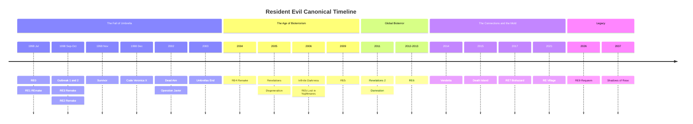
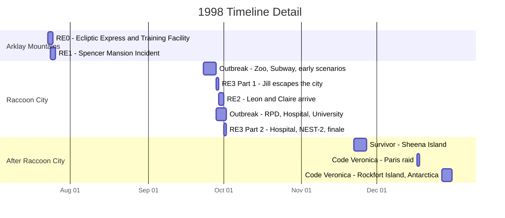
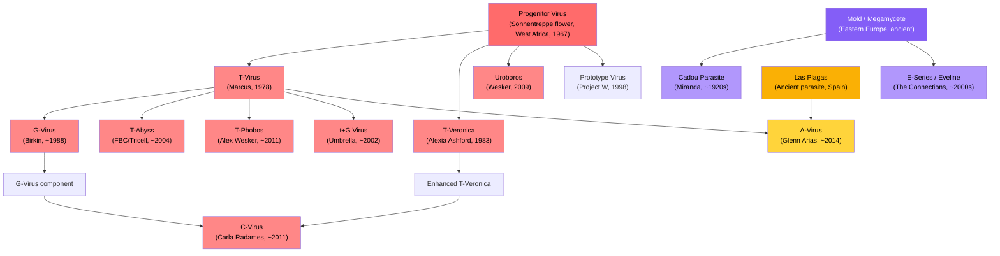

# Resident Evil: Canonical Timeline

A comprehensive reference documenting the canonical story of every Resident Evil game, DLC, and CG animated project, ordered by in-universe chronology. Each entry includes the full plot, key characters, biological threats, and lore significance.

English &nbsp;|&nbsp; [Português (Brasil)](README.pt-br.md) &nbsp;|&nbsp; [Português (Portugal)](README.pt-eu.md) &nbsp;|&nbsp; [Italiano](README.it.md) &nbsp;|&nbsp; [Español](README.es.md)

Games are ordered by when they happen in the story, not when they were released. Remakes are the preferred source for story details. All canonical spin-offs, DLCs, and CG animated films are included. Non-canonical entries are listed separately for reference.

## Table of Contents

- [Timeline Overview](#timeline-overview)
- [The Raccoon City Incident: A Closer Look](#the-raccoon-city-incident-a-closer-look)
- [Prehistory: The Seeds of Bioterror](#prehistory-the-seeds-of-bioterror-19191998)
- **The Arklay Mountains and Raccoon City (1998)**
  - [Resident Evil 0](#resident-evil-0)
  - [Resident Evil (REmake)](#resident-evil-remake)
  - [Resident Evil Outbreak / File #2](#resident-evil-outbreak--file-2)
  - [Resident Evil 3 (Remake)](#resident-evil-3-remake)
  - [Resident Evil 2 (Remake)](#resident-evil-2-remake)
  - [Resident Evil Survivor](#resident-evil-survivor)
  - [Resident Evil Code: Veronica X](#resident-evil-code-veronica-x)
- **The Fall of Umbrella (2002-2004)**
  - [Resident Evil Dead Aim](#resident-evil-dead-aim)
  - [Darkside Chronicles: Operation Javier](#darkside-chronicles-operation-javier)
  - [Umbrella Chronicles: Umbrella's End](#umbrella-chronicles-umbrellas-end)
  - [Resident Evil 4 (Remake)](#resident-evil-4-remake)
- **The Rise of Bioterrorism (2005-2009)**
  - [Resident Evil Revelations](#resident-evil-revelations)
  - [Degeneration (CG Film)](#degeneration-cg-film)
  - [Infinite Darkness (CG Series)](#infinite-darkness-cg-series)
  - [Resident Evil 5](#resident-evil-5)
- **Global Bioterror (2011-2013)**
  - [Resident Evil Revelations 2](#resident-evil-revelations-2)
  - [Damnation (CG Film)](#damnation-cg-film)
  - [Resident Evil 6](#resident-evil-6)
- **The Connections and the Mold (2014-2021)**
  - [Vendetta (CG Film)](#vendetta-cg-film)
  - [Death Island (CG Film)](#death-island-cg-film)
  - [Resident Evil 7: Biohazard](#resident-evil-7-biohazard)
  - [Resident Evil Village](#resident-evil-village)
- **Legacy (2026-2037)**
  - [Resident Evil 9: Requiem](#resident-evil-9-requiem)
  - [Shadows of Rose](#shadows-of-rose)
- [Viral Genealogy](#viral-genealogy)
- [Key Organizations](#key-organizations)
- [Character Appearances](#character-appearances)
- [Canon Status Reference](#canon-status-reference)

---

## Timeline Overview

> The 1998 cluster is deceptively dense. Seven canonical entries take place within six months, with four of them overlapping during the September-October Raccoon City destruction. The gantt chart below zooms into this period.

---

## The Raccoon City Incident: A Closer Look

Key overlaps to note:

- **RE0 ends where RE1 begins.** Rebecca finishes fighting the Queen Leech and walks directly to the Spencer Mansion.
- **RE3 Part 1 starts before RE2.** Jill begins her escape on September 28, a full day before Leon and Claire arrive on September 29.
- **RE2, RE3, and Outbreak all overlap** during September 29 to October 1. Different characters experience the same catastrophe from different locations across the city.
- **Raccoon City is destroyed on October 1** by a U.S. government thermobaric missile strike, ending RE3 and Outbreak simultaneously.

---

## Prehistory: The Seeds of Bioterror (1919-1998)

The events of the Resident Evil series trace back over a century. Understanding this backstory is essential, as it connects the origins of every major virus, organization, and antagonist.

**~Ancient times.** The Megamycete, a massive fungal superorganism, develops in a cave system in Eastern Europe. It absorbs and stores the consciousness and DNA of organisms that die in its vicinity. Separately, the Progenitor Virus evolves naturally within the Sonnentreppe flowers in West Africa, in a cave system sacred to the Ndipaya people. The parasitic organism Las Plagas thrives in caves beneath what will become Salazar Castle in rural Spain until the 1st Count Salazar seals them away in the 15th century.

**1909.** Eva is born to a woman known only as Mother Miranda in a remote Eastern European village.

**1919.** The Spanish flu ravages Miranda's village and kills Eva at age 10. Consumed by grief, Miranda wanders into a cave and discovers the Megamycete. Upon contact, she experiences visions of hundreds of absorbed consciousnesses. She realizes the fungus can store and potentially restore a mind. She sacrifices Eva's body to the Megamycete and dedicates her life to finding a compatible vessel for Eva's resurrection. Over the following decades, Miranda experiments on villagers using the Mold, creating the Cadou parasite by infecting nematode worms with fungal material.

**1950s.** A young medical student named Oswell E. Spencer is caught in a snowstorm in the European mountains. Miranda rescues him and nurses him back to health. Spencer learns about her Mold research and becomes fascinated by the concept of using biological agents to reshape humanity. He later uses Miranda's ideas as the philosophical foundation for his own ambitions: to become a god by controlling human evolution.

**December 1966.** Spencer, Edward Ashford, and James Marcus organize an expedition to West Africa. In early 1967, they isolate the Progenitor Virus from the Sonnentreppe flowers in the Garden of the Sun.

**1967-1968.** Spencer commissions architect George Trevor to design a mansion in the Arklay Mountains near Raccoon City. The mansion's true purpose is to conceal an underground bioweapons laboratory. After completion, Spencer kidnaps the Trevor family and uses them as Progenitor test subjects. Jessica Trevor dies from the Type-A strain. Her daughter Lisa Trevor, age 14, survives the Type-B strain and becomes effectively immortal. Lisa endures decades of continuous experimentation, becoming a grotesque, tragic figure who wanders the mansion grounds wearing the faces of dead researchers, searching for her mother.

**1968.** Spencer, Ashford, and Marcus found Umbrella Pharmaceuticals. Publicly a pharmaceutical conglomerate spanning cosmetics, chemicals, machinery, and consumer products. Secretly a front for bioweapons research funded by government contracts. Edward Ashford dies from accidental Progenitor exposure shortly after founding, leaving the Ashford family branch weakened.

**1971.** Alexander Ashford, Edward's son, attempts to restore his family's prestige through Project CODE: Veronica. He extracts DNA from the embalmed body of his brilliant ancestor Veronica Ashford and creates twin clones: Alexia, a prodigy who inherits Veronica's genius, and Alfred, a byproduct of average intelligence.

**January 13, 1978.** James Marcus achieves the T-Virus breakthrough at the Executive Training Facility by combining the Progenitor Virus with leech DNA. The Tyrant Virus, or T-Virus, is born. It causes necrosis, zombification, and extreme mutagenesis in most hosts, but rare compatible subjects develop superhuman abilities.

**1981.** The 10-year-old Alexia Ashford becomes Chief Researcher at Umbrella's Antarctic facility. She creates the T-Veronica virus by combining the Progenitor Virus with queen ant genes and an ancient virus. The virus grants its host pyrokinetic abilities and insect control, but only if the host undergoes 15 years of cryogenic adaptation. Immediate injection causes uncontrolled mutation.

**1983.** Alexia injects her father Alexander with T-Veronica as a test subject, transforming him into the creature Nosferatu. She chains him in the facility's basement. She then injects herself and enters cryogenic sleep, to awaken 15 years later with the virus perfectly bonded to her body. Alfred is left alone to manage the Ashford legacy, slowly descending into madness.

**1988.** Spencer grows paranoid about Marcus's ambitions and independence. He orders Marcus assassinated. Albert Wesker and William Birkin, Marcus's own star pupils who have been secretly reporting to Spencer for years, lead a USS squad into Marcus's laboratory. Marcus is shot and his body dumped in the sewers. Birkin seizes Marcus's T-Virus research and takes credit for it. Unknown to anyone, a Queen Leech enters Marcus's corpse, absorbs his memories, and begins a decade-long process of regeneration.

**Early 1990s.** William Birkin begins developing the G-Virus at the NEST laboratory beneath Raccoon City, derived from unique mutations observed in Lisa Trevor's body. Unlike the T-Virus, which creates zombies, the G-Virus causes continuous uncontrolled mutation and enables parasitic reproduction through embryo implantation.

**1996.** Wesker is embedded as captain of S.T.A.R.S. Alpha Team in the Raccoon City Police Department, while secretly working for Umbrella and making arrangements with a rival organization.

**May 11, 1998.** A T-Virus epsilon strain leak at the Arklay Laboratory triggers an outbreak. Researchers are infected. Cerberus escape into the forest. Over the following weeks, a series of bizarre "cannibal murders" in the Arklay Mountains attracts public and police attention. The Raccoon City Police Department creates the S.T.A.R.S. special tactics unit to investigate.

---

## The Arklay Mountains and Raccoon City (1998)

### Resident Evil 0

**In-Universe Dates:** July 23-24, 1998
**Location:** Ecliptic Express train, Umbrella Executive Training Facility, Arklay Mountains
**Protagonists:** Rebecca Chambers, S.T.A.R.S. Bravo Team medic, 18 years old and the youngest S.T.A.R.S. member. Billy Coen, former U.S. Marine Second Lieutenant convicted of massacring 23 people in Africa, being transported to his execution when the convoy was attacked. Billy claims he was framed by his commanding officer.
**Antagonists:** Queen Leech, the reanimated consciousness of James Marcus. Proto Tyrant, an early failed Tyrant model.

#### Plot Summary

On the evening of July 23, 1998, the Queen Leech unleashes a swarm of leeches on the Ecliptic Express, an Umbrella-owned train traveling through the Arklay Mountains. All passengers and staff are killed or infected with the T-Virus. The attack is the Queen Leech's revenge against Umbrella for Marcus's murder a decade earlier.

S.T.A.R.S. Bravo Team's helicopter malfunctions and crash-lands in Raccoon Forest while en route to investigate the cannibal murders. The team splits up to search the area. They discover a wrecked military police transport with dead drivers. The prisoner, Billy Coen, is missing.

Rebecca discovers the halted Ecliptic Express and boards it alone, finding it overrun with zombies and leeches. She encounters Billy, who has also taken refuge on the train. Despite her orders to arrest him, Rebecca reluctantly cooperates with Billy to survive the infested train. Bravo Team member Edward Dewey stumbles aboard, badly wounded by Cerberus, and dies after warning Rebecca about the dangers outside.

The Queen Leech, disguised as a young version of James Marcus, reactivates the train. Billy and Rebecca desperately apply the emergency brakes, but the train derails and crashes into an underground station connected to the Umbrella Executive Training Facility.

The Training Facility was built in the 1960s to educate gifted teenagers recruited by Umbrella. Evidence throughout the facility reveals a darker truth: Marcus used the students as test subjects for his leech and T-Virus experiments, turning them into zombies. The facility's basement contains a torture chamber covered in dried blood.

Rebecca and Billy piece together Marcus's history through scattered documents. They learn that Marcus, alongside Spencer and Ashford, discovered the Progenitor Virus in the 1960s. Marcus combined it with leech DNA to create the T-Virus on January 13, 1978. They find evidence that Spencer ordered Marcus's assassination in 1988, carried out by his own protegees Wesker and Birkin, who then stole his research.

The pair navigate through a dilapidated church and descend into Marcus's hidden underground laboratory. The creature posing as young Marcus reveals itself as the Queen Leech, a massive, mutating organism that has spent ten years regenerating using Marcus's corpse as a host. It has absorbed Marcus's memories, personality, and thirst for revenge against Umbrella.

In the final battle, Rebecca discovers the Queen Leech is vulnerable to direct sunlight. She opens the facility's roof while Billy draws the creature's attention. Exposed to sunlight, the Queen Leech weakens, and Billy destroys it with a magnum revolver. William Birkin, monitoring the situation remotely, triggers the facility's self-destruct system.

As the complex detonates, Rebecca makes a decision that defines her character: she fakes Billy's death in her official report, telling authorities he perished in the mountains. She keeps his dog tags as "proof." Billy disappears into the forest, a free man. Rebecca heads toward the Spencer Mansion to rendezvous with her Bravo Team colleagues, walking directly into the events of Resident Evil 1.

#### Key Biological Threats

- **Queen Leech:** A leech that entered Marcus's corpse, absorbed his memories, and developed shapeshifting abilities. It can mimic Marcus's human appearance and control swarms of leeches telepathically. In its true form, it is a massive amorphous organism vulnerable to UV light.
- **Mimicry Marcus:** Humanoid forms composed of hundreds of leeches acting as a collective, mimicking Marcus's shape.
- **Proto Tyrant:** An early, unstable Tyrant prototype stored in Marcus's laboratory. Less powerful and less stable than the T-002 model that appears in RE1.
- **Eliminator:** T-Virus infected primates with enhanced aggression and strength.
- **Stinger:** A massive T-Virus mutated scorpion encountered in the Training Facility.
- **Centurion:** A giant centipede created through T-Virus exposure.

#### Lore Significance

RE0 is the chronological starting point of the playable series. It establishes the origin of the T-Virus, the internal power dynamics within Umbrella, and the betrayals that set the entire franchise in motion. The game reveals that Umbrella's three co-founders each had distinct agendas: Spencer sought power, Ashford sought prestige, and Marcus sought scientific breakthroughs. Spencer's willingness to murder his own co-founder and steal his research establishes the ruthlessness that defines Umbrella's corporate culture.

Rebecca's journey from the Training Facility directly into the Spencer Mansion provides the narrative bridge to RE1. The game also explains why Bravo Team members are scattered throughout the mansion area when Alpha Team arrives.

---

### Resident Evil (REmake)

**In-Universe Dates:** July 24-25, 1998
**Location:** Spencer Mansion and Arklay Laboratory, Arklay Mountains near Raccoon City
**Protagonists:** Chris Redfield, S.T.A.R.S. Alpha Team point man. Jill Valentine, S.T.A.R.S. Alpha Team rear security, former Delta Force operative. Barry Burton, Alpha Team weapons specialist, being blackmailed by Wesker in Jill's scenario. Rebecca Chambers, arriving from RE0, assists Chris in his scenario.
**Antagonists:** Albert Wesker, S.T.A.R.S. Alpha Team captain and secret Umbrella double agent. Tyrant T-002, Umbrella's prototype super-soldier. Lisa Trevor, a tragic, near-unkillable test subject who has been experimented on since 1967.

#### Plot Summary

After Bravo Team fails to report in, Alpha Team is dispatched on July 24, 1998. The team consists of Chris Redfield, Jill Valentine, Barry Burton, Albert Wesker, Joseph Frost, and helicopter pilot Brad Vickers. Upon landing in the Arklay Forest, they discover the wreckage of Bravo Team's helicopter. Joseph Frost is attacked and killed by Cerberus zombie dogs. Brad Vickers panics and flies the helicopter away, stranding the remaining four on the ground. Chris, Jill, Barry, and Wesker flee into the Spencer Mansion.

Wesker orders the team to split up and investigate. In Jill's campaign, she works alongside Barry, who provides weapons and assistance while secretly reporting to Wesker. Wesker is blackmailing Barry by threatening his family. In Chris's campaign, he explores alone until finding Rebecca Chambers, fresh from the events of RE0, who assists him with her medical expertise.

The mansion is a death trap. The ornate halls are filled with zombies, traps designed by the mansion's architect, and increasingly dangerous creatures. The team discovers the bodies and journals of dead Bravo Team members scattered throughout. Kenneth Sullivan is found being devoured by a zombie. Forest Speyer lies dead on the balcony, killed by crows and rigged with explosives. Richard Aiken, poisoned by the giant snake Yawn, dies despite Rebecca's attempts to save him in Chris's scenario.

Unique to the REmake, zombies that are killed but not properly disposed of reanimate as Crimson Heads: faster, more aggressive mutants with claws and heightened predatory instincts. The only way to prevent this is to burn the corpses or decapitate them. This mechanic adds a persistent resource management tension to exploring the mansion.

The guardhouse, a separate building connected to the mansion, houses the Aqua Ring shark tank containing Neptune, a T-Virus infected great white shark, and the massive Plant 42, a mutant plant that has consumed the building's structure. Players learn through researcher journals about the various experiments conducted at the facility and the gradual breakdown of safety protocols that preceded the outbreak.

The REmake introduces Lisa Trevor's story. Players encounter her in the cabin area and underground tunnels. She cannot be permanently killed. Her diary entries, written in increasingly deteriorating handwriting over decades, reveal the horror of her captivity. In 1967, at age 14, she and her mother Jessica were kidnapped by Spencer and used as Progenitor test subjects. Jessica died. Lisa survived every virus they injected her with, including the NE-alpha parasite later used to create Nemesis. The G-Virus was eventually isolated from her blood. By 1998, she is a grotesque creature wearing the peeled faces of researchers she killed, perpetually searching for her mother's face.

Beneath the mansion lies the Arklay Laboratory, Umbrella's underground research facility where the T-Virus BOW program operates. The laboratory contains development logs, cryogenic storage for experimental subjects, and the crown jewel of Umbrella's research: the Tyrant Project.

In the laboratory, Wesker reveals himself as a traitor. He has been an Umbrella agent all along, and the entire S.T.A.R.S. operation was designed to gather combat data on BOWs fighting trained soldiers. He has been recording everything. In Jill's scenario, his blackmail of Barry is revealed, and Barry ultimately turns against Wesker. Wesker activates the Tyrant T-002 from its cryogenic pod, a towering, grey-skinned humanoid with a massive claw and an exposed heart. The Tyrant impales Wesker through the abdomen, seemingly killing him, then turns on the remaining S.T.A.R.S. members.

What no one knows is that Wesker injected himself with a special virus provided by William Birkin before entering the mansion. The virus, part of Spencer's Project W, is designed to grant superhuman abilities to genetically compatible hosts. Wesker dies and is resurrected by the virus while the others fight for survival.

After defeating the Tyrant in the lab, the survivors activate the emergency self-destruct system. They race through the collapsing facility to the mansion's rooftop helipad. The Tyrant, now mutated into its Super Tyrant form with an exposed heart and massive claws, bursts through the helipad floor for a final confrontation. Brad Vickers, who has been circling the area in the helicopter, drops a rocket launcher. The Super Tyrant is destroyed.

Chris, Jill, Barry, and Rebecca escape in the helicopter as the Spencer Mansion and its underground laboratory are consumed by the explosion. The four survivors resolve to expose Umbrella's crimes. Chris leaves for Europe shortly after to investigate Umbrella's headquarters, a decision that will bring his sister Claire to Raccoon City two months later looking for him.

#### Key Biological Threats

- **Tyrant T-002:** Umbrella's prototype super-soldier, the pinnacle of their Tyrant Project. A humanoid BOW with superhuman strength, speed, and a massive bone claw extending from its right arm. Its exposed heart is its weakness. When sufficiently damaged, it mutates into the faster, more aggressive Super Tyrant form.
- **Lisa Trevor:** Not a traditional antagonist but an unkillable presence. Decades of viral experimentation have made her effectively immortal. She absorbed the NE-alpha parasite that would later be used in the Nemesis Project. Her body was the source material for the G-Virus.
- **Crimson Heads:** Zombies that reanimate if not burned or decapitated. Faster and more lethal than standard zombies, with claws and heightened aggression. An REmake-exclusive mechanic.
- **Hunters MA-121 Alpha:** Reptilian-human hybrid BOWs created by grafting reptile DNA to human embryos using the T-Virus. Capable of decapitating victims with a single swipe. They infiltrate the mansion after the guardhouse section.
- **Yawn:** A massive T-Virus mutated snake that guards the mansion's upper floors. Its venom is lethal without antidote.
- **Neptune:** T-Virus infected great white sharks in the Aqua Ring.
- **Plant 42:** A massive mutant plant in the guardhouse, vulnerable to the V-JOLT chemical compound.
- **Cerberus:** T-Virus infected Dobermans roaming the mansion grounds and forest.

#### Lore Significance

The Mansion Incident is the inciting event of the entire Resident Evil franchise. Every subsequent game traces its roots to what happens here. The survivors become the core anti-Umbrella fighters: Chris and Jill co-found the BSAA, Barry trains the next generation of operatives, and Rebecca continues bioweapons research from an academic angle.

Wesker's survival and transformation from human agent to superhuman threat establishes him as the series' overarching antagonist through RE5. His injection of the Project W virus is the first hint of Spencer's eugenics program, a thread that takes seven games to fully unravel.

The Raccoon City authorities, under Umbrella's influence, cover up the Mansion Incident. S.T.A.R.S. is quietly disbanded. The survivors' warnings go unheeded. This cover-up directly enables the T-Virus outbreak that consumes the city two months later. The Raccoon City Police Chief, Brian Irons, is on Umbrella's payroll and actively suppresses evidence.

Lisa Trevor's story is the REmake's most significant addition to the lore. Her decades of suffering reveal the depth of Umbrella's cruelty and provide the origin of both the G-Virus and the NE-alpha parasite used in the Nemesis. She is the connecting thread between the Progenitor Virus, the T-Virus, the G-Virus, and the Nemesis Project.

---

### Resident Evil Outbreak / File #2

**In-Universe Dates:** September 23 to October 1, 1998
**Location:** Various locations across Raccoon City: J's Bar, Raccoon Zoo, subway system, Raccoon General Hospital, RPD Police Station, Raccoon University, Umbrella waste disposal facility
**Protagonists:** Eight Raccoon City civilians: Kevin Ryman, RPD police officer. Mark Wilkins, security guard and Vietnam veteran. Jim Chapman, subway employee. George Hamilton, surgeon at Raccoon General Hospital. David King, plumber and handyman. Alyssa Ashcroft, investigative journalist. Yoko Suzuki, university student and former Umbrella employee with suppressed memories. Cindy Lennox, waitress at J's Bar.
**Antagonists:** William Birkin in G-mutant form. Thanatos, an unauthorized Tyrant created by Raccoon University researcher Greg Mueller. Nyx, a massive amorphous BOW stored at an Umbrella dockyard. Nikolai Ginovaef, UBCS monitor working for Umbrella.

#### Plot Summary

The Outbreak games depict the Raccoon City disaster through the eyes of ordinary citizens rather than trained operatives. The scenarios span the full duration of the outbreak, from the initial infection of the water supply to the city's destruction by missile strike.

**"Wild Things," September 23.** The earliest scenario chronologically. The T-Virus has reached the Raccoon Zoo, mutating the animals. Survivors face zombie lions, a zombie elephant named Oscar, and infected hyenas. An evacuation helicopter crashes, forcing the group to find an alternative escape. This scenario shows how early the infection spread to the city's infrastructure.

**"Outbreak," September 24.** The T-Virus outbreak reaches J's Bar in uptown Raccoon City, where many of the eight protagonists are regulars or employees. Zombies break through the windows and doors. The survivors barricade the entrances, fight through the horde, and escape through the rooftops as the RPD detonates explosives to clear the streets. This introductory scenario is the first time the eight civilians cross paths.

**"Underbelly," September 25-26.** The survivors attempt to flee via the Raccoon City subway system. A train crash disturbs a nest of parasites, including the Giga Bite, a massive mutant flea. The group navigates the flooded tunnels and either escapes on a departing train or through ventilation shafts.

**"Below Freezing Point," September 25-26.** Led by Yoko Suzuki, whose fragmented memories of working at Umbrella surface throughout the scenario, the group infiltrates Umbrella's underground laboratory beneath the city, the same NEST facility from RE2. They encounter Monica, a rogue Umbrella virologist attempting to steal research data. Monica is killed by the mutated William Birkin in his G-creature form. The survivors escape through the lab's emergency tunnels.

**"The Hive," September 26-27.** Raccoon General Hospital, the same hospital that appears in RE3, is under attack by a colony of giant mutant leeches. A Leech Man entity stalks the corridors. The survivors destroy the Leech Queen inhabiting the hospital's basement to escape.

**"Hellfire," September 27-28.** A fire engulfs an old hotel in Raccoon City. The survivors navigate the burning, collapsing structure while fighting zombies. A massive mutant creature prowls the hotel. The scenario illustrates how the city's infrastructure is disintegrating on multiple fronts simultaneously.

**"Flashback," September 28-29.** The group takes refuge in a cabin in Raccoon Forest, where they meet Al Lester, a man who promises to guide them to safety. Al is actually deranged. His wife Dorothy was experimented on in a nearby abandoned hospital and merged with a mutant plant. Al lures victims to feed the plant, hoping to keep Dorothy alive. The survivors destroy the plant's core and escape the forest.

**"Desperate Times," September 28-29.** The survivors join the remaining police officers defending the RPD Police Station, the same building from RE2. Lieutenant Marvin Branagh, the wounded officer who later gives Leon information in RE2, leads the defense. The barricades eventually fail, and the survivors escape through the sewers as the station is overrun.

**"Decisions, Decisions," October 1.** The final and most significant scenario. George Hamilton leads the group to Raccoon University to find his colleague Peter Jenkins, who was developing a T-Virus vaccine called "Daylight." They discover Peter was murdered by former Umbrella researcher Greg Mueller, who wanted to suppress the vaccine and sell his own unauthorized Tyrant creation. Mueller is assassinated by Nikolai Ginovaef, the UBCS monitor from RE3, who is eliminating witnesses and collecting data. Mueller's Tyrant, Thanatos, is released. The survivors synthesize the Daylight vaccine themselves, defeat Thanatos after it mutates into the more powerful Thanatos R form, and escape by helicopter moments before the U.S. government's thermobaric missile obliterates Raccoon City on October 1.

**"End of the Road," October 1.** David King leads the group to an Umbrella waste disposal facility on the city's outskirts. They encounter scientists attempting to retrieve a cure. Those who escape by highway face Nyx, a massive amorphous BOW that can absorb other organisms, including a T-103 Tyrant. This scenario provides one of the final glimpses of Raccoon City before its destruction.

#### Key Biological Threats

- **Thanatos:** An unauthorized Tyrant created by Greg Mueller at Raccoon University using stolen Umbrella research. Distinct from Umbrella's official Tyrant models. Its mutated form, Thanatos R, is faster and more aggressive.
- **Nyx:** A massive amorphous BOW stored at an Umbrella waste disposal dockyard. Capable of absorbing and incorporating other organisms into its body mass, including a T-103 Tyrant. One of the most dangerous BOWs encountered in the Raccoon City incident.
- **William Birkin G-form:** Encountered in the "Below Freezing Point" scenario in the same NEST lab from RE2.
- **Oscar:** A T-Virus infected elephant at the Raccoon Zoo.
- **Giga Bite:** A massive mutant flea in the subway system.
- **Leech Man:** A humanoid entity composed of mutant leeches infesting Raccoon General Hospital.

#### Lore Significance

The Outbreak games prove that Raccoon City's destruction was not just the story of a few heroes. Thousands of civilians experienced the outbreak, and small groups fought to survive across every corner of the city simultaneously. The "Daylight" vaccine represents an alternative T-Virus cure that, had it been mass-produced, could have changed the course of events.

Yoko Suzuki's suppressed Umbrella memories hint that Umbrella experimented on its own employees and erased their awareness. Alyssa Ashcroft's investigative journalist background becomes directly relevant to RE9: Requiem, where her daughter Grace Ashcroft is a protagonist.

The scenarios overlap with RE2 and RE3, placing the player in locations that Leon, Claire, and Jill visit, sometimes at the same time. Marvin Branagh's defense of the RPD in "Desperate Times" shows the hours before Leon and Claire arrive to find the station already fallen.

---

### Resident Evil 3 (Remake)

**In-Universe Dates:** September 28 to October 1, 1998. Begins approximately 24 hours before RE2. The first half predates RE2; the second half occurs after RE2's main events conclude.
**Location:** Raccoon City streets, subway system, Clock Tower, Raccoon General Hospital, NEST-2 laboratory
**Protagonists:** Jill Valentine, former S.T.A.R.S. Alpha Team member and survivor of the Mansion Incident. Since July she has been trying to expose Umbrella's crimes but has been stonewalled by the company's influence over local authorities. Carlos Oliveira, Corporal in Umbrella's Biohazard Countermeasure Service, a former South American guerrilla fighter who joined the UBCS without knowing the full extent of Umbrella's crimes.
**Antagonists:** Nemesis-T Type, a T-103 Tyrant implanted with a NE-alpha parasite, granting it intelligence, speech, and the ability to follow complex orders. Its mission: hunt and kill all surviving S.T.A.R.S. members to demonstrate the parasite's combat effectiveness. Nikolai Zinoviev, UBCS Sergeant and secret Umbrella "Supervisor" planted to collect BOW combat data.

#### Plot Summary

The game opens with Jill having a nightmare in her apartment, illustrating the PTSD she has suffered since the Mansion Incident two months earlier. She awakens to a phone call warning her about a new threat. Before she can react, Nemesis crashes through her apartment wall.

Nemesis is Umbrella's most sophisticated bioweapon to date: a T-103 Tyrant implanted with the NE-alpha parasite, which forms its own brain within the host's nervous system. This grants the creature intelligence, tactical reasoning, the ability to use weapons, and limited speech. It can say one word: "S.T.A.R.S." Its mission is to eliminate all surviving S.T.A.R.S. members as a field demonstration of the NE-alpha parasite's military potential. Jill, as one of four known survivors, is the primary target.

Jill barely escapes the initial encounter and flees into the streets. She witnesses Brad Vickers, her former S.T.A.R.S. colleague and RE1 helicopter pilot, being overwhelmed by zombies. Brad holds a door shut to buy Jill time and is bitten. He dies from the infection shortly after. His zombified body is later encountered by Carlos at the RPD.

Jill meets the surviving UBCS mercenaries: Carlos Oliveira, the wounded platoon leader Mikhail Viktor, and the suspicious Nikolai Zinoviev. The UBCS were deployed by Umbrella to handle the outbreak, but most squads have been wiped out. The survivors plan to escape via the subway system.

Jill and Carlos work to restore power to the subway. Jill navigates the infested city, collecting parts and solving problems while being periodically stalked by Nemesis. The creature is relentless, appearing at unpredictable moments, sometimes wielding a rocket launcher. The encounters escalate in intensity, with Nemesis adapting to Jill's tactics.

When Nemesis boards the subway car during their escape, Mikhail Viktor makes a heroic sacrifice. The wounded platoon leader detonates a grenade at point-blank range, destroying the car and stalling Nemesis. Mikhail dies in the explosion. The damaged subway crashes near the Clock Tower.

At the Clock Tower, Jill and Carlos attempt to signal a rescue helicopter. A helicopter arrives, but Nemesis, having survived and now shedding its coat to reveal a more organic, tentacle-covered form, destroys it. During the ensuing battle, Nemesis infects Jill with the T-Virus through a tentacle strike. Jill collapses and falls into a coma.

Carlos carries Jill to Raccoon General Hospital and desperately searches for a cure. The hospital is overrun with Hunters and zombie staff. Carlos fights through the wards and discovers a T-Virus vaccine synthesized by Umbrella researchers. He also encounters Nikolai, who reveals his true role as a paid "Supervisor," a monitor planted by Umbrella to covertly collect BOW combat data during the outbreak. Nikolai has been eliminating other monitors and survivors to ensure he alone possesses the valuable data. Carlos confronts him but Nikolai escapes.

The remake gives Carlos an expanded gameplay section at the RPD Police Station, overlapping with RE2's setting. Carlos fights through the same halls that Leon and Claire navigate, at roughly the same time, providing a different perspective on the station's fall.

Carlos administers the vaccine, curing Jill. She awakens on October 1, the day the U.S. government has authorized a thermobaric missile strike on Raccoon City. Radio broadcasts announce the impending destruction. The clock is ticking.

The cured Jill makes her way to NEST-2, an Umbrella laboratory connected to the NEST facility from RE2. She discovers it has been used for further BOW development and viral research. Nikolai reappears, attempting to execute Jill on the facility's helipad and use Carlos as bait to collect final combat data. Carlos immobilizes Nikolai, and Jill puts an end to his schemes.

Nemesis, now mutated into a massive quadrupedal form barely recognizable as having once been humanoid, attacks Jill in NEST-2. She immerses the creature in acid and finishes it with a railgun, destroying the bioweapon that has stalked her across the city.

Jill and Carlos reach the helipad and are extracted just as the thermobaric missile hits. Raccoon City is completely obliterated. Every remaining infected, every piece of Umbrella's evidence, and every civilian who could not escape is annihilated. The U.S. government, under the direction of National Security Advisor Derek C. Simmons, orchestrates a cover-up of their own involvement.

#### Key Biological Threats

- **Nemesis-T Type:** The most advanced Tyrant model at the time of the Raccoon City incident. A T-103 implanted with the NE-alpha parasite, which forms a secondary brain. Capable of speech, weapon use, tactical planning, and relentless pursuit. Progresses through multiple mutation stages: trench-coated humanoid, exposed organic form with tentacles, and massive quadrupedal creature. The NE-alpha parasite was originally tested on Lisa Trevor, who absorbed it.
- **Drain Deimos / Brain Suckers:** Giant mutant flea-like parasites that drain cerebrospinal fluid from victims.
- **Hunters Beta and Gamma:** Advanced Hunter variants. Gamma Hunters are aquatic, encountered in the sewers. Beta Hunters are encountered at the hospital.
- **Grave Digger:** A massive T-Virus mutated worm in the city's park area, present in the original version.
- **Pale Heads:** Remake-exclusive zombies with extreme regenerative abilities, found in NEST-2.

#### Lore Significance

RE3 runs concurrent with RE2 and shows the other side of Raccoon City's final days. While Leon and Claire navigate the RPD and NEST underground, Jill fights Nemesis across the city's streets, subway, and hospitals. Carlos's section at the RPD directly overlaps with RE2's events.

The Nemesis Project demonstrates Umbrella's escalating ambitions. The NE-alpha parasite gives a Tyrant intelligence and mission focus, a significant leap from the mindless T-002 in RE1 or the obedient-but-simple Mr. X in RE2. The combat data collected during Nemesis's pursuit of Jill is valuable to Umbrella regardless of the creature's survival.

Umbrella's deployment of the UBCS reveals the company's willingness to sacrifice its own employees. The UBCS mercenaries are expendable assets, recruited from war criminals and desperate soldiers worldwide. The Supervisors hidden among them exist solely to document how BOWs perform against trained humans in live combat.

The destruction of Raccoon City is the pivotal event of the franchise. It triggers congressional investigations, international outcry, and ultimately the legal proceedings that destroy Umbrella Corporation. Jill's survival and her firsthand knowledge of both the Mansion Incident and the Raccoon City destruction make her one of the most important witnesses against Umbrella. She and Chris go on to co-found the BSAA.

---

### Resident Evil 2 (Remake)

**In-Universe Dates:** September 29 to October 1, 1998
**Location:** Raccoon City outskirts, RPD Police Station, Raccoon City sewers, NEST underground laboratory
**Protagonists:** Leon S. Kennedy, a 21-year-old rookie police officer arriving for his first day at the RPD. He overslept at a motel on the city's outskirts after a breakup and arrived late, only to find the city overrun. Claire Redfield, 19-year-old college student and younger sister of Chris Redfield, arriving in Raccoon City on her motorcycle to search for Chris, who has not contacted her since the Mansion Incident. Ada Wong, a spy working for a rival organization, posing as an FBI agent looking for a reporter named Ben Bertolucci while secretly pursuing a G-Virus sample. Sherry Birkin, 12-year-old daughter of William and Annette Birkin, hiding in the police station.
**Antagonists:** William Birkin / "G," former Chief Researcher at NEST and creator of the G-Virus, who injected himself with his creation after being shot by Umbrella's USS and now mutates through five increasingly grotesque stages. Mr. X / T-00, a mass-produced T-103 Tyrant deployed by Umbrella to recover the G-Virus sample and eliminate survivors. Chief Brian Irons, the corrupt RPD Chief who has been on Umbrella's payroll for years, suppressing evidence of their crimes.

#### Plot Summary

On September 22, 1998, one week before the game begins, Umbrella's Security Service led by the operative HUNK raids the NEST laboratory beneath Raccoon City. Their mission: seize the G-Virus from William Birkin, who has been planning to defect to the U.S. military with his research. In the confrontation, USS operatives shoot Birkin multiple times. Left for dead, Birkin injects himself with a G-Virus sample in desperation. The virus reanimates and mutates him into a creature driven by rage and reproductive instinct. He slaughters the USS squad. In the chaos, T-Virus samples spill and are spread through the sewer system by rats. Within days, the city's water supply is contaminated and tens of thousands of citizens are infected.

On the evening of September 29, Leon Kennedy and Claire Redfield arrive in Raccoon City independently. Leon, driving his Jeep, and Claire, on her motorcycle, meet at a gas station on the outskirts when zombies attack. They commandeer a police car and speed toward the RPD building. A zombie in the back seat causes a crash, and a jackknifed tanker truck separates them. They agree to meet at the RPD and take separate routes.

The RPD Police Station, formerly an art museum, is a labyrinthine building with elaborate architecture that now serves as a tomb. Most officers are dead. Lieutenant Marvin Branagh, gravely wounded and fighting the infection, gives Leon a combat knife and critical information before succumbing to the T-Virus and turning. The player is forced to put down the man who just helped them.

Leon encounters Ada Wong, who claims to be searching for reporter Ben Bertolucci. In truth, Ada is a spy working for a rival organization, sent to recover a G-Virus sample. Despite her mission, she develops genuine feelings for Leon over the course of their partnership. Their dynamic blends mutual reliance with mutual deception.

Claire discovers Sherry Birkin hiding in the police station. Sherry's parents, William and Annette, are Umbrella scientists at NEST. Claire takes Sherry under her protection, and their bond becomes one of the series' most enduring relationships.

Chief Brian Irons, the corrupt police chief, is encountered in the RPD's taxidermy room surrounded by his hunting trophies. He has been on Umbrella's payroll for years, suppressing evidence of their illegal activities and obstructing the S.T.A.R.S. survivors' attempts to expose the company. During the outbreak, his sanity deteriorates. In Claire's scenario, Irons kidnaps Sherry. His death comes when William Birkin, driven by G-Virus reproductive instinct, implants a G-embryo in him. The embryo bursts from Irons' body, killing him violently.

An Umbrella helicopter drops a shipping container onto the RPD roof mid-game. The T-00 Tyrant, codenamed Mr. X, emerges and begins methodically stalking the player through the station. Unlike the mindless zombies, Mr. X is mission-oriented: recover the G-Virus pendant and eliminate witnesses. He cannot be permanently stopped, only staggered. The sound of his heavy footsteps echoing through the halls creates persistent tension. In the remake, Mr. X patrols dynamically, following sounds and pursuing the player through multiple rooms.

Both characters eventually navigate from the RPD into the city's sewer system, and from there to NEST, Umbrella's massive underground research facility where the G-Virus was developed. The facility is a high-tech complex filled with laboratories, specimen storage, and the evidence of Birkin's decades of research.

In Leon's scenario, Annette Birkin, William's wife and fellow NEST researcher, reveals Ada's true identity. Ada is not looking for a boyfriend or a reporter. She is a mercenary spy hired to steal the G-Virus. The revelation forces Leon to confront his growing feelings for someone who has been manipulating him. In the climactic scene, Ada holds Leon at gunpoint to demand the G-Virus sample. During the facility's self-destruct sequence, Ada is knocked off a walkway and falls into the darkness. She survives, escaping with a tissue fragment containing G-Virus material.

In Claire's scenario, William Birkin, driven by the G-Virus's reproductive instinct to find genetically compatible hosts, targets his own daughter Sherry. He implants a G-embryo in her. Claire and Annette race to synthesize the DEVIL vaccine from Umbrella's equipment in NEST. Annette, mortally wounded by the mutated William, confirms the vaccine works before dying. Sherry is cured, but the G-Virus exposure leaves her with permanent regenerative abilities that become relevant in RE6.

The NEST facility's self-destruct activates. Leon defeats Mr. X in his final, mutated Super Tyrant form on an elevator platform, using a rocket launcher dropped by Ada from the shadows above. The survivors converge on an underground emergency train. As the train speeds through the tunnel, Birkin in his final G5 form, a massive blob of flesh, teeth, and eyes that has consumed the train's rear section, attacks. The rear car is decoupled, leaving Birkin to be consumed by the facility's explosion.

Leon, Claire, and Sherry emerge from the tunnel on the outskirts of Raccoon City as dawn breaks. They walk down a road away from the burning city. Leon tells Claire he will find a way to stop Umbrella. Claire says she still needs to find Chris. Their paths diverge, but their lives remain intertwined across the series.

HUNK, the only surviving USS operative from the original raid on Birkin, escapes Raccoon City separately with a G-Virus sample secured in a briefcase. His extraction by helicopter from the RPD roof means Umbrella ultimately obtained what they came for, at the cost of an entire city.

#### Key Biological Threats

- **William Birkin / "G":** Progresses through five mutation stages. G1 retains a vaguely human shape with a massive eyeball on the right shoulder and a clawed arm. G2 loses most human features, growing a second pair of arms. G3 is fully monstrous, quadrupedal. G4 is a massive, asymmetric horror. G5 is an amorphous mass of flesh and teeth that consumes everything it touches. Unlike T-Virus mutations, G-Virus mutation is continuous and uncontrollable.
- **Mr. X / T-00:** A mass-produced T-103 Tyrant, more refined than the prototype T-002 from RE1. Deployed in a trench coat and fedora to blend into urban environments. Follows orders, tracks targets, and cannot be permanently killed with conventional weapons. In his Super Tyrant form, the coat tears away to reveal exposed musculature and a massive bone claw.
- **Lickers:** Skinless, blind BOWs that hunt by sound. They are an advanced mutation stage of zombies whose brains have swollen and become exposed. Fast, lethal, and capable of wall-crawling. Their tongues can impale victims from across a room.
- **G-Adults / G-Embryos:** Birkin, driven by G-Virus reproductive instinct, implants parasitic embryos in hosts. Genetically incompatible hosts reject the embryo, which bursts out and grows into a G-Adult: a small, aggressive creature. Compatible hosts, specifically blood relatives, would theoretically produce a perfect G-organism.
- **Giant Alligator:** A massive T-Virus infected alligator in the city sewers. Encountered briefly but memorably.
- **Ivy:** Plant-based BOWs in NEST created by T-Virus exposure. In the remake, they are called Plant 43 and are encountered in the greenhouse section.

#### Lore Significance

RE2 depicts the franchise's defining catastrophe. The Raccoon City outbreak is the event that everything before leads to and everything after responds to. It destroys Umbrella's public reputation, triggers government investigations, and starts the global bioweapons black market.

Leon's experience here transforms him from an idealistic rookie into the hardened government agent he becomes in RE4 and RE6. His complicated relationship with Ada Wong, born in the deception and desperation of Raccoon City, becomes one of the series' longest-running threads.

Claire's bond with Sherry carries forward directly. In RE: Revelations 2, Claire is kidnapped while working for TerraSave. In RE6, Sherry returns as an adult DSO agent, her regenerative abilities a permanent mark of the G-Virus exposure Claire fought to cure.

The G-Virus represents a fundamentally different threat from the T-Virus. While the T-Virus creates controllable zombies and BOWs for military sale, the G-Virus creates an uncontrollable organism driven by pure evolutionary instinct. Birkin's tragedy is that his life's work consumed him literally.

The recovery of G-Virus samples by multiple parties, HUNK for Umbrella, Ada for her employer, creates the conditions for bioweapons proliferation in later games. The C-Virus in RE6 is directly derived from combining G-Virus material with an enhanced T-Veronica strain.

---

### Resident Evil Survivor

**In-Universe Dates:** November 22-26, 1998
**Location:** Sheena Island, a private Umbrella-owned island in Europe
**Protagonists:** Ark Thompson, a private detective and friend of Leon S. Kennedy. He infiltrated Sheena Island undercover as Vincent Goldman, the island's Umbrella commander, to investigate the facility's operations. Lott and Lily Klein, children of an Umbrella researcher who help Ark escape.
**Antagonists:** Vincent Goldman, the real Umbrella commander of Sheena Island. He deliberately triggered a T-Virus outbreak to cover up evidence of his illegal Tyrant mass-production operation. Hypnos-T Type, an advanced Tyrant variant developed on the island.

#### Plot Summary

Sheena Island is Umbrella's secret mass-production facility for Tyrant-class BOWs. The island's population consists of Umbrella employees and their families, along with kidnapped teenagers used as raw material for Tyrant production. The adolescent subjects are selected because their developing brains produce higher levels of the specific hormones needed for Tyrant cultivation.

Ark Thompson, sent by Leon S. Kennedy to investigate, infiltrated the island by posing as the commander Vincent Goldman. When Goldman discovered the infiltration, he released the T-Virus across the island to destroy evidence and eliminate witnesses. The entire population was infected.

Ark survives the initial outbreak but suffers amnesia from a helicopter crash. He wanders the island, gradually recovering his memories while fighting through zombies, Hunters, and Lickers. He discovers the horrifying truth about the Tyrant production line and the kidnapped teenagers.

Ark encounters Lott Klein, the son of an Umbrella researcher, and his younger sister Lily. The children initially distrust Ark but eventually help him navigate the facility. Goldman, having survived his own outbreak, activates the Hypnos-T Type, an advanced Tyrant model developed specifically on Sheena Island. The Hypnos-T is more agile and intelligent than standard Tyrants.

Ark defeats the Hypnos-T Type after it progresses through multiple mutation stages. He, Lott, and Lily escape the island by helicopter as the facility's self-destruct system activates. The island and all evidence of Umbrella's Tyrant mass-production are destroyed.

#### Key Biological Threats

- **Hypnos-T Type:** An advanced Tyrant model created on Sheena Island. More agile and faster than the T-103 series. Named after the Greek god of sleep. Progresses through multiple mutation forms.
- **Cleaners:** Umbrella's armored, gas-mask-wearing soldiers deployed on the island.
- **Undertakers:** Parasitic BOWs that reanimate and control dead bodies.

#### Lore Significance

Survivor reveals the industrial scale of Umbrella's Tyrant production. Sheena Island was a factory, not just a laboratory. The use of kidnapped teenagers as biological raw material demonstrates that Umbrella's cruelty extended far beyond their adult researchers and test subjects. The existence of a dedicated mass-production facility implies that Umbrella had buyers lined up for Tyrant-class BOWs, pointing to a thriving black market that explodes after Umbrella's collapse.

Ark's connection to Leon establishes a network of anti-Umbrella agents operating independently during this period. The game was written by FLAGSHIP, the same team responsible for RE0, lending it canonical weight.

---

### Resident Evil Code: Veronica X

**In-Universe Dates:** December 17, 1998, through late December 1998
**Location:** Umbrella facility in Paris, Rockfort Island in the Southern Ocean, Umbrella Antarctic Research Base
**Protagonists:** Claire Redfield, continuing her search for Chris after escaping Raccoon City. Chris Redfield, who travels to Rockfort Island after receiving Claire's distress message relayed through Leon. Steve Burnside, a fellow prisoner on Rockfort Island, son of a former Umbrella employee who was caught selling company secrets.
**Antagonists:** Alexia Ashford, the genius twin who created T-Veronica and has just awakened from 15 years of cryogenic sleep with the virus perfectly bonded to her body, granting pyrokinetic abilities. Alfred Ashford, her mentally unstable twin brother and commander of Rockfort Island, who has developed a split personality and cross-dresses as Alexia. Albert Wesker, now operating as a free agent with superhuman abilities, seeking a T-Veronica sample for his research.

#### Plot Summary

On December 17, 1998, Claire Redfield infiltrates an Umbrella facility in Paris, still searching for her brother Chris. She is captured by Umbrella security forces.

Ten days later, on December 27, Claire awakens in a cell on Rockfort Island, a remote prison and military base in the Southern Ocean. A T-Virus outbreak has already swept the island, triggered by an attack from Wesker's paramilitary group H.C.F., which assaulted the facility seeking T-Veronica virus samples. The island's prisoners and staff are now zombies.

Claire meets Steve Burnside, a brash young prisoner. Steve's father was an Umbrella employee caught selling company secrets. Umbrella imprisoned the entire family on Rockfort Island as punishment. Steve's father was infected during experiments, and Steve was forced to shoot his own zombified father, leaving deep emotional scars. Despite his bravado, Steve is traumatized and emotionally volatile.

The island is commanded by Alfred Ashford, the 7th generation of the Ashford family. Alfred is deeply unstable. He switches between his own personality and that of his twin sister Alexia, cross-dressing and speaking in her voice. In his delusion, he believes Alexia is still present on the island, issuing orders and watching over him. The reality is that Alexia has been in cryogenic sleep at the Antarctic base since 1983.

Claire and Steve explore the island's military training facility and prison complex. They discover the Ashford family's dark history through portraits, diaries, and secret rooms. They learn about Alexander Ashford's Project CODE: Veronica, which cloned the ancestor Veronica's DNA to produce Alexia and Alfred. They find Alexander himself, still alive as the creature Nosferatu, chained in the facility's basement. Alexia used her own father as a T-Veronica test subject in 1983, before injecting herself and entering cryogenic sleep. Alexander has been suffering in this grotesque state for fifteen years. Claire and Steve fight and kill Nosferatu on the facility's rooftop during a snowstorm.

Claire and Steve escape Rockfort Island via a seaplane, but Alfred, in a final act, redirects the autopilot to the Antarctic Umbrella facility. At the Antarctic base, they find another T-Virus outbreak underway. They fatally wound Alfred, who staggers to the cryo-chamber and, with his dying act, releases Alexia from her 15-year sleep. Alexia awakens with the T-Veronica virus perfectly integrated into her body. She is calm, controlled, and immensely powerful. Her body can generate flame and she can control insect-like organisms telepathically.

Meanwhile, Chris Redfield receives Claire's distress message, relayed through Leon Kennedy. Chris travels to Rockfort Island and arrives to find it devastated. He encounters Albert Wesker for the first time since the Mansion Incident. Wesker reveals his superhuman speed, strength, and glowing red eyes. He wants T-Veronica and knows Alexia possesses the perfected strain. Chris fights through the island's remaining threats and follows Claire's trail to Antarctica.

At the Antarctic base, Wesker confronts Alexia directly. She proves more powerful than he anticipated. Her pyrokinetic abilities and T-Veronica enhancements overwhelm even Wesker's superhuman physique. In the X version, they fight more evenly before Wesker retreats, calculating that he needs Chris to weaken Alexia first.

Steve is captured and injected with T-Veronica by Alexia. Without the 15-year adaptation period, the virus causes immediate, violent mutation. Steve transforms into a massive axe-wielding creature and attacks Claire. In a moment of heartbreaking clarity, Steve regains enough of his humanity to resist the virus and turn against Alexia, protecting Claire. The effort costs him his life. He confesses his love for Claire before dying in her arms.

Chris activates the base's self-destruct system. He confronts Alexia through multiple mutation forms. In her first form, she retains her human appearance but wields fire. In her second form, she becomes a winged, insectoid creature. Chris defeats her final form using the Linear Launcher, a weapon that Alexander Ashford himself designed decades earlier as a failsafe against Alexia, anticipating the possibility that his daughter's experiment might one day need to be stopped.

Chris and Claire escape the exploding facility together. They are finally reunited after months of separation. Wesker escapes separately, taking Steve Burnside's body with him. Steve's corpse contains T-Veronica samples that Wesker will use for his future research. Wesker leaves a chilling message for Chris: their rivalry is far from over.

#### Key Biological Threats

- **T-Veronica Virus:** Created by Alexia Ashford by combining the Progenitor Virus with queen ant genes, plant DNA, and an ancient virus. Requires 15 years of cryogenic adaptation for a host to bond with it properly. Grants pyrokinesis, insect telepathy, and extreme physical enhancement. Immediate injection without adaptation causes uncontrolled, monstrous mutation.
- **Alexia Ashford:** The only successful T-Veronica host. Three mutation forms: human with fire control, winged insectoid, and final plant-insect hybrid.
- **Nosferatu:** Alexander Ashford, mutated by T-Veronica injection in 1983. Chained in the basement for 15 years. A tragic figure used as a test subject by his own children.
- **Steve Burnside mutated form:** Transformed by forced T-Veronica injection into a massive axe-wielding creature. Retains enough humanity to resist the virus momentarily.
- **Bandersnatch:** Elastic-armed BOWs unique to Rockfort Island. One arm is overdeveloped and can stretch across rooms; the other is atrophied.
- **Gulp Worm:** A massive worm encountered in the island's underground areas.

#### Lore Significance

Code: Veronica bridges the Raccoon City era and the global bioterrorism era. It is the first game to show Wesker's full post-human capabilities, establishing him as a physical threat, not just a schemer. His collection of T-Veronica samples from Steve's body directly fuels his later research that leads to the Uroboros virus in RE5.

The Ashford family arc enriches Umbrella's corporate history. Edward Ashford's accidental death, Alexander's desperate cloning project, and the twins' patricide and megalomania paint a portrait of inherited ambition and decay within Umbrella's founding families.

T-Veronica's connection to RE6 is direct. Carla Radames later combines an enhanced T-Veronica strain with the G-Virus to create the C-Virus, making Alexia's creation one of the ancestral components of the most devastating bioweapon in the series.

The Chris-Wesker rivalry, established here and carried through RE5, becomes the emotional core of the franchise's middle arc. Their Antarctic confrontation, where Wesker taunts Chris about his weakness and promises future encounters, sets the stakes for the next decade of the story.

---

## The Fall of Umbrella (2002-2004)

### Resident Evil Dead Aim

**In-Universe Dates:** September 18-22, 2002
**Location:** Spencer Rain, an Umbrella-owned luxury ocean liner in the Atlantic, and a nearby abandoned Umbrella waste disposal island
**Protagonists:** Bruce McGivern, American operative of the Anti-Umbrella Pursuit and Investigation Team under USSTRATCOM. Fong Ling, a Chinese intelligence agent sent to neutralize the bioterror threat.
**Antagonists:** Morpheus D. Duvall, a former Umbrella employee scapegoated for the Raccoon City incident. Driven by revenge, he steals bioweapons to hold the U.S. and China hostage, demanding $5 billion.

#### Plot Summary

By 2002, Umbrella is under international legal and military pressure. Multiple governments run active anti-Umbrella operations. Morpheus D. Duvall, a former Umbrella researcher who was blamed for the Raccoon City disaster to protect upper management, steals three T-Virus samples and a prototype t+G virus sample from Umbrella's Paris laboratory.

Morpheus releases the T-Virus aboard the Spencer Rain, an Umbrella luxury liner used for covert BOW transport and auctions. He threatens to launch T-Virus-loaded missiles at the United States and China unless he receives $5 billion.

Bruce McGivern infiltrates the ship. Fong Ling, working for Chinese intelligence, is also aboard with orders to eliminate the threat. The two clash initially but form an uneasy alliance as they fight through the infected ship.

A grenade attack mortally wounds Morpheus, who injects himself with the experimental t+G virus. The t+G virus, a hybrid of the T-Virus and the G-Virus, grants him a bizarre transformation: his body becomes seemingly perfected but androgynous, surrounded by an electrical barrier that deflects conventional weapons.

The Spencer Rain crashes into a nearby island containing an abandoned Umbrella waste disposal facility. The island was used to dump failed BOW experiments and has already suffered its own outbreak. Bruce discovers that China has deployed an orbital weapons satellite to eliminate Fong Ling as a loose end, tracking a chip embedded in her tattoo. Bruce removes the chip with a knife, saving her life.

Fong Ling is captured by the increasingly unstable Morpheus. Bruce chooses to rescue her rather than proceed directly to the missile controls. He defeats Morpheus in a final underwater confrontation, where the t+G virus causes continuous mutation and expansion. The facility self-destructs, destroying the missiles and all evidence. Bruce and Fong Ling escape to the surface.

#### Lore Significance

Dead Aim demonstrates that by 2002, Umbrella's disgruntled former employees have become a threat in their own right. Morpheus's scapegoating illustrates how Umbrella protected its leadership by sacrificing lower-ranking staff. The t+G virus, a hybrid of the T-Virus and G-Virus, represents early attempts to combine viral strains, a trend that escalates dramatically with the C-Virus in RE6. The orbital satellite and multiple government operations against Umbrella show the geopolitical scale of the bioweapons crisis.

---

### Darkside Chronicles: Operation Javier

**In-Universe Dates:** Summer 2002
**Location:** A fictional region in the South American Amazon
**Protagonists:** Leon S. Kennedy, now a U.S. government agent. Jack Krauser, a U.S. military operative and Leon's partner on this mission.
**Antagonists:** Javier Hidalgo, a South American drug lord who purchased T-Veronica virus samples from a former Umbrella researcher to keep his dying wife alive.

#### Plot Summary

Leon Kennedy and Jack Krauser are sent to South America to investigate reports of a drug lord using biological weapons. Javier Hidalgo acquired T-Veronica samples and injected his dying wife, Hilda, hoping to save her from a terminal illness. Without the 15-year cryogenic adaptation, Hilda mutated into a monstrous creature.

Javier kept Hilda contained and later acquired more T-Veronica to treat his daughter Manuela, administering it in controlled doses along with organ transplants from kidnapped girls to slow the virus's progression. Manuela retains her humanity and develops limited pyrokinetic abilities similar to Alexia Ashford.

Leon and Krauser fight through Javier's compound, discovering the full extent of his experiments. Javier merges with a massive T-Veronica plant organism in desperation. Leon and Krauser, with Manuela's help, destroy the creature. Krauser is severely injured during the mission, and his arm is permanently damaged.

This mission is the origin of Leon and Krauser's relationship, directly referenced in RE4. Krauser's injury and his frustration with his physical limitations drive him to seek out biological enhancement, eventually leading him to Las Plagas and Los Illuminados. His betrayal in RE4 is rooted in the bitterness born here.

#### Lore Significance

Operation Javier confirms that T-Veronica samples leaked onto the black market after Code: Veronica. Umbrella's collapse is accelerating, and their viral creations are spreading to criminal organizations worldwide. Krauser's arc from loyal soldier to bioweapon-seeking traitor begins here, providing crucial context for his antagonist role in RE4.

---

### Umbrella Chronicles: Umbrella's End

**In-Universe Dates:** February 18, 2003
**Location:** Umbrella's last stronghold, a Russian facility
**Protagonists:** Chris Redfield and Jill Valentine, leading a combined U.S.-Russian military assault.
**Antagonists:** Sergei Vladimir, a former Soviet colonel and one of Umbrella's last remaining loyalists. T-A.L.O.S., Tyrant-Armored Lethal Organic System, Umbrella's most advanced Tyrant model.

#### Plot Summary

By early 2003, Umbrella Corporation has been found guilty on all charges related to the Raccoon City disaster and numerous other bioweapons violations. The company is being forced into bankruptcy. Most leadership has fled or been arrested. One facility remains operational: a Russian stronghold under the command of Sergei Vladimir.

Chris and Jill lead the assault, supported by U.S. and Russian military forces. The facility is Umbrella's last-ditch effort to preserve its research. Sergei activates T-A.L.O.S., the most advanced Tyrant ever produced by Umbrella, a fully armored, weapon-equipped combat platform.

Chris and Jill destroy T-A.L.O.S. Wesker, operating independently, infiltrates the facility's computer systems and downloads the entirety of Umbrella's research archive from the UMF-013 mainframe, including data that even Spencer kept hidden from most of the organization. Sergei confronts Wesker directly. Wesker kills him.

Umbrella Corporation officially ceases to exist. The company is dissolved, its assets seized, its leaders prosecuted. The bioweapons research it accumulated over three decades, however, has already leaked to dozens of nations, corporations, and criminal organizations. The end of Umbrella marks the beginning of a far more dangerous, decentralized era of bioterrorism.

#### Lore Significance

This scenario provides closure to the Umbrella Corporation storyline. The company that drove the first seven years of the franchise is gone. Wesker's theft of the complete archive gives him the technological foundation for the Uroboros project. The power vacuum left by Umbrella's collapse is filled by organizations like Tricell, Neo-Umbrella, and The Connections, each of which becomes a primary threat in later games.

---

### Resident Evil 4 (Remake)

**In-Universe Dates:** Autumn 2004
**Location:** A rural region in Spain
**Protagonists:** Leon S. Kennedy, now a highly skilled U.S. government agent working for the Division of Security Operations. Ashley Graham, the U.S. President's daughter, kidnapped by Los Illuminados and implanted with a Plaga parasite. Luis Serra Navarro, a former Umbrella researcher who defected from Los Illuminados after learning the cult's true plans, and an ally to Leon.
**Antagonists:** Osmund Saddler, prophet and leader of Los Illuminados, who carries a Dominant Plaga giving him direct control over all Subordinate Plaga hosts. His plan: use Ashley as a sleeper agent to infiltrate the U.S. government. Ramon Salazar, the 8th Count of Valdelobos and castellan of the castle, manipulated by Saddler since childhood. Bitores Mendez, the village chief, a Plaga-infected enforcer. Jack Krauser, Leon's former partner from Operation Javier, now working with the cult after seeking biological enhancement for his damaged arm.

#### Plot Summary

Six years after Raccoon City, Leon Kennedy has become one of the U.S. government's most capable agents. Umbrella is gone, but bioweapons have proliferated globally. When Ashley Graham, the President's daughter, is kidnapped and taken to rural Spain, Leon is sent alone with two local police escorts to investigate.

The escorts are killed by hostile villagers within minutes of arrival. The villagers are not zombies. They are Ganados: humans infected with Subordinate Plaga parasites that suppress their free will while maintaining their intelligence, coordination, and ability to use tools and weapons. They communicate, set ambushes, and work as organized groups. This represents a fundamental shift in the franchise's threat model, from shambling undead to coordinated, intelligent enemies.

Las Plagas is an ancient parasitic organism discovered in fossil form beneath Salazar Castle. The 1st Count Salazar sealed the parasites in the caves during a crusade against a pagan cult in the 15th century. Ramon Salazar, the 8th Count, was manipulated by Saddler from childhood into reopening the caves. The fossilized spores were excavated and revived, infecting the local population.

Leon is captured early and injected with a Plaga egg by Chief Mendez. The parasite will eventually hatch and take control of his nervous system. This creates a ticking clock throughout the game: Leon must complete his mission and find a way to remove the parasite before it matures.

Leon meets Luis Serra Navarro in captivity. Luis is a former Madrid police officer who was recruited by Los Illuminados for his research skills. He previously worked for Umbrella and carries knowledge of viral biology. He defected after discovering Saddler's plan to use Plagas for global domination. Luis provides Leon with Plaga-suppressing medication and critical information, becoming a charming and indispensable ally.

Leon rescues Ashley from the village church. Together, they fight through the village, eventually reaching Salazar's castle. Chief Mendez confronts Leon in a burning barn and transforms into a massive insectoid creature as his Plaga takes full control. Leon kills him and takes his false eye, which serves as a key to leave the village.

In the castle, Leon encounters Ada Wong, operating in the shadows with her own agenda. In the remake's Separate Ways DLC, Ada's full mission is revealed: she was sent by Wesker to recover a Dominant Plaga sample. However, after learning that Wesker plans to use Las Plagas to exterminate billions of people in a parallel to his later Uroboros scheme, Ada explicitly betrays him, diverting the helicopter carrying the sample away from Wesker's agents.

Luis is killed during the castle section. In the remake, his death comes at the hands of Krauser, who throws a knife into his back. Luis survives long enough to pass Leon critical research data and the Plaga-suppressing medication. His death is one of the remake's most emotional moments, given his expanded role and likability.

Ramon Salazar, confronting Leon in the castle's throne room, merges with a Queen Plaga to become a massive biological tower. Leon destroys the creature and advances to the island military compound where Saddler's main forces are based.

On the island, Leon encounters Krauser. The reunion is bitter. Krauser, Leon's former partner from Operation Javier in 2002, was embittered by his permanent arm injury and sought biological power. He infiltrated Los Illuminados to obtain Plaga samples for his own enhancement. In the remake, Krauser's motivations are more complex: he genuinely believes that biological enhancement is the future of warfare and views Leon's resistance as naive. Their knife fight on the ruins is the climax of a personal betrayal arc that began in South America.

Leon and Ashley locate a medical laser device developed by Luis's research. The device removes their Plaga parasites, freeing them from Saddler's potential control. This is a crucial moment: without the removal, Ashley would have returned to Washington as a sleeper agent, allowing Saddler to eventually control the President and senior government officials.

In the final confrontation, Saddler transforms into a massive multi-limbed creature, his Dominant Plaga fully manifested. Ada provides Leon with a special rocket launcher from the shadows. Leon destroys Saddler, ending the Los Illuminados threat.

Ada takes the Dominant Plaga sample and escapes via helicopter, deliberately redirecting away from Wesker's extraction point. Leon and Ashley escape on a jet ski as the island's self-destruct system activates.

#### Key Biological Threats

- **Las Plagas:** Ancient parasitic organisms with two primary types. Subordinate Plagas suppress host free will while maintaining intelligence and coordination. Dominant Plagas grant the carrier direct control over all Subordinate hosts in range. When a Subordinate Plaga fully matures and is threatened, it can burst from the host's head or body, becoming an exposed tentacle creature that fights independently.
- **Ganados:** Plaga-infected humans. Village Ganados use farming tools and dynamite. Castle Cultist Ganados wear robes and use medieval weapons. Island Military Ganados use modern firearms and combat tactics.
- **El Gigante:** A massive humanoid BOW created by Plaga exposure.
- **Garrador:** A blinded, armored prisoner fitted with razor claws, controlled by a Plaga on its back.
- **Verdugo:** Salazar's insectoid bodyguards, among the most dangerous individual BOWs in the game.
- **Novistador:** Invisible insect-like creatures in the castle's sewers.
- **U-3:** A chimera BOW encountered on the island, combining multiple organism types.
- **Regenerador / Iron Maiden:** Terrifying enemies in the island section that regenerate from any damage unless their internal Plaga cores are destroyed with thermal optics.

#### Lore Significance

RE4 marks the franchise's pivot away from Umbrella. The company is dead, but its legacy, a world where bioweapons are available to anyone with money, is more dangerous than the company itself ever was. Las Plagas represents a fundamentally different bio-threat: a mind-control parasite rather than a mutagenic virus.

The Plaga technology spreads globally after this incident. It reappears in RE5 as the Majini parasites in Africa, in Revelations 2 in modified form, and in RE6 as a component of various threats. Saddler's plan to use Ashley as a sleeper agent foreshadows the political manipulation themes of RE6, where the National Security Advisor orchestrates bioterror attacks for political gain.

Ada's betrayal of Wesker in the remake's Separate Ways DLC is narratively significant. It confirms that Ada, despite her mercenary exterior, has a moral line she will not cross. It also means Wesker never obtains a Dominant Plaga sample through Ada, potentially altering the timeline of his research toward the Uroboros project.

---

## The Rise of Bioterrorism (2005-2009)

### Resident Evil Revelations

**In-Universe Dates:** 2005
**Location:** Queen Zenobia cruise ship in the Mediterranean Sea, near the ruins of the floating city Terragrigia
**Protagonists:** Jill Valentine and Parker Luciani, BSAA agents investigating the ship. Chris Redfield and Jessica Sherawat, BSAA agents on a parallel mission.
**Antagonists:** Morgan Lansdale, Director of the Federal Bioterrorism Commission, who secretly orchestrated the Terragrigia Panic to increase the FBC's power and budget. Jack Norman, leader of the bioterrorist group Il Veltro, used and betrayed by Lansdale.

#### Plot Summary

In 2004, the floating city of Terragrigia was attacked by Il Veltro, a bioterrorist organization that deployed UAVs loaded with the T-Abyss virus and Hunter BOWs from the Queen Zenobia and its sister ships. The FBC responded under Morgan Lansdale's command with BSAA support. After three weeks of fighting, Lansdale ordered the activation of the Regia Solis satellite, a solar energy weapon that focused solar radiation to incinerate Terragrigia entirely. Thousands died. The city was reduced to ash.

The truth, revealed over the course of the game, is that Lansdale himself secretly supplied Il Veltro with the T-Abyss virus and orchestrated the entire attack. His goal: create a bioterrorism crisis so devastating that the FBC would be granted expanded authority and funding. He then betrayed Veltro, intending to eliminate them along with the evidence.

In 2005, BSAA director Clive R. O'Brian sends Jill and Parker to investigate the derelict Queen Zenobia after Chris and Jessica reportedly go missing during an investigation of Veltro's possible return. O'Brian is actually manipulating events behind the scenes to flush out evidence of Lansdale's conspiracy.

The Queen Zenobia is infested with Ooze, victims of the T-Abyss virus who have undergone aquatic-themed mutations. The ship's corridors are claustrophobic and waterlogged. Jill and Parker discover that the ship served as Veltro's base of operations and that Veltro planted T-Abyss-loaded devices capable of contaminating one-fifth of the Earth's oceans.

Chris and Jessica, who were actually on a separate mission, eventually reach the Zenobia. The four BSAA agents work together through the ship's levels. Raymond Vester, an FBC agent disguised as a Veltro operative, is shot by Jessica. He survives. His true allegiance is gradually revealed: Raymond was working to expose Lansdale from within the FBC.

In the ship's laboratory, Jill and Chris neutralize the T-Abyss samples. During a video confrontation, Lansdale inadvertently reveals his involvement in the Terragrigia conspiracy. Parker discovers that Jessica is actually an FBC mole working for Lansdale. Jessica triggers the Zenobia's self-destruct system and escapes. Parker is caught in the explosion and badly wounded but survives.

The Queen Zenobia sinks. Jill and Chris escape to the Queen Dido, a sister ship where Jack Norman has been hiding for a year, slowly mutating from prolonged T-Abyss exposure. Norman, enraged at being betrayed by the man who supplied him with the virus in the first place, injects himself with a concentrated T-Abyss dose and transforms into the Ultimate Abyss. Jill and Chris destroy him and recover his PDA containing irrefutable evidence of Lansdale's crimes.

Lansdale is arrested. The FBC is dissolved by executive order. Its assets, personnel, and authority are absorbed by the BSAA, which is reorganized as a special unit under United Nations control. This transformation gives the BSAA actual enforcement authority, making it the primary global anti-bioterrorism organization.

In a post-credits scene, Jessica delivers a T-Abyss sample to Tricell, the pharmaceutical conglomerate that becomes the primary corporate antagonist of RE5. Raymond, revealed to be in contact with Jessica, facilitated the handoff.

#### Key Biological Threats

- **T-Abyss Virus:** Created by combining the T-Virus with genetic material from a deep-sea organism called "The Abyss." Produces aquatic-themed mutations: fins, suckers, translucent skin, bioluminescence. Designed for oceanic contamination.
- **Ooze:** T-Abyss infected humans. Pale, bloated, aquatic mutants that ooze through the ship's corridors. Some variants can fire bone projectiles.
- **Malacoda:** A massive, whale-like sea creature controlled by parasites, encountered during the ship's sinking.
- **Scagdead:** A large, partially mutated Ooze that retains enough speech to repeat phrases, creating an unsettling effect.
- **Ultimate Abyss:** Jack Norman's final T-Abyss mutation. Fast, teleporting, and capable of generating illusions.

#### Lore Significance

Revelations explains the BSAA's transformation from a limited NGO into a UN-backed enforcement agency. This institutional change is critical for everything that follows: the BSAA's global operations in RE5, RE6, and RE Village depend on the authority gained here.

The T-Abyss sample delivered to Tricell directly sets up RE5. Tricell uses Umbrella's scattered research, including T-Abyss and other viral samples, to fund Wesker's Uroboros project. Jessica's betrayal demonstrates that even within the BSAA, loyalty is not guaranteed, a theme that intensifies with the BSAA's corruption revealed in RE Village.

The Terragrigia Panic is one of the series' most significant off-screen events. The destruction of an entire floating city by a government satellite, based on a false flag operation, illustrates how bioterrorism has become a tool for political manipulation. This foreshadows Derek Simmons's use of bioterror for political ends in RE6.

---

### Degeneration (CG Film)

**In-Universe Dates:** 2005
**Location:** Harvardville Airport and WilPharma Corporation facility, United States
**Protagonists:** Leon S. Kennedy, now a federal agent. Claire Redfield, working for the NGO TerraSave.
**Antagonists:** Curtis Miller, a man who lost his family in Raccoon City and seeks revenge against the government and WilPharma. Frederic Downing, a former Umbrella researcher working at WilPharma who has been secretly selling T-Virus and G-Virus samples on the black market.

#### Plot Summary

Leon and Claire reunite for the first time since Raccoon City when a T-Virus outbreak occurs at Harvardville Airport. A zombie attack in the terminal creates panic. Leon arrives with a government response team, while Claire, now a TerraSave activist, is already at the airport advocating against WilPharma's controversial vaccine research.

Curtis Miller, whose family died in Raccoon City's destruction, has become radicalized. He blames both the government and pharmaceutical companies for the cover-up. Curtis attacks the WilPharma research facility, and in the chaos, he injects himself with the G-Virus. He mutates through stages similar to William Birkin, attacking Leon and Claire in the collapsing facility.

Leon defeats the mutated Curtis. The investigation reveals that Frederic Downing, the facility's head researcher and a former Umbrella scientist, orchestrated the airport outbreak and Curtis's radicalization. Downing has been selling T-Virus and G-Virus samples on the black market while using WilPharma as cover. He is arrested.

The film shows that Umbrella's viral legacy has infected the pharmaceutical industry. Former Umbrella researchers have embedded themselves in legitimate companies, continuing to profit from bioweapons sales. Curtis Miller's tragedy illustrates how Raccoon City's destruction created a generation of radicalized individuals willing to use biological weapons as instruments of revenge.

---

### Infinite Darkness (CG Series)

**In-Universe Dates:** 2006
**Location:** The White House, Washington D.C.; the fictional country of Penamstan
**Protagonists:** Leon S. Kennedy and Claire Redfield.
**Antagonists:** Secretary of Defense Wilson, who was secretly infected with a virus during a military operation in Penamstan and has been using inhibitor drugs to suppress the infection. Jason, a U.S. soldier infected in Penamstan who is being used by Wilson.

#### Plot Summary

A zombie outbreak occurs inside the White House. Leon investigates and discovers it was triggered by a compromised computer chip containing a virus. The trail leads to Penamstan, a fictional country where the U.S. military conducted operations years earlier.

Claire, working for TerraSave, discovers evidence of a U.S. military cover-up in Penamstan. Civilians were exposed to bioweapons during the military operation, and the government suppressed all evidence.

Jason, a soldier who was infected during the Penamstan operation, has been manipulated by Secretary of Defense Wilson. Wilson wants to use the threat of bioterrorism to justify expanded military intervention. Jason, losing control of his infection, transforms into a massive BOW. Leon kills the mutated Jason aboard a submarine.

Leon confronts Wilson but cannot expose him publicly without compromising national security. The cover-up is maintained. Claire is frustrated by the outcome, but Leon promises that the truth will eventually come out.

The series highlights government corruption and the weaponization of bioterror threats for political gain. Wilson's scheme foreshadows Derek Simmons's far more ambitious political manipulation in RE6. The maintained cover-up demonstrates that even after Umbrella's fall, powerful institutions continue to suppress the truth about bioweapons.

---

### Resident Evil 5

**In-Universe Dates:** 2006 for Lost in Nightmares DLC. March 5-7, 2009 for the main game.
**Location:** Spencer Estate in Europe for Lost in Nightmares. Kijuju Autonomous Zone, West Africa for the main game. A volcanic facility for the finale.
**Protagonists:** Chris Redfield, BSAA operative. Sheva Alomar, BSAA West African branch agent whose parents were killed by Umbrella's exploitation of Africa. Jill Valentine, revealed to be alive after being presumed dead, brainwashed by Wesker.
**Antagonists:** Albert Wesker, planning to release the Uroboros virus globally via missile to force human evolution, killing billions of "unworthy" humans. Excella Gionne, CEO of Tricell's African division and Wesker's partner, who provides resources and facilities. Ricardo Irving, a black market bioweapons dealer.

#### Lost in Nightmares (2006)

Two years before the main game, Chris and Jill receive intelligence on the location of Ozwell E. Spencer, Umbrella's co-founder. They infiltrate Spencer's European estate, a building that deliberately echoes the Spencer Mansion from RE1, filled with familiar architectural puzzles and traps.

They find Spencer already dead. Wesker stands over the old man's corpse. In his final moments, Spencer revealed the full truth of Project W to Wesker: it was a eugenics program. Hundreds of children were abducted from around the world and raised in Spencer Foundation homes, selected for genetic potential and ideologically conditioned to share Spencer's values. They were all given the surname "Wesker." At a predetermined time, the candidates were given a special Progenitor Virus variant. Most died. Only Albert and Alex Wesker survived, gaining superhuman abilities.

Spencer's goal was to become a god by creating a race of superhumans that he controlled. Wesker, disgusted at being a pawn, killed Spencer. He then decided to inherit and surpass Spencer's vision: not to serve as Spencer's creation, but to become the god himself.

Chris and Jill confront Wesker. He is vastly superior physically. Jill tackles Wesker through a window and both fall off a cliff into the darkness below. Chris finds no bodies. Jill is declared dead, and Chris is consumed by guilt.

Wesker survived the fall due to his superhuman resilience. He found Jill alive and captured her. During her captivity, Wesker discovered that the T-Virus remnants in Jill's body produced unique antibodies. He extracted these antibodies to refine the Uroboros virus, making it less lethal to genetically compatible hosts. He also attached a P30 mind-control device to Jill's chest, enslaving her as a combat operative.

#### Main Game (March 2009)

Chris and Sheva are deployed to the Kijuju Autonomous Zone in West Africa to intercept a bioweapons deal conducted by Ricardo Irving. The local population has been infected with Type 2 and 3 Plaga variants, becoming Majini: intelligent, coordinated, and hostile, just like the Ganados in RE4 but in an African context.

The BSAA Alpha Team deployed before Chris and Sheva is wiped out during the initial operation. Chris discovers a photograph in recovered intelligence data showing Jill, confirming she may be alive. This discovery transforms the mission from a standard operation into a personal quest.

Irving escapes several ambushes. He eventually injects himself with a Plaga variant and transforms into a massive aquatic creature in a reservoir battle. Chris and Sheva kill him. Irving's dying words direct them toward a series of underground caves.

The caves contain the Stairway of the Sun, the natural habitat of the Sonnentreppe flowers from which the Progenitor Virus was isolated in 1967. This is the birthplace of every virus in the series. Beneath the caves lies a former Umbrella research facility, now operated by Tricell, where the Uroboros virus is being manufactured.

Chris and Sheva discover evidence of Wesker's full plan: load Uroboros into missiles and detonate them in the atmosphere, dispersing the virus globally. Uroboros is a selection mechanism. Genetically compatible hosts gain superhuman abilities. Everyone else is consumed by writhing black tentacles and dies. Wesker intends this as forced evolution, killing billions to create a new world of superhumans with himself as their god.

They encounter a mysterious cloaked woman accompanying Excella Gionne. During a fight, her mask is knocked off, revealing Jill Valentine. She is alive but under Wesker's control via the P30 device on her chest. Wesker appears and taunts Chris, saying he can "only spare seven minutes" for the encounter before leaving Jill to fight them.

Chris and Sheva carefully restrain Jill and remove the P30 device from her chest, freeing her from Wesker's mind control. The reunion is emotional. Jill, now freed, provides critical intelligence: Wesker requires regular doses of a serum called PG67A/W to maintain his superhuman stability. An overdose would destabilize his genetic structure.

Wesker betrays Excella, injecting her with Uroboros. She transforms into the massive creature Uroboros Aheri. Chris and Sheva destroy her. Wesker boards a stealth bomber loaded with Uroboros missiles, intending to deploy them from high altitude for global dispersal.

Chris and Sheva stow aboard the bomber and confront Wesker. They administer an overdose of his serum using syringes found on the plane, destabilizing his body. The struggle causes the bomber to crash into a volcano.

In the final battle, Wesker, desperate and losing control, injects himself with Uroboros. His body partially absorbs the virus, transforming his right arm into a mass of writhing black tentacles while his left side remains humanoid. He attacks Chris and Sheva on rock platforms surrounded by lava. A BSAA helicopter piloted by Jill and Josh Stone arrives for extraction.

Chris and Sheva fire RPGs at Wesker as he sinks into the molten lava, one final rocketed blast pushing him under. Albert Wesker, the architect of so much suffering, the boy raised in a test tube to be a god's instrument who chose instead to become a god himself, dies in a volcano at the age of approximately 49.

#### Desperate Escape (DLC)

Running parallel to the final chapters of the main game, Jill Valentine and BSAA agent Josh Stone fight their way out of the Tricell facility to reach the helicopter. The DLC shows Jill's recovery and determination after months of mind control, as she immediately throws herself back into combat to save Chris.

#### Key Biological Threats

- **Uroboros Virus:** A Progenitor-based RNA virus engineered by Wesker. Designed as a selection mechanism for global human evolution. Compatible hosts gain superhuman abilities. Incompatible hosts are consumed by writhing black tentacles and die. Refined using antibodies extracted from Jill's T-Virus exposure.
- **Majini:** Humans infected with Type 2 and 3 Plaga variants. Intelligent, coordinated, capable of using weapons and vehicles. A direct evolution of the Ganado threat from RE4.
- **Uroboros Aheri:** Excella Gionne's Uroboros-mutated form. A massive tentacle creature.
- **Lickers:** Returning from RE2, now deployed as controlled bioweapons by Tricell.
- **Reapers:** Cockroach-like BOWs with instant-kill abilities.
- **Ndesu:** A massive El Gigante variant encountered in Kijuju.
- **U-8:** A giant crab-like creature in the underground facility.
- **Wesker Uroboros Form:** Half-human, half-tentacle mass. Wesker's desperate final transformation.

#### Lore Significance

RE5 closes the Wesker arc that began in RE1. The revelation of Project W ties together Wesker's entire character: his cold superiority, his disdain for humanity, his obsession with evolution. He was engineered to be exactly what he became. Spencer created a monster and the monster surpassed its creator.

The Progenitor Virus's West African origin ties together the entire series' viral genealogy. Every major virus, T-Virus, G-Virus, T-Veronica, Uroboros, traces back to the Sonnentreppe flower growing in these caves. Spencer, Ashford, and Marcus came here in 1966 and took a flower. Sixty years of horror followed.

Jill's captivity and rescue arc is one of the series' most emotional threads. Her willingness to sacrifice herself for Chris at the Spencer Estate, her suffering under Wesker's control, and her immediate return to combat upon being freed demonstrate why she is one of the franchise's most respected characters.

The BSAA is established as the primary global anti-bioterror force, but cracks are already forming. The organization's reliance on government funding and political support makes it vulnerable to the corruption revealed in RE Village.

---

## Global Bioterror (2011-2013)

### Resident Evil Revelations 2

**In-Universe Dates:** 2011, with Barry's campaign taking place six months after Claire and Moira's
**Location:** Sein Island in the Baltic Sea, TerraSave headquarters
**Protagonists:** Claire Redfield, now working for the anti-bioterrorism NGO TerraSave. Moira Burton, Barry's daughter and fellow TerraSave member, who has a deep fear of firearms stemming from a childhood accident where she shot her sister Polly with Barry's gun. Barry Burton, former S.T.A.R.S. member, who arrives on the island six months later searching for Moira. Natalia Korda, a young orphan girl found on the island by Barry, with the ability to sense enemies and perceive things invisible to normal humans.
**Antagonists:** Alex Wesker, the last surviving subject of Spencer's Wesker Project alongside Albert. She served as Overseer of the island's fear experiments. Her goal: transfer her consciousness into a suitable young host to achieve immortality.

#### Plot Summary

Alex Wesker is one of the thirteen children selected for Spencer's Project W. Like Albert, she was given the Wesker surname, raised in a Spencer Foundation home, and enhanced with a special virus variant. Spencer assigned her a specific task: research immortality. While Albert pursued physical perfection through viral enhancement, Alex pursued the transfer of consciousness from one body to another.

In 2006, Alex established a research facility on Sein Island in the Baltic Sea. She developed the T-Phobos virus, a unique pathogen that activates based on the host's fear response. Subjects who succumb to extreme fear trigger the virus, which causes grotesque mutation. Subjects who remain calm suppress the virus entirely. This fear-based activation mechanism serves Alex's true purpose: identifying a host with sufficient mental resilience to receive her transferred consciousness.

Alex identified Natalia Korda, a young orphan who survived a bioterror attack that killed her parents, as the ideal candidate. Natalia demonstrated zero fear response during testing, making her the perfect vessel.

In 2011, TerraSave members including Claire Redfield and Moira Burton are kidnapped during a company party by Alex's operatives and transported to Sein Island. They are fitted with monitoring bracelets that measure fear levels in real-time, turning their terror into data.

Claire and Moira's campaign spans their fight through the island's nightmarish environments. The Afflicted, humans driven insane by torture and T-Phobos infection, populate the facilities. Revenants, composite BOWs stitched together from multiple T-Phobos victims, represent some of the most disturbing enemies in the series. Claire and Moira discover Alex Wesker's identity and her plan through scattered documents and recorded messages.

Alex copies her consciousness into Natalia through an experimental procedure. She then kills herself, believing her mind will fully manifest in the girl's body over time. The transfer is imperfect: Alex's corpse reanimates as a mutated monster, driven by fragmented consciousness and rage. The creature is not fully Alex, but neither is it mindless.

Claire and Moira become separated during the collapse of Alex's tower. Claire is rescued by a TerraSave helicopter. Moira is believed dead.

Six months later, Barry Burton arrives on the island to search for his daughter. He finds Natalia, who possesses unusual perceptive abilities: she can sense enemy positions and perceive invisible threats. These powers stem from Alex's partial consciousness transfer. Barry and Natalia navigate the now-decayed island, which has further deteriorated over six months. The ruins are haunted by remaining BOWs and the mutated remnants of Alex's experiments.

Barry discovers that Moira survived the tower collapse. She has been living on the island for six months, surviving on her own. In the canonical good ending, Moira overcomes her fear of firearms, picking up a gun to save her father from the mutated Alex Wesker. This moment is the resolution of her character arc: the girl who accidentally shot her sister as a child finally reclaims her agency.

The mutated Alex Wesker is destroyed with a rocket launcher, fired by Claire who arrives by helicopter. Barry reconciles with Moira and decides to adopt Natalia.

In the final scene, Natalia is reading a book when she suddenly smiles in a disturbing way, with a brief flash of Alex Wesker's eyes. The implication is clear: Alex's consciousness is dormant within Natalia and may eventually take over. This unresolved thread has not been addressed in subsequent games.

#### Key Biological Threats

- **T-Phobos Virus:** A unique fear-activated pathogen. Triggers mutation when the host experiences extreme terror. Hosts who remain calm suppress the virus. Designed as a selection mechanism for consciousness transfer candidates.
- **The Afflicted:** Humans driven insane by prolonged torture and T-Phobos infection. They retain basic tool use but are driven by rage and pain.
- **Revenants:** Composite BOWs assembled from multiple T-Phobos victims stitched together. They can only be killed by destroying a specific weak core hidden within their mass. One of the most body-horror-intensive enemy designs in the franchise.
- **Mutated Alex Wesker:** Alex's reanimated corpse, partially transformed by residual T-Phobos and her failed consciousness transfer. Multiple mutation stages.
- **Glasp:** Invisible BOWs that can only be detected by Natalia's special perception.

#### Lore Significance

Revelations 2 completes the Wesker Project narrative. Albert Wesker sought physical godhood and died in a volcano. Alex Wesker sought immortality through consciousness transfer and may have partially succeeded. The two siblings represent different philosophical approaches to the same goal Spencer gave them: transcending human limitations.

The T-Phobos virus is unique in the series as a fear-activated pathogen, adding a psychological dimension to the franchise's biological threats. Moira's character arc, from traumatized gun-phobic girl to someone who saves her father by conquering that fear, is one of the most emotionally resonant arcs in the spin-off entries.

The Alex-in-Natalia thread remains unresolved and represents one of the franchise's most significant dangling plot points.

---

### Damnation (CG Film)

**In-Universe Dates:** 2011
**Location:** The Eastern Slav Republic, a fictional Eastern European country in civil war
**Protagonists:** Leon S. Kennedy, sent to investigate reports of BOWs being used in the conflict. Alexander "Sasha" Kozachenko, a rebel leader fighting the government.
**Antagonists:** President Svetlana Belikova, who is using Tyrant T-103 models to suppress the rebellion. Ada Wong appears pursuing her own objectives.

#### Plot Summary

Leon is sent to the Eastern Slav Republic, where a civil war has become a proving ground for bioweapons. Rebels have obtained Subordinate Plaga parasites and are using them to control Lickers as attack animals. The sight of Lickers following commands from human handlers is a striking demonstration of how Las Plagas technology has proliferated since RE4.

President Belikova's government, facing the rebel Licker threat, responds by deploying T-103 Tyrants. Multiple Tyrants are dropped into urban combat zones. The film features one of the franchise's most spectacular action sequences: Leon fighting alongside rebel forces against multiple Tyrants in a war-torn city.

Ada Wong appears, operating independently. She is collecting intelligence and samples for her unnamed employer. Her motives, as always, are opaque.

Leon allies with Sasha, who is using Plagas to control Lickers out of desperation rather than malice. Their partnership is uneasy but effective. Leon ultimately defeats the Tyrants, and a joint U.S.-Russian military intervention forces Belikova to stand down.

The film demonstrates that bioweapons have become a standard part of modern warfare. What began as Umbrella's secret experiments are now tools used by governments and rebel groups alike. The casualness with which both sides deploy BOWs illustrates how normalized bioterror has become.

---

### Resident Evil 6

**In-Universe Dates:** December 24-25, 2012 for Edonia. June 29 to July 1, 2013 for Tall Oaks and Lanshiang.
**Location:** Edonia, a fictional Eastern European republic. Tall Oaks, a U.S. city. Lanshiang, China. Various underwater and aerial locations.
**Protagonists:** Leon S. Kennedy and Helena Harper in the Leon campaign. Chris Redfield and Piers Nivans in the Chris campaign. Jake Muller and Sherry Birkin in the Jake campaign. Ada Wong in the Ada campaign.
**Antagonists:** Derek C. Simmons, U.S. National Security Advisor and leader of "The Family," a centuries-old secret organization that manipulates global events from the shadows. Carla Radames, a brilliant geneticist who created the C-Virus and was forcibly transformed into a genetic clone of Ada Wong by Simmons, driving her insane and leading her to found Neo-Umbrella.

#### Plot Summary

RE6 is the most globally scaled entry in the franchise, featuring four interlocking campaigns that span two continents and six months.

**Edonia, December 24-25, 2012.** Chris Redfield leads a BSAA team to Edonia, a fictional Eastern European country where a civil war is being fueled by C-Virus enhanced mercenaries called J'avo. Unlike zombies, J'avo retain intelligence, speech, and the ability to use firearms. When damaged, their bodies undergo rapid localized mutations, growing new limbs or transforming body parts into insectoid weapons.

Jake Muller is one of these mercenaries, fighting for money without knowing the significance of his own blood. Sherry Birkin, now an adult DSO agent with regenerative abilities from her childhood G-Virus exposure, contacts Jake. She reveals that his blood contains natural antibodies to the C-Virus, inherited from his father. Jake's father is Albert Wesker. Jake has never met his father and knows nothing about him beyond the name.

The fake "Ada Wong," actually Carla Radames in her cloned body, ambushes Chris's team. She injects most of his soldiers with the C-Virus via needle-tipped projectiles. Chris watches helplessly as his men, people he trained and trusted, transform into monsters before his eyes. Only Chris and his sniper Piers Nivans survive. The trauma shatters Chris. He suffers amnesia and PTSD, disappears from duty, and spends six months as an alcoholic in Eastern Europe.

Sherry and Jake's extraction goes wrong. They are captured by Carla's forces and held prisoner in a Chinese facility for six months.

**Tall Oaks, June 29, 2013.** President Adam Benford arrives at Ivy University in Tall Oaks to deliver a historic speech. He intends to publicly reveal the U.S. government's role in the Raccoon City cover-up. Leon Kennedy, now a close friend and bodyguard to the President, supports the decision.

Simmons, the National Security Advisor, cannot allow this disclosure. It would expose The Family's role in manipulating the cover-up and destabilize the global power balance The Family has maintained for centuries. He deploys a Lepotica inside the university, a BOW that releases aerosolized C-Virus. The campus is overrun with zombies within minutes.

Leon finds President Benford already turned. He is forced to shoot his friend, the man who gave him his career and believed in exposing the truth. This moment defines Leon's arc in RE6: he has lost his mentor and been framed for the assassination.

Helena Harper, a Secret Service agent, reveals she helped Simmons gain access to the President. Simmons kidnapped Helena's sister Deborah as leverage, threatening to kill her unless Helena cooperated. Together, Leon and Helena fight through the Tall Oaks Cathedral catacombs. They find Deborah, but she has already been injected with the C-Virus and transforms into a spider-like creature. Helena watches her sister die for the second time, having already lost her once to Simmons's blackmail.

Tall Oaks is destroyed by a government sterilization operation, mirroring Raccoon City fifteen years earlier. Simmons frames Leon and Helena for the President's death.

**Lanshiang, China, June 30 to July 1, 2013.** All four campaigns converge in Lanshiang, a major Chinese coastal city where Neo-Umbrella, the organization founded by Carla Radames, is headquartered.

Piers Nivans finds Chris in a bar in Eastern Europe and physically drags him back to duty. Chris's memories gradually return as he leads a new BSAA team through Lanshiang. When Carla kills his new soldiers the same way she killed his old ones, Chris's recovered memories trigger a rage that nearly consumes him. He becomes obsessed with hunting "Ada," not knowing she is actually a clone.

Jake and Sherry escape their six-month captivity and fight through Lanshiang pursued by the Ustanak, a massive BOW assigned to capture Jake alive for his antibodies.

Leon and Helena track Simmons to Lanshiang. Simmons is injected with an enhanced C-Virus by one of Carla's agents. He undergoes multiple grotesque transformations: a centaur form, a dinosaur form, an insectoid form, and finally a giant fly creature after absorbing hundreds of zombies. Leon and Helena destroy him atop a building, using a lightning rod to deliver the killing blow.

Carla is betrayed and shot by one of Simmons's Family agents. She falls from a carrier ship but injects herself with an enhanced C-Virus, mutating into a massive white blob creature that spreads across the ship. The real Ada Wong, who has been operating in the shadows throughout, destroys Carla's mutated form.

A Neo-Umbrella missile detonates over central Lanshiang, releasing C-Virus gas and infecting thousands of civilians. The city descends into chaos.

Chris and Piers infiltrate an underwater Neo-Umbrella facility to stop Haos, a building-sized BOW designed as a failsafe. If the missile plan failed, Haos would be released to physically spread the C-Virus across the ocean. During the battle, Piers is severely injured, losing his right arm. Knowing the mission will fail without more firepower, Piers injects himself with the C-Virus. His right arm mutates into a bioelectric weapon capable of generating massive electrical discharges. Using this new power, Piers helps Chris destroy Haos.

But Piers knows the virus will eventually consume him entirely. He forces Chris into an escape pod and seals the door from outside. Chris watches through the glass as Piers, the man who dragged him out of a bar and back to duty, the man who sacrificed his humanity to complete the mission, salutes him and triggers the facility's destruction. Piers dies.

Jake and Sherry defeat the Ustanak for the final time in an undersea lava pit. Jake provides his blood for a C-Virus vaccine. He initially demanded $50 million, but after learning the full truth about his father's legacy and choosing to be a different kind of person, he accepts the mission for its own sake.

Leon and Helena are cleared of all charges after compiled evidence against Simmons is presented. Chris, inspired by Piers's sacrifice, decides to continue leading the BSAA rather than retiring. Ada destroys Carla's laboratory and all remaining Neo-Umbrella research.

#### Key Biological Threats

- **C-Virus:** Created by Carla Radames by combining an enhanced T-Veronica strain with the G-Virus extracted from Sherry Birkin's blood. Extremely versatile: can create zombies via aerosolization, J'avo via injection, and chrysalid mutations via concentrated exposure. Victims can transform into dozens of different creature types depending on the strain and exposure method.
- **J'avo:** C-Virus infected humans who retain intelligence, speech, and weapon proficiency. When damaged, their bodies undergo rapid localized mutations. Named from the Serbian word for "devil."
- **Lepotica:** A BOW that releases C-Virus gas, responsible for the Tall Oaks and Lanshiang mass infections.
- **Ustanak:** A massive, relentless BOW that pursues Jake and Sherry across multiple campaigns. Functionally similar to Nemesis and Mr. X in its persistent pursuit role.
- **Haos:** A building-sized underwater BOW designed to spread C-Virus globally. One of the largest creatures in the franchise.
- **Simmons Mutations:** Derek Simmons progresses through centaur, dinosaur, insectoid, and giant fly forms. His ability to shift between forms makes him unpredictable.

#### Lore Significance

RE6 represents the peak of global bioterror in the franchise. The C-Virus, descended from both the G-Virus and T-Veronica, is the synthesis of the series' major viral threats. Its versatility makes it more dangerous than any single previous virus.

The Family reveals that Raccoon City's cover-up was not just Umbrella's doing. A centuries-old secret organization, operating through the National Security Advisor himself, orchestrated the destruction and suppressed the truth. Simmons killed a sitting President to prevent disclosure. The implication is staggering: bioterror has been a tool of global power politics for decades.

Jake Muller as Wesker's son introduces a genetic legacy theme. Jake inherited his father's viral resistance but chooses a fundamentally different path. Where Albert Wesker sought godhood, Jake ultimately rejects power and chooses to help humanity.

Piers Nivans's sacrifice is one of the franchise's most selfless acts. He injects himself with the very virus they are fighting, knowing it will kill him, to save his captain and complete the mission. His death motivates Chris to continue fighting, providing the emotional fuel for Chris's appearance in RE7 and beyond.

Sherry Birkin's return closes a loop that began in RE2. The 12-year-old girl Claire saved in Raccoon City is now a capable adult agent, her G-Virus regeneration a permanent physical reminder of that night. Her partnership with Jake, whose father created the virus that mutated her father, adds a layer of generational weight.

---

## The Connections and the Mold (2014-2021)

### Vendetta (CG Film)

**In-Universe Dates:** 2014
**Location:** Mexico, the Colorado mountains, and New York City
**Protagonists:** Chris Redfield, BSAA operative. Leon S. Kennedy, DSO agent. Rebecca Chambers, now a university professor and BSAA researcher specializing in viral biology.
**Antagonists:** Glenn Arias, an international arms dealer whose family was killed by a government-sanctioned drone strike during his wedding. His bodyguard Diego. Maria Gomez, a woman surgically altered to resemble Arias's dead wife.

#### Plot Summary

Glenn Arias developed the A-Virus, a new biological agent that creates intelligent zombies capable of distinguishing between friend and foe. Arias uses pheromone-based targeting: infected subjects only attack those not marked with a specific chemical signature, allowing Arias to walk among his zombie army unharmed.

Chris leads a BSAA raid on Arias's compound in Mexico after his team discovers evidence of A-Virus development. The raid goes badly. Arias escapes, and most of Chris's team is killed. Among the horrors found in the compound are evidence of Arias's obsession with his dead wife: Maria Gomez has been surgically altered and mind-controlled to serve as a replacement.

Arias kidnaps Rebecca Chambers because she physically resembles his dead wife. Rebecca, who has spent the years since Raccoon City becoming a leading viral researcher, was on the verge of developing a vaccine for the A-Virus when she was taken.

Chris tracks Arias to New York City and recruits Leon, who is going through a difficult period and has been drinking heavily. Leon is reluctant but ultimately agrees. The two franchise veterans work together for the first time on screen.

Arias releases the A-Virus in New York's water supply, threatening a Raccoon City-scale disaster in the most populated city in the United States. Rebecca, even in captivity, manages to synthesize a vaccine.

In the climactic battle, Arias merges with his bodyguard Diego using the A-Virus, forming a massive Tyrant-like creature. Chris and Leon fight the combined monster through the streets of New York. Leon delivers the killing blow from a motorcycle using a specialized weapon. Rebecca's vaccine is distributed via aerial dispersal over the city, curing the infected population before the outbreak becomes irreversible.

The film is notable for reuniting three of the franchise's original generation: Chris, Leon, and Rebecca fighting together for the first time. It demonstrates that even twenty years after Raccoon City, new viral threats continue to emerge.

---

### Death Island (CG Film)

**In-Universe Dates:** 2015
**Location:** San Francisco Bay, Alcatraz Island
**Protagonists:** Chris Redfield, Jill Valentine, Leon S. Kennedy, Claire Redfield, and Rebecca Chambers. The largest assembly of franchise protagonists in a single story.
**Antagonists:** Dylan Blake, a former BSAA operative seeking revenge. Dr. Antonio Taylor, a former Umbrella researcher who developed a new virus.

#### Plot Summary

Death Island brings together five of the franchise's most iconic characters on Alcatraz Island. Each protagonist is drawn to the island through separate threads that converge:

Chris and Jill are investigating BSAA intelligence about a bioweapon sale. Leon is tracking a separate lead on bioterror activity. Claire encounters infected individuals in San Francisco while working for TerraSave. Rebecca's viral research connects to the threat's biological signature.

Dylan Blake, a disillusioned former BSAA agent, has allied with Dr. Antonio Taylor, who developed a new virus capable of creating rapidly mutating BOWs. Their plan uses Alcatraz Island, "Death Island," as a staging ground.

The film's climax features all five protagonists fighting together in an extended action sequence on and around Alcatraz. Their combined experience, spanning every major bioterror incident from the Mansion Incident through Lanshiang, makes them the most formidable anti-bioterror team ever assembled.

The film serves as a celebration of the franchise's character legacy and a bridge between RE6's global bioterror era and RE7's more personal, horror-focused narrative.

---

### Resident Evil 7: Biohazard

**In-Universe Dates:** July 18-19, 2017 for the main game. Not a Hero DLC takes place immediately after. End of Zoe DLC takes place weeks later.
**Location:** Baker ranch, Dulvey Parish, Louisiana. Wrecked tanker ship in the bayou. Abercrombie Salt Mine.
**Protagonists:** Ethan Winters, a systems engineer searching for his wife Mia, who has been missing for three years. Mia Winters, Ethan's wife and covert operative for The Connections, a bioweapons crime syndicate. Zoe Baker, Jack's daughter who resists Eveline's control and guides Ethan by phone. Chris Redfield, leading Blue Umbrella's anti-bioterror unit, who arrives at the finale.
**Antagonists:** Eveline, E-001, an E-Series bioweapon created by The Connections. A genetically modified child capable of psychic mind control via a mutagenic mold. She ages rapidly, appearing as an elderly wheelchair-bound woman by 2017. Jack Baker, the family patriarch, granted superhuman regeneration by Eveline's infection. Marguerite Baker, who controls swarms of mutant insects. Lucas Baker, who was immunized against Eveline's mind control by The Connections in exchange for providing them research data, and who sets elaborate death traps.

#### Plot Summary

The backstory begins in October 2014. Mia Winters and Alan Droney were covert operatives for The Connections, a criminal syndicate that developed bioweapons using mold samples obtained from Mother Miranda's research. They were transporting Eveline, their most advanced creation, aboard a tanker ship. During a hurricane, Eveline became unstable. She killed Alan and began spreading mold throughout the ship. The tanker broke apart and washed ashore in the Louisiana bayou near the Baker family property.

Jack Baker found the wreckage and, with his characteristic Southern hospitality, brought Mia and the child Eveline into his home. Within days, Eveline infected the entire Baker family using her mold-based psychic control. From 2014 to 2017, the Bakers kidnapped and murdered numerous people under Eveline's influence, luring them to the ranch as "family." Lucas Baker, the eldest son, was secretly contacted by The Connections, who provided him with a serum that freed him from Eveline's mind control in exchange for his cooperation as an informant and researcher.

On July 18, 2017, Ethan Winters receives an email from Mia: "Come get me." She has been missing for three years. Ethan drives to the Baker property in Dulvey, Louisiana.

The Baker ranch is a masterpiece of environmental horror. The main house, the old house, and the various outbuildings are dilapidated, coated in mold, and filled with evidence of violence. The game is presented in first person, a radical departure from previous entries, creating an intimate sense of vulnerability.

Ethan finds Mia in the basement. She briefly appears to be herself, but Eveline's control reasserts. Mia attacks Ethan with a chainsaw and severs his left hand. The game's most crucial revelation is buried in this moment: Jack Baker kills Ethan shortly after. The Mold resurrects Ethan, integrating into his biology. From this point forward, Ethan is technically a Mold construct animated by his consciousness. This explains his ability to reattach severed limbs, survive lethal injuries, and continue fighting through damage that would kill a normal person. Ethan himself does not realize what he has become until RE Village.

Jack Baker stalks Ethan through the main house. Jack is grotesque but also tragic: in rare lucid moments, he begs Ethan to stop Eveline and free his family. Jack regenerates from seemingly fatal wounds, reviving after being set on fire, shot in the head, and dissolved in acid. Their encounters are brutal and claustrophobic.

Marguerite Baker controls the old house, a structure overrun with insect nests and organic mold growths. She commands swarms of mutant wasps and spiders. Her connection to the Mold has warped her maternal instincts into something horrifying: she "births" insects from her body and tends to them as her children.

Lucas Baker has converted a section of the property into an elaborate death trap: a "party room" filled with puzzles and lethal mechanisms. Unlike his parents, Lucas is fully aware of his actions. He was freed from Eveline's mind control by The Connections' serum and now acts as their informant, documenting the Mold's effects while setting traps for his own amusement. He is the most human monster in the game: his cruelty is entirely his own.

Zoe Baker, Jack and Marguerite's daughter, contacts Ethan by phone throughout the game. She has resisted Eveline's control through sheer willpower and guides Ethan toward creating a serum from D-Series components that can cure the Mold infection. Ethan crafts two serums but has enough for only two people.

In the canonical choice, Ethan uses the serum on Mia rather than Zoe. The couple attempts to escape on a boat, but Eveline, enraged at the rejection, calcifies Zoe and capsizes the boat, separating Ethan and Mia.

Ethan is transported to the wrecked tanker ship stuck in the bayou. Through Mia's perspective in playable flashbacks, he experiences the full story of the 2014 incident: Eveline's breakdown on the ship, the crew's infection, and Mia's desperate attempts to contain the situation. These sequences reveal Mia's double life as a Connections operative and the true nature of Eveline as a manufactured bioweapon.

In the Abercrombie Salt Mine, an Umbrella-operated laboratory, Ethan synthesizes a necrotoxin from Eveline's genetic material. He returns to the Baker house and confronts Eveline. The injection reveals her true form: the elderly woman in the wheelchair who has been present in the house throughout the game. Eveline's rapid aging has consumed her, and the "grandmother" that Ethan passed multiple times was the final boss all along.

Eveline mutates into a massive fungal creature, bursting through the house and towering over the property. Chris Redfield arrives with Blue Umbrella's anti-bioterror squad and provides Ethan with an Albert-01 anti-BOW pistol. Ethan destroys Eveline. Chris extracts Ethan and Mia by helicopter.

#### Not a Hero (DLC)

Immediately after the main game, Chris Redfield pursues Lucas Baker into the salt mines. Lucas has been transmitting data to The Connections and has prepared the mines as a massive booby-trapped arena. Lucas injects himself with a mutant Mold sample and transforms into a monster. Chris kills him and recovers evidence of The Connections' operations.

#### End of Zoe (DLC)

Several weeks after the main game, Joe Baker, Jack's brother and a swamp-dwelling survivalist, discovers Zoe's calcified body in the bayou. Blue Umbrella has developed a cure for Mold calcification. Joe fights through Mold-infested swamp creatures, including a regenerating, mutated Jack Baker who has somehow survived, to reach a Blue Umbrella outpost and obtain the cure. Joe, using nothing but his fists and improvised weapons, defeats the mutated Jack in a fistfight powered by a prototype Blue Umbrella gauntlet. Zoe is cured.

#### Key Biological Threats

- **Eveline / E-001:** An E-Series bioweapon, a genetically modified human child with the Mold integrated into her genome at the embryonic stage. Capable of psychic mind control over anyone exposed to her Mold. Ages rapidly, reaching biological old age within three years. Her "family" obsession drives her to control and consume everyone she encounters.
- **The Mold / Mutamycete:** A mutagenic fungal organism derived from the Megamycete. Grants regeneration, consciousness networking, and mind control. Spreads through physical contact, airborne spores, and contaminated food/water. The basis for Eveline's power and the Baker family's mutations.
- **Molded:** Humanoid mold creatures, black and featureless, that serve as the primary enemies. They emerge from Mold deposits and attack on instinct.
- **Jack Baker:** Regenerates from virtually any damage. His boss encounters include a chainsaw duel, a car garage fight, and a monster form in the boat house.
- **Marguerite Baker:** Controls insects, mutates into an insectoid spider-like form in the old house.
- **Lucas Baker:** Not physically mutated, but armed with genius-level trap design and full awareness of his actions.

#### Lore Significance

RE7 shifts the franchise from global bioterror back to intimate horror. After the escalating scale of RE5 and RE6, the game returns to a single location, a small cast, and a deeply personal story.

The Connections links RE7 to the broader universe. This crime syndicate acquired Mold samples from Mother Miranda's research in Eastern Europe, connecting the game's events to RE Village. Miranda herself met Eveline before the tanker incident, evaluating her as a potential vessel for Eva's resurrection before rejecting her as imperfect.

Ethan's status as a Mold construct is the game's most far-reaching revelation. It redefines the nature of the protagonist and raises questions about consciousness, identity, and what it means to be human. These themes are fully explored in RE Village.

Chris Redfield working with Blue Umbrella, a reformed branch of the original Umbrella Corporation, creates uncomfortable moral complexity. The organization that caused the Mansion Incident is now helping clean up bioterror. Chris's distrust of Blue Umbrella reflects the broader franchise theme that institutions cannot be fully trusted.

---

### Resident Evil Village

**In-Universe Dates:** February 9-10, 2021
**Location:** A remote Eastern European village and its surrounding domains: Castle Dimitrescu, House Beneviento, Moreau's Reservoir, Heisenberg's Factory, and the Megamycete cave beneath the village.
**Protagonists:** Ethan Winters, living under BSAA protection with his wife Mia and their six-month-old daughter Rose. Chris Redfield, leading the Hound Wolf Squad, an elite unit operating semi-independently from the BSAA.
**Antagonists:** Mother Miranda, the centuries-old woman who discovered the Megamycete in 1919 and has spent over a hundred years searching for a vessel to resurrect her daughter Eva. The Four Lords, Miranda's most successful Cadou experiment subjects: Alcina Dimitrescu, Donna Beneviento, Salvatore Moreau, and Karl Heisenberg.

#### Plot Summary

Three years after the Baker incident, Ethan and Mia live in a European safehouse under BSAA protection with their infant daughter Rosemary. Life has been peaceful. Then Chris Redfield's Hound Wolf Squad raids their home. Chris shoots Mia multiple times. Soldiers take Rose. Ethan is drugged and transported in a convoy.

The convoy is ambushed. Ethan awakens in the snow near a remote Eastern European village. He stumbles into a nightmare: the village is under siege by Lycans, werewolf-like creatures created by Cadou parasite infection. The villagers who haven't turned cower in houses, praying to Mother Miranda.

Miranda has taken Rose. She intends to use the infant as a vessel for her daughter Eva's consciousness. Rose was born with innate Mold compatibility inherited from both parents: Ethan is a Mold construct, and Mia was previously infected during the Baker incident. This makes Rose the perfect candidate that Miranda has searched for over a century.

Miranda has divided Rose's body into four crystallized flasks and distributed them among her Four Lords for safekeeping during the resurrection ritual. Ethan must recover all four.

**Castle Dimitrescu.** Alcina Dimitrescu is a towering noblewoman, nearly nine feet tall, who was implanted with a Cadou parasite before 1958. A hereditary blood disease, combined with the Cadou, gave her a dependence on consuming human blood and extreme regenerative abilities. Her three "daughters," Bela, Cassandra, and Daniela, are not human at all: they are swarms of carnivorous blowflies given humanoid form by Cadou implantation, held together by a hive intelligence. Ethan fights through the castle's gothic halls, discovering the Dimitrescu family's history of luring maidens to the castle, draining their blood, and selling their remains as wine to fund their lifestyle. He destroys the three daughters by exposing them to cold, which disperses their fly swarms. Dimitrescu herself, enraged, transforms into a massive dragon-like creature on the castle's tower. Ethan kills her and recovers the first flask.

**House Beneviento.** Donna Beneviento is a reclusive dollmaker who channels her Cadou abilities through her porcelain doll Angie. Her power is psychological: mutamycete pollen from her flowers induces vivid hallucinations. Ethan enters the house and is stripped of all weapons and inventory. What follows is the game's most terrifying sequence: a PT-inspired horror section where Ethan navigates a dark house, solves puzzles using a doll of his daughter, and is pursued by a grotesque, mutant fetus creature that represents his deepest fears about failing as a father. The horror is psychological, not physical. Ethan destroys Donna's Cadou and recovers the second flask.

**Moreau's Reservoir.** Salvatore Moreau is the most pathetic of the Four Lords. His Cadou caused severe physical deformity rather than enhancement. He is desperate for Miranda's approval, constantly seeking validation from the mother figure who views him as a failure. Moreau can transform into a massive fish-like creature. Ethan drains the reservoir by manipulating sluice gates and defeats Moreau, recovering the third flask.

**Heisenberg's Factory.** Karl Heisenberg is the most complex of the Four Lords. His Cadou grants electromagnetic abilities: he can generate and control magnetic fields, manipulating metal objects telekinetically. His factory is a nightmarish industrial complex where he creates Soldats, mechanical-biological hybrid soldiers built from Cadou-infected corpses fitted with mechanical components and weapons. Heisenberg secretly despises Miranda and has been building his Soldat army to overthrow her. He offers Ethan a deal: give him Rose, and together they will destroy Miranda. When Ethan refuses, Heisenberg attacks, merging with a massive metal construct. Ethan, using a makeshift tank assembled from factory parts, destroys Heisenberg and recovers the fourth flask.

The Duke, a mysterious and enormous merchant who has appeared at every location to sell Ethan supplies, reassembles Rose from the four flasks. The Duke's nature is never explained. He knows things he should not, appears in impossible locations, and seems genuinely invested in Ethan's success.

The game's central revelation unfolds: Chris did not murder Mia. The woman he shot was Mother Miranda. Miranda used her Mold-granted shapeshifting ability to replace Mia, infiltrating the Winters household to study Rose and plan the kidnapping. Chris staged the raid to eliminate Miranda, but the convoy ambush separated them before he could explain. The real Mia is alive, held prisoner in Miranda's laboratory beneath the village.

Ethan pursues Miranda to the Megamycete site, the ancient fungal organism that started everything in 1919. Miranda begins the ceremony to resurrect Eva using Rose as a vessel. During the confrontation, Miranda mortally wounds Ethan. His body, a Mold construct since RE7, begins to disintegrate. The Mold can no longer sustain him.

In the game's most emotionally powerful sequence, Ethan, dying, fights Miranda one last time. He defeats her. But his body is failing. He hands Rose to Chris. Chris's team has planted explosives around the Megamycete. Ethan takes the detonator.

Chris, Mia, and Rose escape by helicopter. As they rise above the village, Ethan triggers the detonation. The Megamycete, the village, and Ethan Winters are consumed by the blast. A father sacrifices himself to save his daughter, destroying the ancient organism that has been the root of so much suffering.

In the post-credits scene, Chris discovers that the BSAA soldiers sent to the village as backup were not human. Pulling off a dead soldier's helmet reveals a mutant BOW underneath. The BSAA has been deploying bioweapons as soldiers. Chris, horrified, declares his intention to confront the BSAA directly.

#### Key Biological Threats

- **Cadou:** A parasitic nematode altered by the Mold, created by Miranda as a vehicle for infection. Implanted into human subjects to test compatibility for Eva's resurrection. High compatibility produces powerful individuals like the Four Lords. Low compatibility produces Lycans or worse.
- **Lycans:** Werewolf-like creatures created from villagers infected with Cadou. Fast, aggressive, pack hunters that retain enough intelligence to use basic tools and coordinate attacks. Urias is the alpha Lycan, a massive leader wielding a war hammer.
- **Dimitrescu Daughters:** Swarms of carnivorous blowflies given humanoid form by Cadou. Vulnerable to cold, which disrupts their cohesion.
- **Soldats:** Mechanical-biological hybrids created by Heisenberg. Cadou-infected corpses fitted with drills, blades, jet engines, and armor.
- **Megamycete:** The ancient fungal superorganism. Stores the consciousness and DNA of every organism that dies in its vicinity. The source of all Mold. Destroyed by Ethan's sacrifice.

#### Lore Significance

Village reveals the ultimate origin of the Resident Evil franchise. Mother Miranda's discovery of the Megamycete in 1919 inspired Spencer to pursue viral manipulation after he met her in the 1950s. Spencer took Miranda's ideas about reshaping humanity through biological agents and combined them with the Progenitor Virus to create Umbrella Corporation. Without Miranda, there is no Umbrella, no T-Virus, no Raccoon City.

The Connections obtained their Mold from Miranda. They created Eveline from Miranda's research. Miranda rejected Eveline as an imperfect vessel. This chain of events connects RE7's Baker House incident directly to a century-old quest by a grieving mother.

Ethan's sacrifice closes his personal arc. The systems engineer who drove to Louisiana looking for his wife became, without knowing it, a Mold-based consciousness inhabiting a constructed body. His choice to sacrifice himself is a fully human decision made by someone whose humanity was in question. The game argues that consciousness and love define humanity, not biology.

The BSAA corruption revelation in the post-credits scene is a seismic shift. The organization that Chris and Jill founded to fight bioterror is now deploying bioweapons itself. This thread carries directly into RE9: Requiem.

---

## Legacy (2026-2037)

### Resident Evil 9: Requiem

**In-Universe Dates:** October 2026, twenty-eight years after the Raccoon City destruction
**Location:** A rebuilt area near the former Raccoon City site, the Wrenwood Hotel
**Protagonists:** Grace Ashcroft, an FBI analyst and daughter of Alyssa Ashcroft from RE Outbreak. Leon S. Kennedy, now a veteran agent.
**Antagonists:** Victor Gideon, a former Umbrella scientist who triggers a new zombie outbreak. The lingering effects of the T-Virus manifest as "Raccoon City Syndrome," a condition affecting survivors of the original outbreak.

#### Plot Summary

Twenty-eight years after the thermobaric missile erased Raccoon City from the map, the area has been partially rebuilt. But the ghosts of 1998 refuse to stay buried. Raccoon City Syndrome, a long-term T-Virus mutation that affects survivors who were exposed but never fully infected, has been quietly claiming victims.

Grace Ashcroft, an FBI analyst, investigates a series of deaths linked to the syndrome. She is the daughter of Alyssa Ashcroft, the investigative journalist from RE Outbreak who survived Raccoon City's destruction. Grace's personal connection to the tragedy drives her investigation.

The trail leads to the Wrenwood Hotel, the location where her mother Alyssa was murdered. Victor Gideon, a former Umbrella scientist who survived the company's collapse, has been developing new applications of the T-Virus. He triggers a fresh zombie outbreak in the area, plunging Grace into a survival horror scenario that echoes her mother's experience twenty-eight years earlier.

Leon S. Kennedy handles the game's action-oriented segments. Now in his late forties, Leon is one of the most experienced bioterror agents alive. His involvement connects the game to the franchise's deepest history: he was there on September 29, 1998, a rookie cop on his first day.

The game reveals Spencer's final project: Elpis, a comprehensive T-Virus cure. Leon, who has been carrying traces of his Raccoon City exposure for nearly three decades, is cured of Raccoon City Syndrome. Chris Redfield appears in the ending, connecting the game to the ongoing BSAA corruption plotline from RE Village.

RE9 can be played in both first-person and third-person perspectives, switchable at any time. The game bridges the franchise's classic era with its modern direction by returning to where it all began: the ruins of Raccoon City.

#### Lore Significance

Requiem demonstrates that Raccoon City's legacy is biological, not just historical. The T-Virus did not disappear when the city was destroyed. It mutated, adapted, and persisted in the survivors' bodies for decades. Spencer's Elpis project proves that Umbrella, in its final years, was researching a cure alongside its weapons, though whether out of conscience or commercial interest remains ambiguous.

Grace Ashcroft's connection to the Outbreak games makes those spin-offs retroactively more important. Alyssa Ashcroft's survival of Raccoon City and her journalist's instinct to document the truth created a legacy that her daughter continues.

The game uses the RE2 Remake's RPD model, reinforcing Capcom's position that remakes represent the definitive visual and spatial canon.

---

### Shadows of Rose

**In-Universe Dates:** 2037, sixteen years after RE Village
**Location:** A government laboratory, the Megamycete's consciousness realm
**Protagonists:** Rosemary "Rose" Winters, now 16 years old, possessing Mold-based supernatural powers including telekinesis and Mold manipulation. Michael, a mysterious entity guiding Rose within the Megamycete, later revealed to be a consciousness fragment of Ethan Winters preserved in the Mold network.
**Antagonists:** The archived consciousness of Mother Miranda, who has spent sixteen years inside the Megamycete trying to escape. A corrupted version of the Duke that hunts Rose throughout the realm.

#### Plot Summary

Sixteen years after Ethan's sacrifice, Rose is a teenager living with Mia under BSAA protection. She possesses extraordinary Mold-based abilities: telekinesis, Mold perception, and regeneration. These powers have made her an outcast. She has been bullied and ostracized her entire life for being different.

K, a member of Chris Redfield's Hound Wolf Squad, tells Rose about a crystal within the Megamycete's consciousness realm that could permanently erase her powers. Although the physical Megamycete was destroyed in 2021, fragments were preserved and studied by government researchers. A gateway into the Megamycete's consciousness realm still exists.

Rose enters the realm. Inside, she finds twisted reconstructions of locations from RE Village: Castle Dimitrescu, House Beneviento, and the village itself. The realm manifests as a living database, reconstructing environments from the stored memories and consciousnesses of everyone the Megamycete consumed over centuries.

A mysterious entity named "Michael" communicates with Rose by writing glowing golden text on surfaces throughout the realm. Michael guides her, warns her of danger, and provides supplies. His identity is unknown.

Rose is hunted by a corrupted version of the Duke and encounters Miranda's archived consciousness. Miranda, fully aware that she is trapped within the realm, has spent sixteen years trying to escape. She still seeks to resurrect Eva, and she views Rose as the vessel that was stolen from her.

Miranda captures Rose. In the climactic moment, Michael reveals himself as Ethan Winters. His consciousness, preserved in the Mold network when he died destroying the Megamycete, has persisted as a fragment within the realm. Father and daughter meet for the first and only time in Rose's memory. Together, they defeat Miranda. Miranda's consciousness is absorbed permanently into the Megamycete's remains, ending her threat forever.

In a warm, emotional conversation, Ethan encourages Rose to accept who she is. He tells her that her powers are not a curse but a part of her identity. Rose decides to keep her powers rather than eliminate them.

Rose exits the Megamycete realm. The DLC ends with the epilogue scene from RE Village, now enriched with deeper meaning: an older Rose visits Ethan's grave. She places flowers and speaks to him. An SUV arrives to pick her up. A figure walks behind her car, briefly visible. Some fans interpret this as Ethan's consciousness manifesting in the real world.

#### Key Biological Threats

- **Face Eaters:** Mold-based enemies within the Megamycete realm.
- **Corrupted Duke:** A twisted version of the merchant from Village, now hostile.
- **Miranda's Consciousness:** The archived remnant of Mother Miranda, still dangerous within the Mold network.

#### Lore Significance

Shadows of Rose is the furthest point in the canonical timeline: 2037. It closes the Winters family saga definitively. Ethan's consciousness finds peace, Rose accepts her identity, and Miranda's threat is permanently ended.

The Megamycete's ability to preserve consciousness after physical destruction confirms that the Mold operates on a level beyond conventional biology. Ethan's persistence as Michael demonstrates that the boundary between life and death in the Resident Evil universe is not absolute, at least for those connected to the Mold.

Rose's decision to keep her powers and her training under Chris's Hound Wolf Squad positions her as one of the most powerful individuals in the Resident Evil universe and a potential future protagonist.

---

## Viral Genealogy

Three distinct biological lineages define the franchise:

1. **Progenitor lineage** (red): The Sonnentreppe flower produced the Progenitor Virus, which spawned the T-Virus, G-Virus, T-Veronica, T-Abyss, T-Phobos, Uroboros, and ultimately the C-Virus. This lineage accounts for most of the franchise's biological threats.

2. **Mold lineage** (purple): The Megamycete produced the Mold, which Miranda used to create the Cadou parasite. The Connections obtained Mold samples from Miranda to engineer Eveline. This lineage drives RE7, Village, and Shadows of Rose.

3. **Plaga lineage** (yellow): Las Plagas is an ancient parasite with a separate evolutionary origin. It was combined with T-Virus components to create the A-Virus. Plaga technology was also used by Tricell to create the Majini and by various factions to control Lickers.

Spencer's unique historical role is that he encountered both the Progenitor Virus in Africa and Miranda's Mold research in Europe, absorbing ideas from both to create Umbrella Corporation. He is the human bridge between the Progenitor and Mold lineages.

---

## Key Organizations

| Organization | Active Period | Role | Fate |
|---|---|---|---|
| Mother Miranda's Village | ~1919-2021 | Origin of Mold research, Cadou experiments on villagers | Destroyed by Ethan Winters |
| Umbrella Corporation | 1968-2003 | Created T-Virus, G-Virus, Tyrant program, and dozens of BOW models | Bankrupt after criminal conviction |
| S.T.A.R.S. | Pre-1996 to 1998 | Raccoon City special tactics unit. Infiltrated by Wesker | Disbanded after Mansion Incident |
| The Family | Ancient to 2013 | Shadow government organization controlling global stability through manipulation | Weakened after Simmons's death |
| BSAA | 2003-present | UN-backed counter-bioterrorism force. Founded by Chris and Jill | Corrupted by ~2021, deploying BOW soldiers |
| Tricell Inc. | Pre-2004 to ~2011 | Pharmaceutical conglomerate that funded Wesker's Uroboros project | Found guilty, assets seized |
| The Connections | Pre-2000 to present | International bioweapons crime syndicate. Created Eveline. Subverted the BSAA | Still active |
| Neo-Umbrella | ~2012-2013 | Terrorist organization founded by Carla Radames. Deployed C-Virus globally | Destroyed after Lanshiang |
| Blue Umbrella | 2007-present | Reformed U.S. branch of original Umbrella. Assists counter-bioterrorism under government monitoring | Active, distrusted |
| Hound Wolf Squad | ~2018-present | Chris Redfield's elite unit, operating semi-independently from the BSAA | Active |
| TerraSave | Pre-2005 to present | Anti-bioterror NGO focused on advocacy and survivor support. Claire Redfield's organization | Active |
| Division of Security Operations (DSO) | Pre-2004 to present | U.S. government anti-bioterror agency. Leon Kennedy's employer | Active |
| Los Illuminados | Ancient to 2004 | Spanish religious cult that revived and weaponized Las Plagas | Destroyed by Leon Kennedy |

---

## Character Appearances

| Character | RE0 | RE1 | Out | RE3 | RE2 | Surv | CV | DA | OJ | UE | RE4 | Rev | Deg | ID | RE5 | Rev2 | Dam | RE6 | Ven | DI | RE7 | Vil | RE9 | SoR |
|---|---|---|---|---|---|---|---|---|---|---|---|---|---|---|---|---|---|---|---|---|---|---|---|---|
| Chris Redfield | | X | | | | | X | | | X | | X | | X | X | | | X | X | X | X | X | X | |
| Jill Valentine | | X | | X | | | | | | X | | X | | | X | | | | | X | | | | |
| Leon S. Kennedy | | | | | X | | | | X | | X | | X | X | | | X | X | X | X | | | X | |
| Claire Redfield | | | | | X | | X | | | | | | X | X | | X | | | | X | | | | |
| Ada Wong | | | | | X | | | | | | X | | | | | | | X | | | | | | |
| Barry Burton | | X | | | | | | | | | | | | | | X | | | | | | | | |
| Rebecca Chambers | X | X | | | | | | | | | | | | | | | | | X | X | | | | |
| Albert Wesker | | X | | | | | X | | | | X | | | | X | | | | | | | | | |
| Sherry Birkin | | | | | X | | | | | | | | | | | | | X | | | | | | |
| Carlos Oliveira | | | | X | | | | | | | | | | | | | | | | | | | | |
| Ethan Winters | | | | | | | | | | | | | | | | | | | | | X | X | | X |
| Rose Winters | | | | | | | | | | | | | | | | | | | | | | X | | X |
| HUNK | | | | | X | | | | | | | | | | | | | | | | | | | |
| Jake Muller | | | | | | | | | | | | | | | | | | X | | | | | | |

> **Legend:** RE0=RE Zero, RE1=REmake, Out=Outbreak, RE3=RE3 Remake, RE2=RE2 Remake, Surv=Survivor, CV=Code Veronica, DA=Dead Aim, OJ=Operation Javier, UE=Umbrella's End, RE4=RE4 Remake, Rev=Revelations, Deg=Degeneration, ID=Infinite Darkness, RE5=RE5, Rev2=Revelations 2, Dam=Damnation, RE6=RE6, Ven=Vendetta, DI=Death Island, RE7=RE7, Vil=Village, RE9=Requiem, SoR=Shadows of Rose

---

## Canon Status Reference

| Title | Release Year | Canon Status | Notes |
|---|---|---|---|
| Resident Evil / REmake | 1996 / 2002 | Canon | Both versions canon. REmake preferred for detail |
| Resident Evil 2 / RE2 Remake | 1998 / 2019 | Canon | Both versions canon. Remake preferred |
| Resident Evil 3 / RE3 Remake | 1999 / 2020 | Canon | Both versions canon. Remake preferred |
| Resident Evil 0 | 2002 | Canon | Chronological prequel to RE1 |
| Resident Evil Code: Veronica X | 2000 | Canon | Core storyline entry |
| Resident Evil 4 / RE4 Remake | 2005 / 2023 | Canon | Both versions canon. Remake preferred |
| Resident Evil 5 | 2009 | Canon | Includes Lost in Nightmares, Desperate Escape DLCs |
| Resident Evil 6 | 2012 | Canon | Four interlocking campaigns |
| Resident Evil 7: Biohazard | 2017 | Canon | Includes Not a Hero, End of Zoe DLCs |
| Resident Evil Village | 2021 | Canon | Includes Shadows of Rose DLC |
| Resident Evil 9: Requiem | 2026 | Canon | Latest mainline entry |
| Resident Evil Revelations | 2012 | Canon | Set between RE4 and RE5 |
| Resident Evil Revelations 2 | 2015 | Canon | Set between RE5 and RE6 |
| Resident Evil Outbreak | 2003 | Canon | Events referenced in Umbrella Chronicles. RE9 features Alyssa's daughter |
| Resident Evil Outbreak File #2 | 2004 | Canon | Same continuity as Outbreak |
| Resident Evil Survivor | 2000 | Canon | Written by FLAGSHIP. Referenced in official materials |
| Resident Evil Dead Aim | 2003 | Canon | Confirmed in Darkside Chronicles guidebook |
| Umbrella Chronicles | 2007 | Canon | Original scenarios canon. Retellings are abridged |
| Darkside Chronicles | 2009 | Canon | Operation Javier is canon. Retellings are abridged |
| Umbrella Corps | 2016 | Canon (disputed) | Producer confirmed timeline placement. Minimal story |
| Degeneration (CG Film) | 2008 | Canon | Leon and Claire post-Raccoon City |
| Infinite Darkness (CG Series) | 2021 | Canon | Produced under Capcom supervision |
| Damnation (CG Film) | 2012 | Canon | Leon in Eastern Slav Republic |
| Vendetta (CG Film) | 2017 | Canon | Chris, Leon, and Rebecca |
| Death Island (CG Film) | 2023 | Canon | Five protagonists assemble |
| RE: Operation Raccoon City | 2012 | **Non-canon** | "What-if" scenario where player can kill Leon |
| RE Gaiden | 2001 | **Non-canon** | Game Boy Color. Not endorsed by Capcom |
| RE: RE:Verse | 2022 | **Non-canon** | Multiplayer spin-off |
| RE: Resistance | 2020 | **Non-canon** | Asymmetric multiplayer |
| RE: Mercenaries 3D | 2011 | **Non-canon** | Gameplay-only, no story |
| S.D. Perry novels | 1998-2004 | **Non-canon** | Separate "Perryverse" continuity |
| Live-action films (Anderson) | 2002-2016 | **Non-canon** | Completely separate continuity |
| Welcome to Raccoon City | 2021 | **Non-canon** | Separate adaptation |
| Netflix live-action series | 2022 | **Non-canon** | Cancelled. Separate continuity |

> **Capcom's official stance:** originals and remakes "all exist simultaneously." Both are considered canon depictions of the same broad events. When details conflict, future games may draw from either version. In practice, RE9: Requiem uses the RE2 Remake's RPD model, suggesting remakes take visual and spatial precedence.
