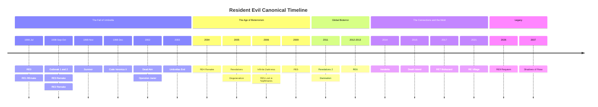
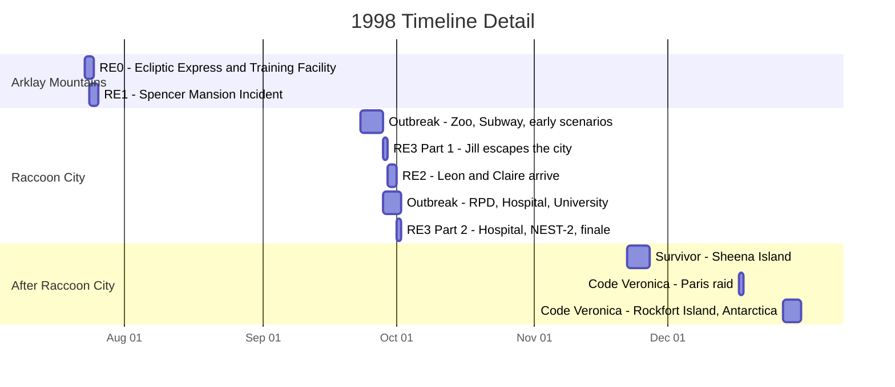
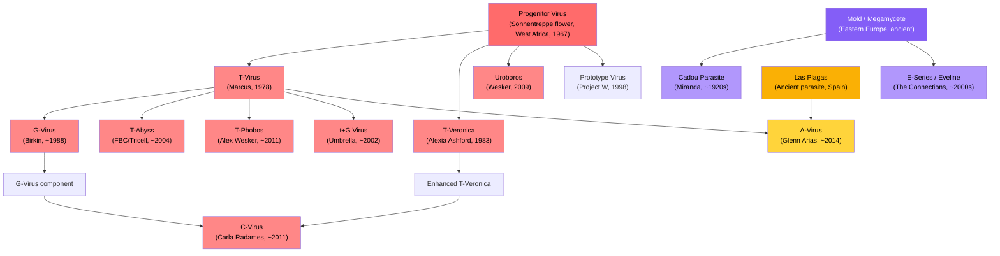

# Resident Evil: Linha do Tempo Canônica

Uma referência abrangente documentando a história canônica de cada jogo, DLC e projeto de animação CG de Resident Evil, ordenados pela cronologia dentro do universo. Cada entrada inclui o enredo completo, personagens principais, ameaças biológicas e significado para a lore.

[English](README.md) &nbsp;|&nbsp; Português (Brasil) &nbsp;|&nbsp; [Português (Portugal)](README.pt-eu.md) &nbsp;|&nbsp; [Italiano](README.it.md) &nbsp;|&nbsp; [Español](README.es.md)

Os jogos estão ordenados por quando acontecem na história, não por data de lançamento. Remakes são a fonte preferida para detalhes da trama. Todos os spin-offs canônicos, DLCs e filmes CG estão incluídos. Entradas não canônicas são listadas separadamente para referência.

## Índice

- [Visão Geral da Linha do Tempo](#visão-geral-da-linha-do-tempo)
- [O Incidente de Raccoon City: Um Olhar Detalhado](#o-incidente-de-raccoon-city-um-olhar-detalhado)
- [Pré-história: As Sementes do Bioterror](#pré-história-as-sementes-do-bioterror-19191998)
- **As Montanhas Arklay e Raccoon City (1998)**
  - [Resident Evil 0](#resident-evil-0)
  - [Resident Evil (REmake)](#resident-evil-remake)
  - [Resident Evil Outbreak / File #2](#resident-evil-outbreak--file-2)
  - [Resident Evil 3 (Remake)](#resident-evil-3-remake)
  - [Resident Evil 2 (Remake)](#resident-evil-2-remake)
  - [Resident Evil Survivor](#resident-evil-survivor)
  - [Resident Evil Code: Veronica X](#resident-evil-code-veronica-x)
- **A Queda da Umbrella (2002-2004)**
  - [Resident Evil Dead Aim](#resident-evil-dead-aim)
  - [Darkside Chronicles: Operation Javier](#darkside-chronicles-operation-javier)
  - [Umbrella Chronicles: Umbrella's End](#umbrella-chronicles-umbrellas-end)
  - [Resident Evil 4 (Remake)](#resident-evil-4-remake)
- **A Ascensão do Bioterrorismo (2005-2009)**
  - [Resident Evil Revelations](#resident-evil-revelations)
  - [Degeneration (Filme CG)](#degeneration-filme-cg)
  - [Infinite Darkness (Série CG)](#infinite-darkness-série-cg)
  - [Resident Evil 5](#resident-evil-5)
- **Bioterror Global (2011-2013)**
  - [Resident Evil Revelations 2](#resident-evil-revelations-2)
  - [Damnation (Filme CG)](#damnation-filme-cg)
  - [Resident Evil 6](#resident-evil-6)
- **The Connections e o Mold (2014-2021)**
  - [Vendetta (Filme CG)](#vendetta-filme-cg)
  - [Death Island (Filme CG)](#death-island-filme-cg)
  - [Resident Evil 7: Biohazard](#resident-evil-7-biohazard)
  - [Resident Evil Village](#resident-evil-village)
- **Legado (2026-2037)**
  - [Resident Evil 9: Requiem](#resident-evil-9-requiem)
  - [Shadows of Rose](#shadows-of-rose)
- [Genealogia Viral](#genealogia-viral)
- [Organizações Principais](#organizações-principais)
- [Aparições dos Personagens](#aparições-dos-personagens)
- [Referência de Status Canônico](#referência-de-status-canônico)

---

## Visão Geral da Linha do Tempo

> O agrupamento de 1998 é enganosamente denso. Sete entradas canônicas acontecem em seis meses, com quatro delas se sobrepondo durante a destruição de Raccoon City entre setembro e outubro. O gráfico de gantt abaixo amplia esse período.

---

## O Incidente de Raccoon City: Um Olhar Detalhado

Principais sobreposições a observar:

- **RE0 termina onde RE1 começa.** Rebecca termina a luta contra a Queen Leech e segue diretamente para a Spencer Mansion.
- **A Parte 1 de RE3 começa antes de RE2.** Jill inicia sua fuga em 28 de setembro, um dia inteiro antes de Leon e Claire chegarem em 29 de setembro.
- **RE2, RE3 e Outbreak se sobrepõem** entre 29 de setembro e 1 de outubro. Diferentes personagens vivenciam a mesma catástrofe de diferentes locais pela cidade.
- **Raccoon City é destruída em 1 de outubro** por um ataque de míssil termobárico do governo americano, encerrando RE3 e Outbreak simultaneamente.

---

## Pré-história: As Sementes do Bioterror (1919-1998)

Os eventos da série Resident Evil remontam a mais de um século. Entender essa história pregressa é essencial, pois ela conecta as origens de cada vírus, organização e antagonista importante.

**~Tempos antigos.** O Megamycete, um superorganismo fúngico massivo, se desenvolve em um sistema de cavernas no Leste Europeu. Ele absorve e armazena a consciência e o DNA de organismos que morrem nas suas proximidades. Separadamente, o Progenitor Virus evolui naturalmente dentro das flores Sonnentreppe na África Ocidental, em um sistema de cavernas sagrado para o povo Ndipaya. O organismo parasita Las Plagas prospera em cavernas sob o que se tornará o Castelo Salazar na Espanha rural até o 1o Conde Salazar selá-los no século XV.

**1909.** Eva nasce de uma mulher conhecida apenas como Mother Miranda em uma vila remota do Leste Europeu.

**1919.** A gripe espanhola devasta a vila de Miranda e mata Eva aos 10 anos. Consumida pela dor, Miranda vaga até uma caverna e descobre o Megamycete. Ao contato, ela experimenta visões de centenas de consciências absorvidas. Ela percebe que o fungo pode armazenar e potencialmente restaurar uma mente. Ela sacrifica o corpo de Eva ao Megamycete e dedica sua vida a encontrar um recipiente compatível para a ressurreição de Eva. Ao longo das décadas seguintes, Miranda experimenta em aldeões usando o Mold, criando o parasita Cadou ao infectar vermes nematoides com material fúngico.

**Anos 1950.** Um jovem estudante de medicina chamado Oswell E. Spencer é pego em uma tempestade de neve nas montanhas europeias. Miranda o resgata e cuida dele. Spencer aprende sobre a pesquisa do Mold de Miranda e fica fascinado pelo conceito de usar agentes biológicos para remodelar a humanidade. Mais tarde, ele usa as ideias de Miranda como fundamento filosófico para suas próprias ambições: tornar-se um deus controlando a evolução humana.

**Dezembro de 1966.** Spencer, Edward Ashford e James Marcus organizam uma expedição à África Ocidental. No início de 1967, eles isolam o Progenitor Virus das flores Sonnentreppe no Jardim do Sol.

**1967-1968.** Spencer contrata o arquiteto George Trevor para projetar uma mansão nas Montanhas Arklay, perto de Raccoon City. O verdadeiro propósito da mansão é esconder um laboratório subterrâneo de armas biológicas. Após a conclusão, Spencer sequestra a família Trevor e os usa como cobaias do Progenitor. Jessica Trevor morre pela cepa Type-A. Sua filha Lisa Trevor, de 14 anos, sobrevive à cepa Type-B e se torna efetivamente imortal. Lisa suporta décadas de experimentação contínua, tornando-se uma figura grotesca e trágica que vaga pelos terrenos da mansão usando os rostos de pesquisadores mortos, procurando por sua mãe.

**1968.** Spencer, Ashford e Marcus fundam a Umbrella Pharmaceuticals. Publicamente, um conglomerado farmacêutico abrangendo cosméticos, químicos, maquinário e produtos de consumo. Secretamente, uma fachada para pesquisas de armas biológicas financiadas por contratos governamentais. Edward Ashford morre por exposição acidental ao Progenitor pouco após a fundação, enfraquecendo o ramo Ashford da família.

**1971.** Alexander Ashford, filho de Edward, tenta restaurar o prestígio de sua família através do Project CODE: Veronica. Ele extrai DNA do corpo embalsamado de sua brilhante ancestral Veronica Ashford e cria clones gêmeos: Alexia, uma prodígio que herda a genialidade de Veronica, e Alfred, um subproduto de inteligência mediana.

**13 de janeiro de 1978.** James Marcus alcança a descoberta do T-Virus no Executive Training Facility ao combinar o Progenitor Virus com DNA de sanguessuga. O Tyrant Virus, ou T-Virus, nasce. Ele causa necrose, zumbificação e mutagênese extrema na maioria dos hospedeiros, mas raros indivíduos compatíveis desenvolvem habilidades sobre-humanas.

**1981.** Alexia Ashford, aos 10 anos, torna-se Pesquisadora-Chefe na instalação Antártica da Umbrella. Ela cria o T-Veronica virus ao combinar o Progenitor Virus com genes de formiga rainha e um vírus antigo. O vírus concede ao hospedeiro habilidades pirocinéticas e controle de insetos, mas apenas se o hospedeiro passar por 15 anos de adaptação criogênica. Injeção imediata causa mutação descontrolada.

**1983.** Alexia injeta seu pai Alexander com T-Veronica como cobaia, transformando-o na criatura Nosferatu. Ela o acorrenta no porão da instalação. Em seguida, ela se injeta e entra em sono criogênico, para despertar 15 anos depois com o vírus perfeitamente ligado ao seu corpo. Alfred é deixado sozinho para administrar o legado Ashford, lentamente descendo à loucura.

**1988.** Spencer fica paranoico com as ambições e independência de Marcus. Ele ordena o assassinato de Marcus. Albert Wesker e William Birkin, os próprios pupilos de destaque de Marcus que vinham secretamente relatando a Spencer por anos, lideram um esquadrão da USS no laboratório de Marcus. Marcus é baleado e seu corpo descartado nos esgotos. Birkin toma a pesquisa do T-Virus de Marcus e assume os créditos. Sem o conhecimento de ninguém, uma Queen Leech entra no cadáver de Marcus, absorve suas memórias e inicia um processo de regeneração que levará uma década.

**Início dos anos 1990.** William Birkin começa a desenvolver o G-Virus no laboratório NEST, sob Raccoon City, derivado de mutações únicas observadas no corpo de Lisa Trevor. Diferente do T-Virus, que cria zumbis, o G-Virus causa mutação contínua descontrolada e permite reprodução parasitária através da implantação de embriões.

**1996.** Wesker é infiltrado como capitão do S.T.A.R.S. Alpha Team no Departamento de Polícia de Raccoon City, enquanto secretamente trabalha para a Umbrella e faz acordos com uma organização rival.

**11 de maio de 1998.** Um vazamento da cepa epsilon do T-Virus no Laboratório Arklay desencadeia um surto. Pesquisadores são infectados. Cerberus escapam para a floresta. Nas semanas seguintes, uma série de bizarros "assassinatos canibais" nas Montanhas Arklay atrai a atenção pública e policial. O Departamento de Polícia de Raccoon City cria a unidade de táticas especiais S.T.A.R.S. para investigar.

---

## As Montanhas Arklay e Raccoon City (1998)

### Resident Evil 0

**Datas no Universo:** 23-24 de julho de 1998
**Localização:** Trem Ecliptic Express, Umbrella Executive Training Facility, Montanhas Arklay
**Protagonistas:** Rebecca Chambers, médica do S.T.A.R.S. Bravo Team, 18 anos e a integrante mais jovem do S.T.A.R.S. Billy Coen, ex-Segundo Tenente do Corpo de Fuzileiros Navais dos EUA condenado por massacrar 23 pessoas na África, sendo transportado para sua execução quando o comboio foi atacado. Billy alega ter sido incriminado por seu oficial comandante.
**Antagonistas:** Queen Leech, a consciência reanimada de James Marcus. Proto Tyrant, um modelo inicial fracassado de Tyrant.

#### Resumo do Enredo

Na noite de 23 de julho de 1998, a Queen Leech solta um enxame de sanguessugas no Ecliptic Express, um trem pertencente à Umbrella que viaja pelas Montanhas Arklay. Todos os passageiros e funcionários são mortos ou infectados com o T-Virus. O ataque é a vingança da Queen Leech contra a Umbrella pelo assassinato de Marcus uma década antes.

O helicóptero do S.T.A.R.S. Bravo Team apresenta mau funcionamento e faz um pouso forçado na Raccoon Forest enquanto se dirigia para investigar os assassinatos canibais. A equipe se separa para vasculhar a área. Eles descobrem um transporte de polícia militar destruído com motoristas mortos. O prisioneiro, Billy Coen, desapareceu.

Rebecca descobre o Ecliptic Express parado e embarca sozinha, encontrando-o infestado de zumbis e sanguessugas. Ela encontra Billy, que também se refugiou no trem. Apesar de suas ordens para prendê-lo, Rebecca relutantemente coopera com Billy para sobreviver no trem infestado. O membro do Bravo Team Edward Dewey tropeça a bordo, gravemente ferido por Cerberus, e morre após avisar Rebecca sobre os perigos lá fora.

A Queen Leech, disfarçada como uma versão jovem de James Marcus, reativa o trem. Billy e Rebecca desesperadamente acionam os freios de emergência, mas o trem descarrila e se choca contra uma estação subterrânea conectada ao Umbrella Executive Training Facility.

O Training Facility foi construído nos anos 1960 para educar adolescentes talentosos recrutados pela Umbrella. Evidências por toda a instalação revelam uma verdade mais sombria: Marcus usou os estudantes como cobaias para seus experimentos com sanguessugas e T-Virus, transformando-os em zumbis. O porão da instalação contém uma câmara de tortura coberta de sangue seco.

Rebecca e Billy reconstroem a história de Marcus através de documentos espalhados. Eles descobrem que Marcus, junto com Spencer e Ashford, descobriu o Progenitor Virus nos anos 1960. Marcus o combinou com DNA de sanguessuga para criar o T-Virus em 13 de janeiro de 1978. Eles encontram evidências de que Spencer ordenou o assassinato de Marcus em 1988, executado por seus próprios protegidos Wesker e Birkin, que então roubaram sua pesquisa.

A dupla navega por uma igreja em ruínas e desce até o laboratório subterrâneo secreto de Marcus. A criatura se passando pelo jovem Marcus se revela como a Queen Leech, um organismo massivo e mutante que passou dez anos se regenerando usando o cadáver de Marcus como hospedeiro. Ela absorveu as memórias, personalidade e sede de vingança de Marcus contra a Umbrella.

Na batalha final, Rebecca descobre que a Queen Leech é vulnerável à luz solar direta. Ela abre o teto da instalação enquanto Billy distrai a criatura. Exposta à luz solar, a Queen Leech enfraquece, e Billy a destrói com um revólver magnum. William Birkin, monitorando a situação remotamente, aciona o sistema de autodestruição da instalação.

Enquanto o complexo detona, Rebecca toma uma decisão que define seu caráter: ela falsifica a morte de Billy em seu relatório oficial, dizendo às autoridades que ele pereceu nas montanhas. Ela guarda as placas de identificação dele como "prova". Billy desaparece na floresta, um homem livre. Rebecca segue rumo à Spencer Mansion para se encontrar com seus colegas do Bravo Team, caminhando diretamente para os eventos de Resident Evil 1.

#### Principais Ameaças Biológicas

- **Queen Leech:** Uma sanguessuga que entrou no cadáver de Marcus, absorveu suas memórias e desenvolveu habilidades de metamorfose. Ela pode imitar a aparência humana de Marcus e controlar enxames de sanguessugas telepaticamente. Em sua forma verdadeira, é um organismo amorfo massivo vulnerável à luz UV.
- **Mimicry Marcus:** Formas humanoides compostas por centenas de sanguessugas agindo como um coletivo, imitando a forma de Marcus.
- **Proto Tyrant:** Um protótipo inicial e instável de Tyrant armazenado no laboratório de Marcus. Menos poderoso e menos estável que o modelo T-002 que aparece em RE1.
- **Eliminator:** Primatas infectados pelo T-Virus com agressividade e força aumentadas.
- **Stinger:** Um escorpião massivo mutante pelo T-Virus encontrado no Training Facility.
- **Centurion:** Uma centopeia gigante criada por exposição ao T-Virus.

#### Significado para a Lore

RE0 é o ponto de partida cronológico da série jogável. Ele estabelece a origem do T-Virus, as dinâmicas internas de poder dentro da Umbrella e as traições que colocaram toda a franquia em movimento. O jogo revela que os três cofundadores da Umbrella tinham agendas distintas: Spencer buscava poder, Ashford buscava prestígio e Marcus buscava descobertas científicas. A disposição de Spencer em assassinar seu próprio cofundador e roubar sua pesquisa estabelece a crueldade que define a cultura corporativa da Umbrella.

A jornada de Rebecca do Training Facility diretamente para a Spencer Mansion fornece a ponte narrativa para RE1. O jogo também explica por que os membros do Bravo Team estão espalhados pela área da mansão quando o Alpha Team chega.

---

### Resident Evil (REmake)

**Datas no Universo:** 24-25 de julho de 1998
**Localização:** Spencer Mansion e Laboratório Arklay, Montanhas Arklay perto de Raccoon City
**Protagonistas:** Chris Redfield, atirador do S.T.A.R.S. Alpha Team. Jill Valentine, segurança de retaguarda do S.T.A.R.S. Alpha Team, ex-operativa da Delta Force. Barry Burton, especialista em armas do Alpha Team, sendo chantageado por Wesker no cenário de Jill. Rebecca Chambers, vinda de RE0, auxilia Chris em seu cenário.
**Antagonistas:** Albert Wesker, capitão do S.T.A.R.S. Alpha Team e agente duplo secreto da Umbrella. Tyrant T-002, protótipo de supersoldado da Umbrella. Lisa Trevor, uma trágica cobaia quase indestrutível que vem sendo submetida a experimentos desde 1967.

#### Resumo do Enredo

Após o Bravo Team não enviar relatórios, o Alpha Team é despachado em 24 de julho de 1998. A equipe consiste em Chris Redfield, Jill Valentine, Barry Burton, Albert Wesker, Joseph Frost e o piloto de helicóptero Brad Vickers. Ao pousar na Floresta Arklay, eles descobrem os destroços do helicóptero do Bravo Team. Joseph Frost é atacado e morto por cães zumbis Cerberus. Brad Vickers entra em pânico e voa o helicóptero embora, deixando os quatro restantes presos no chão. Chris, Jill, Barry e Wesker fogem para a Spencer Mansion.

Wesker ordena que a equipe se separe e investigue. Na campanha de Jill, ela trabalha junto com Barry, que fornece armas e assistência enquanto secretamente se reporta a Wesker. Wesker está chantageando Barry ameaçando sua família. Na campanha de Chris, ele explora sozinho até encontrar Rebecca Chambers, recém-chegada dos eventos de RE0, que o auxilia com sua expertise médica.

A mansão é uma armadilha mortal. Os corredores ornamentados estão repletos de zumbis, armadilhas projetadas pelo arquiteto da mansão e criaturas cada vez mais perigosas. A equipe descobre os corpos e diários de membros mortos do Bravo Team espalhados por toda parte. Kenneth Sullivan é encontrado sendo devorado por um zumbi. Forest Speyer jaz morto na varanda, assassinado por corvos e preparado com explosivos. Richard Aiken, envenenado pela cobra gigante Yawn, morre apesar das tentativas de Rebecca de salvá-lo no cenário de Chris.

Exclusivo do REmake, zumbis que são mortos mas não descartados adequadamente reanimam como Crimson Heads: mutantes mais rápidos e agressivos com garras e instintos predatórios intensificados. A única forma de prevenir isso é queimar os cadáveres ou decapitá-los. Essa mecânica adiciona uma tensão persistente de gerenciamento de recursos ao explorar a mansão.

A casa de hóspedes, um edifício separado conectado à mansão, abriga o tanque de tubarões Aqua Ring contendo Neptune, um tubarão-branco infectado pelo T-Virus, e a massiva Plant 42, uma planta mutante que consumiu a estrutura do prédio. Os jogadores aprendem através de diários de pesquisadores sobre os vários experimentos conduzidos na instalação e o colapso gradual dos protocolos de segurança que precedeu o surto.

O REmake introduz a história de Lisa Trevor. Os jogadores a encontram na área da cabana e nos túneis subterrâneos. Ela não pode ser permanentemente morta. Suas entradas de diário, escritas em caligrafia cada vez mais deteriorada ao longo de décadas, revelam o horror de seu cativeiro. Em 1967, aos 14 anos, ela e sua mãe Jessica foram sequestradas por Spencer e usadas como cobaias do Progenitor. Jessica morreu. Lisa sobreviveu a cada vírus que injetaram nela, incluindo o parasita NE-alpha usado posteriormente para criar Nemesis. O G-Virus foi eventualmente isolado do sangue dela. Em 1998, ela é uma criatura grotesca usando os rostos arrancados de pesquisadores que matou, perpetuamente procurando pelo rosto de sua mãe.

Sob a mansão está o Laboratório Arklay, a instalação subterrânea de pesquisa da Umbrella onde o programa de BOW do T-Virus opera. O laboratório contém registros de desenvolvimento, armazenamento criogênico para cobaias experimentais e a joia da coroa da pesquisa da Umbrella: o Projeto Tyrant.

No laboratório, Wesker se revela como um traidor. Ele foi um agente da Umbrella o tempo todo, e toda a operação do S.T.A.R.S. foi projetada para coletar dados de combate sobre BOWs lutando contra soldados treinados. Ele gravou tudo. No cenário de Jill, sua chantagem contra Barry é revelada, e Barry por fim se volta contra Wesker. Wesker ativa o Tyrant T-002 de seu casulo criogênico, um humanoide imponente de pele cinza com uma garra massiva e um coração exposto. O Tyrant empala Wesker pelo abdômen, aparentemente matando-o, e então se volta contra os membros restantes do S.T.A.R.S.

O que ninguém sabe é que Wesker se injetou com um vírus especial fornecido por William Birkin antes de entrar na mansão. O vírus, parte do Project W de Spencer, foi projetado para conceder habilidades sobre-humanas a hospedeiros geneticamente compatíveis. Wesker morre e é ressuscitado pelo vírus enquanto os outros lutam pela sobrevivência.

Após derrotar o Tyrant no laboratório, os sobreviventes ativam o sistema de autodestruição de emergência. Eles correm pela instalação em colapso até o heliporto no telhado da mansão. O Tyrant, agora mutado em sua forma Super Tyrant com coração exposto e garras massivas, irrompe pelo chão do heliporto para um confronto final. Brad Vickers, que esteve sobrevoando a área no helicóptero, lança um lançador de foguetes. O Super Tyrant é destruído.

Chris, Jill, Barry e Rebecca escapam no helicóptero enquanto a Spencer Mansion e seu laboratório subterrâneo são consumidos pela explosão. Os quatro sobreviventes decidem expor os crimes da Umbrella. Chris parte para a Europa logo depois para investigar a sede da Umbrella, uma decisão que trará sua irmã Claire a Raccoon City dois meses depois à sua procura.

#### Principais Ameaças Biológicas

- **Tyrant T-002:** O protótipo de supersoldado da Umbrella, o ápice de seu Projeto Tyrant. Um BOW humanoide com força sobre-humana, velocidade e uma garra óssea massiva se estendendo do braço direito. Seu coração exposto é sua fraqueza. Quando suficientemente danificado, ele muta para a forma Super Tyrant, mais rápida e agressiva.
- **Lisa Trevor:** Não é uma antagonista tradicional, mas uma presença indestrutível. Décadas de experimentação viral a tornaram efetivamente imortal. Ela absorveu o parasita NE-alpha que seria posteriormente usado no Projeto Nemesis. Seu corpo foi o material de origem para o G-Virus.
- **Crimson Heads:** Zumbis que reanimam se não forem queimados ou decapitados. Mais rápidos e letais que zumbis padrão, com garras e agressividade intensificada. Uma mecânica exclusiva do REmake.
- **Hunters MA-121 Alpha:** BOWs híbridos de réptil e humano criados ao enxertar DNA reptiliano em embriões humanos usando o T-Virus. Capazes de decapitar vítimas com um único golpe. Eles infiltram a mansão após a seção da casa de hóspedes.
- **Yawn:** Uma cobra massiva mutante pelo T-Virus que guarda os andares superiores da mansão. Seu veneno é letal sem antídoto.
- **Neptune:** Tubarões-brancos infectados pelo T-Virus no Aqua Ring.
- **Plant 42:** Uma planta mutante massiva na casa de hóspedes, vulnerável ao composto químico V-JOLT.
- **Cerberus:** Dobermans infectados pelo T-Virus rondando os terrenos da mansão e a floresta.

#### Significado para a Lore

O Incidente da Mansão é o evento incitante de toda a franquia Resident Evil. Cada jogo subsequente tem suas raízes no que acontece aqui. Os sobreviventes se tornam os principais combatentes anti-Umbrella: Chris e Jill cofundam a BSAA, Barry treina a próxima geração de operativos, e Rebecca continua a pesquisa de armas biológicas do ponto de vista acadêmico.

A sobrevivência e transformação de Wesker de agente humano para ameaça sobre-humana o estabelece como o antagonista principal da série até RE5. Sua injeção do vírus do Project W é a primeira dica do programa de eugenia de Spencer, um fio condutor que leva sete jogos para ser completamente revelado.

As autoridades de Raccoon City, sob influência da Umbrella, encobrem o Incidente da Mansão. O S.T.A.R.S. é discretamente dissolvido. Os avisos dos sobreviventes são ignorados. Esse encobrimento permite diretamente o surto de T-Virus que consome a cidade dois meses depois. O Chefe de Polícia de Raccoon City, Brian Irons, está na folha de pagamento da Umbrella e suprime evidências ativamente.

A história de Lisa Trevor é a adição mais significativa do REmake à lore. Suas décadas de sofrimento revelam a profundidade da crueldade da Umbrella e fornecem a origem tanto do G-Virus quanto do parasita NE-alpha usado no Nemesis. Ela é o fio conector entre o Progenitor Virus, o T-Virus, o G-Virus e o Projeto Nemesis.

---

### Resident Evil Outbreak / File #2

**Datas no Universo:** 23 de setembro a 1 de outubro de 1998
**Localização:** Diversos locais por Raccoon City: J's Bar, Raccoon Zoo, sistema de metrô, Raccoon General Hospital, Delegacia de Polícia da RPD, Raccoon University, instalação de descarte de resíduos da Umbrella
**Protagonistas:** Oito civis de Raccoon City: Kevin Ryman, policial da RPD. Mark Wilkins, segurança e veterano do Vietnã. Jim Chapman, funcionário do metrô. George Hamilton, cirurgião no Raccoon General Hospital. David King, encanador e faz-tudo. Alyssa Ashcroft, jornalista investigativa. Yoko Suzuki, estudante universitária e ex-funcionária da Umbrella com memórias suprimidas. Cindy Lennox, garçonete no J's Bar.
**Antagonistas:** William Birkin em forma mutante G. Thanatos, um Tyrant não autorizado criado pelo pesquisador da Raccoon University Greg Mueller. Nyx, um BOW amorfo massivo armazenado em um cais da Umbrella. Nikolai Ginovaef, monitor do UBCS trabalhando para a Umbrella.

#### Resumo do Enredo

Os jogos Outbreak retratam o desastre de Raccoon City através dos olhos de cidadãos comuns em vez de operativos treinados. Os cenários abrangem toda a duração do surto, desde a infecção inicial do abastecimento de água até a destruição da cidade por ataque de míssil.

**"Wild Things", 23 de setembro.** O cenário mais antigo cronologicamente. O T-Virus chegou ao Raccoon Zoo, mutando os animais. Sobreviventes enfrentam leões zumbis, um elefante zumbi chamado Oscar e hienas infectadas. Um helicóptero de evacuação cai, forçando o grupo a encontrar uma fuga alternativa. Este cenário mostra quão cedo a infecção se espalhou pela infraestrutura da cidade.

**"Outbreak", 24 de setembro.** O surto de T-Virus chega ao J's Bar na parte alta de Raccoon City, onde muitos dos oito protagonistas são frequentadores ou funcionários. Zumbis invadem pelas janelas e portas. Os sobreviventes barricam as entradas, lutam contra a horda e escapam pelos telhados enquanto a RPD detona explosivos para limpar as ruas. Este cenário introdutório é a primeira vez que os oito civis se cruzam.

**"Underbelly", 25-26 de setembro.** Os sobreviventes tentam fugir pelo sistema de metrô de Raccoon City. Um acidente de trem perturba um ninho de parasitas, incluindo o Giga Bite, uma pulga mutante massiva. O grupo navega pelos túneis inundados e escapa em um trem partindo ou por dutos de ventilação.

**"Below Freezing Point", 25-26 de setembro.** Liderados por Yoko Suzuki, cujas memórias fragmentadas de trabalhar na Umbrella afloram ao longo do cenário, o grupo infiltra o laboratório subterrâneo da Umbrella sob a cidade, a mesma instalação NEST de RE2. Eles encontram Monica, uma virologista renegada da Umbrella tentando roubar dados de pesquisa. Monica é morta pelo William Birkin mutante em sua forma de criatura G. Os sobreviventes escapam pelos túneis de emergência do laboratório.

**"The Hive", 26-27 de setembro.** O Raccoon General Hospital, o mesmo hospital que aparece em RE3, está sob ataque de uma colônia de sanguessugas mutantes gigantes. Uma entidade Leech Man persegue os corredores. Os sobreviventes destroem a Leech Queen que habita o porão do hospital para escapar.

**"Hellfire", 27-28 de setembro.** Um incêndio engole um antigo hotel em Raccoon City. Os sobreviventes navegam pela estrutura em chamas e desabando enquanto lutam contra zumbis. Uma criatura mutante massiva ronda o hotel. O cenário ilustra como a infraestrutura da cidade está se desintegrando em múltiplas frentes simultaneamente.

**"Flashback", 28-29 de setembro.** O grupo se refugia em uma cabana na Raccoon Forest, onde encontram Al Lester, um homem que promete guiá-los para a segurança. Al está na verdade enlouquecido. Sua esposa Dorothy foi experimentada em um hospital abandonado próximo e se fundiu com uma planta mutante. Al atrai vítimas para alimentar a planta, esperando manter Dorothy viva. Os sobreviventes destroem o núcleo da planta e escapam da floresta.

**"Desperate Times", 28-29 de setembro.** Os sobreviventes se juntam aos policiais remanescentes defendendo a Delegacia de Polícia da RPD, o mesmo prédio de RE2. O Tenente Marvin Branagh, o policial ferido que depois dá informações a Leon em RE2, lidera a defesa. As barricadas eventualmente cedem, e os sobreviventes escapam pelos esgotos enquanto a delegacia é invadida.

**"Decisions, Decisions", 1 de outubro.** O cenário final e mais significativo. George Hamilton lidera o grupo até a Raccoon University para encontrar seu colega Peter Jenkins, que estava desenvolvendo uma vacina contra o T-Virus chamada "Daylight". Eles descobrem que Peter foi assassinado pelo ex-pesquisador da Umbrella Greg Mueller, que queria suprimir a vacina e vender sua própria criação não autorizada de Tyrant. Mueller é assassinado por Nikolai Ginovaef, o monitor do UBCS de RE3, que está eliminando testemunhas e coletando dados. O Tyrant de Mueller, Thanatos, é liberado. Os sobreviventes sintetizam a vacina Daylight por conta própria, derrotam Thanatos após ele mutar para a forma mais poderosa Thanatos R, e escapam de helicóptero momentos antes do míssil termobárico do governo americano obliterar Raccoon City em 1 de outubro.

**"End of the Road", 1 de outubro.** David King lidera o grupo até uma instalação de descarte de resíduos da Umbrella nos arredores da cidade. Eles encontram cientistas tentando recuperar uma cura. Aqueles que escapam pela rodovia enfrentam Nyx, um BOW amorfo massivo que pode absorver outros organismos, incluindo um Tyrant T-103. Este cenário fornece um dos vislumbres finais de Raccoon City antes de sua destruição.

#### Principais Ameaças Biológicas

- **Thanatos:** Um Tyrant não autorizado criado por Greg Mueller na Raccoon University usando pesquisas roubadas da Umbrella. Distinto dos modelos oficiais de Tyrant da Umbrella. Sua forma mutada, Thanatos R, é mais rápida e agressiva.
- **Nyx:** Um BOW amorfo massivo armazenado em um cais de descarte de resíduos da Umbrella. Capaz de absorver e incorporar outros organismos em sua massa corporal, incluindo um Tyrant T-103. Um dos BOWs mais perigosos encontrados no incidente de Raccoon City.
- **William Birkin forma G:** Encontrado no cenário "Below Freezing Point" no mesmo laboratório NEST de RE2.
- **Oscar:** Um elefante infectado pelo T-Virus no Raccoon Zoo.
- **Giga Bite:** Uma pulga mutante massiva no sistema de metrô.
- **Leech Man:** Uma entidade humanoide composta de sanguessugas mutantes infestando o Raccoon General Hospital.

#### Significado para a Lore

Os jogos Outbreak provam que a destruição de Raccoon City não foi apenas a história de alguns heróis. Milhares de civis vivenciaram o surto, e pequenos grupos lutaram para sobreviver em cada canto da cidade simultaneamente. A vacina "Daylight" representa uma cura alternativa para o T-Virus que, se produzida em massa, poderia ter mudado o curso dos eventos.

As memórias suprimidas de Yoko Suzuki sobre a Umbrella sugerem que a Umbrella experimentou em seus próprios funcionários e apagou sua consciência. O histórico de jornalista investigativa de Alyssa Ashcroft se torna diretamente relevante para RE9: Requiem, onde sua filha Grace Ashcroft é protagonista.

Os cenários se sobrepõem com RE2 e RE3, colocando o jogador em locais que Leon, Claire e Jill visitam, às vezes ao mesmo tempo. A defesa da RPD por Marvin Branagh em "Desperate Times" mostra as horas antes de Leon e Claire chegarem e encontrarem a delegacia já tomada.

---

### Resident Evil 3 (Remake)

**Datas no Universo:** 28 de setembro a 1 de outubro de 1998. Começa aproximadamente 24 horas antes de RE2. A primeira metade precede RE2; a segunda metade ocorre após os eventos principais de RE2.
**Localização:** Ruas de Raccoon City, sistema de metrô, Clock Tower, Raccoon General Hospital, laboratório NEST-2
**Protagonistas:** Jill Valentine, ex-membro do S.T.A.R.S. Alpha Team e sobrevivente do Incidente da Mansão. Desde julho ela tenta expor os crimes da Umbrella mas tem sido barrada pela influência da empresa sobre as autoridades locais. Carlos Oliveira, Cabo do Biohazard Countermeasure Service da Umbrella, um ex-guerrilheiro sul-americano que se alistou no UBCS sem conhecer a extensão total dos crimes da Umbrella.
**Antagonistas:** Nemesis-T Type, um Tyrant T-103 implantado com um parasita NE-alpha, concedendo-lhe inteligência, fala e capacidade de seguir ordens complexas. Sua missão: caçar e matar todos os membros sobreviventes do S.T.A.R.S. para demonstrar a eficácia em combate do parasita. Nikolai Zinoviev, Sargento do UBCS e "Supervisor" secreto da Umbrella plantado para coletar dados de combate de BOW.

#### Resumo do Enredo

O jogo abre com Jill tendo um pesadelo em seu apartamento, ilustrando o TEPT que ela sofre desde o Incidente da Mansão dois meses antes. Ela acorda com uma ligação alertando-a sobre uma nova ameaça. Antes que ela possa reagir, Nemesis atravessa a parede de seu apartamento.

Nemesis é a arma biológica mais sofisticada da Umbrella até então: um Tyrant T-103 implantado com o parasita NE-alpha, que forma seu próprio cérebro dentro do sistema nervoso do hospedeiro. Isso concede à criatura inteligência, raciocínio tático, capacidade de usar armas e fala limitada. Ele consegue dizer uma palavra: "S.T.A.R.S." Sua missão é eliminar todos os membros sobreviventes do S.T.A.R.S. como demonstração de campo do potencial militar do parasita NE-alpha. Jill, como uma das quatro sobreviventes conhecidas, é o alvo principal.

Jill mal escapa do encontro inicial e foge pelas ruas. Ela testemunha Brad Vickers, seu ex-colega do S.T.A.R.S. e piloto de helicóptero de RE1, sendo dominado por zumbis. Brad segura uma porta para dar tempo a Jill e é mordido. Ele morre da infecção pouco depois. Seu corpo zumbificado é encontrado posteriormente por Carlos na RPD.

Jill conhece os mercenários sobreviventes do UBCS: Carlos Oliveira, o líder de pelotão ferido Mikhail Viktor e o suspeito Nikolai Zinoviev. O UBCS foi implantado pela Umbrella para lidar com o surto, mas a maioria dos esquadrões foi dizimada. Os sobreviventes planejam escapar pelo sistema de metrô.

Jill e Carlos trabalham para restaurar a energia do metrô. Jill navega pela cidade infestada, coletando peças e resolvendo problemas enquanto é periodicamente perseguida por Nemesis. A criatura é implacável, aparecendo em momentos imprevisíveis, às vezes empunhando um lança-foguetes. Os encontros se intensificam, com Nemesis se adaptando às táticas de Jill.

Quando Nemesis aborda o vagão de metrô durante a fuga, Mikhail Viktor faz um sacrifício heroico. O líder de pelotão ferido detona uma granada à queima-roupa, destruindo o vagão e retardando Nemesis. Mikhail morre na explosão. O metrô danificado descarrila perto da Clock Tower.

Na Clock Tower, Jill e Carlos tentam sinalizar um helicóptero de resgate. Um helicóptero chega, mas Nemesis, tendo sobrevivido e agora se despojando de seu casaco para revelar uma forma mais orgânica coberta de tentáculos, o destrói. Durante a batalha que se segue, Nemesis infecta Jill com o T-Virus através de um golpe de tentáculo. Jill colapsa e entra em coma.

Carlos carrega Jill até o Raccoon General Hospital e busca desesperadamente uma cura. O hospital está tomado por Hunters e funcionários zumbificados. Carlos luta pelos corredores e descobre uma vacina contra o T-Virus sintetizada por pesquisadores da Umbrella. Ele também encontra Nikolai, que revela seu verdadeiro papel como "Supervisor" pago, um monitor plantado pela Umbrella para coletar secretamente dados de combate de BOW durante o surto. Nikolai tem eliminado outros monitores e sobreviventes para garantir que somente ele possua os dados valiosos. Carlos o confronta, mas Nikolai escapa.

O remake dá a Carlos uma seção jogável expandida na Delegacia de Polícia da RPD, sobrepondo-se ao cenário de RE2. Carlos luta pelos mesmos corredores que Leon e Claire percorrem, aproximadamente ao mesmo tempo, fornecendo uma perspectiva diferente sobre a queda da delegacia.

Carlos administra a vacina, curando Jill. Ela acorda em 1 de outubro, o dia em que o governo americano autorizou um ataque de míssil termobárico em Raccoon City. Transmissões de rádio anunciam a destruição iminente. O relógio está correndo.

A Jill curada segue para o NEST-2, um laboratório da Umbrella conectado à instalação NEST de RE2. Ela descobre que o local foi usado para mais desenvolvimento de BOW e pesquisa viral. Nikolai reaparece, tentando executar Jill no heliporto da instalação e usar Carlos como isca para coletar dados de combate finais. Carlos imobiliza Nikolai, e Jill encerra seus planos.

Nemesis, agora mutado em uma forma quadrúpede massiva mal reconhecível como tendo sido humanoide, ataca Jill no NEST-2. Ela imerge a criatura em ácido e a finaliza com um railgun, destruindo a arma biológica que a perseguiu por toda a cidade.

Jill e Carlos alcançam o heliporto e são extraídos no exato momento em que o míssil termobárico atinge. Raccoon City é completamente obliterada. Cada infectado restante, cada peça de evidência da Umbrella e cada civil que não conseguiu escapar é aniquilado. O governo americano, sob a direção do Conselheiro de Segurança Nacional Derek C. Simmons, orquestra um encobrimento de seu próprio envolvimento.

#### Principais Ameaças Biológicas

- **Nemesis-T Type:** O modelo de Tyrant mais avançado na época do incidente de Raccoon City. Um T-103 implantado com o parasita NE-alpha, que forma um cérebro secundário. Capaz de fala, uso de armas, planejamento tático e perseguição implacável. Progride por múltiplos estágios de mutação: humanoide de sobretudo, forma orgânica exposta com tentáculos e criatura quadrúpede massiva. O parasita NE-alpha foi originalmente testado em Lisa Trevor, que o absorveu.
- **Drain Deimos / Brain Suckers:** Parasitas mutantes gigantes semelhantes a pulgas que drenam líquido cefalorraquidiano das vítimas.
- **Hunters Beta e Gamma:** Variantes avançadas de Hunter. Hunters Gamma são aquáticos, encontrados nos esgotos. Hunters Beta são encontrados no hospital.
- **Grave Digger:** Um verme massivo mutante pelo T-Virus na área do parque da cidade, presente na versão original.
- **Pale Heads:** Zumbis exclusivos do remake com habilidades regenerativas extremas, encontrados no NEST-2.

#### Significado para a Lore

RE3 ocorre simultaneamente a RE2 e mostra o outro lado dos últimos dias de Raccoon City. Enquanto Leon e Claire navegam pela RPD e pelo subterrâneo NEST, Jill luta contra Nemesis pelas ruas, metrô e hospitais da cidade. A seção de Carlos na RPD se sobrepõe diretamente aos eventos de RE2.

O Projeto Nemesis demonstra as ambições crescentes da Umbrella. O parasita NE-alpha dá a um Tyrant inteligência e foco de missão, um salto significativo em relação ao T-002 sem mente de RE1 ou ao obediente mas simples Mr. X de RE2. Os dados de combate coletados durante a perseguição de Nemesis a Jill são valiosos para a Umbrella independentemente da sobrevivência da criatura.

A implantação do UBCS pela Umbrella revela a disposição da empresa em sacrificar seus próprios funcionários. Os mercenários do UBCS são ativos descartáveis, recrutados entre criminosos de guerra e soldados desesperados do mundo todo. Os Supervisores escondidos entre eles existem somente para documentar como BOWs se saem contra humanos treinados em combate real.

A destruição de Raccoon City é o evento central da franquia. Ela desencadeia investigações do congresso, indignação internacional e, por fim, os processos judiciais que destroem a Umbrella Corporation. A sobrevivência de Jill e seu conhecimento em primeira mão tanto do Incidente da Mansão quanto da destruição de Raccoon City a tornam uma das testemunhas mais importantes contra a Umbrella. Ela e Chris cofundam a BSAA.

---

### Resident Evil 2 (Remake)

**Datas no Universo:** 29 de setembro a 1 de outubro de 1998
**Localização:** Arredores de Raccoon City, Delegacia de Polícia da RPD, esgotos de Raccoon City, laboratório subterrâneo NEST
**Protagonistas:** Leon S. Kennedy, um policial novato de 21 anos chegando para seu primeiro dia na RPD. Ele perdeu a hora em um motel nos arredores da cidade após um término de relacionamento e chegou atrasado, apenas para encontrar a cidade tomada. Claire Redfield, estudante universitária de 19 anos e irmã mais nova de Chris Redfield, chegando a Raccoon City em sua moto para procurar Chris, que não entrou em contato desde o Incidente da Mansão. Ada Wong, uma espiã trabalhando para uma organização rival, se passando por agente do FBI procurando um repórter chamado Ben Bertolucci enquanto secretamente persegue uma amostra do G-Virus. Sherry Birkin, filha de 12 anos de William e Annette Birkin, escondida na delegacia de polícia.
**Antagonistas:** William Birkin / "G", ex-Pesquisador-Chefe do NEST e criador do G-Virus, que se injetou com sua criação após ser baleado pela USS da Umbrella e agora muta por cinco estágios cada vez mais grotescos. Mr. X / T-00, um Tyrant T-103 de produção em massa enviado pela Umbrella para recuperar a amostra do G-Virus e eliminar sobreviventes. Chefe Brian Irons, o corrupto Chefe da RPD que está na folha de pagamento da Umbrella há anos, suprimindo evidências de seus crimes.

#### Resumo do Enredo

Em 22 de setembro de 1998, uma semana antes do jogo começar, o Serviço de Segurança da Umbrella liderado pelo operativo HUNK invade o laboratório NEST sob Raccoon City. Sua missão: confiscar o G-Virus de William Birkin, que estava planejando desertar para os militares americanos com sua pesquisa. No confronto, operativos da USS disparam contra Birkin múltiplas vezes. Deixado para morrer, Birkin se injeta com uma amostra do G-Virus em desespero. O vírus o reanima e muta em uma criatura movida por raiva e instinto reprodutivo. Ele massacra o esquadrão da USS. No caos, amostras do T-Virus são derramadas e espalhadas pelo sistema de esgoto por ratos. Em poucos dias, o abastecimento de água da cidade é contaminado e dezenas de milhares de cidadãos são infectados.

Na noite de 29 de setembro, Leon Kennedy e Claire Redfield chegam a Raccoon City independentemente. Leon, dirigindo seu Jeep, e Claire, em sua moto, se encontram em um posto de gasolina nos arredores quando zumbis atacam. Eles comandam um carro de polícia e seguem em velocidade rumo ao prédio da RPD. Um zumbi no banco traseiro causa um acidente, e um caminhão-tanque tombado os separa. Eles combinam de se encontrar na RPD e tomam rotas separadas.

A Delegacia de Polícia da RPD, antigamente um museu de arte, é um edifício labiríntico com arquitetura elaborada que agora serve como túmulo. A maioria dos policiais está morta. O Tenente Marvin Branagh, gravemente ferido e lutando contra a infecção, dá a Leon uma faca de combate e informações cruciais antes de sucumbir ao T-Virus e se transformar. O jogador é forçado a abater o homem que acabou de ajudá-lo.

Leon encontra Ada Wong, que alega estar procurando o repórter Ben Bertolucci. Na verdade, Ada é uma espiã trabalhando para uma organização rival, enviada para recuperar uma amostra do G-Virus. Apesar de sua missão, ela desenvolve sentimentos genuínos por Leon ao longo de sua parceria. A dinâmica entre eles mistura dependência mútua com decepção mútua.

Claire descobre Sherry Birkin escondida na delegacia. Os pais de Sherry, William e Annette, são cientistas da Umbrella no NEST. Claire toma Sherry sob sua proteção, e o vínculo entre elas se torna uma das relações mais duradouras da série.

O Chefe Brian Irons, o corrupto chefe de polícia, é encontrado na sala de taxidermia da RPD cercado por seus troféus de caça. Ele está na folha de pagamento da Umbrella há anos, suprimindo evidências de suas atividades ilegais e obstruindo as tentativas dos sobreviventes do S.T.A.R.S. de expor a empresa. Durante o surto, sua sanidade se deteriora. No cenário de Claire, Irons sequestra Sherry. Sua morte vem quando William Birkin, movido pelo instinto reprodutivo do G-Virus, implanta um embrião G nele. O embrião explode do corpo de Irons, matando-o violentamente.

Um helicóptero da Umbrella lança um contêiner no telhado da RPD no meio do jogo. O Tyrant T-00, codinome Mr. X, emerge e começa a perseguir metodicamente o jogador pela delegacia. Diferente dos zumbis sem mente, Mr. X tem uma missão: recuperar o pingente do G-Virus e eliminar testemunhas. Ele não pode ser permanentemente parado, apenas atordoado. O som de seus passos pesados ecoando pelos corredores cria uma tensão persistente. No remake, Mr. X patrulha dinamicamente, seguindo sons e perseguindo o jogador por múltiplas salas.

Ambos os personagens eventualmente navegam da RPD para o sistema de esgotos da cidade, e de lá para o NEST, a massiva instalação subterrânea de pesquisa da Umbrella onde o G-Virus foi desenvolvido. A instalação é um complexo de alta tecnologia cheio de laboratórios, armazenamento de espécimes e evidências das décadas de pesquisa de Birkin.

No cenário de Leon, Annette Birkin, esposa de William e também pesquisadora do NEST, revela a verdadeira identidade de Ada. Ada não está procurando um namorado ou um repórter. Ela é uma espiã mercenária contratada para roubar o G-Virus. A revelação força Leon a confrontar seus sentimentos crescentes por alguém que o manipulou. Na cena climática, Ada aponta uma arma para Leon exigindo a amostra do G-Virus. Durante a sequência de autodestruição da instalação, Ada é derrubada de uma passarela e cai na escuridão. Ela sobrevive, escapando com um fragmento de tecido contendo material do G-Virus.

No cenário de Claire, William Birkin, movido pelo instinto reprodutivo do G-Virus de encontrar hospedeiros geneticamente compatíveis, mira sua própria filha Sherry. Ele implanta um embrião G nela. Claire e Annette correm para sintetizar a vacina DEVIL com o equipamento da Umbrella no NEST. Annette, mortalmente ferida pelo William mutante, confirma que a vacina funciona antes de morrer. Sherry é curada, mas a exposição ao G-Virus lhe deixa habilidades regenerativas permanentes que se tornam relevantes em RE6.

O sistema de autodestruição do NEST é ativado. Leon derrota Mr. X em sua forma final mutada de Super Tyrant em uma plataforma de elevador, usando um lançador de foguetes lançado por Ada das sombras acima. Os sobreviventes convergem em um trem de emergência subterrâneo. Enquanto o trem acelera pelo túnel, Birkin em sua forma final G5, uma massa de carne, dentes e olhos que consumiu a seção traseira do trem, ataca. O vagão traseiro é desacoplado, deixando Birkin para ser consumido pela explosão da instalação.

Leon, Claire e Sherry emergem do túnel nos arredores de Raccoon City ao amanhecer. Eles caminham por uma estrada se afastando da cidade em chamas. Leon diz a Claire que encontrará uma forma de parar a Umbrella. Claire diz que ainda precisa encontrar Chris. Seus caminhos divergem, mas suas vidas permanecem entrelaçadas ao longo da série.

HUNK, o único operativo da USS sobrevivente da invasão original contra Birkin, escapa de Raccoon City separadamente com uma amostra do G-Virus guardada em uma maleta. Sua extração por helicóptero do telhado da RPD significa que a Umbrella obteve o que veio buscar, ao custo de uma cidade inteira.

#### Principais Ameaças Biológicas

- **William Birkin / "G":** Progride por cinco estágios de mutação. G1 mantém uma forma vagamente humana com um olho massivo no ombro direito e um braço com garras. G2 perde a maioria das feições humanas, desenvolvendo um segundo par de braços. G3 é completamente monstruoso, quadrúpede. G4 é um horror massivo e assimétrico. G5 é uma massa amorfa de carne e dentes que consome tudo o que toca. Diferente das mutações do T-Virus, a mutação do G-Virus é contínua e incontrolável.
- **Mr. X / T-00:** Um Tyrant T-103 de produção em massa, mais refinado que o protótipo T-002 de RE1. Implantado usando sobretudo e chapéu para se misturar em ambientes urbanos. Segue ordens, rastreia alvos e não pode ser permanentemente morto com armas convencionais. Em sua forma Super Tyrant, o casaco se rasga revelando musculatura exposta e uma garra óssea massiva.
- **Lickers:** BOWs sem pele e cegos que caçam pelo som. São um estágio avançado de mutação de zumbis cujos cérebros inchaream e ficaram expostos. Rápidos, letais e capazes de escalar paredes. Suas línguas podem empalar vítimas do outro lado da sala.
- **G-Adults / G-Embryos:** Birkin, movido pelo instinto reprodutivo do G-Virus, implanta embriões parasitários em hospedeiros. Hospedeiros geneticamente incompatíveis rejeitam o embrião, que explode e cresce em um G-Adult: uma criatura pequena e agressiva. Hospedeiros compatíveis, especificamente parentes de sangue, teoricamente produziriam um organismo G perfeito.
- **Jacaré Gigante:** Um jacaré massivo infectado pelo T-Virus nos esgotos da cidade. Encontrado brevemente, mas de forma memorável.
- **Ivy:** BOWs baseados em plantas no NEST criados por exposição ao T-Virus. No remake, são chamados Plant 43 e encontrados na seção da estufa.

#### Significado para a Lore

RE2 retrata a catástrofe definitiva da franquia. O surto de Raccoon City é o evento para o qual tudo anterior conduz e ao qual tudo posterior responde. Ele destrói a reputação pública da Umbrella, desencadeia investigações governamentais e inicia o mercado negro global de armas biológicas.

A experiência de Leon aqui o transforma de um novato idealista no agente governamental endurecido que ele se torna em RE4 e RE6. Seu relacionamento complicado com Ada Wong, nascido na decepção e desespero de Raccoon City, se torna um dos fios condutores mais longos da série.

O vínculo de Claire com Sherry se estende diretamente. Em RE: Revelations 2, Claire é sequestrada enquanto trabalha para a TerraSave. Em RE6, Sherry retorna como uma agente adulta do DSO, suas habilidades regenerativas uma marca permanente da exposição ao G-Virus que Claire lutou para curar.

O G-Virus representa uma ameaça fundamentalmente diferente do T-Virus. Enquanto o T-Virus cria zumbis e BOWs controláveis para venda militar, o G-Virus cria um organismo incontrolável movido por puro instinto evolutivo. A tragédia de Birkin é que o trabalho de sua vida o consumiu literalmente.

A recuperação de amostras do G-Virus por múltiplas partes, HUNK para a Umbrella, Ada para seu empregador, cria as condições para a proliferação de armas biológicas nos jogos posteriores. O C-Virus em RE6 é derivado diretamente da combinação de material do G-Virus com uma cepa aprimorada de T-Veronica.

---

### Resident Evil Survivor

**Datas no Universo:** 22-26 de novembro de 1998
**Localização:** Sheena Island, uma ilha privada pertencente à Umbrella na Europa
**Protagonistas:** Ark Thompson, um detetive particular e amigo de Leon S. Kennedy. Ele infiltrou Sheena Island disfarçado como Vincent Goldman, o comandante da Umbrella na ilha, para investigar as operações da instalação. Lott e Lily Klein, filhos de um pesquisador da Umbrella que ajudam Ark a escapar.
**Antagonistas:** Vincent Goldman, o verdadeiro comandante da Umbrella em Sheena Island. Ele deliberadamente desencadeou um surto de T-Virus para encobrir evidências de sua operação ilegal de produção em massa de Tyrants. Hypnos-T Type, uma variante avançada de Tyrant desenvolvida na ilha.

#### Resumo do Enredo

Sheena Island é a instalação secreta de produção em massa da Umbrella para BOWs de classe Tyrant. A população da ilha consiste em funcionários da Umbrella e suas famílias, junto com adolescentes sequestrados usados como matéria-prima para produção de Tyrants. Os indivíduos adolescentes são selecionados porque seus cérebros em desenvolvimento produzem níveis mais altos dos hormônios específicos necessários para o cultivo de Tyrants.

Ark Thompson, enviado por Leon S. Kennedy para investigar, infiltrou a ilha se passando pelo comandante Vincent Goldman. Quando Goldman descobriu a infiltração, ele liberou o T-Virus pela ilha para destruir evidências e eliminar testemunhas. Toda a população foi infectada.

Ark sobrevive ao surto inicial mas sofre amnésia de um acidente de helicóptero. Ele vaga pela ilha, gradualmente recuperando suas memórias enquanto luta contra zumbis, Hunters e Lickers. Ele descobre a verdade horrível sobre a linha de produção de Tyrants e os adolescentes sequestrados.

Ark encontra Lott Klein, o filho de um pesquisador da Umbrella, e sua irmã mais nova Lily. As crianças inicialmente desconfiam de Ark mas eventualmente o ajudam a navegar pela instalação. Goldman, tendo sobrevivido ao seu próprio surto, ativa o Hypnos-T Type, um modelo avançado de Tyrant desenvolvido especificamente em Sheena Island. O Hypnos-T é mais ágil e inteligente que Tyrants padrão.

Ark derrota o Hypnos-T Type após ele progredir por múltiplos estágios de mutação. Ele, Lott e Lily escapam da ilha de helicóptero enquanto o sistema de autodestruição da instalação é ativado. A ilha e todas as evidências da produção em massa de Tyrants da Umbrella são destruídas.

#### Principais Ameaças Biológicas

- **Hypnos-T Type:** Um modelo avançado de Tyrant criado em Sheena Island. Mais ágil e rápido que a série T-103. Nomeado em homenagem ao deus grego do sono. Progride por múltiplas formas de mutação.
- **Cleaners:** Soldados blindados da Umbrella usando máscaras de gás implantados na ilha.
- **Undertakers:** BOWs parasitários que reanimam e controlam corpos mortos.

#### Significado para a Lore

Survivor revela a escala industrial da produção de Tyrants da Umbrella. Sheena Island era uma fábrica, não apenas um laboratório. O uso de adolescentes sequestrados como matéria-prima biológica demonstra que a crueldade da Umbrella se estendia muito além de seus pesquisadores e cobaias adultos. A existência de uma instalação dedicada à produção em massa implica que a Umbrella tinha compradores enfileirados para BOWs de classe Tyrant, apontando para um mercado negro florescente que explode após o colapso da Umbrella.

A conexão de Ark com Leon estabelece uma rede de agentes anti-Umbrella operando independentemente durante este período. O jogo foi escrito pela FLAGSHIP, a mesma equipe responsável por RE0, emprestando-lhe peso canônico.

---

### Resident Evil Code: Veronica X

**Datas no Universo:** 17 de dezembro de 1998 até o final de dezembro de 1998
**Localização:** Instalação da Umbrella em Paris, Rockfort Island no Oceano Antártico, Base Antártica de Pesquisa da Umbrella
**Protagonistas:** Claire Redfield, continuando sua busca por Chris após escapar de Raccoon City. Chris Redfield, que viaja a Rockfort Island após receber a mensagem de socorro de Claire retransmitida por Leon. Steve Burnside, um prisioneiro na Rockfort Island, filho de um ex-funcionário da Umbrella que foi pego vendendo segredos da empresa.
**Antagonistas:** Alexia Ashford, a gêmea gênia que criou o T-Veronica e acabou de despertar de 15 anos de sono criogênico com o vírus perfeitamente ligado ao seu corpo, concedendo-lhe habilidades pirocinéticas. Alfred Ashford, seu irmão gêmeo mentalmente instável e comandante de Rockfort Island, que desenvolveu uma personalidade dividida e se veste como Alexia. Albert Wesker, agora operando como agente livre com habilidades sobre-humanas, buscando uma amostra de T-Veronica para sua pesquisa.

#### Resumo do Enredo

Em 17 de dezembro de 1998, Claire Redfield infiltra uma instalação da Umbrella em Paris, ainda procurando por seu irmão Chris. Ela é capturada pelas forças de segurança da Umbrella.

Dez dias depois, em 27 de dezembro, Claire acorda em uma cela em Rockfort Island, uma prisão remota e base militar no Oceano Antártico. Um surto de T-Virus já varreu a ilha, desencadeado por um ataque do grupo paramilitar H.C.F. de Wesker, que assaltou a instalação buscando amostras do vírus T-Veronica. Os prisioneiros e funcionários da ilha agora são zumbis.

Claire conhece Steve Burnside, um jovem prisioneiro impulsivo. O pai de Steve era um funcionário da Umbrella pego vendendo segredos da empresa. A Umbrella aprisionou a família inteira em Rockfort Island como punição. O pai de Steve foi infectado durante experimentos, e Steve foi forçado a atirar em seu próprio pai zumbificado, deixando cicatrizes emocionais profundas. Apesar de sua bravata, Steve é traumatizado e emocionalmente volátil.

A ilha é comandada por Alfred Ashford, a 7a geração da família Ashford. Alfred é profundamente instável. Ele alterna entre sua própria personalidade e a de sua irmã gêmea Alexia, vestindo-se como ela e falando com sua voz. Em seu delírio, ele acredita que Alexia ainda está presente na ilha, dando ordens e vigiando-o. A realidade é que Alexia está em sono criogênico na base Antártica desde 1983.

Claire e Steve exploram a instalação de treinamento militar e o complexo prisional da ilha. Eles descobrem a história sombria da família Ashford através de retratos, diários e salas secretas. Eles aprendem sobre o Project CODE: Veronica de Alexander Ashford, que clonou o DNA da ancestral Veronica para produzir Alexia e Alfred. Eles encontram o próprio Alexander, ainda vivo como a criatura Nosferatu, acorrentado no porão da instalação. Alexia usou seu próprio pai como cobaia do T-Veronica em 1983, antes de se injetar e entrar em sono criogênico. Alexander sofre nesse estado grotesco há quinze anos. Claire e Steve lutam e matam Nosferatu no telhado da instalação durante uma tempestade de neve.

Claire e Steve escapam de Rockfort Island em um hidroavião, mas Alfred, em um ato final, redireciona o piloto automático para a instalação Antártica da Umbrella. Na base Antártica, eles encontram outro surto de T-Virus em andamento. Eles ferem fatalmente Alfred, que cambaleante vai até a câmara criogênica e, com seu último ato, liberta Alexia de seu sono de 15 anos. Alexia desperta com o vírus T-Veronica perfeitamente integrado ao seu corpo. Ela é calma, controlada e imensamente poderosa. Seu corpo pode gerar chamas e ela pode controlar organismos semelhantes a insetos telepaticamente.

Enquanto isso, Chris Redfield recebe a mensagem de socorro de Claire, retransmitida por Leon Kennedy. Chris viaja a Rockfort Island e chega para encontrá-la devastada. Ele encontra Albert Wesker pela primeira vez desde o Incidente da Mansão. Wesker revela sua velocidade sobre-humana, força e olhos vermelhos brilhantes. Ele quer T-Veronica e sabe que Alexia possui a cepa aperfeiçoada. Chris luta contra as ameaças remanescentes da ilha e segue o rastro de Claire até a Antártica.

Na base Antártica, Wesker confronta Alexia diretamente. Ela prova ser mais poderosa do que ele previu. Suas habilidades pirocinéticas e melhorias do T-Veronica subjugam até o físico sobre-humano de Wesker. Na versão X, eles lutam de forma mais equilibrada antes de Wesker recuar, calculando que ele precisa que Chris enfraqueça Alexia primeiro.

Steve é capturado e injetado com T-Veronica por Alexia. Sem o período de adaptação de 15 anos, o vírus causa mutação imediata e violenta. Steve se transforma em uma criatura massiva empunhando um machado e ataca Claire. Em um momento de clareza devastador, Steve recupera humanidade suficiente para resistir ao vírus e se voltar contra Alexia, protegendo Claire. O esforço lhe custa a vida. Ele confessa seu amor por Claire antes de morrer em seus braços.

Chris ativa o sistema de autodestruição da base. Ele confronta Alexia em múltiplas formas de mutação. Em sua primeira forma, ela mantém aparência humana mas empunha fogo. Em sua segunda forma, ela se torna uma criatura insectoide alada. Chris derrota sua forma final usando o Linear Launcher, uma arma que o próprio Alexander Ashford projetou décadas antes como mecanismo de segurança contra Alexia, antecipando a possibilidade de que o experimento de sua filha um dia precisasse ser detido.

Chris e Claire escapam da instalação em explosão juntos. Eles finalmente se reúnem após meses de separação. Wesker escapa separadamente, levando o corpo de Steve Burnside consigo. O cadáver de Steve contém amostras de T-Veronica que Wesker usará para sua pesquisa futura. Wesker deixa uma mensagem arrepiante para Chris: sua rivalidade está longe de terminar.

#### Principais Ameaças Biológicas

- **T-Veronica Virus:** Criado por Alexia Ashford ao combinar o Progenitor Virus com genes de formiga rainha, DNA de planta e um vírus antigo. Requer 15 anos de adaptação criogênica para que o hospedeiro se vincule adequadamente. Concede pirocinese, telepatia com insetos e aprimoramento físico extremo. Injeção imediata sem adaptação causa mutação descontrolada e monstruosa.
- **Alexia Ashford:** A única hospedeira bem-sucedida do T-Veronica. Três formas de mutação: humana com controle de fogo, insectoide alada e híbrido final planta-inseto.
- **Nosferatu:** Alexander Ashford, mutado por injeção de T-Veronica em 1983. Acorrentado no porão por 15 anos. Uma figura trágica usada como cobaia por seus próprios filhos.
- **Steve Burnside forma mutante:** Transformado por injeção forçada de T-Veronica em uma criatura massiva empunhando um machado. Mantém humanidade suficiente para resistir ao vírus momentaneamente.
- **Bandersnatch:** BOWs de braços elásticos exclusivos de Rockfort Island. Um braço é hiperdesenvolvido e pode se esticar através de salas; o outro é atrofiado.
- **Gulp Worm:** Um verme massivo encontrado nas áreas subterrâneas da ilha.

#### Significado para a Lore

Code: Veronica faz a ponte entre a era de Raccoon City e a era do bioterrorismo global. É o primeiro jogo a mostrar as capacidades plenas de Wesker pós-humano, estabelecendo-o como uma ameaça física, não apenas um conspirador. Sua coleta de amostras de T-Veronica do corpo de Steve alimenta diretamente sua pesquisa posterior que leva ao vírus Uroboros em RE5.

O arco da família Ashford enriquece a história corporativa da Umbrella. A morte acidental de Edward Ashford, o projeto de clonagem desesperado de Alexander e o parricídio e megalomania dos gêmeos pintam um retrato de ambição herdada e decadência dentro das famílias fundadoras da Umbrella.

A conexão de T-Veronica com RE6 é direta. Carla Radames depois combina uma cepa aprimorada de T-Veronica com o G-Virus para criar o C-Virus, tornando a criação de Alexia um dos componentes ancestrais da arma biológica mais devastadora da série.

A rivalidade Chris-Wesker, estabelecida aqui e levada até RE5, se torna o núcleo emocional do arco central da franquia. Seu confronto na Antártica, onde Wesker provoca Chris sobre sua fraqueza e promete futuros encontros, define as apostas para a próxima década da história.

---

## A Queda da Umbrella (2002-2004)

### Resident Evil Dead Aim

**Datas no Universo:** 18-22 de setembro de 2002
**Localização:** Spencer Rain, um transatlântico de luxo pertencente à Umbrella no Atlântico, e uma ilha abandonada de descarte de resíduos da Umbrella próxima
**Protagonistas:** Bruce McGivern, operativo americano do Anti-Umbrella Pursuit and Investigation Team sob o USSTRATCOM. Fong Ling, uma agente da inteligência chinesa enviada para neutralizar a ameaça de bioterror.
**Antagonistas:** Morpheus D. Duvall, um ex-funcionário da Umbrella que foi feito de bode expiatório pelo incidente de Raccoon City. Movido por vingança, ele rouba armas biológicas para fazer os EUA e a China reféns, exigindo 5 bilhões de dólares.

#### Resumo do Enredo

Em 2002, a Umbrella está sob pressão legal e militar internacional. Múltiplos governos conduzem operações ativas contra a Umbrella. Morpheus D. Duvall, um ex-pesquisador da Umbrella que foi culpado pelo desastre de Raccoon City para proteger a alta administração, rouba três amostras de T-Virus e uma amostra do protótipo de vírus t+G do laboratório da Umbrella em Paris.

Morpheus libera o T-Virus a bordo do Spencer Rain, um transatlântico de luxo da Umbrella usado para transporte clandestino de BOW e leilões. Ele ameaça lançar mísseis carregados com T-Virus nos Estados Unidos e na China a menos que receba 5 bilhões de dólares.

Bruce McGivern infiltra o navio. Fong Ling, trabalhando para a inteligência chinesa, também está a bordo com ordens de eliminar a ameaça. Os dois se chocam inicialmente mas formam uma aliança instável enquanto lutam pelo navio infectado.

Um ataque de granada fere mortalmente Morpheus, que se injeta com o vírus experimental t+G. O vírus t+G, um híbrido do T-Virus e do G-Virus, lhe concede uma transformação bizarra: seu corpo se torna aparentemente aperfeiçoado porém andrógino, cercado por uma barreira elétrica que desvia armas convencionais.

O Spencer Rain colide com uma ilha próxima contendo uma instalação abandonada de descarte de resíduos da Umbrella. A ilha era usada para descartar experimentos fracassados de BOW e já sofreu seu próprio surto. Bruce descobre que a China implantou um satélite de armas orbital para eliminar Fong Ling como ponta solta, rastreando um chip embutido em sua tatuagem. Bruce remove o chip com uma faca, salvando a vida dela.

Fong Ling é capturada pelo cada vez mais instável Morpheus. Bruce escolhe resgatá-la em vez de prosseguir diretamente aos controles dos mísseis. Ele derrota Morpheus em um confronto final subaquático, onde o vírus t+G causa mutação e expansão contínuas. A instalação se autodestrói, destruindo os mísseis e todas as evidências. Bruce e Fong Ling escapam para a superfície.

#### Significado para a Lore

Dead Aim demonstra que em 2002, os ex-funcionários descontentes da Umbrella se tornaram uma ameaça por conta própria. O enquadramento de Morpheus como bode expiatório ilustra como a Umbrella protegia sua liderança sacrificando funcionários de menor escalão. O vírus t+G, um híbrido do T-Virus e G-Virus, representa tentativas iniciais de combinar cepas virais, uma tendência que escala dramaticamente com o C-Virus em RE6. O satélite orbital e as múltiplas operações governamentais contra a Umbrella mostram a escala geopolítica da crise de armas biológicas.

---

### Darkside Chronicles: Operation Javier

**Datas no Universo:** Verão de 2002
**Localização:** Uma região fictícia na Amazônia sul-americana
**Protagonistas:** Leon S. Kennedy, agora um agente do governo americano. Jack Krauser, um operativo militar americano e parceiro de Leon nesta missão.
**Antagonistas:** Javier Hidalgo, um traficante sul-americano que comprou amostras do vírus T-Veronica de um ex-pesquisador da Umbrella para manter sua esposa moribunda viva.

#### Resumo do Enredo

Leon Kennedy e Jack Krauser são enviados à América do Sul para investigar relatos de um traficante usando armas biológicas. Javier Hidalgo adquiriu amostras de T-Veronica e injetou em sua esposa moribunda, Hilda, esperando salvá-la de uma doença terminal. Sem a adaptação criogênica de 15 anos, Hilda mutou em uma criatura monstruosa.

Javier manteve Hilda contida e depois adquiriu mais T-Veronica para tratar sua filha Manuela, administrando-o em doses controladas junto com transplantes de órgãos de garotas sequestradas para retardar a progressão do vírus. Manuela mantém sua humanidade e desenvolve habilidades pirocinéticas limitadas semelhantes às de Alexia Ashford.

Leon e Krauser lutam pelo complexo de Javier, descobrindo a extensão total de seus experimentos. Javier se funde com um organismo planta massivo de T-Veronica em desespero. Leon e Krauser, com a ajuda de Manuela, destroem a criatura. Krauser é gravemente ferido durante a missão, e seu braço sofre dano permanente.

Esta missão é a origem do relacionamento entre Leon e Krauser, diretamente referenciada em RE4. A lesão de Krauser e sua frustração com suas limitações físicas o levam a buscar aprimoramento biológico, eventualmente conduzindo-o até Las Plagas e Los Illuminados. Sua traição em RE4 tem raízes na amargura nascida aqui.

#### Significado para a Lore

Operation Javier confirma que amostras de T-Veronica vazaram para o mercado negro após Code: Veronica. O colapso da Umbrella está se acelerando, e suas criações virais estão se espalhando para organizações criminosas ao redor do mundo. O arco de Krauser de soldado leal a traidor em busca de armas biológicas começa aqui, fornecendo contexto crucial para seu papel de antagonista em RE4.

---

### Umbrella Chronicles: Umbrella's End

**Datas no Universo:** 18 de fevereiro de 2003
**Localização:** Último reduto da Umbrella, uma instalação russa
**Protagonistas:** Chris Redfield e Jill Valentine, liderando um assalto militar combinado EUA-Rússia.
**Antagonistas:** Sergei Vladimir, ex-coronel soviético e um dos últimos lealistas remanescentes da Umbrella. T-A.L.O.S., Tyrant-Armored Lethal Organic System, o modelo de Tyrant mais avançado da Umbrella.

#### Resumo do Enredo

No início de 2003, a Umbrella Corporation foi considerada culpada em todas as acusações relacionadas ao desastre de Raccoon City e inúmeras outras violações de armas biológicas. A empresa está sendo forçada à falência. A maioria da liderança fugiu ou foi presa. Uma instalação permanece operacional: um reduto russo sob o comando de Sergei Vladimir.

Chris e Jill lideram o assalto, apoiados por forças militares americanas e russas. A instalação é o último recurso da Umbrella para preservar sua pesquisa. Sergei ativa o T-A.L.O.S., o Tyrant mais avançado já produzido pela Umbrella, uma plataforma de combate totalmente blindada e equipada com armas.

Chris e Jill destroem o T-A.L.O.S. Wesker, operando independentemente, infiltra os sistemas de computador da instalação e baixa todo o arquivo de pesquisa da Umbrella do mainframe UMF-013, incluindo dados que até Spencer mantinha ocultos da maioria da organização. Sergei confronta Wesker diretamente. Wesker o mata.

A Umbrella Corporation oficialmente deixa de existir. A empresa é dissolvida, seus ativos confiscados, seus líderes processados. A pesquisa de armas biológicas que ela acumulou ao longo de três décadas, no entanto, já vazou para dezenas de nações, corporações e organizações criminosas. O fim da Umbrella marca o início de uma era de bioterrorismo muito mais perigosa e descentralizada.

#### Significado para a Lore

Este cenário encerra o arco da Umbrella Corporation. A empresa que impulsionou os primeiros sete anos da franquia se foi. O roubo do arquivo completo por Wesker lhe dá a fundação tecnológica para o projeto Uroboros. O vácuo de poder deixado pelo colapso da Umbrella é preenchido por organizações como Tricell, Neo-Umbrella e The Connections, cada uma das quais se torna uma ameaça primária nos jogos posteriores.

---

### Resident Evil 4 (Remake)

**Datas no Universo:** Outono de 2004
**Localização:** Uma região rural na Espanha
**Protagonistas:** Leon S. Kennedy, agora um agente altamente capacitado do governo americano trabalhando para a Division of Security Operations. Ashley Graham, filha do Presidente dos EUA, sequestrada por Los Illuminados e implantada com um parasita Plaga. Luis Serra Navarro, ex-pesquisador da Umbrella que desertou de Los Illuminados após descobrir os verdadeiros planos do culto, e aliado de Leon.
**Antagonistas:** Osmund Saddler, profeta e líder de Los Illuminados, que carrega uma Dominant Plaga concedendo-lhe controle direto sobre todos os hospedeiros de Subordinate Plaga. Seu plano: usar Ashley como agente adormecida para infiltrar o governo americano. Ramon Salazar, o 8o Conde de Valdelobos e castelão do castelo, manipulado por Saddler desde a infância. Bitores Mendez, o chefe da vila, um executor infectado por Plaga. Jack Krauser, ex-parceiro de Leon da Operation Javier, agora trabalhando com o culto após buscar aprimoramento biológico para seu braço danificado.

#### Resumo do Enredo

Seis anos após Raccoon City, Leon Kennedy se tornou um dos agentes mais capazes do governo americano. A Umbrella se foi, mas armas biológicas proliferaram globalmente. Quando Ashley Graham, a filha do Presidente, é sequestrada e levada à Espanha rural, Leon é enviado sozinho com dois policiais locais como escolta para investigar.

Os escoltas são mortos por aldeões hostis poucos minutos após a chegada. Os aldeões não são zumbis. São Ganados: humanos infectados com parasitas Subordinate Plaga que suprimem seu livre-arbítrio mantendo sua inteligência, coordenação e capacidade de usar ferramentas e armas. Eles se comunicam, montam emboscadas e trabalham como grupos organizados. Isso representa uma mudança fundamental no modelo de ameaça da franquia, de mortos-vivos cambaleantes para inimigos coordenados e inteligentes.

Las Plagas é um organismo parasita antigo descoberto em forma fossilizada sob o Castelo Salazar. O 1o Conde Salazar selou os parasitas nas cavernas durante uma cruzada contra um culto pagão no século XV. Ramon Salazar, o 8o Conde, foi manipulado por Saddler desde a infância para reabrir as cavernas. Os esporos fossilizados foram escavados e revividos, infectando a população local.

Leon é capturado cedo e injetado com um ovo de Plaga pelo Chefe Mendez. O parasita eventualmente chocará e tomará controle de seu sistema nervoso. Isso cria um relógio de contagem regressiva ao longo do jogo: Leon deve completar sua missão e encontrar uma forma de remover o parasita antes que ele amadureça.

Leon conhece Luis Serra Navarro em cativeiro. Luis é um ex-policial de Madri que foi recrutado por Los Illuminados por suas habilidades de pesquisa. Ele anteriormente trabalhou para a Umbrella e carrega conhecimento de biologia viral. Ele desertou após descobrir o plano de Saddler de usar Plagas para dominação global. Luis fornece a Leon medicação supressora de Plaga e informações críticas, tornando-se um aliado carismático e indispensável.

Leon resgata Ashley da igreja da vila. Juntos, eles lutam pela vila, eventualmente chegando ao castelo de Salazar. O Chefe Mendez confronta Leon em um celeiro em chamas e se transforma em uma criatura insectoide massiva quando sua Plaga assume controle total. Leon o mata e pega seu olho falso, que serve como chave para deixar a vila.

No castelo, Leon encontra Ada Wong, operando nas sombras com sua própria agenda. No DLC Separate Ways do remake, a missão completa de Ada é revelada: ela foi enviada por Wesker para recuperar uma amostra de Dominant Plaga. No entanto, após descobrir que Wesker planeja usar Las Plagas para exterminar bilhões de pessoas num paralelo ao seu posterior esquema Uroboros, Ada explicitamente o trai, desviando o helicóptero carregando a amostra dos agentes de Wesker.

Luis é morto durante a seção do castelo. No remake, sua morte vem pelas mãos de Krauser, que joga uma faca em suas costas. Luis sobrevive tempo suficiente para passar a Leon dados de pesquisa críticos e a medicação supressora de Plaga. Sua morte é um dos momentos mais emocionais do remake, dado seu papel expandido e carisma.

Ramon Salazar, confrontando Leon na sala do trono do castelo, se funde com uma Queen Plaga para se tornar uma torre biológica massiva. Leon destrói a criatura e avança para o complexo militar na ilha onde as forças principais de Saddler estão baseadas.

Na ilha, Leon encontra Krauser. O reencontro é amargo. Krauser, ex-parceiro de Leon da Operation Javier em 2002, foi amargurado por sua lesão permanente no braço e buscou poder biológico. Ele infiltrou Los Illuminados para obter amostras de Plaga para seu próprio aprimoramento. No remake, as motivações de Krauser são mais complexas: ele genuinamente acredita que aprimoramento biológico é o futuro da guerra e vê a resistência de Leon como ingênua. Sua luta de facas nas ruínas é o clímax de um arco de traição pessoal que começou na América do Sul.

Leon e Ashley localizam um dispositivo laser médico desenvolvido pela pesquisa de Luis. O dispositivo remove seus parasitas Plaga, libertando-os do controle potencial de Saddler. Este é um momento crucial: sem a remoção, Ashley teria retornado a Washington como agente adormecida, permitindo que Saddler eventualmente controlasse o Presidente e altos funcionários do governo.

No confronto final, Saddler se transforma em uma criatura massiva de múltiplos membros, sua Dominant Plaga totalmente manifestada. Ada fornece a Leon um lançador de foguetes especial das sombras. Leon destrói Saddler, encerrando a ameaça de Los Illuminados.

Ada pega a amostra de Dominant Plaga e escapa de helicóptero, deliberadamente redirecionando para longe do ponto de extração de Wesker. Leon e Ashley escapam em um jet ski enquanto o sistema de autodestruição da ilha é ativado.

#### Principais Ameaças Biológicas

- **Las Plagas:** Organismos parasitas antigos com dois tipos primários. Subordinate Plagas suprimem o livre-arbítrio do hospedeiro mantendo inteligência e coordenação. Dominant Plagas concedem ao portador controle direto sobre todos os hospedeiros Subordinate ao alcance. Quando uma Subordinate Plaga amadurece completamente e é ameaçada, pode irromper da cabeça ou corpo do hospedeiro, tornando-se uma criatura de tentáculos exposta que luta independentemente.
- **Ganados:** Humanos infectados por Plaga. Ganados da vila usam ferramentas agrícolas e dinamite. Ganados Cultistas do castelo vestem túnicas e usam armas medievais. Ganados Militares da ilha usam armas de fogo modernas e táticas de combate.
- **El Gigante:** Um BOW humanoide massivo criado por exposição a Plaga.
- **Garrador:** Um prisioneiro cego e blindado equipado com garras afiadas, controlado por uma Plaga em suas costas.
- **Verdugo:** Os guarda-costas insectoides de Salazar, entre os BOWs individuais mais perigosos do jogo.
- **Novistador:** Criaturas invisíveis semelhantes a insetos nos esgotos do castelo.
- **U-3:** Um BOW quimérico encontrado na ilha, combinando múltiplos tipos de organismos.
- **Regenerador / Iron Maiden:** Inimigos aterrorizantes na seção da ilha que se regeneram de qualquer dano a menos que seus núcleos internos de Plaga sejam destruídos com ótica térmica.

#### Significado para a Lore

RE4 marca a virada da franquia para longe da Umbrella. A empresa está morta, mas seu legado, um mundo onde armas biológicas estão disponíveis para qualquer um com dinheiro, é mais perigoso do que a própria empresa jamais foi. Las Plagas representa uma bioameaça fundamentalmente diferente: um parasita de controle mental em vez de um vírus mutagênico.

A tecnologia Plaga se espalha globalmente após este incidente. Ela reaparece em RE5 como os parasitas Majini na África, em Revelations 2 em forma modificada, e em RE6 como componente de várias ameaças. O plano de Saddler de usar Ashley como agente adormecida prenuncia os temas de manipulação política de RE6, onde o Conselheiro de Segurança Nacional orquestra ataques bioterroristas para ganho político.

A traição de Ada contra Wesker no DLC Separate Ways do remake é narrativamente significativa. Ela confirma que Ada, apesar de seu exterior mercenário, tem uma linha moral que não cruzará. Também significa que Wesker nunca obtém uma amostra de Dominant Plaga através de Ada, potencialmente alterando a linha do tempo de sua pesquisa rumo ao projeto Uroboros.

---

## A Ascensão do Bioterrorismo (2005-2009)

### Resident Evil Revelations

**Datas no Universo:** 2005
**Localização:** Navio cruzeiro Queen Zenobia no Mar Mediterrâneo, perto das ruínas da cidade flutuante Terragrigia
**Protagonistas:** Jill Valentine e Parker Luciani, agentes da BSAA investigando o navio. Chris Redfield e Jessica Sherawat, agentes da BSAA em uma missão paralela.
**Antagonistas:** Morgan Lansdale, Diretor da Federal Bioterrorism Commission, que secretamente orquestrou o Pânico de Terragrigia para aumentar o poder e orçamento da FBC. Jack Norman, líder do grupo bioterrorista Il Veltro, usado e traído por Lansdale.

#### Resumo do Enredo

Em 2004, a cidade flutuante de Terragrigia foi atacada por Il Veltro, uma organização bioterrorista que implantou UAVs carregados com o vírus T-Abyss e BOWs Hunter dos navios Queen Zenobia e seus irmãos. A FBC respondeu sob o comando de Morgan Lansdale com apoio da BSAA. Após três semanas de combate, Lansdale ordenou a ativação do satélite Regia Solis, uma arma de energia solar que focalizou radiação solar para incinerar Terragrigia inteiramente. Milhares morreram. A cidade foi reduzida a cinzas.

A verdade, revelada ao longo do jogo, é que o próprio Lansdale secretamente forneceu a Il Veltro o vírus T-Abyss e orquestrou todo o ataque. Seu objetivo: criar uma crise de bioterrorismo tão devastadora que a FBC receberia autoridade e financiamento expandidos. Ele então traiu Il Veltro, pretendendo eliminá-los junto com as evidências.

Em 2005, o diretor da BSAA Clive R. O'Brian envia Jill e Parker para investigar o abandonado Queen Zenobia após Chris e Jessica supostamente desaparecerem durante uma investigação do possível retorno de Il Veltro. O'Brian está na verdade manipulando os eventos nos bastidores para obter evidências da conspiração de Lansdale.

O Queen Zenobia está infestado com Ooze, vítimas do vírus T-Abyss que passaram por mutações de temática aquática. Os corredores do navio são claustrofóbicos e alagados. Jill e Parker descobrem que o navio serviu como base de operações de Il Veltro e que Il Veltro plantou dispositivos carregados com T-Abyss capazes de contaminar um quinto dos oceanos da Terra.

Chris e Jessica, que na verdade estavam em uma missão separada, eventualmente chegam ao Zenobia. Os quatro agentes da BSAA trabalham juntos pelos andares do navio. Raymond Vester, um agente da FBC disfarçado como operativo de Il Veltro, é baleado por Jessica. Ele sobrevive. Sua verdadeira lealdade é gradualmente revelada: Raymond estava trabalhando para expor Lansdale de dentro da FBC.

No laboratório do navio, Jill e Chris neutralizam as amostras de T-Abyss. Durante um confronto por vídeo, Lansdale inadvertidamente revela seu envolvimento na conspiração de Terragrigia. Parker descobre que Jessica é na verdade uma infiltrada da FBC trabalhando para Lansdale. Jessica aciona o sistema de autodestruição do Zenobia e escapa. Parker é pego na explosão e gravemente ferido, mas sobrevive.

O Queen Zenobia afunda. Jill e Chris escapam para o Queen Dido, um navio irmão onde Jack Norman se escondeu por um ano, lentamente mutando pela exposição prolongada ao T-Abyss. Norman, enfurecido por ter sido traído pelo homem que lhe forneceu o vírus em primeiro lugar, se injeta com uma dose concentrada de T-Abyss e se transforma no Ultimate Abyss. Jill e Chris o destroem e recuperam seu PDA contendo evidências irrefutáveis dos crimes de Lansdale.

Lansdale é preso. A FBC é dissolvida por ordem executiva. Seus ativos, pessoal e autoridade são absorvidos pela BSAA, que é reorganizada como unidade especial sob controle das Nações Unidas. Essa transformação dá à BSAA autoridade real de aplicação da lei, tornando-a a principal organização global anti-bioterrorismo.

Em uma cena pós-créditos, Jessica entrega uma amostra de T-Abyss à Tricell, o conglomerado farmacêutico que se torna o principal antagonista corporativo de RE5. Raymond, revelado como estando em contato com Jessica, facilitou a entrega.

#### Principais Ameaças Biológicas

- **T-Abyss Virus:** Criado ao combinar o T-Virus com material genético de um organismo de águas profundas chamado "The Abyss". Produz mutações de temática aquática: nadadeiras, ventosas, pele translúcida, bioluminescência. Projetado para contaminação oceânica.
- **Ooze:** Humanos infectados pelo T-Abyss. Mutantes pálidos, inchados e aquáticos que se arrastam pelos corredores do navio. Algumas variantes podem disparar projéteis ósseos.
- **Malacoda:** Uma criatura marinha massiva semelhante a uma baleia controlada por parasitas, encontrada durante o naufrágio do navio.
- **Scagdead:** Um Ooze grande e parcialmente mutado que mantém fala suficiente para repetir frases, criando um efeito perturbador.
- **Ultimate Abyss:** A mutação final de Jack Norman pelo T-Abyss. Rápido, com teletransporte e capaz de gerar ilusões.

#### Significado para a Lore

Revelations explica a transformação da BSAA de uma ONG limitada em uma agência de aplicação da lei apoiada pela ONU. Essa mudança institucional é crítica para tudo que se segue: as operações globais da BSAA em RE5, RE6 e RE Village dependem da autoridade conquistada aqui.

A amostra de T-Abyss entregue à Tricell prepara diretamente RE5. A Tricell usa a pesquisa dispersa da Umbrella, incluindo T-Abyss e outras amostras virais, para financiar o projeto Uroboros de Wesker. A traição de Jessica demonstra que mesmo dentro da BSAA, a lealdade não é garantida, um tema que se intensifica com a corrupção da BSAA revelada em RE Village.

O Pânico de Terragrigia é um dos eventos fora de tela mais significativos da série. A destruição de uma cidade flutuante inteira por um satélite governamental, baseada em uma operação de bandeira falsa, ilustra como o bioterrorismo se tornou uma ferramenta de manipulação política. Isso prenuncia o uso de bioterror por Derek Simmons para fins políticos em RE6.

---

### Degeneration (Filme CG)

**Datas no Universo:** 2005
**Localização:** Aeroporto de Harvardville e instalação da WilPharma Corporation, Estados Unidos
**Protagonistas:** Leon S. Kennedy, agora um agente federal. Claire Redfield, trabalhando para a ONG TerraSave.
**Antagonistas:** Curtis Miller, um homem que perdeu sua família em Raccoon City e busca vingança contra o governo e a WilPharma. Frederic Downing, um ex-pesquisador da Umbrella trabalhando na WilPharma que tem secretamente vendido amostras de T-Virus e G-Virus no mercado negro.

#### Resumo do Enredo

Leon e Claire se reúnem pela primeira vez desde Raccoon City quando um surto de T-Virus ocorre no Aeroporto de Harvardville. Um ataque de zumbi no terminal cria pânico. Leon chega com uma equipe de resposta governamental, enquanto Claire, agora ativista da TerraSave, já está no aeroporto advogando contra a controversa pesquisa de vacinas da WilPharma.

Curtis Miller, cuja família morreu na destruição de Raccoon City, se radicalizou. Ele culpa tanto o governo quanto as empresas farmacêuticas pelo encobrimento. Curtis ataca a instalação de pesquisa da WilPharma, e no caos, ele se injeta com o G-Virus. Ele muta por estágios semelhantes aos de William Birkin, atacando Leon e Claire na instalação em colapso.

Leon derrota o Curtis mutante. A investigação revela que Frederic Downing, o pesquisador-chefe da instalação e ex-cientista da Umbrella, orquestrou o surto no aeroporto e a radicalização de Curtis. Downing tem vendido amostras de T-Virus e G-Virus no mercado negro enquanto usa a WilPharma como fachada. Ele é preso.

O filme mostra que o legado viral da Umbrella infectou a indústria farmacêutica. Ex-pesquisadores da Umbrella se incorporaram em empresas legítimas, continuando a lucrar com vendas de armas biológicas. A tragédia de Curtis Miller ilustra como a destruição de Raccoon City criou uma geração de indivíduos radicalizados dispostos a usar armas biológicas como instrumentos de vingança.

---

### Infinite Darkness (Série CG)

**Datas no Universo:** 2006
**Localização:** A Casa Branca, Washington D.C.; o país fictício de Penamstan
**Protagonistas:** Leon S. Kennedy e Claire Redfield.
**Antagonistas:** Secretário de Defesa Wilson, que foi secretamente infectado com um vírus durante uma operação militar em Penamstan e tem usado drogas inibidoras para suprimir a infecção. Jason, um soldado americano infectado em Penamstan que está sendo usado por Wilson.

#### Resumo do Enredo

Um surto de zumbis ocorre dentro da Casa Branca. Leon investiga e descobre que foi desencadeado por um chip de computador comprometido contendo um vírus. A trilha leva a Penamstan, um país fictício onde os militares americanos conduziram operações anos antes.

Claire, trabalhando para a TerraSave, descobre evidências de um encobrimento militar americano em Penamstan. Civis foram expostos a armas biológicas durante a operação militar, e o governo suprimiu todas as evidências.

Jason, um soldado que foi infectado durante a operação em Penamstan, foi manipulado pelo Secretário de Defesa Wilson. Wilson quer usar a ameaça de bioterrorismo para justificar intervenção militar expandida. Jason, perdendo controle de sua infecção, se transforma em um BOW massivo. Leon mata o Jason mutante a bordo de um submarino.

Leon confronta Wilson mas não pode expô-lo publicamente sem comprometer a segurança nacional. O encobrimento é mantido. Claire fica frustrada com o resultado, mas Leon promete que a verdade eventualmente virá à tona.

A série destaca a corrupção governamental e a instrumentalização de ameaças bioterroristas para ganho político. O esquema de Wilson prenuncia a manipulação política muito mais ambiciosa de Derek Simmons em RE6. O encobrimento mantido demonstra que mesmo após a queda da Umbrella, instituições poderosas continuam a suprimir a verdade sobre armas biológicas.

---

### Resident Evil 5

**Datas no Universo:** 2006 para o DLC Lost in Nightmares. 5-7 de março de 2009 para o jogo principal.
**Localização:** Propriedade Spencer na Europa para Lost in Nightmares. Zona Autônoma de Kijuju, África Ocidental para o jogo principal. Uma instalação vulcânica para o final.
**Protagonistas:** Chris Redfield, operativo da BSAA. Sheva Alomar, agente da filial da BSAA na África Ocidental cujos pais foram mortos pela exploração da Umbrella na África. Jill Valentine, revelada como viva após ser presumida morta, lavada cerebralmente por Wesker.
**Antagonistas:** Albert Wesker, planejando liberar o vírus Uroboros globalmente via míssil para forçar a evolução humana, matando bilhões de humanos "indignos". Excella Gionne, CEO da divisão africana da Tricell e parceira de Wesker, que fornece recursos e instalações. Ricardo Irving, um comerciante de armas biológicas no mercado negro.

#### Lost in Nightmares (2006)

Dois anos antes do jogo principal, Chris e Jill recebem inteligência sobre a localização de Ozwell E. Spencer, cofundador da Umbrella. Eles infiltram a propriedade europeia de Spencer, um edifício que deliberadamente ecoa a Spencer Mansion de RE1, repleto de quebra-cabeças arquitetônicos e armadilhas familiares.

Eles encontram Spencer já morto. Wesker está de pé sobre o cadáver do velho. Em seus momentos finais, Spencer revelou a verdade completa do Project W a Wesker: era um programa de eugenia. Centenas de crianças foram sequestradas ao redor do mundo e criadas em lares da Fundação Spencer, selecionadas por potencial genético e ideologicamente condicionadas a compartilhar os valores de Spencer. Todas receberam o sobrenome "Wesker". Em um momento predeterminado, os candidatos receberam uma variante especial do Progenitor Virus. A maioria morreu. Apenas Albert e Alex Wesker sobreviveram, ganhando habilidades sobre-humanas.

O objetivo de Spencer era tornar-se um deus criando uma raça de super-humanos que ele controlava. Wesker, enojado por ser um peão, matou Spencer. Ele então decidiu herdar e superar a visão de Spencer: não servir como criação de Spencer, mas tornar-se o deus ele mesmo.

Chris e Jill confrontam Wesker. Ele é vastamente superior fisicamente. Jill se joga contra Wesker pela janela e ambos caem de um penhasco na escuridão. Chris não encontra corpos. Jill é declarada morta, e Chris é consumido pela culpa.

Wesker sobreviveu à queda devido à sua resiliência sobre-humana. Ele encontrou Jill viva e a capturou. Durante seu cativeiro, Wesker descobriu que os resquícios de T-Virus no corpo de Jill produziam anticorpos únicos. Ele extraiu esses anticorpos para refinar o vírus Uroboros, tornando-o menos letal para hospedeiros geneticamente compatíveis. Ele também fixou um dispositivo de controle mental P30 no peito de Jill, escravizando-a como operativa de combate.

#### Jogo Principal (Março de 2009)

Chris e Sheva são enviados à Zona Autônoma de Kijuju na África Ocidental para interceptar uma negociação de armas biológicas conduzida por Ricardo Irving. A população local foi infectada com variantes de Plaga Tipo 2 e 3, tornando-se Majini: inteligentes, coordenados e hostis, assim como os Ganados em RE4 mas em contexto africano.

O Alpha Team da BSAA implantado antes de Chris e Sheva é dizimado durante a operação inicial. Chris descobre uma fotografia em dados de inteligência recuperados mostrando Jill, confirmando que ela pode estar viva. Essa descoberta transforma a missão de uma operação padrão em uma busca pessoal.

Irving escapa de várias emboscadas. Ele eventualmente se injeta com uma variante de Plaga e se transforma em uma criatura aquática massiva em uma batalha no reservatório. Chris e Sheva o matam. As últimas palavras de Irving os direcionam para uma série de cavernas subterrâneas.

As cavernas contêm a Escadaria do Sol, o habitat natural das flores Sonnentreppe das quais o Progenitor Virus foi isolado em 1967. Este é o berço de cada vírus da série. Sob as cavernas está uma antiga instalação de pesquisa da Umbrella, agora operada pela Tricell, onde o vírus Uroboros está sendo fabricado.

Chris e Sheva descobrem evidências do plano completo de Wesker: carregar Uroboros em mísseis e detoná-los na atmosfera, dispersando o vírus globalmente. Uroboros é um mecanismo de seleção. Hospedeiros geneticamente compatíveis ganham habilidades sobre-humanas. Todos os outros são consumidos por tentáculos negros retorcidos e morrem. Wesker pretende isso como evolução forçada, matando bilhões para criar um novo mundo de super-humanos com ele mesmo como seu deus.

Eles encontram uma mulher misteriosa encapuzada acompanhando Excella Gionne. Durante uma luta, sua máscara é derrubada, revelando Jill Valentine. Ela está viva mas sob controle de Wesker via dispositivo P30 em seu peito. Wesker aparece e provoca Chris, dizendo que "só pode poupar sete minutos" para o encontro antes de partir, deixando Jill para lutar contra eles.

Chris e Sheva cuidadosamente contêm Jill e removem o dispositivo P30 de seu peito, libertando-a do controle mental de Wesker. O reencontro é emocional. Jill, agora livre, fornece inteligência crítica: Wesker necessita de doses regulares de um soro chamado PG67A/W para manter sua estabilidade sobre-humana. Uma overdose desestabilizaria sua estrutura genética.

Wesker trai Excella, injetando-a com Uroboros. Ela se transforma na criatura massiva Uroboros Aheri. Chris e Sheva a destroem. Wesker embarca em um bombardeiro stealth carregado com mísseis Uroboros, pretendendo implantá-los de grande altitude para dispersão global.

Chris e Sheva se escondem a bordo do bombardeiro e confrontam Wesker. Eles administram uma overdose de seu soro usando seringas encontradas no avião, desestabilizando seu corpo. A luta faz o bombardeiro cair em um vulcão.

Na batalha final, Wesker, desesperado e perdendo controle, se injeta com Uroboros. Seu corpo absorve parcialmente o vírus, transformando seu braço direito em uma massa de tentáculos negros retorcidos enquanto seu lado esquerdo permanece humanoide. Ele ataca Chris e Sheva em plataformas de rocha cercadas por lava. Um helicóptero da BSAA pilotado por Jill e Josh Stone chega para extração.

Chris e Sheva disparam RPGs contra Wesker enquanto ele afunda na lava derretida, um último tiro de foguete o empurrando para baixo. Albert Wesker, o arquiteto de tanto sofrimento, o garoto criado em tubo de ensaio para ser o instrumento de um deus e que escolheu se tornar um deus ele próprio, morre em um vulcão com aproximadamente 49 anos.

#### Desperate Escape (DLC)

Paralelamente aos capítulos finais do jogo principal, Jill Valentine e o agente da BSAA Josh Stone lutam para escapar da instalação da Tricell e alcançar o helicóptero. O DLC mostra a recuperação e determinação de Jill após meses de controle mental, enquanto ela imediatamente se lança de volta ao combate para salvar Chris.

#### Principais Ameaças Biológicas

- **Uroboros Virus:** Um vírus RNA baseado no Progenitor criado por Wesker. Projetado como um mecanismo de seleção para a evolução humana global. Hospedeiros compatíveis ganham habilidades sobre-humanas. Hospedeiros incompatíveis são consumidos por tentáculos negros retorcidos e morrem. Refinado usando anticorpos extraídos da exposição de Jill ao T-Virus.
- **Majini:** Humanos infectados com variantes de Plaga Tipo 2 e 3. Inteligentes, coordenados, capazes de usar armas e veículos. Uma evolução direta da ameaça Ganado de RE4.
- **Uroboros Aheri:** A forma mutante de Excella Gionne por Uroboros. Uma criatura massiva de tentáculos.
- **Lickers:** Retornando de RE2, agora implantados como armas biológicas controladas pela Tricell.
- **Reapers:** BOWs semelhantes a baratas com habilidades de morte instantânea.
- **Ndesu:** Uma variante massiva de El Gigante encontrada em Kijuju.
- **U-8:** Uma criatura gigante semelhante a caranguejo na instalação subterrânea.
- **Forma Uroboros de Wesker:** Metade humano, metade massa de tentáculos. A transformação final desesperada de Wesker.

#### Significado para a Lore

RE5 encerra o arco de Wesker que começou em RE1. A revelação do Project W conecta todo o personagem de Wesker: sua fria superioridade, seu desdém pela humanidade, sua obsessão com evolução. Ele foi projetado para ser exatamente o que se tornou. Spencer criou um monstro e o monstro superou seu criador.

A origem do Progenitor Virus na África Ocidental conecta toda a genealogia viral da série. Cada vírus importante, T-Virus, G-Virus, T-Veronica, Uroboros, remonta à flor Sonnentreppe crescendo nessas cavernas. Spencer, Ashford e Marcus vieram aqui em 1966 e levaram uma flor. Sessenta anos de horror se seguiram.

O arco de cativeiro e resgate de Jill é uma das tramas mais emocionais da série. Sua disposição em se sacrificar por Chris na Propriedade Spencer, seu sofrimento sob o controle de Wesker e seu retorno imediato ao combate ao ser libertada demonstram por que ela é uma das personagens mais respeitadas da franquia.

A BSAA está estabelecida como a principal força anti-bioterror global, mas rachaduras já estão se formando. A dependência da organização de financiamento governamental e apoio político a torna vulnerável à corrupção revelada em RE Village.

---

## Bioterror Global (2011-2013)

### Resident Evil Revelations 2

**Datas no Universo:** 2011, com a campanha de Barry acontecendo seis meses após a de Claire e Moira
**Localização:** Sein Island no Mar Báltico, sede da TerraSave
**Protagonistas:** Claire Redfield, agora trabalhando para a ONG anti-bioterrorismo TerraSave. Moira Burton, filha de Barry e também membro da TerraSave, que tem um medo profundo de armas de fogo originado de um acidente na infância quando ela atirou em sua irmã Polly com a arma de Barry. Barry Burton, ex-membro do S.T.A.R.S., que chega na ilha seis meses depois procurando por Moira. Natalia Korda, uma jovem órfã encontrada na ilha por Barry, com a capacidade de sentir inimigos e perceber coisas invisíveis a humanos normais.
**Antagonistas:** Alex Wesker, a última cobaia sobrevivente do Projeto Wesker de Spencer ao lado de Albert. Ela serviu como Supervisora dos experimentos de medo da ilha. Seu objetivo: transferir sua consciência para uma jovem hospedeira adequada para alcançar a imortalidade.

#### Resumo do Enredo

Alex Wesker é uma das treze crianças selecionadas para o Project W de Spencer. Como Albert, ela recebeu o sobrenome Wesker, foi criada em um lar da Fundação Spencer e aprimorada com uma variante especial de vírus. Spencer lhe atribuiu uma tarefa específica: pesquisar a imortalidade. Enquanto Albert perseguiu a perfeição física através de aprimoramento viral, Alex perseguiu a transferência de consciência de um corpo para outro.

Em 2006, Alex estabeleceu uma instalação de pesquisa em Sein Island no Mar Báltico. Ela desenvolveu o vírus T-Phobos, um patógeno único que se ativa com base na resposta de medo do hospedeiro. Sujeitos que sucumbem ao medo extremo ativam o vírus, que causa mutação grotesca. Sujeitos que permanecem calmos suprimem o vírus inteiramente. Esse mecanismo de ativação baseado em medo serve ao verdadeiro propósito de Alex: identificar um hospedeiro com resiliência mental suficiente para receber sua consciência transferida.

Alex identificou Natalia Korda, uma jovem órfã que sobreviveu a um ataque bioterrorista que matou seus pais, como a candidata ideal. Natalia demonstrou resposta zero de medo durante os testes, tornando-a o recipiente perfeito.

Em 2011, membros da TerraSave incluindo Claire Redfield e Moira Burton são sequestrados durante uma festa da empresa pelos operativos de Alex e transportados para Sein Island. Eles são equipados com pulseiras de monitoramento que medem níveis de medo em tempo real, transformando seu terror em dados.

A campanha de Claire e Moira abrange sua luta pelos ambientes pesadelescos da ilha. Os Afflicted, humanos enlouquecidos por tortura e infecção de T-Phobos, populam as instalações. Revenants, BOWs compostos costurados a partir de múltiplas vítimas de T-Phobos, representam alguns dos inimigos mais perturbadores da série. Claire e Moira descobrem a identidade de Alex Wesker e seu plano através de documentos espalhados e mensagens gravadas.

Alex copia sua consciência para Natalia através de um procedimento experimental. Ela então se mata, acreditando que sua mente se manifestará completamente no corpo da garota com o tempo. A transferência é imperfeita: o cadáver de Alex reanima como um monstro mutante, movido por consciência fragmentada e raiva. A criatura não é totalmente Alex, mas tampouco é sem mente.

Claire e Moira se separam durante o colapso da torre de Alex. Claire é resgatada por um helicóptero da TerraSave. Moira é presumida morta.

Seis meses depois, Barry Burton chega na ilha para procurar sua filha. Ele encontra Natalia, que possui habilidades perceptivas incomuns: ela pode sentir posições de inimigos e perceber ameaças invisíveis. Esses poderes provêm da transferência parcial de consciência de Alex. Barry e Natalia navegam pela ilha agora deteriorada, que se degradou ainda mais em seis meses. As ruínas são assombradas por BOWs remanescentes e os restos mutantes dos experimentos de Alex.

Barry descobre que Moira sobreviveu ao colapso da torre. Ela viveu na ilha por seis meses, sobrevivendo por conta própria. No final bom canônico, Moira supera seu medo de armas de fogo, pegando uma arma para salvar seu pai da Alex Wesker mutante. Esse momento é a resolução de seu arco de personagem: a garota que acidentalmente atirou em sua irmã quando criança finalmente retoma sua autonomia.

A Alex Wesker mutante é destruída com um lançador de foguetes, disparado por Claire que chega de helicóptero. Barry se reconcilia com Moira e decide adotar Natalia.

Na cena final, Natalia está lendo um livro quando de repente sorri de forma perturbadora, com um breve lampejo dos olhos de Alex Wesker. A implicação é clara: a consciência de Alex está dormente dentro de Natalia e pode eventualmente assumir o controle. Esse fio não resolvido não foi abordado nos jogos subsequentes.

#### Principais Ameaças Biológicas

- **T-Phobos Virus:** Um patógeno único ativado pelo medo. Desencadeia mutação quando o hospedeiro experimenta terror extremo. Hospedeiros que permanecem calmos suprimem o vírus. Projetado como mecanismo de seleção para candidatos à transferência de consciência.
- **The Afflicted:** Humanos enlouquecidos por tortura prolongada e infecção de T-Phobos. Retêm uso básico de ferramentas mas são movidos por raiva e dor.
- **Revenants:** BOWs compostos montados a partir de múltiplas vítimas de T-Phobos costuradas juntas. Só podem ser mortos destruindo um núcleo fraco específico escondido dentro de sua massa. Um dos designs de inimigo mais focados em body-horror da franquia.
- **Alex Wesker mutante:** O cadáver reanimado de Alex, parcialmente transformado por T-Phobos residual e sua transferência de consciência falha. Múltiplos estágios de mutação.
- **Glasp:** BOWs invisíveis que só podem ser detectados pela percepção especial de Natalia.

#### Significado para a Lore

Revelations 2 completa a narrativa do Projeto Wesker. Albert Wesker buscou a divindade física e morreu em um vulcão. Alex Wesker buscou a imortalidade através da transferência de consciência e pode ter parcialmente conseguido. Os dois irmãos representam abordagens filosóficas diferentes para o mesmo objetivo que Spencer lhes deu: transcender as limitações humanas.

O vírus T-Phobos é único na série como um patógeno ativado pelo medo, adicionando uma dimensão psicológica às ameaças biológicas da franquia. O arco de Moira, de garota traumatizada com fobia de armas a alguém que salva seu pai ao conquistar esse medo, é um dos arcos mais emocionalmente ressonantes das entradas spin-off.

O fio de Alex dentro de Natalia permanece não resolvido e representa um dos pontos de trama pendentes mais significativos da franquia.

---

### Damnation (Filme CG)

**Datas no Universo:** 2011
**Localização:** A República Eslava Oriental, um país fictício do Leste Europeu em guerra civil
**Protagonistas:** Leon S. Kennedy, enviado para investigar relatos de BOWs sendo usados no conflito. Alexander "Sasha" Kozachenko, um líder rebelde lutando contra o governo.
**Antagonistas:** Presidente Svetlana Belikova, que está usando modelos de Tyrant T-103 para suprimir a rebelião. Ada Wong aparece perseguindo seus próprios objetivos.

#### Resumo do Enredo

Leon é enviado à República Eslava Oriental, onde uma guerra civil se tornou um campo de provas para armas biológicas. Rebeldes obtiveram parasitas Subordinate Plaga e os estão usando para controlar Lickers como animais de ataque. A visão de Lickers seguindo comandos de controladores humanos é uma demonstração marcante de como a tecnologia Las Plagas se proliferou desde RE4.

O governo da Presidente Belikova, enfrentando a ameaça dos Lickers rebeldes, responde implantando Tyrants T-103. Múltiplos Tyrants são lançados em zonas de combate urbano. O filme apresenta uma das sequências de ação mais espetaculares da franquia: Leon lutando ao lado de forças rebeldes contra múltiplos Tyrants em uma cidade devastada pela guerra.

Ada Wong aparece, operando independentemente. Ela está coletando inteligência e amostras para seu empregador não identificado. Seus motivos, como sempre, são opacos.

Leon se alia a Sasha, que está usando Plagas para controlar Lickers por desespero em vez de malícia. Sua parceria é tensa mas eficaz. Leon por fim derrota os Tyrants, e uma intervenção militar conjunta EUA-Rússia força Belikova a recuar.

O filme demonstra que armas biológicas se tornaram parte padrão da guerra moderna. O que começou como experimentos secretos da Umbrella agora são ferramentas usadas por governos e grupos rebeldes igualmente. A casualidade com que ambos os lados implantam BOWs ilustra quão normalizado o bioterror se tornou.

---

### Resident Evil 6

**Datas no Universo:** 24-25 de dezembro de 2012 para Edonia. 29 de junho a 1 de julho de 2013 para Tall Oaks e Lanshiang.
**Localização:** Edonia, uma república fictícia do Leste Europeu. Tall Oaks, uma cidade americana. Lanshiang, China. Diversos locais subaquáticos e aéreos.
**Protagonistas:** Leon S. Kennedy e Helena Harper na campanha de Leon. Chris Redfield e Piers Nivans na campanha de Chris. Jake Muller e Sherry Birkin na campanha de Jake. Ada Wong na campanha de Ada.
**Antagonistas:** Derek C. Simmons, Conselheiro de Segurança Nacional dos EUA e líder da "The Family", uma organização secreta milenar que manipula eventos globais das sombras. Carla Radames, uma geneticista brilhante que criou o C-Virus e foi transformada à força em um clone genético de Ada Wong por Simmons, enlouquecendo-a e levando-a a fundar a Neo-Umbrella.

#### Resumo do Enredo

RE6 é a entrada de escala mais global da franquia, apresentando quatro campanhas interligadas que abrangem dois continentes e seis meses.

**Edonia, 24-25 de dezembro de 2012.** Chris Redfield lidera uma equipe da BSAA até Edonia, um país fictício do Leste Europeu onde uma guerra civil está sendo alimentada por mercenários aprimorados pelo C-Virus chamados J'avo. Diferente de zumbis, J'avo mantêm inteligência, fala e capacidade de usar armas de fogo. Quando danificados, seus corpos sofrem mutações localizadas rápidas, desenvolvendo novos membros ou transformando partes do corpo em armas insectoides.

Jake Muller é um desses mercenários, lutando por dinheiro sem saber da importância de seu próprio sangue. Sherry Birkin, agora uma agente adulta do DSO com habilidades regenerativas de sua exposição ao G-Virus na infância, contata Jake. Ela revela que o sangue dele contém anticorpos naturais contra o C-Virus, herdados de seu pai. O pai de Jake é Albert Wesker. Jake nunca conheceu seu pai e não sabe nada sobre ele além do nome.

A falsa "Ada Wong", na verdade Carla Radames em seu corpo clonado, embosca a equipe de Chris. Ela injeta a maioria de seus soldados com o C-Virus através de projéteis com pontas de agulha. Chris assiste impotente enquanto seus homens, pessoas que ele treinou e em quem confiou, se transformam em monstros diante de seus olhos. Apenas Chris e seu atirador Piers Nivans sobrevivem. O trauma destroça Chris. Ele sofre amnésia e TEPT, desaparece do serviço e passa seis meses como alcoólatra no Leste Europeu.

Sherry e Jake são capturados durante a extração mal-sucedida. Eles ficam presos em uma instalação chinesa por seis meses.

**Tall Oaks, 29 de junho de 2013.** O Presidente Adam Benford chega à Ivy University em Tall Oaks para fazer um discurso histórico. Ele pretende revelar publicamente o papel do governo americano no encobrimento de Raccoon City. Leon Kennedy, agora amigo próximo e guarda-costas do Presidente, apoia a decisão.

Simmons, o Conselheiro de Segurança Nacional, não pode permitir essa divulgação. Ela exporia o papel da The Family na manipulação do encobrimento e desestabilizaria o equilíbrio de poder global que The Family mantém há séculos. Ele implanta um Lepotica dentro da universidade, um BOW que libera C-Virus em aerossol. O campus é tomado por zumbis em minutos.

Leon encontra o Presidente Benford já transformado. Ele é forçado a atirar em seu amigo, o homem que lhe deu sua carreira e acreditava em expor a verdade. Esse momento define o arco de Leon em RE6: ele perdeu seu mentor e foi incriminado pelo assassinato.

Helena Harper, uma agente do Serviço Secreto, revela que ajudou Simmons a ter acesso ao Presidente. Simmons sequestrou a irmã de Helena, Deborah, como chantagem, ameaçando matá-la a menos que Helena cooperasse. Juntos, Leon e Helena lutam pelas catacumbas da Catedral de Tall Oaks. Eles encontram Deborah, mas ela já foi injetada com o C-Virus e se transforma em uma criatura aracnóide. Helena assiste à morte de sua irmã pela segunda vez, já tendo perdido ela uma vez para a chantagem de Simmons.

Tall Oaks é destruída por uma operação de esterilização governamental, espelhando Raccoon City quinze anos antes. Simmons incrimina Leon e Helena pela morte do Presidente.

**Lanshiang, China, 30 de junho a 1 de julho de 2013.** Todas as quatro campanhas convergem em Lanshiang, uma grande cidade costeira chinesa onde a Neo-Umbrella, a organização fundada por Carla Radames, está sediada.

Piers Nivans encontra Chris em um bar no Leste Europeu e fisicamente o arrasta de volta ao serviço. As memórias de Chris gradualmente retornam enquanto ele lidera uma nova equipe da BSAA por Lanshiang. Quando Carla mata seus novos soldados da mesma forma que matou os antigos, as memórias recuperadas de Chris disparam uma raiva que quase o consome. Ele fica obcecado em caçar "Ada", sem saber que ela é na verdade um clone.

Jake e Sherry escapam de seu cativeiro de seis meses e lutam por Lanshiang perseguidos pelo Ustanak, um BOW massivo designado para capturar Jake vivo por seus anticorpos.

Leon e Helena rastreiam Simmons até Lanshiang. Simmons é injetado com um C-Virus aprimorado por um dos agentes de Carla. Ele passa por múltiplas transformações grotescas: uma forma de centauro, uma forma de dinossauro, uma forma insectoide e finalmente uma criatura mosca gigante após absorver centenas de zumbis. Leon e Helena o destroem no topo de um edifício, usando um para-raios para dar o golpe final.

Carla é traída e baleada por um dos agentes da Family de Simmons. Ela cai de um navio cargueiro mas se injeta com um C-Virus aprimorado, mutando em uma criatura massiva de massa branca que se espalha pelo navio. A verdadeira Ada Wong, que tem operado nas sombras o tempo todo, destrói a forma mutante de Carla.

Um míssil da Neo-Umbrella detona sobre o centro de Lanshiang, liberando gás C-Virus e infectando milhares de civis. A cidade mergulha no caos.

Chris e Piers infiltram uma instalação subaquática da Neo-Umbrella para deter Haos, um BOW do tamanho de um edifício projetado como mecanismo de segurança. Se o plano do míssil falhasse, Haos seria liberado para espalhar fisicamente o C-Virus pelo oceano. Durante a batalha, Piers é gravemente ferido, perdendo o braço direito. Sabendo que a missão falhará sem mais poder de fogo, Piers se injeta com o C-Virus. Seu braço direito muta em uma arma bioelétrica capaz de gerar descargas elétricas massivas. Usando esse novo poder, Piers ajuda Chris a destruir Haos.

Mas Piers sabe que o vírus eventualmente o consumirá por completo. Ele força Chris para dentro de uma cápsula de escape e sela a porta pelo lado de fora. Chris observa pelo vidro enquanto Piers, o homem que o arrastou de um bar de volta ao serviço, o homem que sacrificou sua humanidade para completar a missão, o saúda e aciona a destruição da instalação. Piers morre.

Jake e Sherry derrotam o Ustanak pela última vez em um poço de lava submarino. Jake fornece seu sangue para uma vacina contra o C-Virus. Ele inicialmente exigiu 50 milhões de dólares, mas após saber a verdade completa sobre o legado de seu pai e escolher ser um tipo diferente de pessoa, ele aceita a missão por ela mesma.

Leon e Helena são inocentados de todas as acusações após evidências compiladas contra Simmons serem apresentadas. Chris, inspirado pelo sacrifício de Piers, decide continuar liderando a BSAA em vez de se aposentar. Ada destrói o laboratório de Carla e toda a pesquisa restante da Neo-Umbrella.

#### Principais Ameaças Biológicas

- **C-Virus:** Criado por Carla Radames ao combinar uma cepa aprimorada de T-Veronica com o G-Virus extraído do sangue de Sherry Birkin. Extremamente versátil: pode criar zumbis via aerolização, J'avo via injeção e mutações crisálida via exposição concentrada. Vítimas podem se transformar em dezenas de tipos diferentes de criaturas dependendo da cepa e método de exposição.
- **J'avo:** Humanos infectados pelo C-Virus que retêm inteligência, fala e proficiência com armas. Quando danificados, seus corpos sofrem mutações localizadas rápidas. Nomeados a partir da palavra sérvia para "demônio".
- **Lepotica:** Um BOW que libera gás C-Virus, responsável pelas infecções em massa de Tall Oaks e Lanshiang.
- **Ustanak:** Um BOW massivo e implacável que persegue Jake e Sherry por múltiplas campanhas. Funcionalmente similar ao Nemesis e Mr. X em seu papel de perseguição persistente.
- **Haos:** Um BOW subaquático do tamanho de um edifício projetado para espalhar o C-Virus globalmente. Uma das maiores criaturas da franquia.
- **Mutações de Simmons:** Derek Simmons progride por formas de centauro, dinossauro, insectoide e mosca gigante. Sua capacidade de alternar entre formas o torna imprevisível.

#### Significado para a Lore

RE6 representa o ápice do bioterror global na franquia. O C-Virus, descendente tanto do G-Virus quanto do T-Veronica, é a síntese das principais ameaças virais da série. Sua versatilidade o torna mais perigoso que qualquer vírus anterior individualmente.

The Family revela que o encobrimento de Raccoon City não foi obra apenas da Umbrella. Uma organização secreta milenar, operando através do próprio Conselheiro de Segurança Nacional, orquestrou a destruição e suprimiu a verdade. Simmons matou um Presidente em exercício para evitar a divulgação. A implicação é avassaladora: bioterror tem sido uma ferramenta da política de poder global por décadas.

Jake Muller como filho de Wesker introduz um tema de legado genético. Jake herdou a resistência viral de seu pai mas escolhe um caminho fundamentalmente diferente. Onde Albert Wesker buscou a divindade, Jake por fim rejeita o poder e escolhe ajudar a humanidade.

O sacrifício de Piers Nivans é um dos atos mais altruístas da franquia. Ele se injeta com o próprio vírus que estão combatendo, sabendo que isso o matará, para salvar seu capitão e completar a missão. Sua morte motiva Chris a continuar lutando, fornecendo o combustível emocional para a aparição de Chris em RE7 e além.

O retorno de Sherry Birkin fecha um ciclo que começou em RE2. A garota de 12 anos que Claire salvou em Raccoon City agora é uma agente adulta capaz, sua regeneração pelo G-Virus uma lembrança física permanente daquela noite. Sua parceria com Jake, cujo pai criou o vírus que mutou o pai dela, adiciona uma camada de peso geracional.

---

## The Connections e o Mold (2014-2021)

### Vendetta (Filme CG)

**Datas no Universo:** 2014
**Localização:** México, montanhas do Colorado e Nova York
**Protagonistas:** Chris Redfield, operativo da BSAA. Leon S. Kennedy, agente do DSO. Rebecca Chambers, agora professora universitária e pesquisadora da BSAA especializada em biologia viral.
**Antagonistas:** Glenn Arias, um traficante internacional de armas cuja família foi morta por um ataque de drone sancionado pelo governo durante seu casamento. Seu guarda-costas Diego. Maria Gomez, uma mulher cirurgicamente alterada para se parecer com a esposa morta de Arias.

#### Resumo do Enredo

Glenn Arias desenvolveu o A-Virus, um novo agente biológico que cria zumbis inteligentes capazes de distinguir entre amigo e inimigo. Arias usa direcionamento baseado em feromônios: sujeitos infectados só atacam aqueles não marcados com uma assinatura química específica, permitindo que Arias caminhe entre seu exército de zumbis ileso.

Chris lidera uma operação da BSAA no complexo de Arias no México após sua equipe descobrir evidências do desenvolvimento do A-Virus. A operação vai mal. Arias escapa, e a maioria da equipe de Chris é morta. Entre os horrores encontrados no complexo estão evidências da obsessão de Arias com sua esposa morta: Maria Gomez foi cirurgicamente alterada e controlada mentalmente para servir como substituta.

Arias sequestra Rebecca Chambers porque ela se parece fisicamente com sua esposa morta. Rebecca, que passou os anos desde Raccoon City se tornando uma pesquisadora viral líder, estava à beira de desenvolver uma vacina contra o A-Virus quando foi levada.

Chris rastreia Arias até Nova York e recruta Leon, que está passando por um período difícil e tem bebido pesado. Leon está relutante mas por fim concorda. Os dois veteranos da franquia trabalham juntos pela primeira vez na tela.

Arias libera o A-Virus no abastecimento de água de Nova York, ameaçando um desastre em escala de Raccoon City na cidade mais populosa dos Estados Unidos. Rebecca, mesmo em cativeiro, consegue sintetizar uma vacina.

Na batalha climática, Arias se funde com seu guarda-costas Diego usando o A-Virus, formando uma criatura massiva semelhante a um Tyrant. Chris e Leon lutam contra o monstro combinado pelas ruas de Nova York. Leon dá o golpe fatal de uma moto usando uma arma especializada. A vacina de Rebecca é distribuída via dispersão aérea sobre a cidade, curando a população infectada antes que o surto se torne irreversível.

O filme é notável por reunir três da geração original da franquia: Chris, Leon e Rebecca lutando juntos pela primeira vez. Ele demonstra que mesmo vinte anos após Raccoon City, novas ameaças virais continuam a emergir.

---

### Death Island (Filme CG)

**Datas no Universo:** 2015
**Localização:** Baía de São Francisco, Ilha de Alcatraz
**Protagonistas:** Chris Redfield, Jill Valentine, Leon S. Kennedy, Claire Redfield e Rebecca Chambers. A maior reunião de protagonistas da franquia em uma única história.
**Antagonistas:** Dylan Blake, um ex-operativo da BSAA buscando vingança. Dr. Antonio Taylor, um ex-pesquisador da Umbrella que desenvolveu um novo vírus.

#### Resumo do Enredo

Death Island reúne cinco dos personagens mais icônicos da franquia na Ilha de Alcatraz. Cada protagonista é atraído à ilha por fios separados que convergem:

Chris e Jill estão investigando inteligência da BSAA sobre uma venda de arma biológica. Leon está seguindo uma pista separada sobre atividade bioterrorista. Claire encontra indivíduos infectados em São Francisco enquanto trabalha para a TerraSave. A pesquisa viral de Rebecca se conecta à assinatura biológica da ameaça.

Dylan Blake, um ex-agente desiludido da BSAA, se aliou ao Dr. Antonio Taylor, que desenvolveu um novo vírus capaz de criar BOWs de mutação rápida. O plano deles usa a Ilha de Alcatraz, "Death Island", como base de operações.

O clímax do filme apresenta todos os cinco protagonistas lutando juntos em uma sequência de ação estendida dentro e ao redor de Alcatraz. Sua experiência combinada, abrangendo cada grande incidente de bioterror do Incidente da Mansão até Lanshiang, os torna a equipe anti-bioterror mais formidável já reunida.

O filme serve como celebração do legado de personagens da franquia e ponte entre a era de bioterror global de RE6 e a narrativa mais pessoal e focada em horror de RE7.

---

### Resident Evil 7: Biohazard

**Datas no Universo:** 18-19 de julho de 2017 para o jogo principal. O DLC Not a Hero acontece imediatamente depois. O DLC End of Zoe acontece semanas depois.
**Localização:** Rancho Baker, Dulvey Parish, Louisiana. Navio-tanque naufragado no pântano. Mina de Sal Abercrombie.
**Protagonistas:** Ethan Winters, um engenheiro de sistemas procurando sua esposa Mia, desaparecida há três anos. Mia Winters, esposa de Ethan e operativa secreta de The Connections, um sindicato criminoso de armas biológicas. Zoe Baker, filha de Jack que resiste ao controle de Eveline e guia Ethan por telefone. Chris Redfield, liderando a unidade anti-bioterror da Blue Umbrella, que chega no final.
**Antagonistas:** Eveline, E-001, uma arma biológica da Série E criada por The Connections. Uma criança geneticamente modificada capaz de controle mental psíquico via um mofo mutagênico. Ela envelhece rapidamente, aparecendo como uma idosa em cadeira de rodas em 2017. Jack Baker, o patriarca da família, dotado de regeneração sobre-humana pela infecção de Eveline. Marguerite Baker, que controla enxames de insetos mutantes. Lucas Baker, que foi imunizado contra o controle mental de Eveline por The Connections em troca de fornecer dados de pesquisa, e que arma armadilhas mortais elaboradas.

#### Resumo do Enredo

A história pregressa começa em outubro de 2014. Mia Winters e Alan Droney eram operativos secretos de The Connections, um sindicato criminoso que desenvolveu armas biológicas usando amostras de mofo obtidas da pesquisa de Mother Miranda. Eles estavam transportando Eveline, sua criação mais avançada, a bordo de um navio-tanque. Durante um furacão, Eveline se tornou instável. Ela matou Alan e começou a espalhar mofo por todo o navio. O navio-tanque se partiu e foi parar na costa no pântano da Louisiana perto da propriedade da família Baker.

Jack Baker encontrou os destroços e, com sua hospitalidade sulista característica, trouxe Mia e a criança Eveline para sua casa. Em poucos dias, Eveline infectou toda a família Baker usando seu controle psíquico baseado em mofo. De 2014 a 2017, os Bakers sequestraram e assassinaram inúmeras pessoas sob a influência de Eveline, atraindo-as ao rancho como "família". Lucas Baker, o filho mais velho, foi secretamente contatado por The Connections, que lhe forneceu um soro que o libertou do controle mental de Eveline em troca de sua cooperação como informante e pesquisador.

Em 18 de julho de 2017, Ethan Winters recebe um e-mail de Mia: "Venha me buscar." Ela está desaparecida há três anos. Ethan dirige até a propriedade Baker em Dulvey, Louisiana.

O rancho Baker é uma obra-prima de horror ambiental. A casa principal, a casa velha e as diversas construções anexas são dilapidadas, cobertas de mofo e cheias de evidências de violência. O jogo é apresentado em primeira pessoa, uma mudança radical em relação às entradas anteriores, criando uma sensação íntima de vulnerabilidade.

Ethan encontra Mia no porão. Ela brevemente parece ser ela mesma, mas o controle de Eveline se reasserta. Mia ataca Ethan com uma motosserra e decepa sua mão esquerda. A revelação mais crucial do jogo está enterrada neste momento: Jack Baker mata Ethan logo depois. O Mold ressuscita Ethan, integrando-se à sua biologia. Deste ponto em diante, Ethan é tecnicamente um constructo de Mold animado por sua consciência. Isso explica sua capacidade de recolocar membros decepados, sobreviver a ferimentos letais e continuar lutando através de danos que matariam uma pessoa normal. O próprio Ethan não percebe o que se tornou até RE Village.

Jack Baker persegue Ethan pela casa principal. Jack é grotesco mas também trágico: em raros momentos de lucidez, ele implora a Ethan que pare Eveline e liberte sua família. Jack se regenera de ferimentos aparentemente fatais, revivendo após ser incendiado, baleado na cabeça e dissolvido em ácido. Seus encontros são brutais e claustrofóbicos.

Marguerite Baker controla a casa velha, uma estrutura tomada por ninhos de insetos e crescimentos orgânicos de mofo. Ela comanda enxames de vespas e aranhas mutantes. Sua conexão com o Mold distorceu seus instintos maternais em algo horripilante: ela "dá à luz" insetos de seu corpo e cuida deles como seus filhos.

Lucas Baker converteu uma seção da propriedade em uma armadilha mortal elaborada: uma "sala de festa" cheia de quebra-cabeças e mecanismos letais. Diferente de seus pais, Lucas está plenamente ciente de suas ações. Ele foi libertado do controle mental de Eveline pelo soro de The Connections e agora age como informante deles, documentando os efeitos do Mold enquanto arma armadilhas para sua própria diversão. Ele é o monstro mais humano do jogo: sua crueldade é inteiramente dele.

Zoe Baker, filha de Jack e Marguerite, contata Ethan por telefone ao longo do jogo. Ela resistiu ao controle de Eveline por pura força de vontade e guia Ethan para criar um soro a partir de componentes da Série D que pode curar a infecção do Mold. Ethan produz dois soros mas tem o suficiente para apenas duas pessoas.

Na escolha canônica, Ethan usa o soro em Mia em vez de Zoe. O casal tenta escapar em um barco, mas Eveline, enfurecida pela rejeição, calcifica Zoe e vira o barco, separando Ethan e Mia.

Ethan é transportado para o navio-tanque naufragado preso no pântano. Através da perspectiva de Mia em flashbacks jogáveis, ele vivencia a história completa do incidente de 2014: a crise de Eveline no navio, a infecção da tripulação e as tentativas desesperadas de Mia de conter a situação. Essas sequências revelam a vida dupla de Mia como operativa de The Connections e a verdadeira natureza de Eveline como arma biológica manufaturada.

Na Mina de Sal Abercrombie, um laboratório operado pela Umbrella, Ethan sintetiza uma necrotoxina a partir do material genético de Eveline. Ele retorna à casa Baker e confronta Eveline. A injeção revela sua verdadeira forma: a idosa na cadeira de rodas que esteve presente na casa durante todo o jogo. O envelhecimento acelerado de Eveline a consumiu, e a "avó" pela qual Ethan passou múltiplas vezes era o chefe final o tempo todo.

Eveline muta em uma criatura fúngica massiva, irrompendo pela casa e se elevando sobre a propriedade. Chris Redfield chega com o esquadrão anti-bioterror da Blue Umbrella e fornece a Ethan uma pistola anti-BOW Albert-01. Ethan destrói Eveline. Chris extrai Ethan e Mia de helicóptero.

#### Not a Hero (DLC)

Imediatamente após o jogo principal, Chris Redfield persegue Lucas Baker nas minas de sal. Lucas tem transmitido dados para The Connections e preparou as minas como uma arena massiva cheia de armadilhas. Lucas se injeta com uma amostra mutante de Mold e se transforma em um monstro. Chris o mata e recupera evidências das operações de The Connections.

#### End of Zoe (DLC)

Várias semanas após o jogo principal, Joe Baker, irmão de Jack e sobrevivente solitário do pântano, descobre o corpo calcificado de Zoe no pântano. A Blue Umbrella desenvolveu uma cura para a calcificação por Mold. Joe luta por criaturas do pântano infestadas de Mold, incluindo um Jack Baker mutante e regenerativo que de alguma forma sobreviveu, para alcançar um posto avançado da Blue Umbrella e obter a cura. Joe, usando nada além de seus punhos e armas improvisadas, derrota o Jack mutante em uma luta de socos potencializada por um protótipo de manopla da Blue Umbrella. Zoe é curada.

#### Principais Ameaças Biológicas

- **Eveline / E-001:** Uma arma biológica da Série E, uma criança humana geneticamente modificada com o Mold integrado ao seu genoma no estágio embrionário. Capaz de controle mental psíquico sobre qualquer pessoa exposta ao seu Mold. Envelhece rapidamente, atingindo velhice biológica em três anos. Sua obsessão por "família" a impulsiona a controlar e consumir todos que encontra.
- **O Mold / Mutamycete:** Um organismo fúngico mutagênico derivado do Megamycete. Concede regeneração, rede de consciências e controle mental. Se espalha por contato físico, esporos aéreos e alimentos/água contaminados. A base do poder de Eveline e das mutações da família Baker.
- **Molded:** Criaturas humanoides de mofo, negras e sem feições, que servem como os inimigos principais. Elas emergem de depósitos de Mold e atacam por instinto.
- **Jack Baker:** Se regenera de virtualmente qualquer dano. Seus confrontos de chefe incluem um duelo de motosserra, uma luta na garagem do carro e uma forma monstro na casa de barcos.
- **Marguerite Baker:** Controla insetos, muta em uma forma insectoide semelhante a aranha na casa velha.
- **Lucas Baker:** Não mutou fisicamente, mas armado com design de armadilhas de nível genial e plena consciência de suas ações.

#### Significado para a Lore

RE7 muda a franquia do bioterror global de volta para o horror íntimo. Após a escala crescente de RE5 e RE6, o jogo retorna a uma única localização, um pequeno elenco e uma história profundamente pessoal.

The Connections liga RE7 ao universo mais amplo. Este sindicato criminoso adquiriu amostras de Mold da pesquisa de Mother Miranda no Leste Europeu, conectando os eventos do jogo a RE Village. A própria Miranda conheceu Eveline antes do incidente do navio-tanque, avaliando-a como um potencial recipiente para a ressurreição de Eva antes de rejeitá-la como imperfeita.

O status de Ethan como constructo de Mold é a revelação de maior alcance do jogo. Ele redefine a natureza do protagonista e levanta questões sobre consciência, identidade e o que significa ser humano. Esses temas são plenamente explorados em RE Village.

Chris Redfield trabalhando com a Blue Umbrella, um ramo reformado da Umbrella Corporation original, cria uma complexidade moral desconfortável. A organização que causou o Incidente da Mansão agora está ajudando a limpar o bioterror. A desconfiança de Chris em relação à Blue Umbrella reflete o tema mais amplo da franquia de que instituições não podem ser totalmente confiáveis.

---

### Resident Evil Village

**Datas no Universo:** 9-10 de fevereiro de 2021
**Localização:** Uma vila remota do Leste Europeu e seus domínios circundantes: Castle Dimitrescu, House Beneviento, Reservatório de Moreau, Fábrica de Heisenberg e a caverna do Megamycete sob a vila.
**Protagonistas:** Ethan Winters, vivendo sob proteção da BSAA com sua esposa Mia e sua filha de seis meses Rose. Chris Redfield, liderando o Hound Wolf Squad, uma unidade de elite operando semi-independentemente da BSAA.
**Antagonistas:** Mother Miranda, a mulher centenária que descobriu o Megamycete em 1919 e passou mais de cem anos procurando um recipiente para ressuscitar sua filha Eva. Os Quatro Lordes, os sujeitos de experimentos Cadou mais bem-sucedidos de Miranda: Alcina Dimitrescu, Donna Beneviento, Salvatore Moreau e Karl Heisenberg.

#### Resumo do Enredo

Três anos após o incidente Baker, Ethan e Mia vivem em uma casa segura europeia sob proteção da BSAA com sua filha bebê Rosemary. A vida tem sido pacífica. Então o Hound Wolf Squad de Chris Redfield invade a casa. Chris atira em Mia múltiplas vezes. Soldados levam Rose. Ethan é drogado e transportado em um comboio.

O comboio é emboscado. Ethan acorda na neve perto de uma vila remota do Leste Europeu. Ele tropeça em um pesadelo: a vila está sitiada por Lycans, criaturas semelhantes a lobisomens criadas por infecção do parasita Cadou. Os aldeões que não se transformaram se acovardam em casas, rezando para Mother Miranda.

Miranda levou Rose. Ela pretende usar a criança como recipiente para a consciência de sua filha Eva. Rose nasceu com compatibilidade inata ao Mold herdada de ambos os pais: Ethan é um constructo de Mold, e Mia foi previamente infectada durante o incidente Baker. Isso torna Rose a candidata perfeita que Miranda buscou por mais de um século.

Miranda dividiu o corpo de Rose em quatro frascos cristalizados e os distribuiu entre seus Quatro Lordes para custódia durante o ritual de ressurreição. Ethan deve recuperar todos os quatro.

**Castle Dimitrescu.** Alcina Dimitrescu é uma nobre imponente, com quase 2,70m de altura, que foi implantada com um parasita Cadou antes de 1958. Uma doença sanguínea hereditária, combinada com o Cadou, lhe deu dependência de consumir sangue humano e habilidades regenerativas extremas. Suas três "filhas", Bela, Cassandra e Daniela, não são humanas: são enxames de moscas-varejeiras carnívoras em forma humanoide por implantação de Cadou, mantidas unidas por uma inteligência de colmeia. Ethan luta pelos corredores góticos do castelo, descobrindo a história da família Dimitrescu de atrair donzelas ao castelo, drenar seu sangue e vender seus restos como vinho para financiar seu estilo de vida. Ele destrói as três filhas ao expô-las ao frio, que dispersa seus enxames de moscas. A própria Dimitrescu, enfurecida, se transforma em uma criatura massiva semelhante a um dragão na torre do castelo. Ethan a mata e recupera o primeiro frasco.

**House Beneviento.** Donna Beneviento é uma reclusa fabricante de bonecas que canaliza suas habilidades de Cadou através de sua boneca de porcelana Angie. Seu poder é psicológico: o pólen mutamycete de suas flores induz alucinações vívidas. Ethan entra na casa e é despojado de todas as armas e inventário. O que se segue é a sequência mais aterrorizante do jogo: uma seção de horror inspirada em P.T. onde Ethan navega por uma casa escura, resolve quebra-cabeças usando uma boneca de sua filha e é perseguido por uma criatura grotesca de feto mutante que representa seus medos mais profundos de falhar como pai. O horror é psicológico, não físico. Ethan destrói o Cadou de Donna e recupera o segundo frasco.

**Reservatório de Moreau.** Salvatore Moreau é o mais patético dos Quatro Lordes. Seu Cadou causou grave deformidade física em vez de aprimoramento. Ele é desesperado pela aprovação de Miranda, constantemente buscando validação da figura materna que o vê como um fracasso. Moreau pode se transformar em uma criatura massiva semelhante a um peixe. Ethan drena o reservatório manipulando comportas e derrota Moreau, recuperando o terceiro frasco.

**Fábrica de Heisenberg.** Karl Heisenberg é o mais complexo dos Quatro Lordes. Seu Cadou concede habilidades eletromagnéticas: ele pode gerar e controlar campos magnéticos, manipulando objetos metálicos telecineticamente. Sua fábrica é um complexo industrial pesadelesco onde ele cria Soldats, soldados híbridos mecânico-biológicos construídos a partir de cadáveres infectados por Cadou equipados com componentes mecânicos e armas. Heisenberg secretamente despreza Miranda e vem construindo seu exército de Soldats para derrubá-la. Ele oferece a Ethan um acordo: entregue Rose, e juntos destruirão Miranda. Quando Ethan recusa, Heisenberg ataca, fundindo-se com um constructo metálico massivo. Ethan, usando um tanque improvisado montado com peças da fábrica, destrói Heisenberg e recupera o quarto frasco.

O Duke, um comerciante misterioso e enorme que apareceu em cada localização para vender suprimentos a Ethan, remonta Rose a partir dos quatro frascos. A natureza do Duke nunca é explicada. Ele sabe coisas que não deveria, aparece em locais impossíveis e parece genuinamente investido no sucesso de Ethan.

A revelação central do jogo se desenrola: Chris não assassinou Mia. A mulher em quem ele atirou era Mother Miranda. Miranda usou sua habilidade de metamorfose concedida pelo Mold para substituir Mia, infiltrando a casa dos Winters para estudar Rose e planejar o sequestro. Chris planejou a operação para eliminar Miranda, mas a emboscada do comboio os separou antes que ele pudesse explicar. A verdadeira Mia está viva, mantida prisioneira no laboratório de Miranda sob a vila.

Ethan persegue Miranda até o local do Megamycete, o antigo organismo fúngico que começou tudo em 1919. Miranda inicia a cerimônia para ressuscitar Eva usando Rose como recipiente. Durante o confronto, Miranda fere mortalmente Ethan. Seu corpo, um constructo de Mold desde RE7, começa a se desintegrar. O Mold não consegue mais sustentá-lo.

Na sequência emocionalmente mais poderosa do jogo, Ethan, morrendo, luta contra Miranda uma última vez. Ele a derrota. Mas seu corpo está falhando. Ele entrega Rose a Chris. A equipe de Chris plantou explosivos ao redor do Megamycete. Ethan pega o detonador.

Chris, Mia e Rose escapam de helicóptero. Enquanto eles se elevam sobre a vila, Ethan aciona a detonação. O Megamycete, a vila e Ethan Winters são consumidos pela explosão. Um pai se sacrifica para salvar sua filha, destruindo o organismo antigo que foi a raiz de tanto sofrimento.

Na cena pós-créditos, Chris descobre que os soldados da BSAA enviados à vila como reforço não eram humanos. Ao tirar o capacete de um soldado morto, revela-se um BOW mutante embaixo. A BSAA tem implantado armas biológicas como soldados. Chris, horrorizado, declara sua intenção de confrontar a BSAA diretamente.

#### Principais Ameaças Biológicas

- **Cadou:** Um nematoide parasita alterado pelo Mold, criado por Miranda como veículo de infecção. Implantado em sujeitos humanos para testar compatibilidade para a ressurreição de Eva. Alta compatibilidade produz indivíduos poderosos como os Quatro Lordes. Baixa compatibilidade produz Lycans ou pior.
- **Lycans:** Criaturas semelhantes a lobisomens criadas de aldeões infectados com Cadou. Rápidos, agressivos, caçadores em matilha que retêm inteligência suficiente para usar ferramentas básicas e coordenar ataques. Urias é o Lycan alfa, um líder massivo empunhando um martelo de guerra.
- **Filhas de Dimitrescu:** Enxames de moscas-varejeiras carnívoras em forma humanoide por Cadou. Vulneráveis ao frio, que interrompe sua coesão.
- **Soldats:** Híbridos mecânico-biológicos criados por Heisenberg. Cadáveres infectados por Cadou equipados com brocas, lâminas, motores a jato e armadura.
- **Megamycete:** O antigo superorganismo fúngico. Armazena a consciência e DNA de cada organismo que morre em sua vizinhança. A fonte de todo o Mold. Destruído pelo sacrifício de Ethan.

#### Significado para a Lore

Village revela a origem definitiva da franquia Resident Evil. A descoberta do Megamycete por Mother Miranda em 1919 inspirou Spencer a perseguir a manipulação viral após conhecê-la nos anos 1950. Spencer pegou as ideias de Miranda sobre remodelar a humanidade através de agentes biológicos e as combinou com o Progenitor Virus para criar a Umbrella Corporation. Sem Miranda, não há Umbrella, não há T-Virus, não há Raccoon City.

The Connections obteve seu Mold de Miranda. Eles criaram Eveline a partir da pesquisa de Miranda. Miranda rejeitou Eveline como um recipiente imperfeito. Essa cadeia de eventos conecta o incidente da Casa Baker em RE7 diretamente a uma busca centenária de uma mãe enlutada.

O sacrifício de Ethan encerra seu arco pessoal. O engenheiro de sistemas que dirigiu até a Louisiana procurando sua esposa se tornou, sem saber, uma consciência baseada em Mold habitando um corpo construído. Sua escolha de se sacrificar é uma decisão plenamente humana tomada por alguém cuja humanidade estava em questão. O jogo argumenta que consciência e amor definem a humanidade, não a biologia.

A revelação da corrupção da BSAA na cena pós-créditos é uma mudança sísmica. A organização que Chris e Jill fundaram para combater o bioterror agora está implantando armas biológicas ela mesma. Esse fio condutor segue diretamente para RE9: Requiem.

---

## Legado (2026-2037)

### Resident Evil 9: Requiem

**Datas no Universo:** Outubro de 2026, vinte e oito anos após a destruição de Raccoon City
**Localização:** Uma área reconstruída perto do antigo local de Raccoon City, o Hotel Wrenwood
**Protagonistas:** Grace Ashcroft, uma analista do FBI e filha de Alyssa Ashcroft de RE Outbreak. Leon S. Kennedy, agora um agente veterano.
**Antagonistas:** Victor Gideon, um ex-cientista da Umbrella que desencadeia um novo surto de zumbis. Os efeitos persistentes do T-Virus se manifestam como "Síndrome de Raccoon City", uma condição que afeta sobreviventes do surto original.

#### Resumo do Enredo

Vinte e oito anos depois do míssil termobárico apagar Raccoon City do mapa, a área foi parcialmente reconstruída. Mas os fantasmas de 1998 se recusam a ficar enterrados. A Síndrome de Raccoon City, uma mutação de longo prazo do T-Virus que afeta sobreviventes que foram expostos mas nunca totalmente infectados, vem silenciosamente fazendo vítimas.

Grace Ashcroft, uma analista do FBI, investiga uma série de mortes ligadas à síndrome. Ela é filha de Alyssa Ashcroft, a jornalista investigativa de RE Outbreak que sobreviveu à destruição de Raccoon City. A conexão pessoal de Grace com a tragédia impulsiona sua investigação.

A trilha leva ao Hotel Wrenwood, o local onde sua mãe Alyssa foi assassinada. Victor Gideon, um ex-cientista da Umbrella que sobreviveu ao colapso da empresa, tem desenvolvido novas aplicações do T-Virus. Ele desencadeia um novo surto de zumbis na área, mergulhando Grace em um cenário de survival horror que ecoa a experiência de sua mãe vinte e oito anos antes.

Leon S. Kennedy comanda os segmentos do jogo voltados para ação. Agora no final dos quarenta anos, Leon é um dos agentes de bioterror mais experientes vivos. Seu envolvimento conecta o jogo à história mais profunda da franquia: ele estava lá em 29 de setembro de 1998, um policial novato em seu primeiro dia.

O jogo revela o projeto final de Spencer: Elpis, uma cura abrangente para o T-Virus. Leon, que tem carregado traços de sua exposição em Raccoon City por quase três décadas, é curado da Síndrome de Raccoon City. Chris Redfield aparece no final, conectando o jogo ao arco de corrupção da BSAA de RE Village.

RE9 pode ser jogado tanto em primeira quanto em terceira pessoa, alternável a qualquer momento. O jogo faz a ponte entre a era clássica da franquia e sua direção moderna ao retornar onde tudo começou: as ruínas de Raccoon City.

#### Significado para a Lore

Requiem demonstra que o legado de Raccoon City é biológico, não apenas histórico. O T-Virus não desapareceu quando a cidade foi destruída. Ele mutou, se adaptou e persistiu nos corpos dos sobreviventes por décadas. O projeto Elpis de Spencer prova que a Umbrella, em seus anos finais, pesquisava uma cura ao lado de suas armas, embora se por consciência ou interesse comercial permaneça ambíguo.

A conexão de Grace Ashcroft com os jogos Outbreak torna esses spin-offs retroativamente mais importantes. A sobrevivência de Alyssa Ashcroft em Raccoon City e seu instinto de jornalista para documentar a verdade criaram um legado que sua filha continua.

O jogo usa o modelo da RPD do RE2 Remake, reforçando a posição da Capcom de que os remakes representam o cânone visual e espacial definitivo.

---

### Shadows of Rose

**Datas no Universo:** 2037, dezesseis anos após RE Village
**Localização:** Um laboratório governamental, o reino de consciência do Megamycete
**Protagonistas:** Rosemary "Rose" Winters, agora com 16 anos, possuindo poderes sobrenaturais baseados em Mold incluindo telecinese e manipulação de Mold. Michael, uma entidade misteriosa guiando Rose dentro do Megamycete, revelado posteriormente como um fragmento de consciência de Ethan Winters preservado na rede do Mold.
**Antagonistas:** A consciência arquivada de Mother Miranda, que passou dezesseis anos dentro do Megamycete tentando escapar. Uma versão corrompida do Duke que caça Rose por todo o reino.

#### Resumo do Enredo

Dezesseis anos após o sacrifício de Ethan, Rose é uma adolescente vivendo com Mia sob proteção da BSAA. Ela possui habilidades extraordinárias baseadas em Mold: telecinese, percepção de Mold e regeneração. Esses poderes a tornaram uma pária. Ela foi intimidada e excluída a vida inteira por ser diferente.

K, um membro do Hound Wolf Squad de Chris Redfield, conta a Rose sobre um cristal dentro do reino de consciência do Megamycete que poderia permanentemente apagar seus poderes. Embora o Megamycete físico tenha sido destruído em 2021, fragmentos foram preservados e estudados por pesquisadores governamentais. Um portal para o reino de consciência do Megamycete ainda existe.

Rose entra no reino. Lá dentro, ela encontra reconstruções distorcidas de locais de RE Village: Castle Dimitrescu, House Beneviento e a própria vila. O reino se manifesta como um banco de dados vivo, reconstruindo ambientes a partir das memórias e consciências armazenadas de todos que o Megamycete consumiu ao longo de séculos.

Uma entidade misteriosa chamada "Michael" se comunica com Rose escrevendo texto dourado brilhante em superfícies por todo o reino. Michael a guia, a alerta sobre perigos e fornece suprimentos. Sua identidade é desconhecida.

Rose é caçada por uma versão corrompida do Duke e encontra a consciência arquivada de Miranda. Miranda, plenamente ciente de que está presa dentro do reino, passou dezesseis anos tentando escapar. Ela ainda busca ressuscitar Eva, e vê Rose como o recipiente que foi roubado dela.

Miranda captura Rose. No momento climático, Michael se revela como Ethan Winters. Sua consciência, preservada na rede do Mold quando ele morreu destruindo o Megamycete, persistiu como um fragmento dentro do reino. Pai e filha se encontram pela primeira e única vez na memória de Rose. Juntos, eles derrotam Miranda. A consciência de Miranda é absorvida permanentemente nos restos do Megamycete, encerrando sua ameaça para sempre.

Em uma conversa calorosa e emocional, Ethan encoraja Rose a aceitar quem ela é. Ele diz que seus poderes não são uma maldição, mas parte de sua identidade. Rose decide manter seus poderes em vez de eliminá-los.

Rose sai do reino do Megamycete. O DLC termina com a cena do epílogo de RE Village, agora enriquecida com significado mais profundo: uma Rose mais velha visita o túmulo de Ethan. Ela coloca flores e fala com ele. Um SUV chega para buscá-la. Uma figura caminha atrás de seu carro, brevemente visível. Alguns fãs interpretam isso como a consciência de Ethan se manifestando no mundo real.

#### Principais Ameaças Biológicas

- **Face Eaters:** Inimigos baseados em Mold dentro do reino do Megamycete.
- **Duke Corrompido:** Uma versão distorcida do comerciante de Village, agora hostil.
- **Consciência de Miranda:** O remanescente arquivado de Mother Miranda, ainda perigoso dentro da rede do Mold.

#### Significado para a Lore

Shadows of Rose é o ponto mais distante na linha do tempo canônica: 2037. Ele encerra a saga da família Winters definitivamente. A consciência de Ethan encontra paz, Rose aceita sua identidade, e a ameaça de Miranda é permanentemente eliminada.

A capacidade do Megamycete de preservar consciência após destruição física confirma que o Mold opera em um nível além da biologia convencional. A persistência de Ethan como Michael demonstra que a fronteira entre vida e morte no universo de Resident Evil não é absoluta, pelo menos para aqueles conectados ao Mold.

A decisão de Rose de manter seus poderes e seu treinamento sob o Hound Wolf Squad de Chris a posiciona como um dos indivíduos mais poderosos do universo de Resident Evil e uma potencial futura protagonista.

---

## Genealogia Viral

Três linhagens biológicas distintas definem a franquia:

1. **Linhagem Progenitor** (vermelho): A flor Sonnentreppe produziu o Progenitor Virus, que gerou o T-Virus, G-Virus, T-Veronica, T-Abyss, T-Phobos, Uroboros e, por fim, o C-Virus. Essa linhagem é responsável pela maioria das ameaças biológicas da franquia.

2. **Linhagem Mold** (roxo): O Megamycete produziu o Mold, que Miranda usou para criar o parasita Cadou. The Connections obteve amostras de Mold de Miranda para criar Eveline. Essa linhagem impulsiona RE7, Village e Shadows of Rose.

3. **Linhagem Plaga** (amarelo): Las Plagas é um parasita antigo com origem evolutiva separada. Foi combinado com componentes do T-Virus para criar o A-Virus. A tecnologia Plaga também foi usada pela Tricell para criar os Majini e por várias facções para controlar Lickers.

O papel histórico único de Spencer é que ele encontrou tanto o Progenitor Virus na África quanto a pesquisa de Mold de Miranda na Europa, absorvendo ideias de ambos para criar a Umbrella Corporation. Ele é a ponte humana entre as linhagens Progenitor e Mold.

---

## Organizações Principais

| Organização | Período Ativo | Função | Destino |
|---|---|---|---|
| Vila de Mother Miranda | ~1919-2021 | Origem da pesquisa de Mold, experimentos com Cadou em aldeões | Destruída por Ethan Winters |
| Umbrella Corporation | 1968-2003 | Criou T-Virus, G-Virus, programa Tyrant e dezenas de modelos de BOW | Faliu após condenação criminal |
| S.T.A.R.S. | Pré-1996 a 1998 | Unidade de táticas especiais de Raccoon City. Infiltrado por Wesker | Dissolvido após Incidente da Mansão |
| The Family | Antiguidade até 2013 | Organização governamental sombra controlando estabilidade global através de manipulação | Enfraquecida após morte de Simmons |
| BSAA | 2003-presente | Força anti-bioterrorismo apoiada pela ONU. Fundada por Chris e Jill | Corrompida por volta de 2021, implantando soldados BOW |
| Tricell Inc. | Pré-2004 a ~2011 | Conglomerado farmacêutico que financiou o projeto Uroboros de Wesker | Considerada culpada, ativos confiscados |
| The Connections | Pré-2000 a presente | Sindicato criminoso internacional de armas biológicas. Criou Eveline. Subverteu a BSAA | Ainda ativa |
| Neo-Umbrella | ~2012-2013 | Organização terrorista fundada por Carla Radames. Implantou C-Virus globalmente | Destruída após Lanshiang |
| Blue Umbrella | 2007-presente | Ramo americano reformado da Umbrella original. Auxilia no combate ao bioterrorismo sob monitoramento governamental | Ativa, com desconfiança |
| Hound Wolf Squad | ~2018-presente | Unidade de elite de Chris Redfield, operando semi-independentemente da BSAA | Ativa |
| TerraSave | Pré-2005 a presente | ONG anti-bioterror focada em advocacia e apoio a sobreviventes. Organização de Claire Redfield | Ativa |
| Division of Security Operations (DSO) | Pré-2004 a presente | Agência anti-bioterror do governo americano. Empregadora de Leon Kennedy | Ativa |
| Los Illuminados | Antiguidade até 2004 | Culto religioso espanhol que reviveu e armou Las Plagas | Destruído por Leon Kennedy |

---

## Aparições dos Personagens

| Personagem | RE0 | RE1 | Out | RE3 | RE2 | Surv | CV | DA | OJ | UE | RE4 | Rev | Deg | ID | RE5 | Rev2 | Dam | RE6 | Ven | DI | RE7 | Vil | RE9 | SoR |
|---|---|---|---|---|---|---|---|---|---|---|---|---|---|---|---|---|---|---|---|---|---|---|---|---|
| Chris Redfield | | X | | | | | X | | | X | | X | | X | X | | | X | X | X | X | X | X | |
| Jill Valentine | | X | | X | | | | | | X | | X | | | X | | | | | X | | | | |
| Leon S. Kennedy | | | | | X | | | | X | | X | | X | X | | | X | X | X | X | | | X | |
| Claire Redfield | | | | | X | | X | | | | | | X | X | | X | | | | X | | | | |
| Ada Wong | | | | | X | | | | | | X | | | | | | | X | | | | | | |
| Barry Burton | | X | | | | | | | | | | | | | | X | | | | | | | | |
| Rebecca Chambers | X | X | | | | | | | | | | | | | | | | | X | X | | | | |
| Albert Wesker | | X | | | | | X | | | | X | | | | X | | | | | | | | | |
| Sherry Birkin | | | | | X | | | | | | | | | | | | | X | | | | | | |
| Carlos Oliveira | | | | X | | | | | | | | | | | | | | | | | | | | |
| Ethan Winters | | | | | | | | | | | | | | | | | | | | | X | X | | X |
| Rose Winters | | | | | | | | | | | | | | | | | | | | | | X | | X |
| HUNK | | | | | X | | | | | | | | | | | | | | | | | | | |
| Jake Muller | | | | | | | | | | | | | | | | | | X | | | | | | |

> **Legenda:** RE0=RE Zero, RE1=REmake, Out=Outbreak, RE3=RE3 Remake, RE2=RE2 Remake, Surv=Survivor, CV=Code Veronica, DA=Dead Aim, OJ=Operation Javier, UE=Umbrella's End, RE4=RE4 Remake, Rev=Revelations, Deg=Degeneration, ID=Infinite Darkness, RE5=RE5, Rev2=Revelations 2, Dam=Damnation, RE6=RE6, Ven=Vendetta, DI=Death Island, RE7=RE7, Vil=Village, RE9=Requiem, SoR=Shadows of Rose

---

## Referência de Status Canônico

| Título | Ano de Lançamento | Status Canônico | Observações |
|---|---|---|---|
| Resident Evil / REmake | 1996 / 2002 | Canônico | Ambas versões canônicas. REmake preferido para detalhes |
| Resident Evil 2 / RE2 Remake | 1998 / 2019 | Canônico | Ambas versões canônicas. Remake preferido |
| Resident Evil 3 / RE3 Remake | 1999 / 2020 | Canônico | Ambas versões canônicas. Remake preferido |
| Resident Evil 0 | 2002 | Canônico | Prequel cronológico de RE1 |
| Resident Evil Code: Veronica X | 2000 | Canônico | Entrada central da história |
| Resident Evil 4 / RE4 Remake | 2005 / 2023 | Canônico | Ambas versões canônicas. Remake preferido |
| Resident Evil 5 | 2009 | Canônico | Inclui DLCs Lost in Nightmares e Desperate Escape |
| Resident Evil 6 | 2012 | Canônico | Quatro campanhas interligadas |
| Resident Evil 7: Biohazard | 2017 | Canônico | Inclui DLCs Not a Hero e End of Zoe |
| Resident Evil Village | 2021 | Canônico | Inclui DLC Shadows of Rose |
| Resident Evil 9: Requiem | 2026 | Canônico | Entrada mainline mais recente |
| Resident Evil Revelations | 2012 | Canônico | Ambientado entre RE4 e RE5 |
| Resident Evil Revelations 2 | 2015 | Canônico | Ambientado entre RE5 e RE6 |
| Resident Evil Outbreak | 2003 | Canônico | Eventos referenciados em Umbrella Chronicles. RE9 apresenta a filha de Alyssa |
| Resident Evil Outbreak File #2 | 2004 | Canônico | Mesma continuidade de Outbreak |
| Resident Evil Survivor | 2000 | Canônico | Escrito pela FLAGSHIP. Referenciado em materiais oficiais |
| Resident Evil Dead Aim | 2003 | Canônico | Confirmado no guia de Darkside Chronicles |
| Umbrella Chronicles | 2007 | Canônico | Cenários originais canônicos. Recontagens são resumidas |
| Darkside Chronicles | 2009 | Canônico | Operation Javier é canônico. Recontagens são resumidas |
| Umbrella Corps | 2016 | Canônico (disputado) | Produtor confirmou posição na linha do tempo. História mínima |
| Degeneration (Filme CG) | 2008 | Canônico | Leon e Claire pós-Raccoon City |
| Infinite Darkness (Série CG) | 2021 | Canônico | Produzido sob supervisão da Capcom |
| Damnation (Filme CG) | 2012 | Canônico | Leon na República Eslava Oriental |
| Vendetta (Filme CG) | 2017 | Canônico | Chris, Leon e Rebecca |
| Death Island (Filme CG) | 2023 | Canônico | Cinco protagonistas reunidos |
| RE: Operation Raccoon City | 2012 | **Não canônico** | Cenário "e se" onde o jogador pode matar Leon |
| RE Gaiden | 2001 | **Não canônico** | Game Boy Color. Não endossado pela Capcom |
| RE: RE:Verse | 2022 | **Não canônico** | Spin-off multiplayer |
| RE: Resistance | 2020 | **Não canônico** | Multiplayer assimétrico |
| RE: Mercenaries 3D | 2011 | **Não canônico** | Apenas gameplay, sem história |
| Romances de S.D. Perry | 1998-2004 | **Não canônico** | Continuidade separada "Perryverse" |
| Filmes live-action (Anderson) | 2002-2016 | **Não canônico** | Continuidade completamente separada |
| Welcome to Raccoon City | 2021 | **Não canônico** | Adaptação separada |
| Série live-action Netflix | 2022 | **Não canônico** | Cancelada. Continuidade separada |

> **Posição oficial da Capcom:** originais e remakes "coexistem simultaneamente". Ambos são considerados representações canônicas dos mesmos eventos gerais. Quando detalhes entram em conflito, jogos futuros podem se basear em qualquer versão. Na prática, RE9: Requiem usa o modelo da RPD do RE2 Remake, sugerindo que os remakes têm precedência visual e espacial.
