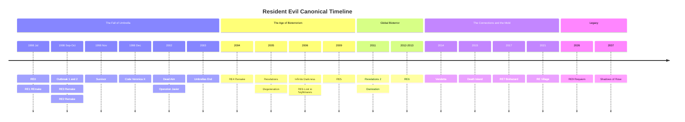
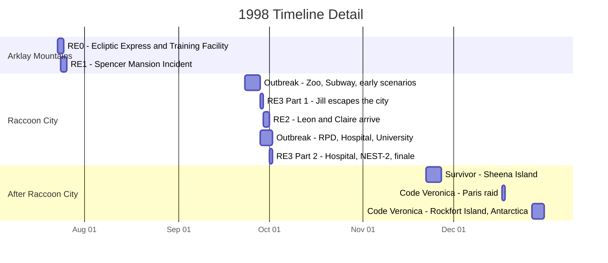
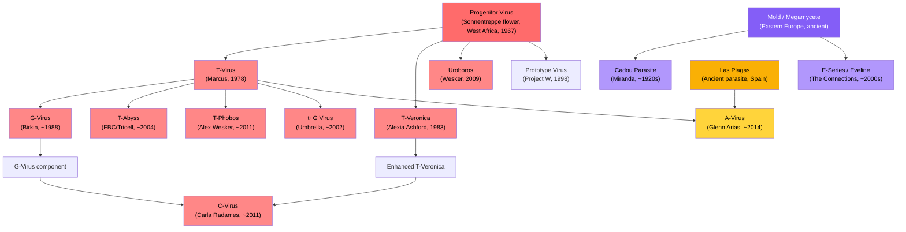

# Resident Evil: Cronologia Canónica

Uma referência abrangente que documenta a história canónica de cada jogo, DLC e projeto de animação CG de Resident Evil, organizada por cronologia dentro do universo fictício. Cada entrada inclui o enredo completo, as personagens principais, as ameaças biológicas e o significado para a lore.

[English](README.md) &nbsp;|&nbsp; [Português (Brasil)](README.pt-br.md) &nbsp;|&nbsp; Português (Portugal) &nbsp;|&nbsp; [Italiano](README.it.md) &nbsp;|&nbsp; [Español](README.es.md)

Os jogos estão ordenados pelo momento em que ocorrem na história, não pela data de lançamento. Os remakes são a fonte preferencial para os detalhes do enredo. Todos os spin-offs canónicos, DLCs e filmes de animação CG estão incluídos. As entradas não canónicas são listadas separadamente para referência.

## Índice

- [Visão Geral da Cronologia](#visão-geral-da-cronologia)
- [O Incidente de Raccoon City: Uma Análise Detalhada](#o-incidente-de-raccoon-city-uma-análise-detalhada)
- [Pré-história: As Sementes do Bioterrorismo](#pré-história-as-sementes-do-bioterrorismo-19191998)
- **As Montanhas Arklay e Raccoon City (1998)**
  - [Resident Evil 0](#resident-evil-0)
  - [Resident Evil (REmake)](#resident-evil-remake)
  - [Resident Evil Outbreak / File #2](#resident-evil-outbreak--file-2)
  - [Resident Evil 3 (Remake)](#resident-evil-3-remake)
  - [Resident Evil 2 (Remake)](#resident-evil-2-remake)
  - [Resident Evil Survivor](#resident-evil-survivor)
  - [Resident Evil Code: Veronica X](#resident-evil-code-veronica-x)
- **A Queda da Umbrella (2002-2004)**
  - [Resident Evil Dead Aim](#resident-evil-dead-aim)
  - [Darkside Chronicles: Operation Javier](#darkside-chronicles-operation-javier)
  - [Umbrella Chronicles: Umbrella's End](#umbrella-chronicles-umbrellas-end)
  - [Resident Evil 4 (Remake)](#resident-evil-4-remake)
- **A Ascensão do Bioterrorismo (2005-2009)**
  - [Resident Evil Revelations](#resident-evil-revelations)
  - [Degeneration (Filme CG)](#degeneration-filme-cg)
  - [Infinite Darkness (Série CG)](#infinite-darkness-série-cg)
  - [Resident Evil 5](#resident-evil-5)
- **Bioterrorismo Global (2011-2013)**
  - [Resident Evil Revelations 2](#resident-evil-revelations-2)
  - [Damnation (Filme CG)](#damnation-filme-cg)
  - [Resident Evil 6](#resident-evil-6)
- **The Connections e o Mold (2014-2021)**
  - [Vendetta (Filme CG)](#vendetta-filme-cg)
  - [Death Island (Filme CG)](#death-island-filme-cg)
  - [Resident Evil 7: Biohazard](#resident-evil-7-biohazard)
  - [Resident Evil Village](#resident-evil-village)
- **Legado (2026-2037)**
  - [Resident Evil 9: Requiem](#resident-evil-9-requiem)
  - [Shadows of Rose](#shadows-of-rose)
- [Genealogia Viral](#genealogia-viral)
- [Organizações Principais](#organizações-principais)
- [Aparições das Personagens](#aparições-das-personagens)
- [Referência de Canonicidade](#referência-de-canonicidade)

---

## Visão Geral da Cronologia

> O agrupamento de 1998 é enganadoramente denso. Sete entradas canónicas decorrem num período de seis meses, com quatro delas a sobreporem-se durante a destruição de Raccoon City em setembro-outubro. O diagrama de gantt abaixo faz zoom neste período.

---

## O Incidente de Raccoon City: Uma Análise Detalhada

Sobreposições importantes a notar:

- **RE0 termina onde RE1 começa.** Rebecca acaba de lutar contra a Queen Leech e caminha diretamente para a Spencer Mansion.
- **A Parte 1 do RE3 começa antes do RE2.** Jill inicia a sua fuga a 28 de setembro, um dia inteiro antes de Leon e Claire chegarem a 29 de setembro.
- **RE2, RE3 e Outbreak sobrepõem-se** durante 29 de setembro a 1 de outubro. Diferentes personagens vivem a mesma catástrofe em locais distintos da cidade.
- **Raccoon City é destruída a 1 de outubro** por um ataque de míssil termobárico do governo dos EUA, terminando RE3 e Outbreak simultaneamente.

---

## Pré-história: As Sementes do Bioterrorismo (1919-1998)

Os acontecimentos da série Resident Evil remontam a mais de um século. Compreender esta história de fundo é essencial, pois liga as origens de cada vírus, organização e antagonista importante.

**~Tempos antigos.** O Megamycete, um superorganismo fúngico massivo, desenvolve-se num sistema de grutas na Europa de Leste. Absorve e armazena a consciência e o ADN dos organismos que morrem nas suas proximidades. Separadamente, o Progenitor Virus evolui naturalmente nas flores Sonnentreppe na África Ocidental, num sistema de grutas sagrado para o povo Ndipaya. O organismo parasitário Las Plagas prospera em grutas sob o que virá a ser o Castelo Salazar na Espanha rural, até o 1.º Conde Salazar os selar no século XV.

**1909.** Eva nasce de uma mulher conhecida apenas como Mother Miranda numa aldeia remota da Europa de Leste.

**1919.** A gripe espanhola devasta a aldeia de Miranda e mata Eva aos 10 anos. Consumida pelo luto, Miranda vagueia até uma gruta e descobre o Megamycete. Ao contacto, experiencia visões de centenas de consciências absorvidas. Percebe que o fungo consegue armazenar e potencialmente restaurar uma mente. Sacrifica o corpo de Eva ao Megamycete e dedica a sua vida a encontrar um recipiente compatível para a ressurreição de Eva. Ao longo das décadas seguintes, Miranda experimenta nos aldeões usando o Mold, criando o parasita Cadou ao infetar vermes nematóides com material fúngico.

**Anos 1950.** Um jovem estudante de medicina chamado Oswell E. Spencer é apanhado por uma tempestade de neve nas montanhas europeias. Miranda resgata-o e cuida dele até recuperar. Spencer aprende sobre a investigação do Mold de Miranda e fica fascinado pelo conceito de usar agentes biológicos para remodelar a humanidade. Mais tarde, usa as ideias de Miranda como fundamento filosófico para as suas próprias ambições: tornar-se um deus controlando a evolução humana.

**Dezembro de 1966.** Spencer, Edward Ashford e James Marcus organizam uma expedição à África Ocidental. No início de 1967, isolam o Progenitor Virus das flores Sonnentreppe no Jardim do Sol.

**1967-1968.** Spencer contrata o arquiteto George Trevor para projetar uma mansão nas Montanhas Arklay, perto de Raccoon City. O verdadeiro propósito da mansão é esconder um laboratório subterrâneo de armas biológicas. Após a conclusão, Spencer rapta a família Trevor e usa-os como cobaias do Progenitor. Jessica Trevor morre da estirpe Type-A. A sua filha Lisa Trevor, de 14 anos, sobrevive à estirpe Type-B e torna-se efetivamente imortal. Lisa suporta décadas de experimentação contínua, transformando-se numa figura grotesca e trágica que vagueia pelos terrenos da mansão usando os rostos de investigadores mortos, à procura da sua mãe.

**1968.** Spencer, Ashford e Marcus fundam a Umbrella Pharmaceuticals. Publicamente, um conglomerado farmacêutico que abrange cosméticos, produtos químicos, maquinaria e bens de consumo. Secretamente, uma fachada para investigação de armas biológicas financiada por contratos governamentais. Edward Ashford morre de exposição acidental ao Progenitor pouco depois da fundação, enfraquecendo o ramo familiar dos Ashford.

**1971.** Alexander Ashford, filho de Edward, tenta restaurar o prestígio da sua família através do Project CODE: Veronica. Extrai ADN do corpo embalsamado da sua brilhante antepassada Veronica Ashford e cria clones gémeos: Alexia, uma prodígio que herda o génio de Veronica, e Alfred, um subproduto de inteligência mediana.

**13 de janeiro de 1978.** James Marcus alcança o avanço do T-Virus na Executive Training Facility ao combinar o Progenitor Virus com ADN de sanguessuga. O Tyrant Virus, ou T-Virus, nasce. Causa necrose, zombificação e mutagénese extrema na maioria dos hospedeiros, mas sujeitos compatíveis raros desenvolvem capacidades sobre-humanas.

**1981.** A Alexia Ashford de 10 anos torna-se Investigadora-Chefe na instalação antártica da Umbrella. Cria o vírus T-Veronica combinando o Progenitor Virus com genes de formiga rainha e um vírus antigo. O vírus confere ao hospedeiro capacidades pirocinéticas e controlo de insetos, mas apenas se o hospedeiro passar por 15 anos de adaptação criogénica. A injeção imediata causa mutação descontrolada.

**1983.** Alexia injeta o seu pai Alexander com T-Veronica como cobaia, transformando-o na criatura Nosferatu. Acorrenta-o na cave da instalação. Depois injeta-se a si própria e entra em sono criogénico, para despertar 15 anos mais tarde com o vírus perfeitamente ligado ao seu corpo. Alfred fica sozinho a gerir o legado Ashford, descendo lentamente na loucura.

**1988.** Spencer torna-se paranoico com as ambições e independência de Marcus. Ordena o assassinato de Marcus. Albert Wesker e William Birkin, os próprios pupilos estrela de Marcus que têm reportado secretamente a Spencer durante anos, lideram um esquadrão USS no laboratório de Marcus. Marcus é alvejado e o seu corpo despejado nos esgotos. Birkin apodera-se da investigação do T-Virus de Marcus e assume o crédito. Sem ninguém saber, uma Queen Leech entra no cadáver de Marcus, absorve as suas memórias e inicia um processo de regeneração que dura uma década.

**Início dos anos 1990.** William Birkin começa a desenvolver o G-Virus no laboratório NEST sob Raccoon City, derivado de mutações únicas observadas no corpo de Lisa Trevor. Ao contrário do T-Virus, que cria zombies, o G-Virus causa mutação contínua descontrolada e permite reprodução parasitária através de implantação de embriões.

**1996.** Wesker está infiltrado como capitão da S.T.A.R.S. Alpha Team no Departamento de Polícia de Raccoon City, enquanto trabalha secretamente para a Umbrella e faz acordos com uma organização rival.

**11 de maio de 1998.** Uma fuga da estirpe epsilon do T-Virus no Arklay Laboratory desencadeia um surto. Investigadores são infetados. Cerberus escapam para a floresta. Ao longo das semanas seguintes, uma série de "assassinatos canibais" bizarros nas Montanhas Arklay atrai atenção pública e policial. O Departamento de Polícia de Raccoon City cria a unidade de táticas especiais S.T.A.R.S. para investigar.

---

## As Montanhas Arklay e Raccoon City (1998)

### Resident Evil 0

**Datas na Cronologia:** 23-24 de julho de 1998
**Localização:** Comboio Ecliptic Express, Umbrella Executive Training Facility, Montanhas Arklay
**Protagonistas:** Rebecca Chambers, médica da S.T.A.R.S. Bravo Team, 18 anos e a membro mais jovem dos S.T.A.R.S. Billy Coen, ex-Segundo-Tenente dos Marines dos EUA condenado por massacrar 23 pessoas em África, sendo transportado para a sua execução quando o comboio foi atacado. Billy afirma ter sido incriminado pelo seu oficial superior.
**Antagonistas:** Queen Leech, a consciência reanimada de James Marcus. Proto Tyrant, um modelo Tyrant inicial falhado.

#### Resumo do Enredo

Na noite de 23 de julho de 1998, a Queen Leech lança um enxame de sanguessugas no Ecliptic Express, um comboio pertencente à Umbrella que viaja pelas Montanhas Arklay. Todos os passageiros e tripulantes são mortos ou infetados com o T-Virus. O ataque é a vingança da Queen Leech contra a Umbrella pelo assassinato de Marcus uma década antes.

O helicóptero da S.T.A.R.S. Bravo Team avaria e faz uma aterragem de emergência na Raccoon Forest enquanto se dirigia para investigar os assassinatos canibais. A equipa separa-se para vasculhar a área. Descobrem o destroço de um transporte da polícia militar com os condutores mortos. O prisioneiro, Billy Coen, desapareceu.

Rebecca descobre o Ecliptic Express parado e embarca sozinha, encontrando-o infestado de zombies e sanguessugas. Encontra Billy, que também se refugiou no comboio. Apesar das suas ordens para o prender, Rebecca coopera relutantemente com Billy para sobreviver no comboio infestado. O membro da Bravo Team Edward Dewey tropeça para bordo, gravemente ferido por Cerberus, e morre após avisar Rebecca dos perigos lá fora.

A Queen Leech, disfarçada como uma versão jovem de James Marcus, reativa o comboio. Billy e Rebecca aplicam desesperadamente os travões de emergência, mas o comboio descarrila e embate numa estação subterrânea ligada à Umbrella Executive Training Facility.

A Training Facility foi construída nos anos 1960 para educar adolescentes talentosos recrutados pela Umbrella. As provas encontradas pela instalação revelam uma verdade mais sombria: Marcus usava os estudantes como cobaias para as suas experiências com sanguessugas e o T-Virus, transformando-os em zombies. A cave da instalação contém uma câmara de tortura coberta de sangue seco.

Rebecca e Billy reconstituem a história de Marcus através de documentos espalhados. Descobrem que Marcus, juntamente com Spencer e Ashford, descobriu o Progenitor Virus nos anos 1960. Marcus combinou-o com ADN de sanguessuga para criar o T-Virus a 13 de janeiro de 1978. Encontram provas de que Spencer ordenou o assassinato de Marcus em 1988, executado pelos seus próprios protegidos Wesker e Birkin, que depois roubaram a sua investigação.

A dupla navega por uma igreja em ruínas e desce ao laboratório subterrâneo oculto de Marcus. A criatura que se fazia passar pelo jovem Marcus revela-se como a Queen Leech, um organismo massivo e mutante que passou dez anos a regenerar-se usando o cadáver de Marcus como hospedeiro. Absorveu as memórias, personalidade e sede de vingança de Marcus contra a Umbrella.

Na batalha final, Rebecca descobre que a Queen Leech é vulnerável à luz solar direta. Abre o teto da instalação enquanto Billy distrai a criatura. Exposta à luz solar, a Queen Leech enfraquece e Billy destrói-a com um revólver magnum. William Birkin, monitorizando a situação remotamente, ativa o sistema de autodestruição da instalação.

Enquanto o complexo detona, Rebecca toma uma decisão que define o seu carácter: falsifica a morte de Billy no seu relatório oficial, dizendo às autoridades que ele pereceu nas montanhas. Fica com as suas chapas de identificação como "prova." Billy desaparece na floresta, um homem livre. Rebecca segue em direção à Spencer Mansion para se encontrar com os colegas da Bravo Team, caminhando diretamente para os eventos de Resident Evil 1.

#### Principais Ameaças Biológicas

- **Queen Leech:** Uma sanguessuga que entrou no cadáver de Marcus, absorveu as suas memórias e desenvolveu capacidades de mudança de forma. Consegue imitar a aparência humana de Marcus e controlar enxames de sanguessugas telepaticamente. Na sua forma verdadeira, é um organismo amorfo massivo vulnerável à luz UV.
- **Mimicry Marcus:** Formas humanoides compostas por centenas de sanguessugas a agir como coletivo, imitando a forma de Marcus.
- **Proto Tyrant:** Um protótipo Tyrant inicial e instável armazenado no laboratório de Marcus. Menos poderoso e menos estável do que o modelo T-002 que aparece no RE1.
- **Eliminator:** Primatas infetados com T-Virus com agressividade e força aumentadas.
- **Stinger:** Um escorpião massivo mutado pelo T-Virus encontrado na Training Facility.
- **Centurion:** Uma centopeia gigante criada por exposição ao T-Virus.

#### Significado para a Lore

RE0 é o ponto de partida cronológico da série jogável. Estabelece a origem do T-Virus, as dinâmicas internas de poder dentro da Umbrella e as traições que puseram toda a franquia em movimento. O jogo revela que os três cofundadores da Umbrella tinham agendas distintas: Spencer buscava poder, Ashford buscava prestígio e Marcus buscava avanços científicos. A disponibilidade de Spencer para assassinar o seu próprio cofundador e roubar a sua investigação estabelece a crueldade que define a cultura corporativa da Umbrella.

A jornada de Rebecca da Training Facility diretamente para a Spencer Mansion fornece a ponte narrativa para o RE1. O jogo também explica por que os membros da Bravo Team estão espalhados pela área da mansão quando a Alpha Team chega.

---

### Resident Evil (REmake)

**Datas na Cronologia:** 24-25 de julho de 1998
**Localização:** Spencer Mansion e Arklay Laboratory, Montanhas Arklay perto de Raccoon City
**Protagonistas:** Chris Redfield, batedor da S.T.A.R.S. Alpha Team. Jill Valentine, segurança de retaguarda da S.T.A.R.S. Alpha Team, ex-operativa da Delta Force. Barry Burton, especialista de armamento da Alpha Team, chantageado por Wesker no cenário de Jill. Rebecca Chambers, vinda do RE0, assiste Chris no cenário dele.
**Antagonistas:** Albert Wesker, capitão da S.T.A.R.S. Alpha Team e agente duplo secreto da Umbrella. Tyrant T-002, o protótipo de supersoldado da Umbrella. Lisa Trevor, uma cobaia trágica e quase indestrutível que tem sido alvo de experiências desde 1967.

#### Resumo do Enredo

Depois da Bravo Team não dar notícias, a Alpha Team é enviada a 24 de julho de 1998. A equipa é composta por Chris Redfield, Jill Valentine, Barry Burton, Albert Wesker, Joseph Frost e o piloto de helicóptero Brad Vickers. Ao aterrarem na Arklay Forest, descobrem os destroços do helicóptero da Bravo Team. Joseph Frost é atacado e morto por Cerberus. Brad Vickers entra em pânico e foge com o helicóptero, deixando os quatro restantes em terra. Chris, Jill, Barry e Wesker refugiam-se na Spencer Mansion.

Wesker ordena à equipa que se separe e investigue. Na campanha de Jill, ela trabalha com Barry, que fornece armas e assistência enquanto secretamente reporta a Wesker. Wesker está a chantagear Barry ameaçando a sua família. Na campanha de Chris, este explora sozinho até encontrar Rebecca Chambers, recém-chegada dos eventos do RE0, que o assiste com a sua perícia médica.

A mansão é uma armadilha mortal. Os corredores ornamentados estão repletos de zombies, armadilhas desenhadas pelo arquiteto da mansão e criaturas cada vez mais perigosas. A equipa descobre os corpos e diários dos membros mortos da Bravo Team espalhados por todo o lado. Kenneth Sullivan é encontrado a ser devorado por um zombie. Forest Speyer jaz morto na varanda, morto por corvos e armadilhado com explosivos. Richard Aiken, envenenado pela serpente gigante Yawn, morre apesar das tentativas de Rebecca para o salvar no cenário de Chris.

Exclusivo do REmake, os zombies que são mortos mas não devidamente eliminados reanimam como Crimson Heads: mutantes mais rápidos e agressivos com garras e instintos predatórios aguçados. A única forma de prevenir isto é queimar os corpos ou decapitá-los. Esta mecânica acrescenta uma tensão persistente de gestão de recursos à exploração da mansão.

A guardhouse, um edifício separado ligado à mansão, alberga o tanque de tubarões Aqua Ring contendo Neptune, um tubarão branco infetado com T-Virus, e a massiva Plant 42, uma planta mutante que consumiu a estrutura do edifício. Os jogadores aprendem através de diários de investigadores sobre as várias experiências conduzidas na instalação e a degradação gradual dos protocolos de segurança que precedeu o surto.

O REmake introduz a história de Lisa Trevor. Os jogadores encontram-na na área da cabana e nos túneis subterrâneos. Ela não pode ser morta permanentemente. As suas entradas de diário, escritas com caligrafia cada vez mais deteriorada ao longo de décadas, revelam o horror do seu cativeiro. Em 1967, aos 14 anos, ela e a sua mãe Jessica foram raptadas por Spencer e usadas como cobaias do Progenitor. Jessica morreu. Lisa sobreviveu a todos os vírus que lhe injetaram, incluindo o parasita NE-alpha mais tarde usado para criar o Nemesis. O G-Virus foi eventualmente isolado do seu sangue. Em 1998, é uma criatura grotesca que usa os rostos arrancados de investigadores que matou, eternamente à procura do rosto da sua mãe.

Sob a mansão encontra-se o Arklay Laboratory, a instalação subterrânea de investigação da Umbrella onde opera o programa de BOW do T-Virus. O laboratório contém registos de desenvolvimento, armazenamento criogénico para cobaias experimentais e a joia da coroa da investigação da Umbrella: o Tyrant Project.

No laboratório, Wesker revela-se como traidor. Foi um agente da Umbrella durante todo o tempo, e toda a operação dos S.T.A.R.S. foi concebida para recolher dados de combate sobre BOWs a lutar contra soldados treinados. Tem gravado tudo. No cenário de Jill, a sua chantagem sobre Barry é revelada, e Barry acaba por se virar contra Wesker. Wesker ativa o Tyrant T-002 da sua cápsula criogénica, um humanoide colossal de pele cinzenta com uma garra massiva e um coração exposto. O Tyrant empala Wesker pelo abdómen, aparentemente matando-o, e depois vira-se contra os restantes membros dos S.T.A.R.S.

O que ninguém sabe é que Wesker se injetou com um vírus especial fornecido por William Birkin antes de entrar na mansão. O vírus, parte do Project W de Spencer, foi concebido para conceder capacidades sobre-humanas a hospedeiros geneticamente compatíveis. Wesker morre e é ressuscitado pelo vírus enquanto os outros lutam pela sobrevivência.

Após derrotarem o Tyrant no laboratório, os sobreviventes ativam o sistema de autodestruição de emergência. Correm pela instalação em colapso até ao heliporto no telhado da mansão. O Tyrant, agora mutado na sua forma Super Tyrant com coração exposto e garras massivas, irrompe pelo chão do heliporto para um confronto final. Brad Vickers, que tem estado a sobrevoar a área no helicóptero, lança um lança-rockets. O Super Tyrant é destruído.

Chris, Jill, Barry e Rebecca escapam no helicóptero enquanto a Spencer Mansion e o seu laboratório subterrâneo são consumidos pela explosão. Os quatro sobreviventes decidem expor os crimes da Umbrella. Chris parte para a Europa pouco depois para investigar a sede da Umbrella, uma decisão que levará a sua irmã Claire a Raccoon City dois meses mais tarde à sua procura.

#### Principais Ameaças Biológicas

- **Tyrant T-002:** O protótipo de supersoldado da Umbrella, o pináculo do seu Tyrant Project. Um BOW humanoide com força e velocidade sobre-humanas e uma garra óssea massiva que se estende do braço direito. O seu coração exposto é a sua fraqueza. Quando suficientemente danificado, muta para a forma Super Tyrant, mais rápida e agressiva.
- **Lisa Trevor:** Não é uma antagonista tradicional, mas uma presença indestrutível. Décadas de experimentação viral tornaram-na efetivamente imortal. Absorveu o parasita NE-alpha que mais tarde seria usado no Nemesis Project. O seu corpo foi o material de origem para o G-Virus.
- **Crimson Heads:** Zombies que reanimam se não forem queimados ou decapitados. Mais rápidos e letais do que zombies normais, com garras e agressividade aumentada. Uma mecânica exclusiva do REmake.
- **Hunters MA-121 Alpha:** BOWs híbridos réptil-humano criados por enxerto de ADN reptiliano em embriões humanos usando o T-Virus. Capazes de decapitar vítimas com um único golpe. Infiltram-se na mansão após a secção da guardhouse.
- **Yawn:** Uma serpente massiva mutada pelo T-Virus que guarda os andares superiores da mansão. O seu veneno é letal sem antídoto.
- **Neptune:** Tubarões brancos infetados com T-Virus no Aqua Ring.
- **Plant 42:** Uma planta mutante massiva na guardhouse, vulnerável ao composto químico V-JOLT.
- **Cerberus:** Dobermans infetados com T-Virus que vagueiam pelos terrenos da mansão e pela floresta.

#### Significado para a Lore

O Mansion Incident é o evento catalisador de toda a franquia Resident Evil. Cada jogo subsequente tem as suas raízes no que acontece aqui. Os sobreviventes tornam-se os combatentes centrais anti-Umbrella: Chris e Jill cofundam a BSAA, Barry treina a geração seguinte de operativos e Rebecca prossegue investigação de armas biológicas numa vertente académica.

A sobrevivência e transformação de Wesker de agente humano em ameaça sobre-humana estabelece-o como o antagonista principal da série até ao RE5. A sua injeção do vírus do Project W é a primeira pista do programa de eugenia de Spencer, um fio narrativo que demora sete jogos a desvendar completamente.

As autoridades de Raccoon City, sob influência da Umbrella, encobrem o Mansion Incident. Os S.T.A.R.S. são discretamente dissolvidos. Os avisos dos sobreviventes são ignorados. Este encobrimento permite diretamente o surto de T-Virus que consome a cidade dois meses depois. O Chefe da Polícia de Raccoon City, Brian Irons, está na folha de pagamentos da Umbrella e suprime ativamente as provas.

A história de Lisa Trevor é a adição mais significativa do REmake à lore. As suas décadas de sofrimento revelam a profundidade da crueldade da Umbrella e fornecem a origem tanto do G-Virus como do parasita NE-alpha usado no Nemesis. Ela é o fio condutor entre o Progenitor Virus, o T-Virus, o G-Virus e o Nemesis Project.

---

### Resident Evil Outbreak / File #2

**Datas na Cronologia:** 23 de setembro a 1 de outubro de 1998
**Localização:** Vários locais em Raccoon City: J's Bar, Zoo de Raccoon, sistema de metro, Raccoon General Hospital, Esquadra de Polícia do RPD, Universidade de Raccoon, instalação de eliminação de resíduos da Umbrella
**Protagonistas:** Oito civis de Raccoon City: Kevin Ryman, agente da polícia do RPD. Mark Wilkins, segurança e veterano do Vietname. Jim Chapman, empregado do metro. George Hamilton, cirurgião no Raccoon General Hospital. David King, canalizador e faz-tudo. Alyssa Ashcroft, jornalista de investigação. Yoko Suzuki, estudante universitária e ex-funcionária da Umbrella com memórias suprimidas. Cindy Lennox, empregada de mesa no J's Bar.
**Antagonistas:** William Birkin na sua forma G-mutante. Thanatos, um Tyrant não autorizado criado pelo investigador da Universidade de Raccoon Greg Mueller. Nyx, um BOW amorfo massivo armazenado num estaleiro da Umbrella. Nikolai Ginovaef, monitor do UBCS a trabalhar para a Umbrella.

#### Resumo do Enredo

Os jogos Outbreak retratam o desastre de Raccoon City pelos olhos de cidadãos comuns em vez de operativos treinados. Os cenários abrangem toda a duração do surto, desde a infeção inicial do abastecimento de água até à destruição da cidade por ataque de míssil.

**"Wild Things," 23 de setembro.** O cenário mais antigo cronologicamente. O T-Virus chegou ao Zoo de Raccoon, mutando os animais. Os sobreviventes enfrentam leões zombie, um elefante zombie chamado Oscar e hienas infetadas. Um helicóptero de evacuação despenha-se, forçando o grupo a encontrar uma fuga alternativa. Este cenário mostra quão cedo a infeção se espalhou pela infraestrutura da cidade.

**"Outbreak," 24 de setembro.** O surto de T-Virus chega ao J's Bar na zona alta de Raccoon City, onde muitos dos oito protagonistas são frequentadores ou empregados. Zombies rebentam pelas janelas e portas. Os sobreviventes barricam as entradas, lutam contra a horda e escapam pelos telhados enquanto o RPD detona explosivos para limpar as ruas. Este cenário introdutório é a primeira vez que os oito civis se cruzam.

**"Underbelly," 25-26 de setembro.** Os sobreviventes tentam fugir pelo sistema de metro de Raccoon City. Um descarrilamento perturba um ninho de parasitas, incluindo o Giga Bite, uma pulga mutante massiva. O grupo navega pelos túneis inundados e escapa num comboio em partida ou por condutas de ventilação.

**"Below Freezing Point," 25-26 de setembro.** Liderados por Yoko Suzuki, cujas memórias fragmentadas de trabalhar na Umbrella emergem ao longo do cenário, o grupo infiltra-se no laboratório subterrâneo da Umbrella sob a cidade, a mesma instalação NEST do RE2. Encontram Monica, uma virologista renegada da Umbrella a tentar roubar dados de investigação. Monica é morta pelo mutado William Birkin na sua forma G-creature. Os sobreviventes escapam pelos túneis de emergência do laboratório.

**"The Hive," 26-27 de setembro.** O Raccoon General Hospital, o mesmo hospital que aparece no RE3, está sob ataque de uma colónia de sanguessugas mutantes gigantes. Uma entidade Leech Man persegue os corredores. Os sobreviventes destroem a Leech Queen que habita a cave do hospital para escapar.

**"Hellfire," 27-28 de setembro.** Um incêndio engole um hotel antigo em Raccoon City. Os sobreviventes navegam pela estrutura em chamas e em colapso enquanto combatem zombies. Uma criatura mutante massiva ronda o hotel. O cenário ilustra como a infraestrutura da cidade se está a desintegrar em múltiplas frentes simultaneamente.

**"Flashback," 28-29 de setembro.** O grupo refugia-se numa cabana na Raccoon Forest, onde conhecem Al Lester, um homem que promete guiá-los em segurança. Al é na verdade perturbado. A sua mulher Dorothy foi alvo de experiências num hospital abandonado próximo e fundiu-se com uma planta mutante. Al atrai vítimas para alimentar a planta, esperando manter Dorothy viva. Os sobreviventes destroem o núcleo da planta e escapam da floresta.

**"Desperate Times," 28-29 de setembro.** Os sobreviventes juntam-se aos agentes de polícia restantes a defender a Esquadra de Polícia do RPD, o mesmo edifício do RE2. O Tenente Marvin Branagh, o agente ferido que mais tarde dá informações a Leon no RE2, lidera a defesa. As barricadas acabam por ceder e os sobreviventes escapam pelos esgotos enquanto a esquadra é invadida.

**"Decisions, Decisions," 1 de outubro.** O cenário final e mais significativo. George Hamilton lidera o grupo até à Universidade de Raccoon para encontrar o seu colega Peter Jenkins, que estava a desenvolver uma vacina contra o T-Virus chamada "Daylight." Descobrem que Peter foi assassinado pelo ex-investigador da Umbrella Greg Mueller, que queria suprimir a vacina e vender a sua própria criação Tyrant não autorizada. Mueller é assassinado por Nikolai Ginovaef, o monitor do UBCS do RE3, que está a eliminar testemunhas e a recolher dados. O Tyrant de Mueller, Thanatos, é libertado. Os sobreviventes sintetizam a vacina Daylight eles próprios, derrotam Thanatos após este mutar na forma mais poderosa Thanatos R, e escapam de helicóptero momentos antes do míssil termobárico do governo dos EUA obliterar Raccoon City a 1 de outubro.

**"End of the Road," 1 de outubro.** David King lidera o grupo até uma instalação de eliminação de resíduos da Umbrella nos arredores da cidade. Encontram cientistas a tentar recuperar uma cura. Aqueles que escapam pela autoestrada enfrentam Nyx, um BOW amorfo massivo que consegue absorver outros organismos, incluindo um T-103 Tyrant. Este cenário oferece um dos últimos vislumbres de Raccoon City antes da sua destruição.

#### Principais Ameaças Biológicas

- **Thanatos:** Um Tyrant não autorizado criado por Greg Mueller na Universidade de Raccoon usando investigação roubada da Umbrella. Distinto dos modelos oficiais de Tyrant da Umbrella. A sua forma mutada, Thanatos R, é mais rápida e agressiva.
- **Nyx:** Um BOW amorfo massivo armazenado num estaleiro de eliminação de resíduos da Umbrella. Capaz de absorver e incorporar outros organismos na sua massa corporal, incluindo um T-103 Tyrant. Um dos BOWs mais perigosos encontrados no incidente de Raccoon City.
- **William Birkin forma G:** Encontrado no cenário "Below Freezing Point" no mesmo laboratório NEST do RE2.
- **Oscar:** Um elefante infetado com T-Virus no Zoo de Raccoon.
- **Giga Bite:** Uma pulga mutante massiva no sistema de metro.
- **Leech Man:** Uma entidade humanoide composta por sanguessugas mutantes que infestam o Raccoon General Hospital.

#### Significado para a Lore

Os jogos Outbreak provam que a destruição de Raccoon City não foi apenas a história de alguns heróis. Milhares de civis viveram o surto, e pequenos grupos lutaram para sobreviver em cada canto da cidade simultaneamente. A vacina "Daylight" representa uma cura alternativa para o T-Virus que, se tivesse sido produzida em massa, poderia ter mudado o rumo dos acontecimentos.

As memórias suprimidas da Umbrella de Yoko Suzuki sugerem que a Umbrella experimentava nos seus próprios funcionários e apagava a sua consciência. O passado de jornalista de investigação de Alyssa Ashcroft torna-se diretamente relevante para o RE9: Requiem, onde a sua filha Grace Ashcroft é uma das protagonistas.

Os cenários sobrepõem-se com o RE2 e o RE3, colocando o jogador em locais que Leon, Claire e Jill visitam, por vezes ao mesmo tempo. A defesa do RPD por Marvin Branagh em "Desperate Times" mostra as horas antes de Leon e Claire chegarem para encontrar a esquadra já caída.

---

### Resident Evil 3 (Remake)

**Datas na Cronologia:** 28 de setembro a 1 de outubro de 1998. Começa aproximadamente 24 horas antes do RE2. A primeira metade precede o RE2; a segunda metade ocorre após os eventos principais do RE2 concluírem.
**Localização:** Ruas de Raccoon City, sistema de metro, Clock Tower, Raccoon General Hospital, laboratório NEST-2
**Protagonistas:** Jill Valentine, ex-membro da S.T.A.R.S. Alpha Team e sobrevivente do Mansion Incident. Desde julho que tem tentado expor os crimes da Umbrella mas tem sido bloqueada pela influência da empresa sobre as autoridades locais. Carlos Oliveira, Cabo do Biohazard Countermeasure Service da Umbrella, um ex-guerrilheiro sul-americano que se juntou ao UBCS sem conhecer a extensão total dos crimes da Umbrella.
**Antagonistas:** Nemesis-T Type, um T-103 Tyrant implantado com um parasita NE-alpha, conferindo-lhe inteligência, fala e capacidade de seguir ordens complexas. A sua missão: caçar e matar todos os membros sobreviventes dos S.T.A.R.S. para demonstrar a eficácia de combate do parasita. Nikolai Zinoviev, Sargento do UBCS e "Supervisor" secreto da Umbrella infiltrado para recolher dados de combate de BOWs.

#### Resumo do Enredo

O jogo abre com Jill a ter um pesadelo no seu apartamento, ilustrando o PTSD que sofre desde o Mansion Incident dois meses antes. Acorda com um telefonema a avisá-la de uma nova ameaça. Antes de poder reagir, Nemesis rebenta pela parede do seu apartamento.

Nemesis é a arma biológica mais sofisticada da Umbrella até à data: um T-103 Tyrant implantado com o parasita NE-alpha, que forma o seu próprio cérebro dentro do sistema nervoso do hospedeiro. Isto confere à criatura inteligência, raciocínio tático, capacidade de usar armas e fala limitada. Consegue dizer uma palavra: "S.T.A.R.S." A sua missão é eliminar todos os membros sobreviventes dos S.T.A.R.S. como demonstração de campo do potencial militar do parasita NE-alpha. Jill, como uma dos quatro sobreviventes conhecidos, é o alvo principal.

Jill escapa por pouco do encontro inicial e foge pelas ruas. Testemunha Brad Vickers, o seu ex-colega dos S.T.A.R.S. e piloto de helicóptero do RE1, a ser dominado por zombies. Brad segura uma porta para dar tempo a Jill e é mordido. Morre da infeção pouco depois. O seu corpo zombificado é mais tarde encontrado por Carlos no RPD.

Jill conhece os mercenários UBCS sobreviventes: Carlos Oliveira, o líder de pelotão ferido Mikhail Viktor e o suspeito Nikolai Zinoviev. O UBCS foi destacado pela Umbrella para lidar com o surto, mas a maioria dos esquadrões foi dizimada. Os sobreviventes planeiam escapar pelo sistema de metro.

Jill e Carlos trabalham para restaurar a energia do metro. Jill navega pela cidade infestada, recolhendo peças e resolvendo problemas enquanto é periodicamente perseguida por Nemesis. A criatura é implacável, aparecendo em momentos imprevisíveis, por vezes empunhando um lança-rockets. Os encontros escalam em intensidade, com Nemesis a adaptar-se às táticas de Jill.

Quando Nemesis aborda a carruagem do metro durante a fuga, Mikhail Viktor faz um sacrifício heroico. O líder de pelotão ferido detona uma granada à queima-roupa, destruindo a carruagem e atrasando Nemesis. Mikhail morre na explosão. O metro danificado despenha-se perto da Clock Tower.

Na Clock Tower, Jill e Carlos tentam sinalizar um helicóptero de resgate. Um helicóptero chega, mas Nemesis, tendo sobrevivido e agora a largar o seu casaco para revelar uma forma mais orgânica coberta de tentáculos, destrói-o. Na batalha que se segue, Nemesis infeta Jill com o T-Virus através de um golpe de tentáculo. Jill colapsa e cai em coma.

Carlos transporta Jill para o Raccoon General Hospital e procura desesperadamente uma cura. O hospital está invadido por Hunters e pessoal zombificado. Carlos luta pelos corredores e descobre uma vacina contra o T-Virus sintetizada por investigadores da Umbrella. Também encontra Nikolai, que revela o seu verdadeiro papel como "Supervisor" pago, um monitor infiltrado pela Umbrella para recolher clandestinamente dados de combate de BOWs durante o surto. Nikolai tem estado a eliminar outros monitores e sobreviventes para garantir que apenas ele possui os dados valiosos. Carlos confronta-o, mas Nikolai escapa.

O remake dá a Carlos uma secção de jogabilidade expandida na Esquadra de Polícia do RPD, sobrepondo-se com o cenário do RE2. Carlos luta pelos mesmos corredores que Leon e Claire percorrem, aproximadamente ao mesmo tempo, oferecendo uma perspetiva diferente da queda da esquadra.

Carlos administra a vacina, curando Jill. Ela acorda a 1 de outubro, o dia em que o governo dos EUA autorizou um ataque de míssil termobárico sobre Raccoon City. Transmissões de rádio anunciam a destruição iminente. O relógio está a contar.

A Jill curada dirige-se ao NEST-2, um laboratório da Umbrella ligado à instalação NEST do RE2. Descobre que foi usado para mais desenvolvimento de BOWs e investigação viral. Nikolai reaparece, tentando executar Jill no heliporto da instalação e usar Carlos como isco para recolher dados finais de combate. Carlos imobiliza Nikolai e Jill põe fim aos seus esquemas.

Nemesis, agora mutado numa forma quadrúpede massiva mal reconhecível como tendo sido outrora humanoide, ataca Jill no NEST-2. Ela submerge a criatura em ácido e acaba com ela usando um railgun, destruindo a arma biológica que a perseguiu por toda a cidade.

Jill e Carlos chegam ao heliporto e são extraídos mesmo quando o míssil termobárico atinge. Raccoon City é completamente obliterada. Todos os infetados restantes, todas as provas da Umbrella e todos os civis que não conseguiram escapar são aniquilados. O governo dos EUA, sob a direção do Conselheiro de Segurança Nacional Derek C. Simmons, orquestra um encobrimento do seu próprio envolvimento.

#### Principais Ameaças Biológicas

- **Nemesis-T Type:** O modelo de Tyrant mais avançado na altura do incidente de Raccoon City. Um T-103 implantado com o parasita NE-alpha, que forma um cérebro secundário. Capaz de fala, uso de armas, planeamento tático e perseguição implacável. Progride através de múltiplos estágios de mutação: humanoide de gabardina, forma orgânica exposta com tentáculos e criatura quadrúpede massiva. O parasita NE-alpha foi originalmente testado em Lisa Trevor, que o absorveu.
- **Drain Deimos / Brain Suckers:** Parasitas gigantes mutantes semelhantes a pulgas que drenam líquido cefalorraquidiano das vítimas.
- **Hunters Beta e Gamma:** Variantes avançadas de Hunter. Os Gamma Hunters são aquáticos, encontrados nos esgotos. Os Beta Hunters são encontrados no hospital.
- **Grave Digger:** Um verme massivo mutado pelo T-Virus na área do parque da cidade, presente na versão original.
- **Pale Heads:** Zombies exclusivos do remake com capacidades regenerativas extremas, encontrados no NEST-2.

#### Significado para a Lore

O RE3 decorre em simultâneo com o RE2 e mostra o outro lado dos últimos dias de Raccoon City. Enquanto Leon e Claire percorrem o RPD e o NEST subterrâneo, Jill combate Nemesis pelas ruas, metro e hospitais da cidade. A secção de Carlos no RPD sobrepõe-se diretamente com os eventos do RE2.

O Nemesis Project demonstra as ambições crescentes da Umbrella. O parasita NE-alpha dá a um Tyrant inteligência e foco de missão, um salto significativo em relação ao T-002 irracional do RE1 ou ao Mr. X obediente mas simples do RE2. Os dados de combate recolhidos durante a perseguição de Nemesis a Jill são valiosos para a Umbrella independentemente da sobrevivência da criatura.

O destacamento do UBCS pela Umbrella revela a disposição da empresa para sacrificar os seus próprios empregados. Os mercenários do UBCS são ativos descartáveis, recrutados entre criminosos de guerra e soldados desesperados de todo o mundo. Os Supervisores ocultos entre eles existem apenas para documentar como os BOWs se comportam contra humanos treinados em combate real.

A destruição de Raccoon City é o evento fulcral da franquia. Desencadeia investigações no Congresso, indignação internacional e, em última instância, os processos legais que destroem a Umbrella Corporation. A sobrevivência de Jill e o seu conhecimento em primeira mão tanto do Mansion Incident como da destruição de Raccoon City tornam-na uma das testemunhas mais importantes contra a Umbrella. Ela e Chris cofundam a BSAA.

---

### Resident Evil 2 (Remake)

**Datas na Cronologia:** 29 de setembro a 1 de outubro de 1998
**Localização:** Arredores de Raccoon City, Esquadra de Polícia do RPD, esgotos de Raccoon City, laboratório subterrâneo NEST
**Protagonistas:** Leon S. Kennedy, um polícia novato de 21 anos a chegar para o seu primeiro dia no RPD. Adormeceu demais num motel nos arredores da cidade após um rompimento amoroso e chegou tarde, apenas para encontrar a cidade invadida. Claire Redfield, estudante universitária de 19 anos e irmã mais nova de Chris Redfield, chegando a Raccoon City na sua mota à procura de Chris, que não a contactou desde o Mansion Incident. Ada Wong, uma espia a trabalhar para uma organização rival, fazendo-se passar por agente do FBI à procura de um repórter chamado Ben Bertolucci, enquanto secretamente persegue uma amostra do G-Virus. Sherry Birkin, filha de 12 anos de William e Annette Birkin, escondida na esquadra de polícia.
**Antagonistas:** William Birkin / "G," ex-Investigador-Chefe do NEST e criador do G-Virus, que se injetou com a sua criação após ser alvejado pelo USS da Umbrella e agora muta através de cinco estágios cada vez mais grotescos. Mr. X / T-00, um T-103 Tyrant de produção em massa destacado pela Umbrella para recuperar a amostra do G-Virus e eliminar sobreviventes. Chefe Brian Irons, o corrupto Chefe do RPD que tem estado na folha de pagamentos da Umbrella durante anos, suprimindo provas dos seus crimes.

#### Resumo do Enredo

A 22 de setembro de 1998, uma semana antes do jogo começar, o Security Service da Umbrella liderado pelo operativo HUNK invade o laboratório NEST sob Raccoon City. A missão: apreender o G-Virus de William Birkin, que planeia desertar para os militares dos EUA com a sua investigação. No confronto, operativos do USS alvejam Birkin múltiplas vezes. Dado como morto, Birkin injeta-se com uma amostra do G-Virus em desespero. O vírus reanima-o e transforma-o numa criatura movida por raiva e instinto reprodutivo. Ele massacra o esquadrão do USS. No caos, amostras de T-Virus derramam-se e são espalhadas pelo sistema de esgotos por ratos. Em poucos dias, o abastecimento de água da cidade está contaminado e dezenas de milhares de cidadãos são infetados.

Na noite de 29 de setembro, Leon Kennedy e Claire Redfield chegam a Raccoon City independentemente. Leon, a conduzir o seu Jeep, e Claire, na sua mota, encontram-se numa estação de serviço nos arredores quando zombies atacam. Apoderam-se de um carro de polícia e aceleram em direção ao edifício do RPD. Um zombie no banco traseiro causa um acidente, e um camião cisterna atravessado separa-os. Combinam encontrar-se no RPD e tomam rotas separadas.

A Esquadra de Polícia do RPD, outrora um museu de arte, é um edifício labiríntico com arquitetura elaborada que agora serve como túmulo. A maioria dos agentes está morta. O Tenente Marvin Branagh, gravemente ferido e a combater a infeção, dá a Leon uma faca de combate e informação crucial antes de sucumbir ao T-Virus e transformar-se. O jogador é forçado a abater o homem que acabou de o ajudar.

Leon encontra Ada Wong, que afirma estar à procura do repórter Ben Bertolucci. Na verdade, Ada é uma espia a trabalhar para uma organização rival, enviada para recuperar uma amostra do G-Virus. Apesar da sua missão, desenvolve sentimentos genuínos por Leon ao longo da sua parceria. A dinâmica entre ambos mistura dependência mútua com engano mútuo.

Claire descobre Sherry Birkin escondida na esquadra. Os pais de Sherry, William e Annette, são cientistas da Umbrella no NEST. Claire toma Sherry sob a sua proteção, e o laço entre ambas torna-se uma das relações mais duradouras da série.

O Chefe Brian Irons, o corrupto chefe de polícia, é encontrado na sala de taxidermia do RPD rodeado dos seus troféus de caça. Tem estado na folha de pagamentos da Umbrella durante anos, suprimindo provas das suas atividades ilegais e obstruindo as tentativas dos sobreviventes dos S.T.A.R.S. de expor a empresa. Durante o surto, a sua sanidade deteriora-se. No cenário de Claire, Irons rapta Sherry. A sua morte chega quando William Birkin, movido pelo instinto reprodutivo do G-Virus, lhe implanta um G-embrião. O embrião rebenta do corpo de Irons, matando-o violentamente.

Um helicóptero da Umbrella lança um contentor de transporte no telhado do RPD a meio do jogo. O T-00 Tyrant, com o nome de código Mr. X, emerge e começa a perseguir metodicamente o jogador pela esquadra. Ao contrário dos zombies irracionais, Mr. X está orientado para a missão: recuperar o pendente do G-Virus e eliminar testemunhas. Não pode ser parado permanentemente, apenas atordoado. O som dos seus passos pesados a ecoar pelos corredores cria uma tensão persistente. No remake, Mr. X patrulha dinamicamente, seguindo sons e perseguindo o jogador por múltiplas salas.

Ambas as personagens acabam por navegar do RPD para o sistema de esgotos da cidade, e daí para o NEST, a massiva instalação de investigação subterrânea da Umbrella onde o G-Virus foi desenvolvido. A instalação é um complexo de alta tecnologia repleto de laboratórios, armazenamento de espécimes e as provas de décadas de investigação de Birkin.

No cenário de Leon, Annette Birkin, a mulher de William e também investigadora do NEST, revela a verdadeira identidade de Ada. Ada não procura um namorado nem um repórter. É uma espia mercenária contratada para roubar o G-Virus. A revelação força Leon a confrontar os seus sentimentos crescentes por alguém que o tem manipulado. Na cena climática, Ada aponta uma arma a Leon para exigir a amostra do G-Virus. Durante a sequência de autodestruição da instalação, Ada é derrubada de uma passarela e cai na escuridão. Sobrevive, escapando com um fragmento de tecido contendo material do G-Virus.

No cenário de Claire, William Birkin, movido pelo instinto reprodutivo do G-Virus de encontrar hospedeiros geneticamente compatíveis, visa a sua própria filha Sherry. Implanta um G-embrião nela. Claire e Annette correm para sintetizar a vacina DEVIL a partir do equipamento da Umbrella no NEST. Annette, mortalmente ferida pelo mutado William, confirma que a vacina funciona antes de morrer. Sherry é curada, mas a exposição ao G-Virus deixa-a com capacidades regenerativas permanentes que se tornam relevantes no RE6.

O sistema de autodestruição do NEST é ativado. Leon derrota Mr. X na sua forma final de Super Tyrant mutado numa plataforma de elevador, usando um lança-rockets lançado por Ada das sombras acima. Os sobreviventes convergem num comboio de emergência subterrâneo. Enquanto o comboio acelera pelo túnel, Birkin na sua forma final G5, uma massa enorme de carne, dentes e olhos que consumiu a secção traseira do comboio, ataca. A carruagem traseira é desacoplada, deixando Birkin para ser consumido pela explosão da instalação.

Leon, Claire e Sherry emergem do túnel nos arredores de Raccoon City ao amanhecer. Caminham por uma estrada afastando-se da cidade em chamas. Leon diz a Claire que encontrará uma forma de parar a Umbrella. Claire diz que ainda precisa de encontrar Chris. Os seus caminhos divergem, mas as suas vidas permanecem entrelaçadas ao longo da série.

HUNK, o único operativo do USS sobrevivente da invasão original a Birkin, escapa de Raccoon City separadamente com uma amostra do G-Virus guardada numa mala. A sua extração por helicóptero do telhado do RPD significa que a Umbrella acabou por obter o que veio buscar, ao custo de uma cidade inteira.

#### Principais Ameaças Biológicas

- **William Birkin / "G":** Progride através de cinco estágios de mutação. G1 mantém uma forma vagamente humana com um globo ocular massivo no ombro direito e um braço com garras. G2 perde a maioria das características humanas, desenvolvendo um segundo par de braços. G3 é totalmente monstruoso, quadrúpede. G4 é um horror massivo e assimétrico. G5 é uma massa amorfa de carne e dentes que consome tudo o que toca. Ao contrário das mutações do T-Virus, a mutação do G-Virus é contínua e incontrolável.
- **Mr. X / T-00:** Um T-103 Tyrant de produção em massa, mais refinado do que o protótipo T-002 do RE1. Destacado com gabardina e chapéu para se misturar em ambientes urbanos. Segue ordens, rastreia alvos e não pode ser morto permanentemente com armas convencionais. Na sua forma Super Tyrant, o casaco rasga-se para revelar musculatura exposta e uma garra óssea massiva.
- **Lickers:** BOWs sem pele e cegos que caçam pelo som. São um estágio avançado de mutação de zombies cujos cérebros incharam e ficaram expostos. Rápidos, letais e capazes de trepar paredes. As suas línguas podem empalar vítimas do outro lado de uma sala.
- **G-Adults / G-Embryos:** Birkin, movido pelo instinto reprodutivo do G-Virus, implanta embriões parasitários em hospedeiros. Hospedeiros geneticamente incompatíveis rejeitam o embrião, que rebenta e cresce num G-Adult: uma criatura pequena e agressiva. Hospedeiros compatíveis, especificamente familiares consanguíneos, produziriam teoricamente um organismo G perfeito.
- **Giant Alligator:** Um crocodilo massivo infetado com T-Virus nos esgotos da cidade. Encontrado brevemente mas de forma memorável.
- **Ivy:** BOWs baseados em plantas no NEST criados por exposição ao T-Virus. No remake, chamam-se Plant 43 e são encontrados na secção da estufa.

#### Significado para a Lore

O RE2 retrata a catástrofe definidora da franquia. O surto de Raccoon City é o evento para o qual tudo o que veio antes conduz e ao qual tudo o que vem depois responde. Destrói a reputação pública da Umbrella, desencadeia investigações governamentais e inicia o mercado negro global de armas biológicas.

A experiência de Leon aqui transforma-o de um novato idealista no agente governamental endurecido que se torna no RE4 e RE6. A sua relação complicada com Ada Wong, nascida no engano e desespero de Raccoon City, torna-se um dos fios narrativos mais longos da série.

O laço de Claire com Sherry prolonga-se diretamente. No RE: Revelations 2, Claire é raptada enquanto trabalha para a TerraSave. No RE6, Sherry regressa como agente adulta da DSO, as suas capacidades regenerativas uma marca permanente da exposição ao G-Virus que Claire lutou para curar.

O G-Virus representa uma ameaça fundamentalmente diferente do T-Virus. Enquanto o T-Virus cria zombies e BOWs controláveis para venda militar, o G-Virus cria um organismo incontrolável movido por puro instinto evolutivo. A tragédia de Birkin é que o trabalho da sua vida o consumiu literalmente.

A recuperação de amostras do G-Virus por múltiplas partes, HUNK para a Umbrella e Ada para o seu empregador, cria as condições para a proliferação de armas biológicas nos jogos seguintes. O C-Virus no RE6 deriva diretamente da combinação de material do G-Virus com uma estirpe melhorada de T-Veronica.

---

### Resident Evil Survivor

**Datas na Cronologia:** 22-26 de novembro de 1998
**Localização:** Sheena Island, uma ilha privada pertencente à Umbrella na Europa
**Protagonistas:** Ark Thompson, um detetive privado e amigo de Leon S. Kennedy. Infiltrou-se em Sheena Island disfarçado de Vincent Goldman, o comandante da Umbrella na ilha, para investigar as operações da instalação. Lott e Lily Klein, filhos de um investigador da Umbrella que ajudam Ark a escapar.
**Antagonistas:** Vincent Goldman, o verdadeiro comandante da Umbrella em Sheena Island. Desencadeou deliberadamente um surto de T-Virus para encobrir provas da sua operação ilegal de produção em massa de Tyrants. Hypnos-T Type, uma variante avançada de Tyrant desenvolvida na ilha.

#### Resumo do Enredo

Sheena Island é a instalação secreta de produção em massa da Umbrella para BOWs da classe Tyrant. A população da ilha consiste em empregados da Umbrella e suas famílias, juntamente com adolescentes raptados usados como matéria-prima para a produção de Tyrants. Os sujeitos adolescentes são selecionados porque os seus cérebros em desenvolvimento produzem níveis mais elevados das hormonas específicas necessárias para o cultivo de Tyrants.

Ark Thompson, enviado por Leon S. Kennedy para investigar, infiltrou-se na ilha fazendo-se passar pelo comandante Vincent Goldman. Quando Goldman descobriu a infiltração, libertou o T-Virus por toda a ilha para destruir provas e eliminar testemunhas. Toda a população foi infetada.

Ark sobrevive ao surto inicial mas sofre de amnésia devido a um acidente de helicóptero. Vagueia pela ilha, recuperando gradualmente as suas memórias enquanto luta contra zombies, Hunters e Lickers. Descobre a verdade horrível sobre a linha de produção de Tyrants e os adolescentes raptados.

Ark encontra Lott Klein, filho de um investigador da Umbrella, e a sua irmã mais nova Lily. As crianças inicialmente desconfiam de Ark mas acabam por ajudá-lo a navegar pela instalação. Goldman, tendo sobrevivido ao seu próprio surto, ativa o Hypnos-T Type, um modelo de Tyrant avançado desenvolvido especificamente em Sheena Island. O Hypnos-T é mais ágil e inteligente do que os Tyrants convencionais.

Ark derrota o Hypnos-T Type após este progredir por múltiplos estágios de mutação. Ele, Lott e Lily escapam da ilha de helicóptero enquanto o sistema de autodestruição da instalação é ativado. A ilha e todas as provas da produção em massa de Tyrants da Umbrella são destruídas.

#### Principais Ameaças Biológicas

- **Hypnos-T Type:** Um modelo de Tyrant avançado criado em Sheena Island. Mais ágil e rápido do que a série T-103. Nomeado em honra do deus grego do sono. Progride através de múltiplas formas de mutação.
- **Cleaners:** Soldados da Umbrella blindados e com máscaras de gás destacados na ilha.
- **Undertakers:** BOWs parasitários que reanimam e controlam corpos mortos.

#### Significado para a Lore

Survivor revela a escala industrial da produção de Tyrants da Umbrella. Sheena Island era uma fábrica, não apenas um laboratório. O uso de adolescentes raptados como matéria-prima biológica demonstra que a crueldade da Umbrella se estendia muito além dos seus investigadores e cobaias adultos. A existência de uma instalação dedicada à produção em massa implica que a Umbrella tinha compradores alinhados para BOWs da classe Tyrant, apontando para um mercado negro florescente que explode após o colapso da Umbrella.

A ligação de Ark a Leon estabelece uma rede de agentes anti-Umbrella a operar independentemente durante este período. O jogo foi escrito pela FLAGSHIP, a mesma equipa responsável pelo RE0, conferindo-lhe peso canónico.

---

### Resident Evil Code: Veronica X

**Datas na Cronologia:** 17 de dezembro de 1998, até ao final de dezembro de 1998
**Localização:** Instalação da Umbrella em Paris, Rockfort Island no Oceano Antártico, Base de Investigação Antártica da Umbrella
**Protagonistas:** Claire Redfield, continuando a sua busca por Chris após escapar de Raccoon City. Chris Redfield, que viaja para Rockfort Island após receber a mensagem de socorro de Claire retransmitida por Leon. Steve Burnside, um companheiro prisioneiro em Rockfort Island, filho de um ex-empregado da Umbrella apanhado a vender segredos da empresa.
**Antagonistas:** Alexia Ashford, a gémea prodígio que criou o T-Veronica e que acabou de despertar de 15 anos de sono criogénico com o vírus perfeitamente ligado ao seu corpo, conferindo capacidades pirocinéticas. Alfred Ashford, o seu irmão gémeo mentalmente instável e comandante de Rockfort Island, que desenvolveu uma personalidade dividida e se traveste de Alexia. Albert Wesker, agora a operar como agente livre com capacidades sobre-humanas, à procura de uma amostra de T-Veronica para a sua investigação.

#### Resumo do Enredo

A 17 de dezembro de 1998, Claire Redfield infiltra-se numa instalação da Umbrella em Paris, ainda à procura do seu irmão Chris. É capturada pelas forças de segurança da Umbrella.

Dez dias depois, a 27 de dezembro, Claire acorda numa cela em Rockfort Island, uma prisão remota e base militar no Oceano Antártico. Um surto de T-Virus já varreu a ilha, desencadeado por um ataque do grupo paramilitar H.C.F. de Wesker, que assaltou a instalação em busca de amostras do vírus T-Veronica. Os prisioneiros e o pessoal da ilha são agora zombies.

Claire conhece Steve Burnside, um jovem prisioneiro impetuoso. O pai de Steve era um empregado da Umbrella apanhado a vender segredos da empresa. A Umbrella prendeu toda a família em Rockfort Island como castigo. O pai de Steve foi infetado durante experiências, e Steve foi forçado a abater o seu próprio pai zombificado, deixando cicatrizes emocionais profundas. Apesar da sua bravata, Steve está traumatizado e emocionalmente volátil.

A ilha é comandada por Alfred Ashford, a 7.ª geração da família Ashford. Alfred é profundamente instável. Alterna entre a sua própria personalidade e a da sua irmã gémea Alexia, travestindo-se e falando com a voz dela. No seu delírio, acredita que Alexia ainda está presente na ilha, a dar ordens e a vigiá-lo. A realidade é que Alexia está em sono criogénico na base antártica desde 1983.

Claire e Steve exploram a instalação de treino militar e o complexo prisional da ilha. Descobrem a história sombria da família Ashford através de retratos, diários e salas secretas. Aprendem sobre o Project CODE: Veronica de Alexander Ashford, que clonou o ADN da antepassada Veronica para produzir Alexia e Alfred. Encontram o próprio Alexander, ainda vivo como a criatura Nosferatu, acorrentado na cave da instalação. Alexia usou o seu próprio pai como cobaia de T-Veronica em 1983, antes de se injetar a si própria e entrar em sono criogénico. Alexander tem sofrido neste estado grotesco durante quinze anos. Claire e Steve combatem e matam Nosferatu no telhado da instalação durante uma tempestade de neve.

Claire e Steve escapam de Rockfort Island via hidroavião, mas Alfred, num ato final, redireciona o piloto automático para a instalação antártica da Umbrella. Na base antártica, encontram mais um surto de T-Virus em curso. Ferem fatalmente Alfred, que cambaleia até à câmara de criogenia e, com o seu último ato, liberta Alexia do seu sono de 15 anos. Alexia desperta com o vírus T-Veronica perfeitamente integrado no seu corpo. Está calma, controlada e imensamente poderosa. O seu corpo consegue gerar chamas e controlar organismos semelhantes a insetos telepaticamente.

Entretanto, Chris Redfield recebe a mensagem de socorro de Claire, retransmitida por Leon Kennedy. Chris viaja para Rockfort Island e chega para a encontrar devastada. Encontra Albert Wesker pela primeira vez desde o Mansion Incident. Wesker revela a sua velocidade e força sobre-humanas e os seus olhos vermelhos brilhantes. Quer o T-Veronica e sabe que Alexia possui a estirpe aperfeiçoada. Chris luta contra as ameaças restantes da ilha e segue o rasto de Claire até à Antártica.

Na base antártica, Wesker confronta Alexia diretamente. Ela revela-se mais poderosa do que ele antecipara. As suas capacidades pirocinéticas e os aperfeiçoamentos do T-Veronica dominam até o físico sobre-humano de Wesker. Na versão X, lutam mais equilibradamente antes de Wesker recuar, calculando que precisa que Chris enfraqueça Alexia primeiro.

Steve é capturado e injetado com T-Veronica por Alexia. Sem o período de adaptação de 15 anos, o vírus causa uma mutação violenta e imediata. Steve transforma-se numa criatura massiva empunhando um machado e ataca Claire. Num momento de clareza de partir o coração, Steve recupera humanidade suficiente para resistir ao vírus e virar-se contra Alexia, protegendo Claire. O esforço custa-lhe a vida. Confessa o seu amor por Claire antes de morrer nos seus braços.

Chris ativa o sistema de autodestruição da base. Confronta Alexia através de múltiplas formas de mutação. Na sua primeira forma, mantém a aparência humana mas empunha fogo. Na segunda forma, torna-se uma criatura alada e insetoide. Chris derrota a sua forma final usando o Linear Launcher, uma arma que o próprio Alexander Ashford projetou décadas antes como salvaguarda contra Alexia, antecipando a possibilidade de que a experiência da sua filha pudesse um dia precisar de ser travada.

Chris e Claire escapam da instalação em explosão juntos. Estão finalmente reunidos após meses de separação. Wesker escapa separadamente, levando o corpo de Steve Burnside consigo. O cadáver de Steve contém amostras de T-Veronica que Wesker usará para a sua investigação futura. Wesker deixa uma mensagem arrepiante para Chris: a sua rivalidade está longe de acabar.

#### Principais Ameaças Biológicas

- **T-Veronica Virus:** Criado por Alexia Ashford combinando o Progenitor Virus com genes de formiga rainha, ADN vegetal e um vírus antigo. Requer 15 anos de adaptação criogénica para um hospedeiro se ligar adequadamente. Confere pirocinese, telepatia com insetos e melhoramento físico extremo. A injeção imediata sem adaptação causa mutação monstruosa e descontrolada.
- **Alexia Ashford:** A única hospedeira de T-Veronica bem-sucedida. Três formas de mutação: humana com controlo de fogo, insetoide alada e híbrido final de planta-inseto.
- **Nosferatu:** Alexander Ashford, mutado por injeção de T-Veronica em 1983. Acorrentado na cave durante 15 anos. Uma figura trágica usada como cobaia pelos seus próprios filhos.
- **Forma mutada de Steve Burnside:** Transformado por injeção forçada de T-Veronica numa criatura massiva que empunha um machado. Retém humanidade suficiente para resistir ao vírus momentaneamente.
- **Bandersnatch:** BOWs de braços elásticos exclusivos de Rockfort Island. Um braço é sobredesenvolvido e consegue esticar-se através de salas; o outro está atrofiado.
- **Gulp Worm:** Um verme massivo encontrado nas áreas subterrâneas da ilha.

#### Significado para a Lore

Code: Veronica faz a ponte entre a era de Raccoon City e a era do bioterrorismo global. É o primeiro jogo a mostrar as capacidades pós-humanas completas de Wesker, estabelecendo-o como uma ameaça física, não apenas um manipulador. A sua recolha de amostras de T-Veronica do corpo de Steve alimenta diretamente a sua investigação posterior que conduz ao vírus Uroboros no RE5.

O arco da família Ashford enriquece a história corporativa da Umbrella. A morte acidental de Edward Ashford, o projeto desesperado de clonagem de Alexander e o parricídio e megalomania dos gémeos pintam um retrato de ambição herdada e decadência dentro das famílias fundadoras da Umbrella.

A ligação do T-Veronica ao RE6 é direta. Carla Radames combina mais tarde uma estirpe melhorada de T-Veronica com o G-Virus para criar o C-Virus, fazendo da criação de Alexia um dos componentes ancestrais da arma biológica mais devastadora da série.

A rivalidade Chris-Wesker, estabelecida aqui e prolongada até ao RE5, torna-se o núcleo emocional do arco médio da franquia. O confronto antártico, onde Wesker provoca Chris sobre a sua fraqueza e promete encontros futuros, define as apostas para a década seguinte da história.

---

## A Queda da Umbrella (2002-2004)

### Resident Evil Dead Aim

**Datas na Cronologia:** 18-22 de setembro de 2002
**Localização:** Spencer Rain, um paquete de luxo pertencente à Umbrella no Atlântico, e uma ilha abandonada de eliminação de resíduos da Umbrella nas proximidades
**Protagonistas:** Bruce McGivern, operativo americano da Anti-Umbrella Pursuit and Investigation Team sob o USSTRATCOM. Fong Ling, uma agente dos serviços secretos chineses enviada para neutralizar a ameaça bioterrorista.
**Antagonistas:** Morpheus D. Duvall, um ex-empregado da Umbrella usado como bode expiatório pelo incidente de Raccoon City. Movido por vingança, rouba armas biológicas para chantagear os EUA e a China, exigindo 5 mil milhões de dólares.

#### Resumo do Enredo

Em 2002, a Umbrella está sob pressão legal e militar internacional. Múltiplos governos conduzem operações ativas contra a Umbrella. Morpheus D. Duvall, um ex-investigador da Umbrella culpado pelo desastre de Raccoon City para proteger a administração, rouba três amostras de T-Virus e uma amostra do protótipo do vírus t+G do laboratório da Umbrella em Paris.

Morpheus liberta o T-Virus a bordo do Spencer Rain, um paquete de luxo da Umbrella usado para transporte e leilões clandestinos de BOWs. Ameaça lançar mísseis carregados com T-Virus contra os Estados Unidos e a China, a menos que receba 5 mil milhões de dólares.

Bruce McGivern infiltra-se no navio. Fong Ling, a trabalhar para os serviços secretos chineses, também está a bordo com ordens para eliminar a ameaça. Os dois chocam inicialmente mas formam uma aliança incómoda enquanto lutam pelo navio infetado.

Um ataque com granada fere Morpheus mortalmente, que se injeta com o vírus experimental t+G. O vírus t+G, um híbrido do T-Virus e do G-Virus, concede-lhe uma transformação bizarra: o seu corpo torna-se aparentemente perfecionado mas andrógino, rodeado por uma barreira elétrica que desvia armas convencionais.

O Spencer Rain embate numa ilha próxima contendo uma instalação abandonada de eliminação de resíduos da Umbrella. A ilha era usada para despejar experiências falhadas de BOWs e já sofreu o seu próprio surto. Bruce descobre que a China destacou um satélite de armas orbital para eliminar Fong Ling como ponta solta, rastreando um chip embutido na sua tatuagem. Bruce remove o chip com uma faca, salvando-lhe a vida.

Fong Ling é capturada pelo cada vez mais instável Morpheus. Bruce opta por resgatá-la em vez de avançar diretamente para os controlos dos mísseis. Derrota Morpheus num confronto final subaquático, onde o vírus t+G causa mutação e expansão contínuas. A instalação autodestrói-se, destruindo os mísseis e todas as provas. Bruce e Fong Ling escapam para a superfície.

#### Significado para a Lore

Dead Aim demonstra que até 2002, os ex-empregados descontentes da Umbrella tornaram-se uma ameaça por si próprios. O uso de Morpheus como bode expiatório ilustra como a Umbrella protegia a sua liderança sacrificando pessoal de escalão inferior. O vírus t+G, um híbrido do T-Virus e do G-Virus, representa tentativas iniciais de combinar estirpes virais, uma tendência que escala dramaticamente com o C-Virus no RE6. O satélite orbital e as múltiplas operações governamentais contra a Umbrella mostram a escala geopolítica da crise das armas biológicas.

---

### Darkside Chronicles: Operation Javier

**Datas na Cronologia:** Verão de 2002
**Localização:** Uma região fictícia na Amazónia sul-americana
**Protagonistas:** Leon S. Kennedy, agora um agente do governo dos EUA. Jack Krauser, um operativo militar dos EUA e parceiro de Leon nesta missão.
**Antagonistas:** Javier Hidalgo, um narcotraficante sul-americano que comprou amostras do vírus T-Veronica a um ex-investigador da Umbrella para manter a sua mulher moribunda viva.

#### Resumo do Enredo

Leon Kennedy e Jack Krauser são enviados à América do Sul para investigar relatos de um narcotraficante a usar armas biológicas. Javier Hidalgo adquiriu amostras de T-Veronica e injetou a sua mulher moribunda, Hilda, esperando salvá-la de uma doença terminal. Sem a adaptação criogénica de 15 anos, Hilda mutou numa criatura monstruosa.

Javier manteve Hilda contida e mais tarde adquiriu mais T-Veronica para tratar a sua filha Manuela, administrando-o em doses controladas juntamente com transplantes de órgãos de raparigas raptadas para abrandar a progressão do vírus. Manuela retém a sua humanidade e desenvolve capacidades pirocinéticas limitadas semelhantes às de Alexia Ashford.

Leon e Krauser lutam pelo complexo de Javier, descobrindo a extensão total das suas experiências. Javier funde-se com um organismo vegetal massivo de T-Veronica em desespero. Leon e Krauser, com a ajuda de Manuela, destroem a criatura. Krauser é gravemente ferido durante a missão, e o seu braço fica permanentemente danificado.

Esta missão é a origem da relação entre Leon e Krauser, diretamente referenciada no RE4. A lesão de Krauser e a sua frustração com as suas limitações físicas levam-no a procurar melhoramento biológico, conduzindo-o eventualmente a Las Plagas e Los Illuminados. A sua traição no RE4 está enraizada na amargura nascida aqui.

#### Significado para a Lore

Operation Javier confirma que amostras de T-Veronica escaparam para o mercado negro após Code: Veronica. O colapso da Umbrella está a acelerar, e as suas criações virais estão a espalhar-se por organizações criminosas em todo o mundo. O arco de Krauser de soldado leal a traidor em busca de armas biológicas começa aqui, fornecendo contexto crucial para o seu papel de antagonista no RE4.

---

### Umbrella Chronicles: Umbrella's End

**Datas na Cronologia:** 18 de fevereiro de 2003
**Localização:** O último bastião da Umbrella, uma instalação na Rússia
**Protagonistas:** Chris Redfield e Jill Valentine, liderando um assalto militar conjunto EUA-Rússia.
**Antagonistas:** Sergei Vladimir, um ex-coronel soviético e um dos últimos lealistas da Umbrella. T-A.L.O.S., Tyrant-Armored Lethal Organic System, o modelo de Tyrant mais avançado da Umbrella.

#### Resumo do Enredo

No início de 2003, a Umbrella Corporation foi considerada culpada de todas as acusações relacionadas com o desastre de Raccoon City e numerosas outras violações de armas biológicas. A empresa está a ser forçada à falência. A maioria da liderança fugiu ou foi detida. Uma instalação permanece operacional: um bastião russo sob o comando de Sergei Vladimir.

Chris e Jill lideram o assalto, apoiados por forças militares dos EUA e da Rússia. A instalação é o último esforço da Umbrella para preservar a sua investigação. Sergei ativa o T-A.L.O.S., o Tyrant mais avançado alguma vez produzido pela Umbrella, uma plataforma de combate totalmente blindada e equipada com armas.

Chris e Jill destroem o T-A.L.O.S. Wesker, a operar independentemente, infiltra-se nos sistemas informáticos da instalação e descarrega a totalidade do arquivo de investigação da Umbrella do mainframe UMF-013, incluindo dados que até Spencer manteve ocultos da maioria da organização. Sergei confronta Wesker diretamente. Wesker mata-o.

A Umbrella Corporation deixa oficialmente de existir. A empresa é dissolvida, os seus ativos apreendidos, os seus líderes processados. A investigação de armas biológicas que acumulou ao longo de três décadas, contudo, já escapou para dezenas de nações, corporações e organizações criminosas. O fim da Umbrella marca o início de uma era de bioterrorismo descentralizado muito mais perigosa.

#### Significado para a Lore

Este cenário encerra a história da Umbrella Corporation. A empresa que impulsionou os primeiros sete anos da franquia deixou de existir. O roubo do arquivo completo por Wesker dá-lhe a base tecnológica para o projeto Uroboros. O vácuo de poder deixado pelo colapso da Umbrella é preenchido por organizações como a Tricell, a Neo-Umbrella e The Connections, cada uma das quais se torna uma ameaça principal em jogos posteriores.

---

### Resident Evil 4 (Remake)

**Datas na Cronologia:** Outono de 2004
**Localização:** Uma região rural em Espanha
**Protagonistas:** Leon S. Kennedy, agora um agente altamente qualificado do governo dos EUA a trabalhar para a Division of Security Operations. Ashley Graham, filha do Presidente dos EUA, raptada por Los Illuminados e implantada com um parasita Plaga. Luis Serra Navarro, um ex-investigador da Umbrella que desertou de Los Illuminados após descobrir os verdadeiros planos da seita, e um aliado de Leon.
**Antagonistas:** Osmund Saddler, profeta e líder de Los Illuminados, portador de uma Dominant Plaga que lhe confere controlo direto sobre todos os hospedeiros de Subordinate Plaga. O seu plano: usar Ashley como agente infiltrada para penetrar o governo dos EUA. Ramon Salazar, o 8.º Conde de Valdelobos e castelão do castelo, manipulado por Saddler desde a infância. Bitores Mendez, o chefe da aldeia, um executante infetado com Plaga. Jack Krauser, ex-parceiro de Leon da Operation Javier, agora a trabalhar com a seita após procurar melhoramento biológico para o seu braço danificado.

#### Resumo do Enredo

Seis anos após Raccoon City, Leon Kennedy tornou-se um dos agentes mais capazes do governo dos EUA. A Umbrella desapareceu, mas as armas biológicas proliferaram globalmente. Quando Ashley Graham, a filha do Presidente, é raptada e levada para a Espanha rural, Leon é enviado sozinho com dois escoltas policiais locais para investigar.

Os escoltas são mortos por aldeões hostis minutos após a chegada. Os aldeões não são zombies. São Ganados: humanos infetados com parasitas Subordinate Plaga que suprimem o seu livre arbítrio mantendo a sua inteligência, coordenação e capacidade de usar ferramentas e armas. Comunicam, preparam emboscadas e trabalham como grupos organizados. Isto representa uma mudança fundamental no modelo de ameaça da franquia: de mortos-vivos cambaleantes para inimigos coordenados e inteligentes.

Las Plagas é um organismo parasitário antigo descoberto em forma fóssil sob o Castelo Salazar. O 1.º Conde Salazar selou os parasitas nas grutas durante uma cruzada contra uma seita pagã no século XV. Ramon Salazar, o 8.º Conde, foi manipulado por Saddler desde a infância para reabrir as grutas. Os esporos fossilizados foram escavados e revividos, infetando a população local.

Leon é capturado cedo e injetado com um ovo de Plaga pelo Chefe Mendez. O parasita acabará por eclodir e tomar controlo do seu sistema nervoso. Isto cria um relógio a contar ao longo de todo o jogo: Leon precisa de completar a sua missão e encontrar uma forma de remover o parasita antes que este amadureça.

Leon conhece Luis Serra Navarro em cativeiro. Luis é um ex-agente de polícia de Madrid que foi recrutado por Los Illuminados pelas suas competências de investigação. Trabalhou anteriormente para a Umbrella e possui conhecimento de biologia viral. Desertou após descobrir o plano de Saddler de usar as Plagas para dominação global. Luis fornece a Leon medicação supressora de Plagas e informação crítica, tornando-se um aliado carismático e indispensável.

Leon resgata Ashley da igreja da aldeia. Juntos, lutam pela aldeia, chegando eventualmente ao castelo de Salazar. O Chefe Mendez confronta Leon num celeiro em chamas e transforma-se numa criatura insetoide massiva quando a sua Plaga assume o controlo total. Leon mata-o e pega no seu olho falso, que serve como chave para sair da aldeia.

No castelo, Leon encontra Ada Wong, a operar nas sombras com a sua própria agenda. No DLC Separate Ways do remake, a missão completa de Ada é revelada: foi enviada por Wesker para recuperar uma amostra de Dominant Plaga. Contudo, após descobrir que Wesker planeia usar Las Plagas para exterminar milhares de milhões de pessoas num paralelo ao seu posterior esquema Uroboros, Ada trai-o explicitamente, desviando o helicóptero que transporta a amostra para longe dos agentes de Wesker.

Luis é morto durante a secção do castelo. No remake, a sua morte vem às mãos de Krauser, que lhe atira uma faca nas costas. Luis sobrevive tempo suficiente para passar a Leon dados cruciais de investigação e a medicação supressora de Plagas. A sua morte é um dos momentos mais emocionantes do remake, dado o seu papel expandido e carisma.

Ramon Salazar, confrontando Leon na sala do trono do castelo, funde-se com uma Queen Plaga para se tornar uma torre biológica massiva. Leon destrói a criatura e avança para o complexo militar da ilha onde as forças principais de Saddler estão baseadas.

Na ilha, Leon encontra Krauser. O reencontro é amargo. Krauser, ex-parceiro de Leon da Operation Javier em 2002, ficou amargurado pela sua lesão permanente no braço e procurou poder biológico. Infiltrou-se em Los Illuminados para obter amostras de Plaga para o seu próprio melhoramento. No remake, as motivações de Krauser são mais complexas: acredita genuinamente que o melhoramento biológico é o futuro da guerra e vê a resistência de Leon como ingénua. O combate à faca nas ruínas é o clímax de um arco pessoal de traição que começou na América do Sul.

Leon e Ashley localizam um dispositivo laser médico desenvolvido pela investigação de Luis. O dispositivo remove os parasitas Plaga de ambos, libertando-os do potencial controlo de Saddler. Este é um momento crucial: sem a remoção, Ashley teria regressado a Washington como agente infiltrada, permitindo a Saddler eventualmente controlar o Presidente e altos funcionários do governo.

No confronto final, Saddler transforma-se numa criatura massiva e multi-membrada, a sua Dominant Plaga totalmente manifestada. Ada fornece a Leon um lança-rockets especial a partir das sombras. Leon destrói Saddler, pondo fim à ameaça de Los Illuminados.

Ada pega na amostra de Dominant Plaga e escapa via helicóptero, deliberadamente redirecionando para longe do ponto de extração de Wesker. Leon e Ashley escapam numa mota de água enquanto o sistema de autodestruição da ilha se ativa.

#### Principais Ameaças Biológicas

- **Las Plagas:** Organismos parasitários antigos com dois tipos principais. Subordinate Plagas suprimem o livre arbítrio do hospedeiro mantendo a inteligência e coordenação. Dominant Plagas concedem ao portador controlo direto sobre todos os hospedeiros Subordinate ao alcance. Quando uma Subordinate Plaga amadurece totalmente e é ameaçada, pode rebentar da cabeça ou corpo do hospedeiro, tornando-se uma criatura de tentáculos exposta que luta independentemente.
- **Ganados:** Humanos infetados com Plaga. Ganados da aldeia usam ferramentas agrícolas e dinamite. Ganados Cultistas do castelo usam mantos e armas medievais. Ganados Militares da ilha usam armas de fogo modernas e táticas de combate.
- **El Gigante:** Um BOW humanoide massivo criado por exposição a Plaga.
- **Garrador:** Um prisioneiro cego e blindado equipado com garras afiadas, controlado por uma Plaga nas suas costas.
- **Verdugo:** Os guarda-costas insectoides de Salazar, entre os BOWs individuais mais perigosos do jogo.
- **Novistador:** Criaturas insectoides invisíveis nos esgotos do castelo.
- **U-3:** Um BOW quimera encontrado na ilha, combinando múltiplos tipos de organismos.
- **Regenerador / Iron Maiden:** Inimigos aterrorizantes na secção da ilha que regeneram de qualquer dano a menos que os seus núcleos internos de Plaga sejam destruídos com ótica térmica.

#### Significado para a Lore

O RE4 marca a viragem da franquia para longe da Umbrella. A empresa está morta, mas o seu legado, um mundo onde armas biológicas estão disponíveis para qualquer um com dinheiro, é mais perigoso do que a própria empresa alguma vez foi. Las Plagas representa uma bioameaça fundamentalmente diferente: um parasita de controlo mental em vez de um vírus mutagénico.

A tecnologia das Plagas espalha-se globalmente após este incidente. Reaparece no RE5 como os parasitas Majini em África, no Revelations 2 em forma modificada, e no RE6 como componente de várias ameaças. O plano de Saddler de usar Ashley como agente infiltrada prefigura os temas de manipulação política do RE6, onde o Conselheiro de Segurança Nacional orquestra ataques bioterroristas para ganho político.

A traição de Ada a Wesker no DLC Separate Ways do remake é narrativamente significativa. Confirma que Ada, apesar do seu exterior mercenário, tem uma linha moral que não cruzará. Também significa que Wesker nunca obtém uma amostra de Dominant Plaga através de Ada, potencialmente alterando o cronograma da sua investigação rumo ao projeto Uroboros.

---

## A Ascensão do Bioterrorismo (2005-2009)

### Resident Evil Revelations

**Datas na Cronologia:** 2005
**Localização:** Navio cruzeiro Queen Zenobia no Mar Mediterrâneo, perto das ruínas da cidade flutuante Terragrigia
**Protagonistas:** Jill Valentine e Parker Luciani, agentes da BSAA a investigar o navio. Chris Redfield e Jessica Sherawat, agentes da BSAA numa missão paralela.
**Antagonistas:** Morgan Lansdale, Diretor da Federal Bioterrorism Commission, que secretamente orquestrou o Pânico de Terragrigia para aumentar o poder e orçamento da FBC. Jack Norman, líder do grupo bioterrorista Il Veltro, usado e traído por Lansdale.

#### Resumo do Enredo

Em 2004, a cidade flutuante de Terragrigia foi atacada por Il Veltro, uma organização bioterrorista que destacou UAVs carregados com o vírus T-Abyss e BOWs Hunter a partir da Queen Zenobia e dos seus navios irmãos. A FBC respondeu sob o comando de Morgan Lansdale com apoio da BSAA. Após três semanas de combate, Lansdale ordenou a ativação do Regia Solis, um satélite de energia solar que focou radiação solar para incinerar Terragrigia inteiramente. Milhares morreram. A cidade foi reduzida a cinzas.

A verdade, revelada ao longo do jogo, é que o próprio Lansdale forneceu secretamente o vírus T-Abyss a Il Veltro e orquestrou todo o ataque. O seu objetivo: criar uma crise de bioterrorismo tão devastadora que a FBC recebesse autoridade e financiamento expandidos. Depois traiu o Veltro, pretendendo eliminá-los juntamente com as provas.

Em 2005, o diretor da BSAA Clive R. O'Brian envia Jill e Parker para investigar a abandonada Queen Zenobia após Chris e Jessica alegadamente desaparecerem durante uma investigação do possível regresso do Veltro. O'Brian está na verdade a manipular os acontecimentos nos bastidores para expor provas da conspiração de Lansdale.

A Queen Zenobia está infestada com Ooze, vítimas do vírus T-Abyss que sofreram mutações de temática aquática. Os corredores do navio são claustrofóbicos e alagados. Jill e Parker descobrem que o navio serviu como base de operações do Veltro e que o Veltro colocou dispositivos carregados com T-Abyss capazes de contaminar um quinto dos oceanos da Terra.

Chris e Jessica, que estavam na verdade numa missão separada, acabam por chegar à Zenobia. Os quatro agentes da BSAA trabalham em conjunto pelos níveis do navio. Raymond Vester, um agente da FBC disfarçado de operativo do Veltro, é alvejado por Jessica. Sobrevive. A sua verdadeira lealdade é gradualmente revelada: Raymond estava a trabalhar para expor Lansdale de dentro da FBC.

No laboratório do navio, Jill e Chris neutralizam as amostras de T-Abyss. Durante uma confrontação por vídeo, Lansdale revela inadvertidamente o seu envolvimento na conspiração de Terragrigia. Parker descobre que Jessica é na verdade uma toupeira da FBC a trabalhar para Lansdale. Jessica ativa o sistema de autodestruição da Zenobia e escapa. Parker é apanhado na explosão e gravemente ferido, mas sobrevive.

A Queen Zenobia afunda-se. Jill e Chris escapam para a Queen Dido, um navio irmão onde Jack Norman se tem escondido durante um ano, lentamente a mutar por exposição prolongada ao T-Abyss. Norman, furioso por ter sido traído pelo homem que lhe forneceu o vírus em primeiro lugar, injeta-se com uma dose concentrada de T-Abyss e transforma-se no Ultimate Abyss. Jill e Chris destroem-no e recuperam o seu PDA contendo provas irrefutáveis dos crimes de Lansdale.

Lansdale é preso. A FBC é dissolvida por ordem executiva. Os seus ativos, pessoal e autoridade são absorvidos pela BSAA, que é reorganizada como unidade especial sob controlo das Nações Unidas. Esta transformação dá à BSAA autoridade efetiva de intervenção, tornando-a a principal organização global anti-bioterrorismo.

Numa cena pós-créditos, Jessica entrega uma amostra de T-Abyss à Tricell, o conglomerado farmacêutico que se torna o principal antagonista corporativo do RE5. Raymond, revelado estar em contacto com Jessica, facilitou a entrega.

#### Principais Ameaças Biológicas

- **T-Abyss Virus:** Criado combinando o T-Virus com material genético de um organismo das profundezas marinhas chamado "The Abyss." Produz mutações de temática aquática: barbatanas, ventosas, pele translúcida, bioluminescência. Concebido para contaminação oceânica.
- **Ooze:** Humanos infetados com T-Abyss. Mutantes pálidos, inchados e aquáticos que se arrastam pelos corredores do navio. Algumas variantes conseguem disparar projéteis ósseos.
- **Malacoda:** Uma criatura marinha massiva, semelhante a uma baleia, controlada por parasitas, encontrada durante o afundamento do navio.
- **Scagdead:** Um Ooze grande e parcialmente mutado que retém fala suficiente para repetir frases, criando um efeito perturbante.
- **Ultimate Abyss:** A mutação final de Jack Norman pelo T-Abyss. Rápido, capaz de teletransporte e de gerar ilusões.

#### Significado para a Lore

Revelations explica a transformação da BSAA de uma ONG limitada numa agência de intervenção apoiada pela ONU. Esta mudança institucional é crítica para tudo o que se segue: as operações globais da BSAA no RE5, RE6 e RE Village dependem da autoridade aqui adquirida.

A amostra de T-Abyss entregue à Tricell prepara diretamente o RE5. A Tricell usa a investigação dispersa da Umbrella, incluindo o T-Abyss e outras amostras virais, para financiar o projeto Uroboros de Wesker. A traição de Jessica demonstra que mesmo dentro da BSAA, a lealdade não é garantida, um tema que se intensifica com a corrupção da BSAA revelada no RE Village.

O Pânico de Terragrigia é um dos eventos fora de ecrã mais significativos da série. A destruição de uma cidade flutuante inteira por um satélite governamental, baseada numa operação de bandeira falsa, ilustra como o bioterrorismo se tornou uma ferramenta de manipulação política. Isto prefigura o uso do bioterror por Derek Simmons para fins políticos no RE6.

---

### Degeneration (Filme CG)

**Datas na Cronologia:** 2005
**Localização:** Aeroporto de Harvardville e instalação da WilPharma Corporation, Estados Unidos
**Protagonistas:** Leon S. Kennedy, agora um agente federal. Claire Redfield, a trabalhar para a ONG TerraSave.
**Antagonistas:** Curtis Miller, um homem que perdeu a família em Raccoon City e procura vingança contra o governo e a WilPharma. Frederic Downing, um ex-investigador da Umbrella a trabalhar na WilPharma que tem vendido secretamente amostras de T-Virus e G-Virus no mercado negro.

#### Resumo do Enredo

Leon e Claire reencontram-se pela primeira vez desde Raccoon City quando um surto de T-Virus ocorre no Aeroporto de Harvardville. Um ataque de zombies no terminal cria pânico. Leon chega com uma equipa de resposta governamental, enquanto Claire, agora ativista da TerraSave, já está no aeroporto a fazer campanha contra a controversa investigação de vacinas da WilPharma.

Curtis Miller, cuja família morreu na destruição de Raccoon City, radicalizou-se. Culpa tanto o governo como as empresas farmacêuticas pelo encobrimento. Curtis ataca a instalação de investigação da WilPharma e, no caos, injeta-se com o G-Virus. Muta através de estágios semelhantes aos de William Birkin, atacando Leon e Claire na instalação em colapso.

Leon derrota o Curtis mutado. A investigação revela que Frederic Downing, o investigador-chefe da instalação e ex-cientista da Umbrella, orquestrou o surto no aeroporto e a radicalização de Curtis. Downing tem vendido amostras de T-Virus e G-Virus no mercado negro enquanto usa a WilPharma como cobertura. É preso.

O filme mostra que o legado viral da Umbrella infetou a indústria farmacêutica. Ex-investigadores da Umbrella integraram-se em empresas legítimas, continuando a lucrar com a venda de armas biológicas. A tragédia de Curtis Miller ilustra como a destruição de Raccoon City criou uma geração de indivíduos radicalizados dispostos a usar armas biológicas como instrumentos de vingança.

---

### Infinite Darkness (Série CG)

**Datas na Cronologia:** 2006
**Localização:** A Casa Branca, Washington D.C.; o país fictício de Penamstan
**Protagonistas:** Leon S. Kennedy e Claire Redfield.
**Antagonistas:** Secretário de Defesa Wilson, que foi secretamente infetado com um vírus durante uma operação militar em Penamstan e tem usado drogas inibidoras para suprimir a infeção. Jason, um soldado dos EUA infetado em Penamstan que está a ser manipulado por Wilson.

#### Resumo do Enredo

Um surto de zombies ocorre dentro da Casa Branca. Leon investiga e descobre que foi desencadeado por um chip de computador comprometido contendo um vírus. O rasto leva a Penamstan, um país fictício onde os militares dos EUA conduziram operações anos antes.

Claire, a trabalhar para a TerraSave, descobre provas de um encobrimento militar dos EUA em Penamstan. Civis foram expostos a armas biológicas durante a operação militar, e o governo suprimiu todas as provas.

Jason, um soldado infetado durante a operação em Penamstan, foi manipulado pelo Secretário de Defesa Wilson. Wilson quer usar a ameaça do bioterrorismo para justificar intervenção militar expandida. Jason, perdendo o controlo da sua infeção, transforma-se num BOW massivo. Leon mata o Jason mutado a bordo de um submarino.

Leon confronta Wilson mas não o consegue expor publicamente sem comprometer a segurança nacional. O encobrimento é mantido. Claire está frustrada com o resultado, mas Leon promete que a verdade acabará por vir ao de cima.

A série destaca a corrupção governamental e a instrumentalização de ameaças bioterroristas para ganho político. O esquema de Wilson prefigura a manipulação política muito mais ambiciosa de Derek Simmons no RE6. O encobrimento mantido demonstra que mesmo após a queda da Umbrella, instituições poderosas continuam a suprimir a verdade sobre armas biológicas.

---

### Resident Evil 5

**Datas na Cronologia:** 2006 para o DLC Lost in Nightmares. 5-7 de março de 2009 para o jogo principal.
**Localização:** Spencer Estate na Europa para Lost in Nightmares. Zona Autónoma de Kijuju, África Ocidental para o jogo principal. Uma instalação vulcânica para o final.
**Protagonistas:** Chris Redfield, operativo da BSAA. Sheva Alomar, agente da BSAA do ramo da África Ocidental cujos pais foram mortos pela exploração de África pela Umbrella. Jill Valentine, revelada estar viva após ter sido dada como morta, manipulada mentalmente por Wesker.
**Antagonistas:** Albert Wesker, a planear libertar o vírus Uroboros globalmente via míssil para forçar a evolução humana, matando milhares de milhões de humanos "indignos." Excella Gionne, CEO da divisão africana da Tricell e parceira de Wesker, que fornece recursos e instalações. Ricardo Irving, um negociante de armas biológicas do mercado negro.

#### Lost in Nightmares (2006)

Dois anos antes do jogo principal, Chris e Jill recebem informações sobre a localização de Ozwell E. Spencer, cofundador da Umbrella. Infiltram-se na propriedade europeia de Spencer, um edifício que deliberadamente ecoa a Spencer Mansion do RE1, repleto de puzzles arquitetónicos e armadilhas familiares.

Encontram Spencer já morto. Wesker está de pé sobre o cadáver do velho. Nos seus momentos finais, Spencer revelou a verdade completa do Project W a Wesker: era um programa de eugenia. Centenas de crianças foram raptadas de todo o mundo e criadas em lares da Spencer Foundation, selecionadas pelo seu potencial genético e doutrinadas ideologicamente para partilhar os valores de Spencer. Todas receberam o apelido "Wesker." Num momento predeterminado, os candidatos receberam uma variante especial do Progenitor Virus. A maioria morreu. Apenas Albert e Alex Wesker sobreviveram, ganhando capacidades sobre-humanas.

O objetivo de Spencer era tornar-se um deus criando uma raça de super-humanos que controlasse. Wesker, enojado por ter sido um peão, matou Spencer. Depois decidiu herdar e superar a visão de Spencer: não servir como criação de Spencer, mas tornar-se ele próprio o deus.

Chris e Jill confrontam Wesker. Ele é vastamente superior fisicamente. Jill atira-se contra Wesker através de uma janela e ambos caem de um precipício na escuridão. Chris não encontra corpos. Jill é declarada morta, e Chris é consumido pela culpa.

Wesker sobreviveu à queda devido à sua resiliência sobre-humana. Encontrou Jill viva e capturou-a. Durante o seu cativeiro, Wesker descobriu que os resíduos do T-Virus no corpo de Jill produziam anticorpos únicos. Extraiu esses anticorpos para refinar o vírus Uroboros, tornando-o menos letal para hospedeiros geneticamente compatíveis. Também fixou um dispositivo de controlo mental P30 no peito de Jill, escravizando-a como operativa de combate.

#### Jogo Principal (Março de 2009)

Chris e Sheva são destacados para a Zona Autónoma de Kijuju na África Ocidental para intercetar uma negociação de armas biológicas conduzida por Ricardo Irving. A população local foi infetada com variantes de Plaga Tipo 2 e 3, tornando-se Majini: inteligentes, coordenados e hostis, tal como os Ganados no RE4 mas num contexto africano.

A Alpha Team da BSAA destacada antes de Chris e Sheva é dizimada durante a operação inicial. Chris descobre uma fotografia nos dados de inteligência recuperados mostrando Jill, confirmando que pode estar viva. Esta descoberta transforma a missão de uma operação padrão numa demanda pessoal.

Irving escapa a várias emboscadas. Acaba por se injetar com uma variante de Plaga e transforma-se numa criatura aquática massiva numa batalha num reservatório. Chris e Sheva matam-no. As últimas palavras de Irving direcionam-nos para uma série de grutas subterrâneas.

As grutas contêm a Escadaria do Sol, o habitat natural das flores Sonnentreppe das quais o Progenitor Virus foi isolado em 1967. Este é o berço de todos os vírus da série. Sob as grutas encontra-se uma antiga instalação de investigação da Umbrella, agora operada pela Tricell, onde o vírus Uroboros está a ser fabricado.

Chris e Sheva descobrem provas do plano completo de Wesker: carregar Uroboros em mísseis e detoná-los na atmosfera, dispersando o vírus globalmente. Uroboros é um mecanismo de seleção. Hospedeiros geneticamente compatíveis ganham capacidades sobre-humanas. Todos os outros são consumidos por tentáculos negros contorcidos e morrem. Wesker pretende isto como evolução forçada, matando milhares de milhões para criar um novo mundo de super-humanos com ele próprio como seu deus.

Encontram uma mulher encapuzada misteriosa a acompanhar Excella Gionne. Durante um combate, a sua máscara é arrancada, revelando Jill Valentine. Está viva mas sob o controlo de Wesker via o dispositivo P30 no seu peito. Wesker aparece e provoca Chris, dizendo que "só pode dispensar sete minutos" para o encontro, antes de deixar Jill a combatê-los.

Chris e Sheva cuidadosamente imobilizam Jill e removem o dispositivo P30 do seu peito, libertando-a do controlo mental de Wesker. A reunião é emocional. Jill, agora livre, fornece informação crítica: Wesker necessita de doses regulares de um soro chamado PG67A/W para manter a sua estabilidade sobre-humana. Uma sobredosagem desestabilizaria a sua estrutura genética.

Wesker trai Excella, injetando-a com Uroboros. Ela transforma-se na criatura massiva Uroboros Aheri. Chris e Sheva destroem-na. Wesker embarca num bombardeiro furtivo carregado com mísseis Uroboros, pretendendo lançá-los de alta altitude para dispersão global.

Chris e Sheva entram clandestinamente no bombardeiro e confrontam Wesker. Administram-lhe uma sobredosagem do seu soro usando seringas encontradas no avião, desestabilizando o seu corpo. A luta causa a queda do bombardeiro num vulcão.

Na batalha final, Wesker, desesperado e a perder o controlo, injeta-se com Uroboros. O seu corpo absorve parcialmente o vírus, transformando o braço direito numa massa de tentáculos negros contorcidos enquanto o lado esquerdo permanece humanoide. Ataca Chris e Sheva em plataformas rochosas rodeadas de lava. Um helicóptero da BSAA pilotado por Jill e Josh Stone chega para extração.

Chris e Sheva disparam RPGs contra Wesker enquanto este afunda na lava derretida, uma última explosão de rocket empurrando-o para baixo. Albert Wesker, o arquiteto de tanto sofrimento, o rapaz criado num tubo de ensaio para ser instrumento de um deus e que escolheu tornar-se ele próprio um deus, morre num vulcão com aproximadamente 49 anos.

#### Desperate Escape (DLC)

A decorrer em paralelo com os capítulos finais do jogo principal, Jill Valentine e o agente da BSAA Josh Stone lutam para sair da instalação da Tricell para chegar ao helicóptero. O DLC mostra a recuperação e determinação de Jill após meses de controlo mental, ao lançar-se imediatamente de volta ao combate para salvar Chris.

#### Principais Ameaças Biológicas

- **Uroboros Virus:** Um vírus RNA baseado no Progenitor desenvolvido por Wesker. Concebido como mecanismo de seleção para a evolução humana global. Hospedeiros compatíveis ganham capacidades sobre-humanas. Hospedeiros incompatíveis são consumidos por tentáculos negros contorcidos e morrem. Refinado usando anticorpos extraídos da exposição de Jill ao T-Virus.
- **Majini:** Humanos infetados com variantes de Plaga Tipo 2 e 3. Inteligentes, coordenados, capazes de usar armas e veículos. Uma evolução direta da ameaça Ganado do RE4.
- **Uroboros Aheri:** A forma mutada de Excella Gionne pelo Uroboros. Uma criatura massiva de tentáculos.
- **Lickers:** De regresso do RE2, agora destacados como armas biológicas controladas pela Tricell.
- **Reapers:** BOWs semelhantes a baratas com capacidades de morte instantânea.
- **Ndesu:** Uma variante massiva de El Gigante encontrada em Kijuju.
- **U-8:** Uma criatura gigante semelhante a um caranguejo na instalação subterrânea.
- **Forma Uroboros de Wesker:** Metade humano, metade massa de tentáculos. A transformação final desesperada de Wesker.

#### Significado para a Lore

O RE5 encerra o arco de Wesker que começou no RE1. A revelação do Project W une o carácter completo de Wesker: a sua superioridade fria, o seu desprezo pela humanidade, a sua obsessão com a evolução. Foi projetado para ser exatamente o que se tornou. Spencer criou um monstro e o monstro superou o seu criador.

A origem do Progenitor Virus na África Ocidental une toda a genealogia viral da série. Todos os vírus principais, T-Virus, G-Virus, T-Veronica, Uroboros, remontam à flor Sonnentreppe que cresce nestas grutas. Spencer, Ashford e Marcus vieram aqui em 1966 e levaram uma flor. Sessenta anos de horror seguiram-se.

O arco de cativeiro e resgate de Jill é um dos fios emocionais mais fortes da série. A sua disposição para se sacrificar por Chris na Spencer Estate, o seu sofrimento sob o controlo de Wesker e o seu regresso imediato ao combate após ser libertada demonstram porque é uma das personagens mais respeitadas da franquia.

A BSAA estabelece-se como a principal força global anti-bioterror, mas já se formam fissuras. A dependência da organização de financiamento governamental e apoio político torna-a vulnerável à corrupção revelada no RE Village.

---

## Bioterrorismo Global (2011-2013)

### Resident Evil Revelations 2

**Datas na Cronologia:** 2011, com a campanha de Barry a decorrer seis meses após a de Claire e Moira
**Localização:** Sein Island no Mar Báltico, sede da TerraSave
**Protagonistas:** Claire Redfield, agora a trabalhar para a ONG anti-bioterrorismo TerraSave. Moira Burton, filha de Barry e também membro da TerraSave, com um medo profundo de armas de fogo resultante de um acidente de infância onde disparou sobre a sua irmã Polly com a arma de Barry. Barry Burton, ex-membro dos S.T.A.R.S., que chega à ilha seis meses depois à procura de Moira. Natalia Korda, uma jovem órfã encontrada na ilha por Barry, com a capacidade de pressentir inimigos e perceber coisas invisíveis para humanos normais.
**Antagonistas:** Alex Wesker, a última cobaia sobrevivente do Wesker Project de Spencer, juntamente com Albert. Serviu como Supervisora das experiências de medo na ilha. O seu objetivo: transferir a sua consciência para uma jovem hospedeira adequada para alcançar a imortalidade.

#### Resumo do Enredo

Alex Wesker é uma das treze crianças selecionadas para o Project W de Spencer. Como Albert, recebeu o apelido Wesker, foi criada num lar da Spencer Foundation e melhorada com uma variante viral especial. Spencer atribuiu-lhe uma tarefa específica: investigar a imortalidade. Enquanto Albert perseguia a perfeição física através de melhoramento viral, Alex perseguia a transferência de consciência de um corpo para outro.

Em 2006, Alex estabeleceu uma instalação de investigação em Sein Island no Mar Báltico. Desenvolveu o vírus T-Phobos, um patogéneo único que se ativa com base na resposta de medo do hospedeiro. Os sujeitos que sucumbem ao medo extremo ativam o vírus, que causa mutação grotesca. Os sujeitos que permanecem calmos suprimem inteiramente o vírus. Este mecanismo de ativação baseado no medo serve o verdadeiro propósito de Alex: identificar uma hospedeira com resiliência mental suficiente para receber a sua consciência transferida.

Alex identificou Natalia Korda, uma jovem órfã que sobreviveu a um ataque bioterrorista que matou os seus pais, como a candidata ideal. Natalia demonstrou resposta zero ao medo durante os testes, tornando-a o recipiente perfeito.

Em 2011, membros da TerraSave incluindo Claire Redfield e Moira Burton são raptados durante uma festa da empresa por operativos de Alex e transportados para Sein Island. São equipados com pulseiras de monitorização que medem os níveis de medo em tempo real, transformando o seu terror em dados.

A campanha de Claire e Moira abrange a sua luta pelos ambientes de pesadelo da ilha. Os Afflicted, humanos enlouquecidos pela tortura e infeção por T-Phobos, povoam as instalações. Revenants, BOWs compostos costurados a partir de múltiplas vítimas de T-Phobos, representam alguns dos inimigos mais perturbantes da série. Claire e Moira descobrem a identidade de Alex Wesker e o seu plano através de documentos espalhados e mensagens gravadas.

Alex copia a sua consciência para Natalia através de um procedimento experimental. Depois suicida-se, acreditando que a sua mente se manifestará totalmente no corpo da rapariga ao longo do tempo. A transferência é imperfeita: o cadáver de Alex reanima como um monstro mutado, impulsionado por consciência fragmentada e raiva. A criatura não é totalmente Alex, mas também não é irracional.

Claire e Moira ficam separadas durante o colapso da torre de Alex. Claire é resgatada por um helicóptero da TerraSave. Moira é dada como morta.

Seis meses depois, Barry Burton chega à ilha à procura da sua filha. Encontra Natalia, que possui capacidades percetivas invulgares: consegue pressentir posições de inimigos e perceber ameaças invisíveis. Estes poderes derivam da transferência parcial de consciência de Alex. Barry e Natalia navegam pela ilha agora em decomposição, que se deteriorou ainda mais em seis meses. As ruínas estão assombradas por BOWs restantes e os restos mutados das experiências de Alex.

Barry descobre que Moira sobreviveu ao colapso da torre. Tem vivido na ilha durante seis meses, sobrevivendo por conta própria. No final canónico bom, Moira supera o seu medo de armas de fogo, pegando numa arma para salvar o seu pai da Alex Wesker mutada. Este momento é a resolução do seu arco de personagem: a rapariga que acidentalmente disparou sobre a irmã em criança finalmente recobra a sua capacidade de ação.

A Alex Wesker mutada é destruída com um lança-rockets, disparado por Claire que chega de helicóptero. Barry reconcilia-se com Moira e decide adotar Natalia.

Na cena final, Natalia está a ler um livro quando de repente sorri de forma perturbante, com um breve flash dos olhos de Alex Wesker. A implicação é clara: a consciência de Alex está adormecida dentro de Natalia e pode eventualmente tomar o controlo. Este fio narrativo não resolvido não foi abordado em jogos subsequentes.

#### Principais Ameaças Biológicas

- **T-Phobos Virus:** Um patogéneo único ativado pelo medo. Desencadeia mutação quando o hospedeiro experiencia terror extremo. Hospedeiros que permanecem calmos suprimem o vírus. Concebido como mecanismo de seleção para candidatos a transferência de consciência.
- **The Afflicted:** Humanos enlouquecidos por tortura prolongada e infeção por T-Phobos. Retêm uso básico de ferramentas mas são impulsionados por raiva e dor.
- **Revenants:** BOWs compostos montados a partir de múltiplas vítimas de T-Phobos costuradas juntas. Só podem ser mortos destruindo um núcleo fraco específico oculto na sua massa. Um dos designs de inimigos com mais body horror da franquia.
- **Alex Wesker mutada:** O cadáver reanimado de Alex, parcialmente transformado por T-Phobos residual e a sua transferência de consciência falhada. Múltiplos estágios de mutação.
- **Glasp:** BOWs invisíveis que só podem ser detetados pela perceção especial de Natalia.

#### Significado para a Lore

Revelations 2 completa a narrativa do Wesker Project. Albert Wesker procurou a divindade física e morreu num vulcão. Alex Wesker procurou a imortalidade através da transferência de consciência e pode ter parcialmente conseguido. Os dois irmãos representam diferentes abordagens filosóficas ao mesmo objetivo que Spencer lhes deu: transcender as limitações humanas.

O vírus T-Phobos é único na série como patogéneo ativado pelo medo, acrescentando uma dimensão psicológica às ameaças biológicas da franquia. O arco de personagem de Moira, de rapariga traumatizada com fobia de armas a alguém que salva o pai ao conquistar esse medo, é um dos arcos emocionalmente mais ressonantes das entradas spin-off.

O fio Alex-em-Natalia permanece por resolver e representa um dos pontos narrativos pendentes mais significativos da franquia.

---

### Damnation (Filme CG)

**Datas na Cronologia:** 2011
**Localização:** A República Eslovaca Oriental, um país fictício da Europa de Leste em guerra civil
**Protagonistas:** Leon S. Kennedy, enviado para investigar relatos de BOWs a serem usados no conflito. Alexander "Sasha" Kozachenko, um líder rebelde a combater o governo.
**Antagonistas:** Presidente Svetlana Belikova, que está a usar modelos T-103 Tyrant para suprimir a rebelião. Ada Wong aparece a perseguir os seus próprios objetivos.

#### Resumo do Enredo

Leon é enviado para a República Eslovaca Oriental, onde uma guerra civil se tornou num campo de provas para armas biológicas. Os rebeldes obtiveram parasitas Subordinate Plaga e estão a usá-los para controlar Lickers como animais de ataque. A visão de Lickers a seguir comandos de controladores humanos é uma demonstração impressionante de como a tecnologia de Las Plagas proliferou desde o RE4.

O governo da Presidente Belikova, perante a ameaça dos Lickers rebeldes, responde destacando T-103 Tyrants. Múltiplos Tyrants são largados em zonas de combate urbanas. O filme apresenta uma das sequências de ação mais espetaculares da franquia: Leon a lutar ao lado de forças rebeldes contra múltiplos Tyrants numa cidade devastada pela guerra.

Ada Wong aparece, a operar independentemente. Está a recolher informações e amostras para o seu empregador não nomeado. Os seus motivos, como sempre, são opacos.

Leon alia-se a Sasha, que está a usar Plagas para controlar Lickers por desespero e não por malícia. A sua parceria é incómoda mas eficaz. Leon acaba por derrotar os Tyrants, e uma intervenção militar conjunta EUA-Rússia força Belikova a recuar.

O filme demonstra que as armas biológicas se tornaram parte padrão da guerra moderna. O que começou como experiências secretas da Umbrella são agora ferramentas usadas por governos e grupos rebeldes igualmente. A naturalidade com que ambos os lados destacam BOWs ilustra quão normalizado o bioterror se tornou.

---

### Resident Evil 6

**Datas na Cronologia:** 24-25 de dezembro de 2012 para Edonia. 29 de junho a 1 de julho de 2013 para Tall Oaks e Lanshiang.
**Localização:** Edonia, uma república fictícia da Europa de Leste. Tall Oaks, uma cidade dos EUA. Lanshiang, China. Vários locais subaquáticos e aéreos.
**Protagonistas:** Leon S. Kennedy e Helena Harper na campanha de Leon. Chris Redfield e Piers Nivans na campanha de Chris. Jake Muller e Sherry Birkin na campanha de Jake. Ada Wong na campanha de Ada.
**Antagonistas:** Derek C. Simmons, Conselheiro de Segurança Nacional dos EUA e líder de "The Family," uma organização secreta secular que manipula eventos globais a partir das sombras. Carla Radames, uma geneticista brilhante que criou o C-Virus e foi forçosamente transformada num clone genético de Ada Wong por Simmons, enlouquecendo-a e levando-a a fundar a Neo-Umbrella.

#### Resumo do Enredo

O RE6 é a entrada com maior escala global da franquia, apresentando quatro campanhas interligadas que abrangem dois continentes e seis meses.

**Edonia, 24-25 de dezembro de 2012.** Chris Redfield lidera uma equipa da BSAA em Edonia, um país fictício da Europa de Leste onde uma guerra civil está a ser alimentada por mercenários melhorados com C-Virus chamados J'avo. Ao contrário dos zombies, os J'avo retêm inteligência, fala e capacidade de usar armas de fogo. Quando danificados, os seus corpos sofrem mutações localizadas rápidas, desenvolvendo novos membros ou transformando partes do corpo em armas insectoides.

Jake Muller é um destes mercenários, a lutar por dinheiro sem conhecer o significado do seu próprio sangue. Sherry Birkin, agora uma agente adulta da DSO com capacidades regenerativas da sua exposição ao G-Virus na infância, contacta Jake. Revela que o sangue dele contém anticorpos naturais contra o C-Virus, herdados do seu pai. O pai de Jake é Albert Wesker. Jake nunca conheceu o pai e não sabe nada sobre ele além do nome.

A falsa "Ada Wong," na verdade Carla Radames no seu corpo clonado, embosca a equipa de Chris. Injeta a maioria dos soldados com o C-Virus através de projéteis com ponta de agulha. Chris assiste impotente enquanto os seus homens, pessoas que treinou e em quem confiava, se transformam em monstros perante os seus olhos. Apenas Chris e o seu atirador de precisão Piers Nivans sobrevivem. O trauma destrói Chris. Sofre de amnésia e PTSD, desaparece do serviço e passa seis meses como alcoólico na Europa de Leste.

Sherry e Jake são capturados. São mantidos prisioneiros numa instalação chinesa durante seis meses.

**Tall Oaks, 29 de junho de 2013.** O Presidente Adam Benford chega à Ivy University em Tall Oaks para fazer um discurso histórico. Pretende revelar publicamente o papel do governo dos EUA no encobrimento de Raccoon City. Leon Kennedy, agora um amigo próximo e guarda-costas do Presidente, apoia a decisão.

Simmons, o Conselheiro de Segurança Nacional, não pode permitir esta revelação. Exporia o papel de The Family na manipulação do encobrimento e desestabilizaria o equilíbrio de poder global que The Family mantém há séculos. Destaca uma Lepotica dentro da universidade, um BOW que liberta C-Virus em aerossol. O campus é invadido por zombies em minutos.

Leon encontra o Presidente Benford já transformado. É forçado a abater o seu amigo, o homem que lhe deu a sua carreira e acreditava em expor a verdade. Este momento define o arco de Leon no RE6: perdeu o seu mentor e foi incriminado pelo assassinato.

Helena Harper, uma agente dos Serviços Secretos, revela que ajudou Simmons a ganhar acesso ao Presidente. Simmons raptou a irmã de Helena, Deborah, como alavanca, ameaçando matá-la a menos que Helena cooperasse. Juntos, Leon e Helena lutam pelas catacumbas da Catedral de Tall Oaks. Encontram Deborah, mas ela já foi injetada com o C-Virus e transforma-se numa criatura semelhante a uma aranha. Helena vê a irmã morrer pela segunda vez, tendo-a já perdido uma vez para a chantagem de Simmons.

Tall Oaks é destruída por uma operação de esterilização governamental, espelhando Raccoon City quinze anos antes. Simmons incrimina Leon e Helena pela morte do Presidente.

**Lanshiang, China, 30 de junho a 1 de julho de 2013.** As quatro campanhas convergem em Lanshiang, uma grande cidade costeira chinesa onde a Neo-Umbrella, a organização fundada por Carla Radames, tem a sua sede.

Piers Nivans encontra Chris num bar na Europa de Leste e arrasta-o fisicamente de volta ao serviço. As memórias de Chris regressam gradualmente enquanto lidera uma nova equipa da BSAA por Lanshiang. Quando Carla mata os novos soldados da mesma forma que matou os anteriores, as memórias recuperadas de Chris desencadeiam uma fúria que quase o consome. Torna-se obcecado em caçar "Ada," sem saber que é na verdade um clone.

Jake e Sherry escapam do seu cativeiro de seis meses e lutam por Lanshiang perseguidos pelo Ustanak, um BOW massivo designado para capturar Jake vivo pelos seus anticorpos.

Leon e Helena localizam Simmons em Lanshiang. Simmons é injetado com um C-Virus melhorado por um dos agentes de Carla. Sofre múltiplas transformações grotescas: uma forma de centauro, uma forma de dinossauro, uma forma insetoide e finalmente uma criatura de mosca gigante após absorver centenas de zombies. Leon e Helena destroem-no no topo de um edifício, usando um para-raios para desferir o golpe final.

Carla é traída e alvejada por um dos agentes da Family de Simmons. Cai de um navio porta-aviões mas injeta-se com um C-Virus melhorado, mutando numa criatura massiva branca tipo bolha que se espalha pelo navio. A verdadeira Ada Wong, que tem operado nas sombras durante todo o tempo, destrói a forma mutada de Carla.

Um míssil da Neo-Umbrella detona sobre o centro de Lanshiang, libertando gás de C-Virus e infetando milhares de civis. A cidade descende no caos.

Chris e Piers infiltram-se numa instalação subaquática da Neo-Umbrella para parar Haos, um BOW do tamanho de um edifício concebido como salvaguarda. Se o plano do míssil falhasse, Haos seria libertado para espalhar fisicamente o C-Virus pelo oceano. Durante a batalha, Piers fica gravemente ferido, perdendo o braço direito. Sabendo que a missão falhará sem mais poder de fogo, Piers injeta-se com o C-Virus. O seu braço direito muta numa arma bioelétrica capaz de gerar descargas elétricas massivas. Usando este novo poder, Piers ajuda Chris a destruir Haos.

Mas Piers sabe que o vírus acabará por consumi-lo inteiramente. Força Chris para uma cápsula de fuga e sela a porta por fora. Chris observa através do vidro enquanto Piers, o homem que o arrastou de um bar de volta ao serviço, o homem que sacrificou a sua humanidade para completar a missão, lhe faz uma saudação militar e ativa a destruição da instalação. Piers morre.

Jake e Sherry derrotam o Ustanak pela última vez num fosso de lava submarino. Jake fornece o seu sangue para uma vacina contra o C-Virus. Inicialmente exigiu 50 milhões de dólares, mas após conhecer a verdade completa sobre o legado do seu pai e escolher ser uma pessoa diferente, aceita a missão por si própria.

Leon e Helena são ilibados de todas as acusações após provas compiladas contra Simmons serem apresentadas. Chris, inspirado pelo sacrifício de Piers, decide continuar a liderar a BSAA em vez de se reformar. Ada destrói o laboratório de Carla e toda a investigação restante da Neo-Umbrella.

#### Principais Ameaças Biológicas

- **C-Virus:** Criado por Carla Radames combinando uma estirpe melhorada de T-Veronica com o G-Virus extraído do sangue de Sherry Birkin. Extremamente versátil: pode criar zombies via aerossol, J'avo via injeção e mutações crisálida via exposição concentrada. As vítimas podem transformar-se em dezenas de tipos diferentes de criaturas dependendo da estirpe e método de exposição.
- **J'avo:** Humanos infetados com C-Virus que retêm inteligência, fala e proficiência com armas. Quando danificados, os seus corpos sofrem mutações localizadas rápidas. Nomeados a partir da palavra sérvia para "diabo."
- **Lepotica:** Um BOW que liberta gás de C-Virus, responsável pelas infeções em massa de Tall Oaks e Lanshiang.
- **Ustanak:** Um BOW massivo e implacável que persegue Jake e Sherry por múltiplas campanhas. Funcionalmente semelhante a Nemesis e Mr. X no seu papel de perseguição persistente.
- **Haos:** Um BOW subaquático do tamanho de um edifício concebido para espalhar o C-Virus globalmente. Uma das maiores criaturas da franquia.
- **Mutações de Simmons:** Derek Simmons progride através de formas de centauro, dinossauro, insetoide e mosca gigante. A sua capacidade de alternar entre formas torna-o imprevisível.

#### Significado para a Lore

O RE6 representa o pico do bioterror global na franquia. O C-Virus, descendente tanto do G-Virus como do T-Veronica, é a síntese das principais ameaças virais da série. A sua versatilidade torna-o mais perigoso do que qualquer vírus individual anterior.

The Family revela que o encobrimento de Raccoon City não foi apenas obra da Umbrella. Uma organização secreta secular, a operar através do próprio Conselheiro de Segurança Nacional, orquestrou a destruição e suprimiu a verdade. Simmons matou um Presidente em exercício para impedir a revelação. A implicação é avassaladora: o bioterror tem sido uma ferramenta de política de poder global durante décadas.

Jake Muller como filho de Wesker introduz um tema de legado genético. Jake herdou a resistência viral do pai mas escolhe um caminho fundamentalmente diferente. Onde Albert Wesker procurou a divindade, Jake acaba por rejeitar o poder e escolher ajudar a humanidade.

O sacrifício de Piers Nivans é um dos atos mais altruístas da franquia. Injeta-se com o próprio vírus contra o qual combatem, sabendo que o matará, para salvar o seu capitão e completar a missão. A sua morte motiva Chris a continuar a lutar, fornecendo o combustível emocional para a aparição de Chris no RE7 e posteriores.

O regresso de Sherry Birkin fecha um ciclo que começou no RE2. A rapariga de 12 anos que Claire salvou em Raccoon City é agora uma agente adulta capaz, a sua regeneração pelo G-Virus uma lembrança física permanente daquela noite. A sua parceria com Jake, cujo pai criou o vírus que mutou o pai dela, acrescenta uma camada de peso geracional.

---

## The Connections e o Mold (2014-2021)

### Vendetta (Filme CG)

**Datas na Cronologia:** 2014
**Localização:** México, montanhas do Colorado e Nova Iorque
**Protagonistas:** Chris Redfield, operativo da BSAA. Leon S. Kennedy, agente da DSO. Rebecca Chambers, agora professora universitária e investigadora da BSAA especializada em biologia viral.
**Antagonistas:** Glenn Arias, um traficante internacional de armas cuja família foi morta por um ataque de drone sancionado pelo governo durante o seu casamento. O seu guarda-costas Diego. Maria Gomez, uma mulher cirurgicamente alterada para se assemelhar à mulher morta de Arias.

#### Resumo do Enredo

Glenn Arias desenvolveu o A-Virus, um novo agente biológico que cria zombies inteligentes capazes de distinguir entre amigo e inimigo. Arias usa marcação baseada em feromonas: os sujeitos infetados só atacam aqueles não marcados com uma assinatura química específica, permitindo a Arias caminhar entre o seu exército de zombies ileso.

Chris lidera uma operação da BSAA no complexo de Arias no México após a sua equipa descobrir provas de desenvolvimento do A-Virus. A operação corre mal. Arias escapa e a maioria da equipa de Chris é morta. Entre os horrores encontrados no complexo estão provas da obsessão de Arias com a sua mulher morta: Maria Gomez foi cirurgicamente alterada e controlada mentalmente para servir como substituta.

Arias rapta Rebecca Chambers porque esta se assemelha fisicamente à sua mulher morta. Rebecca, que passou os anos desde Raccoon City a tornar-se uma investigadora viral de topo, estava à beira de desenvolver uma vacina para o A-Virus quando foi raptada.

Chris localiza Arias em Nova Iorque e recruta Leon, que está a passar por um período difícil e tem bebido excessivamente. Leon reluta mas acaba por aceitar. Os dois veteranos da franquia trabalham juntos pela primeira vez em ecrã.

Arias liberta o A-Virus no abastecimento de água de Nova Iorque, ameaçando um desastre à escala de Raccoon City na cidade mais populosa dos Estados Unidos. Rebecca, mesmo em cativeiro, consegue sintetizar uma vacina.

Na batalha climática, Arias funde-se com o seu guarda-costas Diego usando o A-Virus, formando uma criatura massiva semelhante a um Tyrant. Chris e Leon combatem o monstro combinado pelas ruas de Nova Iorque. Leon desfere o golpe final a partir de uma mota usando uma arma especializada. A vacina de Rebecca é distribuída por dispersão aérea sobre a cidade, curando a população infetada antes de o surto se tornar irreversível.

O filme é notável por reunir três da geração original da franquia: Chris, Leon e Rebecca a lutar juntos pela primeira vez. Demonstra que mesmo vinte anos após Raccoon City, novas ameaças virais continuam a surgir.

---

### Death Island (Filme CG)

**Datas na Cronologia:** 2015
**Localização:** Baía de São Francisco, Ilha de Alcatraz
**Protagonistas:** Chris Redfield, Jill Valentine, Leon S. Kennedy, Claire Redfield e Rebecca Chambers. O maior conjunto de protagonistas da franquia numa única história.
**Antagonistas:** Dylan Blake, um ex-operativo da BSAA em busca de vingança. Dr. Antonio Taylor, um ex-investigador da Umbrella que desenvolveu um novo vírus.

#### Resumo do Enredo

Death Island reúne cinco das personagens mais icónicas da franquia na Ilha de Alcatraz. Cada protagonista é atraído à ilha através de fios separados que convergem:

Chris e Jill estão a investigar informações da BSAA sobre uma venda de armas biológicas. Leon está a seguir uma pista separada sobre atividade bioterrorista. Claire encontra indivíduos infetados em São Francisco enquanto trabalha para a TerraSave. A investigação viral de Rebecca liga-se à assinatura biológica da ameaça.

Dylan Blake, um ex-agente da BSAA desiludido, aliou-se ao Dr. Antonio Taylor, que desenvolveu um novo vírus capaz de criar BOWs de mutação rápida. O plano deles usa a Ilha de Alcatraz, "Death Island," como ponto de partida.

O clímax do filme apresenta os cinco protagonistas a combater juntos numa sequência de ação prolongada em e à volta de Alcatraz. A sua experiência combinada, abrangendo todos os grandes incidentes bioterroristas desde o Mansion Incident até Lanshiang, torna-os a equipa anti-bioterrorismo mais formidável alguma vez reunida.

O filme serve como celebração do legado de personagens da franquia e uma ponte entre a era de bioterrorismo global do RE6 e a narrativa mais pessoal e focada no horror do RE7.

---

### Resident Evil 7: Biohazard

**Datas na Cronologia:** 18-19 de julho de 2017 para o jogo principal. O DLC Not a Hero decorre imediatamente após. O DLC End of Zoe decorre semanas depois.
**Localização:** Rancho dos Baker, Dulvey Parish, Louisiana. Petroleiro naufragado no pântano. Mina de Sal de Abercrombie.
**Protagonistas:** Ethan Winters, um engenheiro de sistemas à procura da sua mulher Mia, desaparecida há três anos. Mia Winters, mulher de Ethan e operativa encoberta da The Connections, um sindicato criminoso de armas biológicas. Zoe Baker, filha de Jack, que resiste ao controlo de Eveline e guia Ethan por telefone. Chris Redfield, a liderar a unidade anti-bioterrorismo da Blue Umbrella, que chega no final.
**Antagonistas:** Eveline, E-001, uma arma biológica da E-Series criada pela The Connections. Uma criança geneticamente modificada capaz de controlo mental psíquico via um mold mutagénico. Envelhece rapidamente, aparecendo como uma idosa em cadeira de rodas em 2017. Jack Baker, o patriarca da família, dotado de regeneração sobre-humana pela infeção de Eveline. Marguerite Baker, que controla enxames de insetos mutantes. Lucas Baker, que foi imunizado contra o controlo mental de Eveline pela The Connections em troca de lhes fornecer dados de investigação, e que cria armadilhas mortais elaboradas.

#### Resumo do Enredo

A história de fundo começa em outubro de 2014. Mia Winters e Alan Droney eram operativos encobertos da The Connections, um sindicato criminoso que desenvolvia armas biológicas usando amostras de mold obtidas da investigação de Mother Miranda. Estavam a transportar Eveline, a sua criação mais avançada, a bordo de um petroleiro. Durante um furacão, Eveline tornou-se instável. Matou Alan e começou a espalhar mold por todo o navio. O petroleiro partiu-se e encalhou no pântano da Louisiana perto da propriedade da família Baker.

Jack Baker encontrou os destroços e, com a sua hospitalidade sulista caraterística, trouxe Mia e a criança Eveline para a sua casa. Em poucos dias, Eveline infetou toda a família Baker usando o seu controlo psíquico baseado no mold. De 2014 a 2017, os Baker raptaram e assassinaram numerosas pessoas sob a influência de Eveline, atraindo-as ao rancho como "família." Lucas Baker, o filho mais velho, foi secretamente contactado pela The Connections, que lhe forneceu um soro que o libertou do controlo mental de Eveline em troca da sua cooperação como informador e investigador.

A 18 de julho de 2017, Ethan Winters recebe um email de Mia: "Come get me." Ela está desaparecida há três anos. Ethan conduz até à propriedade Baker em Dulvey, Louisiana.

O rancho Baker é uma obra-prima de horror ambiental. A casa principal, a casa velha e as várias dependências estão degradadas, cobertas de mold e repletas de provas de violência. O jogo é apresentado em primeira pessoa, uma mudança radical em relação às entradas anteriores, criando uma sensação íntima de vulnerabilidade.

Ethan encontra Mia na cave. Ela parece brevemente ser ela própria, mas o controlo de Eveline reasserta-se. Mia ataca Ethan com uma motosserra e corta-lhe a mão esquerda. A revelação mais crucial do jogo está enterrada neste momento: Jack Baker mata Ethan pouco depois. O Mold ressuscita Ethan, integrando-se na sua biologia. A partir deste ponto, Ethan é tecnicamente um constructo do Mold animado pela sua consciência. Isto explica a sua capacidade de reaplicar membros cortados, sobreviver a lesões letais e continuar a lutar através de danos que matariam uma pessoa normal. O próprio Ethan não percebe no que se tornou até ao RE Village.

Jack Baker persegue Ethan pela casa principal. Jack é grotesco mas também trágico: em raros momentos de lucidez, suplica a Ethan que pare Eveline e liberte a sua família. Jack regenera de ferimentos aparentemente fatais, revivendo após ser incendiado, baleado na cabeça e dissolvido em ácido. Os seus encontros são brutais e claustrofóbicos.

Marguerite Baker controla a casa velha, uma estrutura invadida por ninhos de insetos e crescimentos orgânicos de mold. Comanda enxames de vespas e aranhas mutantes. A sua ligação ao Mold deformou os seus instintos maternais em algo horrível: "dá à luz" insetos do seu corpo e cuida deles como seus filhos.

Lucas Baker converteu uma secção da propriedade numa armadilha mortal elaborada: uma "sala de festas" cheia de puzzles e mecanismos letais. Ao contrário dos seus pais, Lucas está plenamente consciente das suas ações. Foi libertado do controlo mental de Eveline pelo soro da The Connections e agora age como informador deles, documentando os efeitos do Mold enquanto monta armadilhas por diversão. É o monstro mais humano do jogo: a sua crueldade é inteiramente dele.

Zoe Baker, filha de Jack e Marguerite, contacta Ethan por telefone ao longo do jogo. Resistiu ao controlo de Eveline por pura força de vontade e guia Ethan na criação de um soro a partir de componentes da D-Series que pode curar a infeção do Mold. Ethan cria dois soros mas tem quantidade suficiente para apenas duas pessoas.

Na escolha canónica, Ethan usa o soro em Mia em vez de Zoe. O casal tenta fugir de barco, mas Eveline, enfurecida pela rejeição, calcifica Zoe e vira o barco, separando Ethan e Mia.

Ethan é transportado para o petroleiro naufragado encalhado no pântano. Através da perspetiva de Mia em flashbacks jogáveis, experiencia a história completa do incidente de 2014: o colapso de Eveline no navio, a infeção da tripulação e as tentativas desesperadas de Mia para conter a situação. Estas sequências revelam a dupla vida de Mia como operativa da Connections e a verdadeira natureza de Eveline como arma biológica fabricada.

Na Mina de Sal de Abercrombie, um laboratório operado pela Umbrella, Ethan sintetiza uma necrotoxina a partir do material genético de Eveline. Regressa à casa dos Baker e confronta Eveline. A injeção revela a sua verdadeira forma: a idosa em cadeira de rodas que esteve presente na casa durante todo o jogo. O envelhecimento rápido de Eveline consumiu-a, e a "avó" pela qual Ethan passou múltiplas vezes era o boss final desde o início.

Eveline muta numa criatura fúngica massiva, rebentando pela casa e erguendo-se sobre a propriedade. Chris Redfield chega com o esquadrão anti-bioterrorismo da Blue Umbrella e fornece a Ethan uma pistola anti-BOW Albert-01. Ethan destrói Eveline. Chris extrai Ethan e Mia de helicóptero.

#### Not a Hero (DLC)

Imediatamente após o jogo principal, Chris Redfield persegue Lucas Baker até às minas de sal. Lucas tem transmitido dados à The Connections e preparou as minas como uma arena massiva cheia de armadilhas. Lucas injeta-se com uma amostra mutante de Mold e transforma-se num monstro. Chris mata-o e recupera provas das operações da The Connections.

#### End of Zoe (DLC)

Várias semanas após o jogo principal, Joe Baker, irmão de Jack e sobrevivencialista dos pântanos, descobre o corpo calcificado de Zoe no pântano. A Blue Umbrella desenvolveu uma cura para a calcificação do Mold. Joe luta por criaturas do pântano infestadas de Mold, incluindo um Jack Baker regenerador e mutado que de alguma forma sobreviveu, para chegar a um posto avançado da Blue Umbrella e obter a cura. Joe, usando nada além dos punhos e armas improvisadas, derrota o mutado Jack num combate corpo a corpo potenciado por uma manopla protótipo da Blue Umbrella. Zoe é curada.

#### Principais Ameaças Biológicas

- **Eveline / E-001:** Uma arma biológica da E-Series, uma criança humana geneticamente modificada com o Mold integrado no seu genoma no estágio embrionário. Capaz de controlo mental psíquico sobre qualquer pessoa exposta ao seu Mold. Envelhece rapidamente, atingindo velhice biológica em três anos. A sua obsessão com "família" leva-a a controlar e consumir todos os que encontra.
- **O Mold / Mutamycete:** Um organismo fúngico mutagénico derivado do Megamycete. Confere regeneração, networking de consciência e controlo mental. Espalha-se por contacto físico, esporos aéreos e comida/água contaminadas. A base do poder de Eveline e das mutações da família Baker.
- **Molded:** Criaturas humanoides de mold, negras e sem feições, que servem como inimigos principais. Emergem de depósitos de Mold e atacam por instinto.
- **Jack Baker:** Regenera de virtualmente qualquer dano. Os seus encontros de boss incluem um duelo de motosserra, um combate na garagem e uma forma monstruosa na casa dos barcos.
- **Marguerite Baker:** Controla insetos, muta numa forma insetoide semelhante a aranha na casa velha.
- **Lucas Baker:** Não é fisicamente mutado, mas armado com design de armadilhas ao nível de génio e plena consciência das suas ações.

#### Significado para a Lore

O RE7 muda a franquia do bioterrorismo global de volta ao horror íntimo. Após a escala crescente do RE5 e RE6, o jogo regressa a uma única localização, um elenco reduzido e uma história profundamente pessoal.

A The Connections liga o RE7 ao universo mais amplo. Este sindicato criminoso adquiriu amostras de Mold da investigação de Mother Miranda na Europa de Leste, ligando os eventos do jogo ao RE Village. A própria Miranda conheceu Eveline antes do incidente do petroleiro, avaliando-a como potencial recipiente para a ressurreição de Eva antes de a rejeitar como imperfeita.

O estatuto de Ethan como constructo do Mold é a revelação de maior alcance do jogo. Redefine a natureza do protagonista e levanta questões sobre consciência, identidade e o que significa ser humano. Estes temas são plenamente explorados no RE Village.

Chris Redfield a trabalhar com a Blue Umbrella, um ramo reformado da Umbrella Corporation original, cria uma complexidade moral desconfortável. A organização que causou o Mansion Incident está agora a ajudar a combater o bioterrorismo. A desconfiança de Chris em relação à Blue Umbrella reflete o tema mais amplo da franquia de que as instituições não são de total confiança.

---

### Resident Evil Village

**Datas na Cronologia:** 9-10 de fevereiro de 2021
**Localização:** Uma aldeia remota da Europa de Leste e os seus domínios circundantes: Castle Dimitrescu, House Beneviento, Reservatório de Moreau, Fábrica de Heisenberg, e a gruta do Megamycete sob a aldeia.
**Protagonistas:** Ethan Winters, a viver sob proteção da BSAA com a sua mulher Mia e a filha de seis meses Rose. Chris Redfield, a liderar o Hound Wolf Squad, uma unidade de elite a operar semi-independentemente da BSAA.
**Antagonistas:** Mother Miranda, a mulher secular que descobriu o Megamycete em 1919 e passou mais de cem anos à procura de um recipiente para ressuscitar a sua filha Eva. Os Quatro Lords, os sujeitos experimentais mais bem-sucedidos do Cadou de Miranda: Alcina Dimitrescu, Donna Beneviento, Salvatore Moreau e Karl Heisenberg.

#### Resumo do Enredo

Três anos após o incidente Baker, Ethan e Mia vivem numa casa segura europeia sob proteção da BSAA com a sua filha bebé Rosemary. A vida tem sido pacífica. Depois, o Hound Wolf Squad de Chris Redfield invade a sua casa. Chris dispara sobre Mia múltiplas vezes. Soldados levam Rose. Ethan é drogado e transportado num comboio militar.

O comboio é emboscado. Ethan acorda na neve perto de uma aldeia remota da Europa de Leste. Tropeça num pesadelo: a aldeia está sob cerco de Lycans, criaturas semelhantes a lobisomens criadas por infeção do parasita Cadou. Os aldeões que não se transformaram escondem-se em casas, a rezar a Mother Miranda.

Miranda levou Rose. Pretende usar a bebé como recipiente para a consciência da sua filha Eva. Rose nasceu com compatibilidade inata com o Mold herdada de ambos os pais: Ethan é um constructo do Mold, e Mia foi previamente infetada durante o incidente Baker. Isto torna Rose a candidata perfeita que Miranda procurou durante mais de um século.

Miranda dividiu o corpo de Rose em quatro frascos cristalizados e distribuiu-os entre os seus Quatro Lords para custódia durante o ritual de ressurreição. Ethan tem de recuperar os quatro.

**Castle Dimitrescu.** Alcina Dimitrescu é uma nobre imponente, com quase dois metros e setenta, que foi implantada com um parasita Cadou antes de 1958. Uma doença sanguínea hereditária, combinada com o Cadou, deu-lhe uma dependência de consumir sangue humano e capacidades regenerativas extremas. As suas três "filhas," Bela, Cassandra e Daniela, não são humanas de todo: são enxames de moscas carnívoras com forma humanoide dada por implantação de Cadou, mantidas juntas por uma inteligência de colmeia. Ethan luta pelos salões góticos do castelo, descobrindo a história da família Dimitrescu de atrair donzelas ao castelo, drenar o seu sangue e vender os seus restos como vinho para financiar o seu estilo de vida. Destrói as três filhas expondo-as ao frio, que dispersa os seus enxames de moscas. A própria Dimitrescu, enfurecida, transforma-se numa criatura massiva semelhante a um dragão na torre do castelo. Ethan mata-a e recupera o primeiro frasco.

**House Beneviento.** Donna Beneviento é uma bonequeira reclusa que canaliza as suas capacidades de Cadou através da sua boneca de porcelana Angie. O seu poder é psicológico: pólen de mutamycete das suas flores induz alucinações vívidas. Ethan entra na casa e é despojado de todas as armas e inventário. O que se segue é a sequência mais aterrorizante do jogo: uma secção de horror inspirada em PT onde Ethan navega por uma casa escura, resolve puzzles usando uma boneca da sua filha, e é perseguido por uma criatura grotesca de feto mutante que representa os seus medos mais profundos de falhar como pai. O horror é psicológico, não físico. Ethan destrói o Cadou de Donna e recupera o segundo frasco.

**Reservatório de Moreau.** Salvatore Moreau é o mais patético dos Quatro Lords. O seu Cadou causou deformidade física grave em vez de melhoramento. Está desesperado pela aprovação de Miranda, constantemente a procurar validação da figura materna que o vê como um fracasso. Moreau consegue transformar-se numa criatura massiva semelhante a um peixe. Ethan drena o reservatório manipulando comportas e derrota Moreau, recuperando o terceiro frasco.

**Fábrica de Heisenberg.** Karl Heisenberg é o mais complexo dos Quatro Lords. O seu Cadou confere-lhe capacidades eletromagnéticas: consegue gerar e controlar campos magnéticos, manipulando objetos metálicos telecineticamente. A sua fábrica é um complexo industrial de pesadelo onde cria Soldats, soldados híbridos mecânico-biológicos construídos a partir de cadáveres infetados com Cadou equipados com componentes mecânicos e armas. Heisenberg secretamente despreza Miranda e tem construído o seu exército de Soldats para a derrubar. Oferece a Ethan um acordo: dá-lhe Rose, e juntos destruirão Miranda. Quando Ethan recusa, Heisenberg ataca, fundindo-se com uma construção metálica massiva. Ethan, usando um tanque improvisado montado a partir de peças da fábrica, destrói Heisenberg e recupera o quarto frasco.

The Duke, um comerciante misterioso e enorme que apareceu em cada localização para vender mantimentos a Ethan, remonta Rose a partir dos quatro frascos. A natureza do Duke nunca é explicada. Sabe coisas que não deveria saber, aparece em locais impossíveis e parece genuinamente investido no sucesso de Ethan.

A revelação central do jogo desenrola-se: Chris não assassinou Mia. A mulher a quem disparou era Mother Miranda. Miranda usou a sua capacidade de mudança de forma conferida pelo Mold para substituir Mia, infiltrando-se na casa dos Winters para estudar Rose e planear o rapto. Chris organizou a operação para eliminar Miranda, mas a emboscada do comboio separou-os antes que ele pudesse explicar. A verdadeira Mia está viva, mantida prisioneira no laboratório de Miranda sob a aldeia.

Ethan persegue Miranda até ao sítio do Megamycete, o antigo organismo fúngico que iniciou tudo em 1919. Miranda começa a cerimónia para ressuscitar Eva usando Rose como recipiente. Durante o confronto, Miranda fere mortalmente Ethan. O seu corpo, um constructo do Mold desde o RE7, começa a desintegrar-se. O Mold já não o consegue sustentar.

Na sequência emocionalmente mais poderosa do jogo, Ethan, a morrer, combate Miranda uma última vez. Derrota-a. Mas o seu corpo está a falhar. Entrega Rose a Chris. A equipa de Chris plantou explosivos à volta do Megamycete. Ethan pega no detonador.

Chris, Mia e Rose escapam de helicóptero. Enquanto se elevam acima da aldeia, Ethan aciona a detonação. O Megamycete, a aldeia e Ethan Winters são consumidos pela explosão. Um pai sacrifica-se para salvar a sua filha, destruindo o antigo organismo que esteve na raiz de tanto sofrimento.

Na cena pós-créditos, Chris descobre que os soldados da BSAA enviados à aldeia como reforço não eram humanos. Ao remover o capacete de um soldado morto, revela um BOW mutante por baixo. A BSAA tem destacado armas biológicas como soldados. Chris, horrorizado, declara a sua intenção de confrontar a BSAA diretamente.

#### Principais Ameaças Biológicas

- **Cadou:** Um nematóide parasitário alterado pelo Mold, criado por Miranda como veículo de infeção. Implantado em sujeitos humanos para testar compatibilidade para a ressurreição de Eva. Alta compatibilidade produz indivíduos poderosos como os Quatro Lords. Baixa compatibilidade produz Lycans ou pior.
- **Lycans:** Criaturas semelhantes a lobisomens criadas a partir de aldeões infetados com Cadou. Rápidos, agressivos, caçadores em matilha que retêm inteligência suficiente para usar ferramentas básicas e coordenar ataques. Urias é o Lycan alfa, um líder massivo empunhando um martelo de guerra.
- **Filhas de Dimitrescu:** Enxames de moscas carnívoras com forma humanoide dada por Cadou. Vulneráveis ao frio, que perturba a sua coesão.
- **Soldats:** Híbridos mecânico-biológicos criados por Heisenberg. Cadáveres infetados com Cadou equipados com brocas, lâminas, motores a jato e blindagem.
- **Megamycete:** O antigo superorganismo fúngico. Armazena a consciência e o ADN de cada organismo que morre nas suas proximidades. A fonte de todo o Mold. Destruído pelo sacrifício de Ethan.

#### Significado para a Lore

Village revela a origem última da franquia Resident Evil. A descoberta do Megamycete por Mother Miranda em 1919 inspirou Spencer a prosseguir a manipulação viral após a conhecer nos anos 1950. Spencer pegou nas ideias de Miranda sobre remodelar a humanidade através de agentes biológicos e combinou-as com o Progenitor Virus para criar a Umbrella Corporation. Sem Miranda, não há Umbrella, não há T-Virus, não há Raccoon City.

A The Connections obteve o seu Mold de Miranda. Criaram Eveline a partir da investigação de Miranda. Miranda rejeitou Eveline como recipiente imperfeito. Esta cadeia de eventos liga o incidente da Baker House do RE7 diretamente a uma demanda secular de uma mãe enlutada.

O sacrifício de Ethan encerra o seu arco pessoal. O engenheiro de sistemas que conduziu até à Louisiana à procura da sua mulher tornou-se, sem o saber, uma consciência baseada em Mold a habitar um corpo construído. A sua escolha de se sacrificar é uma decisão plenamente humana tomada por alguém cuja humanidade estava em questão. O jogo argumenta que a consciência e o amor definem a humanidade, não a biologia.

A revelação da corrupção da BSAA na cena pós-créditos é uma mudança sísmica. A organização que Chris e Jill fundaram para combater o bioterrorismo está agora a destacar armas biológicas ela própria. Este fio narrativo prolonga-se diretamente no RE9: Requiem.

---

## Legado (2026-2037)

### Resident Evil 9: Requiem

**Datas na Cronologia:** Outubro de 2026, vinte e oito anos após a destruição de Raccoon City
**Localização:** Uma área reconstruída perto do antigo sítio de Raccoon City, o Wrenwood Hotel
**Protagonistas:** Grace Ashcroft, analista do FBI e filha de Alyssa Ashcroft do RE Outbreak. Leon S. Kennedy, agora um agente veterano.
**Antagonistas:** Victor Gideon, um ex-cientista da Umbrella que desencadeia um novo surto zombie. Os efeitos persistentes do T-Virus manifestam-se como "Raccoon City Syndrome," uma condição que afeta sobreviventes do surto original.

#### Resumo do Enredo

Vinte e oito anos após o míssil termobárico ter apagado Raccoon City do mapa, a área foi parcialmente reconstruída. Mas os fantasmas de 1998 recusam-se a ficar enterrados. A Raccoon City Syndrome, uma mutação do T-Virus de longo prazo que afeta sobreviventes que foram expostos mas nunca totalmente infetados, tem silenciosamente cobrado vítimas.

Grace Ashcroft, analista do FBI, investiga uma série de mortes ligadas ao síndrome. É filha de Alyssa Ashcroft, a jornalista de investigação do RE Outbreak que sobreviveu à destruição de Raccoon City. A ligação pessoal de Grace à tragédia impulsiona a sua investigação.

A pista conduz ao Wrenwood Hotel, o local onde a sua mãe Alyssa foi assassinada. Victor Gideon, um ex-cientista da Umbrella que sobreviveu ao colapso da empresa, tem desenvolvido novas aplicações do T-Virus. Desencadeia um novo surto zombie na área, mergulhando Grace num cenário de survival horror que ecoa a experiência da sua mãe vinte e oito anos antes.

Leon S. Kennedy ocupa os segmentos de ação do jogo. Agora perto dos cinquenta, Leon é um dos agentes anti-bioterrorismo mais experientes vivos. O seu envolvimento liga o jogo à história mais profunda da franquia: esteve lá a 29 de setembro de 1998, um polícia novato no seu primeiro dia.

O jogo revela o projeto final de Spencer: Elpis, uma cura abrangente para o T-Virus. Leon, que tem carregado vestígios da sua exposição em Raccoon City durante quase três décadas, é curado da Raccoon City Syndrome. Chris Redfield aparece no final, ligando o jogo ao enredo em curso da corrupção da BSAA do RE Village.

O RE9 pode ser jogado tanto em primeira como em terceira pessoa, alternável a qualquer momento. O jogo faz a ponte entre a era clássica e a direção moderna da franquia ao regressar ao local onde tudo começou: as ruínas de Raccoon City.

#### Significado para a Lore

Requiem demonstra que o legado de Raccoon City é biológico, não apenas histórico. O T-Virus não desapareceu quando a cidade foi destruída. Mutou, adaptou-se e persistiu nos corpos dos sobreviventes durante décadas. O projeto Elpis de Spencer prova que a Umbrella, nos seus últimos anos, estava a investigar uma cura ao lado das suas armas, embora se por consciência ou interesse comercial permaneça ambíguo.

A ligação de Grace Ashcroft aos jogos Outbreak torna esses spin-offs retroativamente mais importantes. A sobrevivência de Alyssa Ashcroft de Raccoon City e o seu instinto de jornalista para documentar a verdade criaram um legado que a sua filha continua.

O jogo usa o modelo do RPD do RE2 Remake, reforçando a posição da Capcom de que os remakes representam o cânone visual e espacial definitivo.

---

### Shadows of Rose

**Datas na Cronologia:** 2037, dezasseis anos após o RE Village
**Localização:** Um laboratório governamental, o reino de consciência do Megamycete
**Protagonistas:** Rosemary "Rose" Winters, agora com 16 anos, possuidora de poderes sobrenaturais baseados no Mold incluindo telecinese e manipulação de Mold. Michael, uma entidade misteriosa que guia Rose dentro do Megamycete, mais tarde revelado como um fragmento de consciência de Ethan Winters preservado na rede de Mold.
**Antagonistas:** A consciência arquivada de Mother Miranda, que passou dezasseis anos dentro do Megamycete a tentar escapar. Uma versão corrompida do Duke que caça Rose por todo o reino.

#### Resumo do Enredo

Dezasseis anos após o sacrifício de Ethan, Rose é uma adolescente a viver com Mia sob proteção da BSAA. Possui capacidades extraordinárias baseadas no Mold: telecinese, perceção de Mold e regeneração. Estes poderes tornaram-na uma marginalizada. Foi vítima de bullying e ostracizada toda a vida por ser diferente.

K, um membro do Hound Wolf Squad de Chris Redfield, conta a Rose sobre um cristal dentro do reino de consciência do Megamycete que poderia apagar permanentemente os seus poderes. Embora o Megamycete físico tenha sido destruído em 2021, fragmentos foram preservados e estudados por investigadores governamentais. Uma porta de entrada para o reino de consciência do Megamycete ainda existe.

Rose entra no reino. Lá dentro, encontra reconstruções distorcidas de locais do RE Village: Castle Dimitrescu, House Beneviento e a própria aldeia. O reino manifesta-se como uma base de dados viva, reconstruindo ambientes a partir das memórias e consciências armazenadas de todos os que o Megamycete consumiu ao longo de séculos.

Uma entidade misteriosa chamada "Michael" comunica com Rose escrevendo texto dourado luminoso em superfícies por todo o reino. Michael guia-a, avisa-a de perigo e fornece mantimentos. A sua identidade é desconhecida.

Rose é caçada por uma versão corrompida do Duke e encontra a consciência arquivada de Miranda. Miranda, plenamente consciente de que está presa dentro do reino, passou dezasseis anos a tentar escapar. Ainda procura ressuscitar Eva e vê Rose como o recipiente que lhe foi roubado.

Miranda captura Rose. No momento climático, Michael revela-se como Ethan Winters. A sua consciência, preservada na rede de Mold quando morreu ao destruir o Megamycete, persistiu como um fragmento dentro do reino. Pai e filha encontram-se pela primeira e única vez na memória de Rose. Juntos, derrotam Miranda. A consciência de Miranda é absorvida permanentemente nos restos do Megamycete, pondo fim à sua ameaça para sempre.

Numa conversa calorosa e emotiva, Ethan encoraja Rose a aceitar quem é. Diz-lhe que os seus poderes não são uma maldição mas parte da sua identidade. Rose decide manter os seus poderes em vez de os eliminar.

Rose sai do reino do Megamycete. O DLC termina com a cena de epílogo do RE Village, agora enriquecida com significado mais profundo: uma Rose mais velha visita o túmulo de Ethan. Coloca flores e fala com ele. Um SUV chega para a buscar. Uma figura caminha atrás do seu carro, brevemente visível. Alguns fãs interpretam isto como a consciência de Ethan a manifestar-se no mundo real.

#### Principais Ameaças Biológicas

- **Face Eaters:** Inimigos baseados no Mold dentro do reino do Megamycete.
- **Duke Corrompido:** Uma versão distorcida do comerciante de Village, agora hostil.
- **Consciência de Miranda:** O remanescente arquivado de Mother Miranda, ainda perigosa dentro da rede de Mold.

#### Significado para a Lore

Shadows of Rose é o ponto mais distante na cronologia canónica: 2037. Encerra a saga da família Winters de forma definitiva. A consciência de Ethan encontra paz, Rose aceita a sua identidade, e a ameaça de Miranda é permanentemente terminada.

A capacidade do Megamycete de preservar consciência após destruição física confirma que o Mold opera a um nível além da biologia convencional. A persistência de Ethan como Michael demonstra que a fronteira entre vida e morte no universo de Resident Evil não é absoluta, pelo menos para aqueles ligados ao Mold.

A decisão de Rose de manter os seus poderes e o seu treino sob o Hound Wolf Squad de Chris posiciona-a como um dos indivíduos mais poderosos do universo de Resident Evil e uma potencial futura protagonista.

---

## Genealogia Viral

Três linhagens biológicas distintas definem a franquia:

1. **Linhagem do Progenitor** (vermelho): A flor Sonnentreppe produziu o Progenitor Virus, que gerou o T-Virus, G-Virus, T-Veronica, T-Abyss, T-Phobos, Uroboros, e em última instância o C-Virus. Esta linhagem é responsável pela maioria das ameaças biológicas da franquia.

2. **Linhagem do Mold** (roxo): O Megamycete produziu o Mold, que Miranda usou para criar o parasita Cadou. A The Connections obteve amostras de Mold de Miranda para engenheirar Eveline. Esta linhagem impulsiona o RE7, Village e Shadows of Rose.

3. **Linhagem das Plagas** (amarelo): Las Plagas é um parasita antigo com uma origem evolutiva separada. Foi combinado com componentes do T-Virus para criar o A-Virus. A tecnologia das Plagas foi também usada pela Tricell para criar os Majini e por várias fações para controlar Lickers.

O papel histórico único de Spencer é que encontrou tanto o Progenitor Virus em África como a investigação de Mold de Miranda na Europa, absorvendo ideias de ambos para criar a Umbrella Corporation. Ele é a ponte humana entre as linhagens do Progenitor e do Mold.

---

## Organizações Principais

| Organização | Período Ativo | Papel | Destino |
|---|---|---|---|
| Aldeia de Mother Miranda | ~1919-2021 | Origem da investigação do Mold, experiências de Cadou em aldeões | Destruída por Ethan Winters |
| Umbrella Corporation | 1968-2003 | Criou T-Virus, G-Virus, programa Tyrant e dezenas de modelos de BOW | Falência após condenação criminal |
| S.T.A.R.S. | Pré-1996 a 1998 | Unidade de táticas especiais de Raccoon City. Infiltrada por Wesker | Dissolvida após o Mansion Incident |
| The Family | Antiguidade a 2013 | Organização governamental na sombra que controla a estabilidade global através de manipulação | Enfraquecida após a morte de Simmons |
| BSAA | 2003-presente | Força anti-bioterrorismo apoiada pela ONU. Fundada por Chris e Jill | Corrompida por ~2021, a destacar soldados BOW |
| Tricell Inc. | Pré-2004 a ~2011 | Conglomerado farmacêutico que financiou o projeto Uroboros de Wesker | Condenada, ativos apreendidos |
| The Connections | Pré-2000 a presente | Sindicato criminoso internacional de armas biológicas. Criou Eveline. Subverteu a BSAA | Ainda ativa |
| Neo-Umbrella | ~2012-2013 | Organização terrorista fundada por Carla Radames. Destacou C-Virus globalmente | Destruída após Lanshiang |
| Blue Umbrella | 2007-presente | Ramo reformado dos EUA da Umbrella original. Assiste no contra-bioterrorismo sob monitorização governamental | Ativa, com desconfiança |
| Hound Wolf Squad | ~2018-presente | Unidade de elite de Chris Redfield, a operar semi-independentemente da BSAA | Ativa |
| TerraSave | Pré-2005 a presente | ONG anti-bioterrorismo focada em advocacia e apoio a sobreviventes. A organização de Claire Redfield | Ativa |
| Division of Security Operations (DSO) | Pré-2004 a presente | Agência anti-bioterrorismo do governo dos EUA. Empregador de Leon Kennedy | Ativa |
| Los Illuminados | Antiguidade a 2004 | Seita religiosa espanhola que reviveu e armou Las Plagas | Destruída por Leon Kennedy |

---

## Aparições das Personagens

| Personagem | RE0 | RE1 | Out | RE3 | RE2 | Surv | CV | DA | OJ | UE | RE4 | Rev | Deg | ID | RE5 | Rev2 | Dam | RE6 | Ven | DI | RE7 | Vil | RE9 | SoR |
|---|---|---|---|---|---|---|---|---|---|---|---|---|---|---|---|---|---|---|---|---|---|---|---|---|
| Chris Redfield | | X | | | | | X | | | X | | X | | X | X | | | X | X | X | X | X | X | |
| Jill Valentine | | X | | X | | | | | | X | | X | | | X | | | | | X | | | | |
| Leon S. Kennedy | | | | | X | | | | X | | X | | X | X | | | X | X | X | X | | | X | |
| Claire Redfield | | | | | X | | X | | | | | | X | X | | X | | | | X | | | | |
| Ada Wong | | | | | X | | | | | | X | | | | | | | X | | | | | | |
| Barry Burton | | X | | | | | | | | | | | | | | X | | | | | | | | |
| Rebecca Chambers | X | X | | | | | | | | | | | | | | | | | X | X | | | | |
| Albert Wesker | | X | | | | | X | | | | X | | | | X | | | | | | | | | |
| Sherry Birkin | | | | | X | | | | | | | | | | | | | X | | | | | | |
| Carlos Oliveira | | | | X | | | | | | | | | | | | | | | | | | | | |
| Ethan Winters | | | | | | | | | | | | | | | | | | | | | X | X | | X |
| Rose Winters | | | | | | | | | | | | | | | | | | | | | | X | | X |
| HUNK | | | | | X | | | | | | | | | | | | | | | | | | | |
| Jake Muller | | | | | | | | | | | | | | | | | | X | | | | | | |

> **Legenda:** RE0=RE Zero, RE1=REmake, Out=Outbreak, RE3=RE3 Remake, RE2=RE2 Remake, Surv=Survivor, CV=Code Veronica, DA=Dead Aim, OJ=Operation Javier, UE=Umbrella's End, RE4=RE4 Remake, Rev=Revelations, Deg=Degeneration, ID=Infinite Darkness, RE5=RE5, Rev2=Revelations 2, Dam=Damnation, RE6=RE6, Ven=Vendetta, DI=Death Island, RE7=RE7, Vil=Village, RE9=Requiem, SoR=Shadows of Rose

---

## Referência de Canonicidade

| Título | Ano de Lançamento | Estado Canónico | Notas |
|---|---|---|---|
| Resident Evil / REmake | 1996 / 2002 | Canónico | Ambas as versões canónicas. REmake preferido para detalhe |
| Resident Evil 2 / RE2 Remake | 1998 / 2019 | Canónico | Ambas as versões canónicas. Remake preferido |
| Resident Evil 3 / RE3 Remake | 1999 / 2020 | Canónico | Ambas as versões canónicas. Remake preferido |
| Resident Evil 0 | 2002 | Canónico | Prequela cronológica do RE1 |
| Resident Evil Code: Veronica X | 2000 | Canónico | Entrada da história principal |
| Resident Evil 4 / RE4 Remake | 2005 / 2023 | Canónico | Ambas as versões canónicas. Remake preferido |
| Resident Evil 5 | 2009 | Canónico | Inclui DLCs Lost in Nightmares, Desperate Escape |
| Resident Evil 6 | 2012 | Canónico | Quatro campanhas interligadas |
| Resident Evil 7: Biohazard | 2017 | Canónico | Inclui DLCs Not a Hero, End of Zoe |
| Resident Evil Village | 2021 | Canónico | Inclui DLC Shadows of Rose |
| Resident Evil 9: Requiem | 2026 | Canónico | Última entrada principal |
| Resident Evil Revelations | 2012 | Canónico | Situado entre RE4 e RE5 |
| Resident Evil Revelations 2 | 2015 | Canónico | Situado entre RE5 e RE6 |
| Resident Evil Outbreak | 2003 | Canónico | Eventos referenciados em Umbrella Chronicles. RE9 apresenta a filha de Alyssa |
| Resident Evil Outbreak File #2 | 2004 | Canónico | Mesma continuidade que Outbreak |
| Resident Evil Survivor | 2000 | Canónico | Escrito pela FLAGSHIP. Referenciado em materiais oficiais |
| Resident Evil Dead Aim | 2003 | Canónico | Confirmado no guia das Darkside Chronicles |
| Umbrella Chronicles | 2007 | Canónico | Cenários originais canónicos. Recapitulações são abreviadas |
| Darkside Chronicles | 2009 | Canónico | Operation Javier é canónica. Recapitulações são abreviadas |
| Umbrella Corps | 2016 | Canónico (disputado) | Produtor confirmou colocação na cronologia. História mínima |
| Degeneration (Filme CG) | 2008 | Canónico | Leon e Claire pós-Raccoon City |
| Infinite Darkness (Série CG) | 2021 | Canónico | Produzido sob supervisão da Capcom |
| Damnation (Filme CG) | 2012 | Canónico | Leon na República Eslava Oriental |
| Vendetta (Filme CG) | 2017 | Canónico | Chris, Leon e Rebecca |
| Death Island (Filme CG) | 2023 | Canónico | Cinco protagonistas reunidos |
| RE: Operation Raccoon City | 2012 | **Não canónico** | Cenário "e se" onde o jogador pode matar Leon |
| RE Gaiden | 2001 | **Não canónico** | Game Boy Color. Não endossado pela Capcom |
| RE: RE:Verse | 2022 | **Não canónico** | Spin-off multijogador |
| RE: Resistance | 2020 | **Não canónico** | Multijogador assimétrico |
| RE: Mercenaries 3D | 2011 | **Não canónico** | Apenas gameplay, sem história |
| Romances de S.D. Perry | 1998-2004 | **Não canónico** | Continuidade "Perryverse" separada |
| Filmes live-action (Anderson) | 2002-2016 | **Não canónico** | Continuidade completamente separada |
| Welcome to Raccoon City | 2021 | **Não canónico** | Adaptação separada |
| Série live-action Netflix | 2022 | **Não canónico** | Cancelada. Continuidade separada |

> **Posição oficial da Capcom:** originais e remakes "coexistem simultaneamente." Ambos são considerados representações canónicas dos mesmos eventos gerais. Quando os detalhes entram em conflito, jogos futuros podem basear-se em qualquer uma das versões. Na prática, o RE9: Requiem usa o modelo do RPD do RE2 Remake, sugerindo que os remakes têm precedência visual e espacial.
